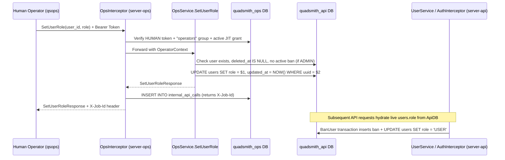

# <a id="admin-role-ops-task-and-exclusive-role-mutation" >Admin Role Ops Task and Exclusive Role Mutation</a>

## <a id="table-of-contents" >Table of Contents</a>

- [1. Background](#1-background)
- [2. Goal](#2-goal)
- [3. Proposal](#3-proposal)
  - [Parameterized SetUserRole Task in OpsService](#parameterized-setuserrole-task-in-opsservice)
  - [CLI Trigger Syntax in qsops](#cli-trigger-syntax-in-qsops)
  - [JIT Elevation and HUMAN Operator Enforcement](#jit-elevation-and-human-operator-enforcement)
  - [Account Status Preconditions and Automatic Role Demotion on Ban](#account-status-preconditions-and-automatic-role-demotion-on-ban)
  - [Eliminating Alternative Role Mutation Pathways](#eliminating-alternative-role-mutation-pathways)
  - [Database-Authoritative Role Resolution and Role-Free Access JWTs](#database-authoritative-role-resolution-and-role-free-access-jwts)
- [4. Assumptions](#4-assumptions)

---

## <a id="1-background" >1. Background</a>

Quadsmith's authentication and moderation architecture relies on two user roles
stored in `users.role` (`'USER'` and `'ADMIN'`), as established in
[`user_auth.md`](user_auth.md) and
[`structured_bans_and_account_restrictions.md`](structured_bans_and_account_restrictions.md).
Meanwhile, operational tasks and job audit tracking are managed through
`OpsService` in `server-ops` and the `qsops` CLI, as detailed in
[`tasks_and_jobs.md`](tasks_and_jobs.md).

Currently, there is no operational task in `OpsService` or `qsops` to promote a
user to `ADMIN` (or demote an `ADMIN` back to `USER`). At the same time, several
codebase pathways expose `role` to arbitrary assignment or fail to strip
administrative privileges on account suspension:

- [`src/proto/quadsmith/api/user.proto`](../../src/proto/quadsmith/api/user.proto)
  defines `string role = 4;` on `SeedUser`, and
  [`src/go/shared/cmd/seeder/main.go`](../../src/go/shared/cmd/seeder/main.go)
  passes `u.Role` directly to `storepb.CreateUser`.
- [`src/go/shared/cmd/protoc-gen-store/main.go`](../../src/go/shared/cmd/protoc-gen-store/main.go)
  generates `CreateUser` and `UpdateUser` in
  [`src/go/shared/gen/quadsmith/store/user_store.pb.go`](../../src/go/shared/gen/quadsmith/store/user_store.pb.go)
  with `role` included in `INSERT` and `UPDATE` statements.
- [`src/go/shared/pkg/auth/service.go`](../../src/go/shared/pkg/auth/service.go)
  blocks banning administrators in `UserService.BanUser` rather than resetting
  the banned user's `role` back to `'USER'`.
- [`src/go/shared/pkg/auth/tokens.go`](../../src/go/shared/pkg/auth/tokens.go)
  embeds `Role` inside stateless JWT access token claims (`JWTClaims`), and
  [`src/go/shared/pkg/auth/interceptor.go`](../../src/go/shared/pkg/auth/interceptor.go)
  trusts the JWT claim without verifying `users.role` in PostgreSQL.
- [`src/db/quadsmith_api.sql`](../../src/db/quadsmith_api.sql) lacks a
  `CHECK (role IN ('USER', 'ADMIN'))` constraint on the `users` table.

---

## <a id="2-goal" >2. Goal</a>

Provide an audited, JIT-protected `set_user_role` ops task (`SetUserRole` RPC)
in `server-ops` and `qsops` for promoting users to `ADMIN` (or demoting to
`USER`), automatically revert a user's role to `USER` if they receive a ban, and
ensure there is no other way in the system for a user to become an admin.

---

## <a id="3-proposal" >3. Proposal</a>

> **TL;DR:**
>
> - Add a manual `set_user_role` task (`SetUserRole` RPC) to `OpsService`.
> - Trigger via
>   `qsops tasks trigger set_user_role --user <id|uuid> --role <role>`.
> - Require active JIT elevation and restrict execution to `HUMAN` operators.
> - Mark `users.role` read-only in store codegen, remove `SeedUser.role`, and
>   enforce `CHECK (role IN ('USER', 'ADMIN'))`.
> - Demote banned users to `USER` automatically, remove JWT role claims, and
>   hydrate `users.role` live from PostgreSQL.

The architecture makes `OpsService.SetUserRole` the sole pathway capable of
granting `'ADMIN'` across the entire platform, automatically resets `users.role`
to `'USER'` whenever an account is banned, and ensures every role change takes
effect immediately on active sessions while recording operator promotions and
demotions in `quadsmith_ops.internal_api_calls`.



### <a id="parameterized-setuserrole-task-in-opsservice" >Parameterized SetUserRole Task in OpsService</a>

In
[`src/proto/quadsmith/ops/ops.proto`](../../src/proto/quadsmith/ops/ops.proto),
add `SetUserRole` to `OpsService` alongside its request and response messages
(ordered according to the repository's top-down protobuf conventions):

```protobuf
service OpsService {
  // ...
  // Maintenance & Operational Tasks
  rpc CleanupExpiredOtps(CleanupExpiredOtpsRequest) returns (CleanupExpiredOtpsResponse);
  rpc CleanupExpiredTokens(CleanupExpiredTokensRequest) returns (CleanupExpiredTokensResponse);
  rpc CleanupOrphanedBlobs(CleanupOrphanedBlobsRequest) returns (CleanupOrphanedBlobsResponse);
  rpc PurgeSoftDeletedAccounts(PurgeSoftDeletedAccountsRequest) returns (PurgeSoftDeletedAccountsResponse);
  rpc SendUsernameReleaseWarnings(SendUsernameReleaseWarningsRequest) returns (SendUsernameReleaseWarningsResponse);
  rpc SetUserRole(SetUserRoleRequest) returns (SetUserRoleResponse);
  // ...
}

message SetUserRoleRequest {
  string user_id = 1; // Public username (id) or UUID
  string role = 2; // Target role: "USER" or "ADMIN"
}

message SetUserRoleResponse {
  string user_uuid = 1;
  string username = 2;
  string previous_role = 3;
  string role = 4;
}
```

In
[`src/go/server-ops/pkg/ops/service.go`](../../src/go/server-ops/pkg/ops/service.go)
and
[`src/go/shared/pkg/opsauth/interceptor.go`](../../src/go/shared/pkg/opsauth/interceptor.go):

- Register `set_user_role` in `taskCatalog` with `Procedure: "SetUserRole"`,
  `Description: "Updates a user account role ('USER' or 'ADMIN')"`, and
  `DefaultInterval: "manual"`.
- Include `"SetUserRole"` in `isTaskMethod` in
  [`src/go/shared/pkg/opsauth/interceptor.go`](../../src/go/shared/pkg/opsauth/interceptor.go)
  and in the `ListJobs` / `GetJob` task method filters in
  [`src/go/server-ops/pkg/ops/service.go`](../../src/go/server-ops/pkg/ops/service.go)
  so every role update returns an `X-Job-Id` header and is inspectable via
  `qsops jobs list` and `qsops jobs get`.
- Because `set_user_role` is an on-demand, parameterized operator task rather
  than a recurring background ticker, no schedule field is added to
  [`src/proto/quadsmith/config/server_jobs.proto`](../../src/proto/quadsmith/config/server_jobs.proto).
- Update active plan [`tasks_and_jobs.md`](tasks_and_jobs.md) to reflect the
  addition of `SetUserRole` (`set_user_role`) on `OpsService`.

<details>
<summary><strong>Alternatives considered</strong></summary>

##### <a id="alt-promote-only-rpc" >Dedicated PromoteUserToAdmin RPC Only</a>

Expose only a one-way `PromoteUserToAdmin` task without supporting role demotion
to `USER`.

**Pros:**

- Slightly narrower RPC surface area when only promoting accounts.

**Cons:**

- Provides no operational mechanism to revoke admin privileges if an admin
  account is compromised or an operator promotes the wrong user.

##### <a id="alt-separate-promote-and-demote-rpcs" >Separate PromoteUserToAdmin and DemoteAdminToUser RPCs</a>

Define two separate task RPCs (`PromoteUserToAdmin` and `DemoteAdminToUser`)
instead of a unified `SetUserRole` task.

**Pros:**

- Allows separate method names in audit logs for promotions versus demotions.

**Cons:**

- Duplicates request/response definitions, CLI dispatch branches, and validation
  logic for mutating the exact same `users.role` column.

</details>

### <a id="cli-trigger-syntax-in-qsops" >CLI Trigger Syntax in qsops</a>

In [`src/go/cli-ops/main.go`](../../src/go/cli-ops/main.go), extend
`qsops tasks trigger` with `--user` and `--role` flags required when triggering
`set_user_role`:

```bash
qsops tasks trigger set_user_role --user <username|uuid> --role <USER|ADMIN>
```

- Dispatches tasks under `qsops tasks trigger` using dedicated Cobra subcommands
  (accepting only snake_case `set_user_role`).
- Enforces strict username resolution without stripping leading `@` prefixes or
  converting to lowercase.
- Validates that `--user` and `--role` (`USER` or `ADMIN`, case-insensitive on
  CLI input, normalized to uppercase `"USER"` / `"ADMIN"`) are provided when
  invoking `set_user_role`.
- Resolves the target user in `OpsService.SetUserRole` using strict exact match:
  `WHERE id = $1 OR uuid::text = $1`.
- Prints human-readable confirmation including the username, UUID, previous
  role, new role, and `Job ID` (`X-Job-Id`), or marshals `SetUserRoleResponse`
  when `--json` is passed.

<details>
<summary><strong>Alternatives considered</strong></summary>

##### <a id="alt-positional-cli-args" >Positional Arguments on qsops tasks trigger</a>

Accept positional arguments such as
`qsops tasks trigger set_user_role <username|uuid> <USER|ADMIN>`.

**Pros:**

- Slightly shorter command invocation.

**Cons:**

- Ambiguous parameter ordering as additional parameterized tasks are introduced
  to `qsops tasks trigger`.

##### <a id="alt-email-lookup-in-set-user-role" >Allow Email Resolution in --user</a>

Resolve the `--user` argument against `user_emails.email` in addition to
`users.id` and `users.uuid`.

**Pros:**

- Allows operators to target a user when only their email address is known.

**Cons:**

- Diverges from the codebase-wide resource identifier convention (`id` with
  `uuid` fallback) defined in `AGENTS.md`.

</details>

### <a id="jit-elevation-and-human-operator-enforcement" >JIT Elevation and HUMAN Operator Enforcement</a>

Changing a user's administrative privileges is a high-sensitivity operation:

1. **JIT Policy Configuration**: Add `"SetUserRole"` to `jit.sensitive_methods`
   across
   [`src/go/server-ops/config/sandbox.textproto`](../../src/go/server-ops/config/sandbox.textproto),
   [`src/go/server-ops/config/staging.textproto`](../../src/go/server-ops/config/staging.textproto),
   and
   [`src/go/server-ops/config/prod.textproto`](../../src/go/server-ops/config/prod.textproto),
   as well as default test configurations in
   [`src/go/shared/pkg/config/testing.go`](../../src/go/shared/pkg/config/testing.go).
2. **HUMAN-Only Execution in Interceptor and Handler**:
   - In
     [`src/go/shared/pkg/opsauth/interceptor.go`](../../src/go/shared/pkg/opsauth/interceptor.go),
     whenever `in.isSensitiveMethod(methodName)` is true, reject non-`HUMAN`
     callers with `connect.CodePermissionDenied`
     (`"sensitive procedure requires a HUMAN operator"`) even if their group
     (such as `robots`) allows `"*"`.
   - Enforce the same `opCtx.OperatorType == "HUMAN"` check directly inside
     `OpsService.SetUserRole` as defense-in-depth.

<details>
<summary><strong>Alternatives considered</strong></summary>

##### <a id="alt-allow-robot-tokens" >Allow ROBOT Tokens to Execute SetUserRole</a>

Require JIT elevation for `HUMAN` operators while allowing `ROBOT` tokens in
authorized groups to invoke `SetUserRole`.

**Pros:**

- Allows automated scripts using robot tokens to change roles without JIT
  grants.

**Cons:**

- Weakens security because `ROBOT` tokens bypass JIT elevation in
  `OpsInterceptor` for unattended cron jobs.

##### <a id="alt-no-jit-required" >Standard Operators Group Membership Without JIT</a>

Allow any authenticated member of the `operators` group to run `SetUserRole`
without acquiring a JIT grant.

**Pros:**

- Saves one CLI command (`qsops jit request`) before promoting a user.

**Cons:**

- Bypasses the justification (`reason`) and time-bounded elevation audit trail
  in `jit_grants`.

</details>

### <a id="account-status-preconditions-and-automatic-role-demotion-on-ban" >Account Status Preconditions and Automatic Role Demotion on Ban</a>

To prevent suspended or deleted accounts from holding administrative privileges:

1. **Automatic Role Demotion to `'USER'` on Ban (`UserService.BanUser`)**:
   - In
     [`src/go/shared/pkg/auth/service.go`](../../src/go/shared/pkg/auth/service.go),
     remove the `if targetRole == "ADMIN"` rejection (while retaining the
     `targetUUID == userCtx.UserUUID` self-ban guard) and execute
     `UPDATE users SET role = 'USER', updated_at = $2 WHERE uuid = $1` inside
     the `BanUser` transaction alongside inserting into `bans` and
     `banned_emails`.
   - If the ban later expires or is revoked via `UserService.UpdateBan`, the
     account's role remains `'USER'`. Re-promoting the user to `'ADMIN'`
     requires explicitly running the `set_user_role` ops task.
   - Update active plan
     [`structured_bans_and_account_restrictions.md`](structured_bans_and_account_restrictions.md)
     to document that banning a user atomically resets `users.role` to `'USER'`.
2. **Lookup & Row Lock in `OpsService.SetUserRole`**:
   - Inside a database transaction in `OpsService.SetUserRole`, query the user
     record with row locking:

     ```sql
     SELECT uuid::text, id, role, deleted_at
     FROM users
     WHERE id = $1 OR uuid::text = $1
     FOR UPDATE
     ```

   - Return `connect.CodeNotFound` if no user matches.
3. **Soft-Deleted Check in `OpsService.SetUserRole`**:
   - If `deleted_at IS NOT NULL`, reject with `connect.CodeFailedPrecondition`
     (`"cannot change role of a soft-deleted user"`).
4. **Active Ban Check in `OpsService.SetUserRole`**:
   - If the target role is `"ADMIN"`, check whether the user has an active ban
     in `bans`:

     ```sql
     SELECT EXISTS (
       SELECT 1 FROM bans
       WHERE user_uuid = $1::uuid
         AND revoked_at IS NULL
         AND (expires_at IS NULL OR expires_at > NOW())
     )
     ```

   - If an active ban exists, reject with `connect.CodeFailedPrecondition`
     (`"cannot promote a banned user to ADMIN; revoke the active ban first"`).
5. **Permanent Account Purge Reset**:
   - In [`src/go/shared/pkg/auth/job.go`](../../src/go/shared/pkg/auth/job.go),
     update `HandlePurgeSoftDeletedAccounts` to also reset `role = 'USER'` when
     anonymizing an expired soft-deleted account to `deleted-<uuid>`, ensuring
     permanently purged tombstone rows never retain `ADMIN`.

<details>
<summary><strong>Alternatives considered</strong></summary>

##### <a id="alt-block-banning-admins" >Block Banning Administrators Instead of Demoting to USER</a>

Retain the `if targetRole == "ADMIN"` check in `UserService.BanUser` so an
administrator cannot be banned until an operator first demotes them via `qsops`.

**Pros:**

- Prevents one admin from suspending another admin directly via `qs user bans`.

**Cons:**

- Leaves no way to immediately suspend a compromised admin account via
  moderation tooling, and fails to guarantee that any user who receives a ban
  automatically reverts to `'USER'`.

##### <a id="alt-restore-admin-on-unban" >Restore ADMIN Role Automatically When a Ban Expires or Is Revoked</a>

Record the user's pre-ban role on `bans` and automatically restore `ADMIN` when
the ban expires or is revoked via `UpdateBan`.

**Pros:**

- Avoids running `qsops tasks trigger set_user_role` after lifting a temporary
  ban on a former admin.

**Cons:**

- Violates the core invariant that `OpsService.SetUserRole` is the sole pathway
  capable of granting `ADMIN` privileges.

##### <a id="alt-auto-unban-on-promote" >Automatically Revoke Active Bans and Restore Deleted Accounts</a>

Automatically clear `deleted_at` and revoke active bans when promoting a user to
`ADMIN`.

**Pros:**

- Completes promotion in a single step even if the account is restricted.

**Cons:**

- Risks accidentally unbanning or resurrecting a wrong account due to a typo in
  the target identifier.

##### <a id="alt-ignore-account-status" >Allow SetUserRole Regardless of Ban or Deletion Status</a>

Update `users.role` without checking `deleted_at` or `bans`.

**Pros:**

- Simpler SQL implementation in `SetUserRole`.

**Cons:**

- Creates an invalid state where a user has `role = 'ADMIN'` while
  simultaneously being banned or scheduled for permanent purge.

</details>

### <a id="eliminating-alternative-role-mutation-pathways" >Eliminating Alternative Role Mutation Pathways</a>

To guarantee that `SetUserRole` is the **only** way a user can become an admin:

1. **Read-Only Column Option in Store Codegen**:
   - Add `bool read_only = 8;` to `ColumnOptions` in
     [`src/proto/quadsmith/sql/sql.proto`](../../src/proto/quadsmith/sql/sql.proto).
   - Annotate `User.role` in
     [`src/proto/quadsmith/store/user.proto`](../../src/proto/quadsmith/store/user.proto)
     with `read_only: true`, and add `checks: "role IN ('USER', 'ADMIN')"` to
     `User`'s `(quadsmith.sql.table)` option.
   - Update
     [`src/go/shared/cmd/protoc-gen-store/main.go`](../../src/go/shared/cmd/protoc-gen-store/main.go)
     so fields with `read_only: true` are omitted strictly from the column lists
     of `Create<Model>` (`INSERT`) and `Update<Model>` (`UPDATE`), while
     remaining in `activeFields` and `readableFields` so `GetUser`, `ListUsers`,
     and `ExportUsers` continue to read and export `role`.
   - Regenerating protobufs updates
     [`src/go/shared/gen/quadsmith/store/user_store.pb.go`](../../src/go/shared/gen/quadsmith/store/user_store.pb.go)
     so `storepb.CreateUser` relies on the PostgreSQL column default (`'USER'`)
     and `storepb.UpdateUser` cannot modify `role`.
2. **Database Schema Constraint**:
   - Regenerating SQL updates
     [`src/db/quadsmith_api.sql`](../../src/db/quadsmith_api.sql) to include
     `CHECK (role IN ('USER', 'ADMIN'))` on `users` alongside
     `role TEXT DEFAULT 'USER' NOT NULL`.
3. **Remove `role` from `SeedUser` and Seed Data**:
   - Remove `string role = 4;` from `SeedUser` in
     [`src/proto/quadsmith/api/user.proto`](../../src/proto/quadsmith/api/user.proto)
     (renumbering `bio = 4` and `reputation_score = 5`).
   - Remove `role: "user"` from
     [`test/sandbox/db/seed_data/users.textproto`](../../test/sandbox/db/seed_data/users.textproto)
     and remove `Role: u.Role` from
     [`src/go/shared/cmd/seeder/main.go`](../../src/go/shared/cmd/seeder/main.go).
4. **Omit `role` from Auth Signup `INSERT` Queries**:
   - In
     [`src/go/shared/pkg/auth/service.go`](../../src/go/shared/pkg/auth/service.go)
     (OTP registration and OAuth registration), omit `role` from
     `INSERT INTO users`, letting PostgreSQL assign `DEFAULT 'USER'`.
   - Normalize test user inserts in
     [`test/api/auth_helper_test.go`](../../test/api/auth_helper_test.go) and
     [`test/api/sandbox_test.go`](../../test/api/sandbox_test.go) to omit `role`
     on `INSERT INTO users`.

<details>
<summary><strong>Alternatives considered</strong></summary>

##### <a id="alt-keep-storepb-role-writes" >Leave storepb.CreateUser and storepb.UpdateUser Unchanged</a>

Remove `SeedUser.role` and add the database `CHECK` constraint, but allow
`storepb.CreateUser` and `storepb.UpdateUser` to continue writing `role`.

**Pros:**

- Avoids modifying `sql.proto` and `protoc-gen-store`.

**Cons:**

- Leaves generated Go store functions in `shared/gen/quadsmith/store` capable of
  mutating `users.role` outside `OpsService.SetUserRole`.

##### <a id="alt-keep-seed-user-role" >Retain SeedUser.role for Sandbox Seeding</a>

Allow `users.textproto` to specify `role` when seeding the sandbox database.

**Pros:**

- Could pre-seed an admin account without calling `OpsService`.

**Cons:**

- Violates the requirement that there must not be any other way for a user to
  become an admin outside the ops task.

</details>

### <a id="database-authoritative-role-resolution-and-role-free-access-jwts" >Database-Authoritative Role Resolution and Role-Free Access JWTs</a>

To ensure that role promotions and demotions take effect immediately without
waiting for 1-hour JWT expirations—and to prevent any caller with access to the
signing key (such as test helpers) from minting an admin JWT without a backing
database role:

1. **Remove `Role` from `JWTClaims` and `SignAccessToken`**:
   - In
     [`src/go/shared/pkg/auth/tokens.go`](../../src/go/shared/pkg/auth/tokens.go),
     remove `Role` from `JWTClaims` and update the signature of
     `SignAccessToken` to:

     ```go
     func SignAccessToken(userUUID, userID, email, sessionUUID string) (string, error)
     ```

   - Update all callers in
     [`src/go/shared/pkg/auth/service.go`](../../src/go/shared/pkg/auth/service.go),
     [`src/go/shared/pkg/auth/tokens_test.go`](../../src/go/shared/pkg/auth/tokens_test.go),
     [`test/api/auth_helper_test.go`](../../test/api/auth_helper_test.go),
     [`test/api/security_test.go`](../../test/api/security_test.go), and
     [`test/api/sandbox_test.go`](../../test/api/sandbox_test.go), and update
     [`user_auth.md`](user_auth.md) to note that `users.role` is resolved live
     from PostgreSQL.
2. **Hydrate Live `users.role` in `AuthenticateHTTPRequest`**:
   - In
     [`src/go/shared/pkg/auth/interceptor.go`](../../src/go/shared/pkg/auth/interceptor.go),
     when a Bearer JWT is verified via `VerifyAccessToken`, default
     `claims.Role = "USER"` and, when `pool != nil`, query
     `SELECT role FROM users WHERE uuid::text = $1` to populate `claims.Role`
     with the live database role.
   - Session cookie (`qs_session`) authentication in `AuthenticateHTTPRequest`
     already queries `u.role` directly from `users`.

<details>
<summary><strong>Alternatives considered</strong></summary>

##### <a id="alt-revoke-refresh-tokens-on-role-change" >Revoke Refresh Tokens on Role Change and Keep JWT Role Claim</a>

Keep `Role` inside `JWTClaims` and delete the user's `refresh_tokens` when
`SetUserRole` runs.

**Pros:**

- Avoids querying `users.role` during Bearer JWT authentication.

**Cons:**

- Forces the promoted or demoted user to log in again.
- Leaves a 1-hour window where a demoted admin's existing JWT still carries
  `Role: "ADMIN"`, and allows `SignAccessToken` to mint admin tokens without
  going through `SetUserRole`.

##### <a id="alt-keep-jwt-role-with-db-override" >Keep Role in JWTClaims and Override from DB When Pool Is Present</a>

Retain the `role` parameter in `SignAccessToken` and `JWTClaims`, but overwrite
it in `AuthenticateHTTPRequest` when `pool != nil`.

**Pros:**

- Fewer signature changes in existing test calls to `SignAccessToken`.

**Cons:**

- Retains dead, misleading data in JWT payloads that is ignored at verification
  time.

</details>

---

## <a id="4-assumptions" >4. Assumptions</a>

1. Valid user roles in `quadsmith_api.users` are strictly `'USER'` and
   `'ADMIN'`.
2. Every newly registered or seeded user starts with `role = 'USER'` via the
   PostgreSQL column default, and can only be promoted to `'ADMIN'` by a `HUMAN`
   operator executing the `set_user_role` ops task (`OpsService.SetUserRole`)
   with an active JIT grant.
3. Banning a user (`UserService.BanUser`) or purging an expired soft-deleted
   account (`HandlePurgeSoftDeletedAccounts`) automatically resets `users.role`
   back to `'USER'`. Expiring or revoking a ban leaves the user at `'USER'`.
