# <a id="email-delivery-and-identity-architecture" >Email Delivery and Identity Architecture</a>

## <a id="table-of-contents" >Table of Contents</a>

- [1. Background](#1-background)
- [2. Goal](#2-goal)
- [3. Proposal](#3-proposal)
  - [The SMTP Protocol Requirement: How Email Delivery Works](#the-smtp-protocol-requirement-how-email-delivery-works)
  - [Email Ownership Verification: Hybrid OAuth and Email Verification](#email-ownership-verification-hybrid-oauth-and-email-verification)
  - [Universal Email Verification Flow: Dual Code and Magic Link](#universal-email-verification-flow-dual-code-and-magic-link)
  - [OAuth Email Provenance Tracking via Junction Architecture](#oauth-email-provenance-tracking-via-junction-architecture)
  - [Unlinking Lifecycle and Primary Email Safeguards](#unlinking-lifecycle-and-primary-email-safeguards)
  - [Standard SMTP Protocol Abstraction (`EmailSender`)](#standard-smtp-protocol-abstraction-emailsender)
  - [Transactional SMTP Relay over Direct Self-Hosted MX Delivery](#transactional-smtp-relay-over-direct-self-hosted-mx-delivery)
  - [Synchronous RPC Dispatch with Strict 5-Second Timeout](#synchronous-rpc-dispatch-with-strict-5-second-timeout)
  - [Declarative Configuration in `config.proto`](#declarative-configuration-in-configproto)
  - [Multipart HTML & Plaintext MIME Email Templates](#multipart-html-plaintext-mime-email-templates)
- [4. Alternatives considered](#4-alternatives-considered)
- [5. Assumptions](#5-assumptions)
- [6. Future work](#6-future-work)

---

## <a id="1-background" >1. Background</a>

In [user_auth.md](user_auth.md), Quadsmith established a passwordless
authentication model relying on 6-digit numeric verification codes with a
3-minute time-to-live (TTL) and cryptographic magic login links with a 15-minute
TTL. Currently,
[src/backend/shared/pkg/auth/service.go](../../src/backend/shared/pkg/auth/service.go#L158-L165)
implements a developer console logger (`cfg.DevPrintOTP`) that prints codes and
magic links directly to stdout. In production configurations such as
[src/backend/server-api/config/prod.textproto](../../src/backend/server-api/config/prod.textproto#L26),
`dev_print_otp` is set to `false`, leaving the platform without an operational
mechanism to deliver emails to real users.

The user asked:

1. Whether an SMTP server is strictly necessary to send emails (either our own
   or via a third-party service).
2. How candidate approaches (self-hosted SMTP server, transactional SMTP relay,
   and vendor HTTP APIs) compare in cost, deliverability, and engineering
   overhead.
3. Whether OAuth identity providers supply the user's verified email address.
4. How to track which OAuth providers supplied which email addresses when
   multiple providers share the same email address, and how to display this on
   the user's account page.
5. What lifecycle and safeguards should govern email addresses when an OAuth
   provider is unlinked.
6. How to standardize all email challenge interactions under a universal **Email
   Verification Flow** supporting both 6-digit codes and 1-click magic links.

---

## <a id="2-goal" >2. Goal</a>

Architect and implement an email delivery engine for Quadsmith that guarantees
sub-second delivery for time-sensitive verification emails, prevents
subscription lock-in or recurring SaaS costs, minimizes email volume through
OAuth identity delegation, tracks multi-provider provenance for every email
address, standardizes on a universal Email Verification Flow (code or magic
link), and maintains an open, standard SMTP interface across declarative
Protobuf schemas.

---

## <a id="3-proposal" >3. Proposal</a>

> **TL;DR:**
>
> - Use standard Go SMTP (`net/smtp` + TLS) with pay-as-you-go relays (e.g.
>   Amazon SES, Resend) to avoid subscription costs and deliverability failures.
> - Adopt a hybrid model: OAuth for zero-email sign-in, and universal Email
>   Verification (code or magic link) for custom addresses.
> - Track OAuth email provenance via `user_email_oauth_accounts` junction table,
>   displaying provider badges on account pages.
> - Protect unlinking: remove orphaned secondary emails, but strictly block
>   unlinking if it would delete the primary email.
> - Dispatch verification emails synchronously with a strict 5-second context
>   timeout for immediate client error reporting.

```mermaid
flowchart TD
    subgraph Identity Sources
        G["Google OAuth"] -->|Provides pilot@gmail.com| J["user_email_oauth_accounts"]
        GH["GitHub OAuth"] -->|Provides pilot@gmail.com| J
        OTP["Email Verification Flow"] -->|Direct Verification| E["user_emails (verified_via_otp = true)"]
        J -->|Links to| E
    end

    subgraph User Account View
        E --> UI["Account Page: pilot@gmail.com [Primary]"]
        UI --> Badges["Badges: [Google] [GitHub] [Email Verification]"]
    end

    subgraph Outbound Delivery
        OTP --> Sender["EmailSender (net/smtp + TLS)"]
        Sender --> Timeout{"5s Timeout"}
        Timeout -->|OK| Relay["SMTP Relay (Amazon SES / Resend)"]
        Timeout -->|Fail| Err["Return Immediate Error to Client"]
        Relay --> Inbox["Recipient Mailbox (< 1s)"]
    end
```



### <a id="the-smtp-protocol-requirement-how-email-delivery-works" >The SMTP Protocol Requirement: How Email Delivery Works</a>

Email delivery between independent domains is governed by
[RFC 5321 (SMTP)](https://datatracker.ietf.org/doc/html/rfc5321). Every mail
provider (Gmail, Microsoft Outlook, Apple iCloud, Yahoo) exposes Mail Exchanger
(MX) records in DNS that accept incoming messages exclusively over TCP port 25
using SMTP commands (`EHLO`, `MAIL FROM`, `RCPT TO`, `DATA`). Therefore, **an
SMTP interaction with the recipient's MX server is strictly mandatory to deliver
an email.**

There are three ways an application can bridge this protocol requirement:

1. **Direct-to-MX Delivery (No Intermediary SMTP Server)**: The Go application
   queries the recipient domain's MX DNS records directly and opens an outbound
   TCP socket on port 25 to the destination server.
   - _Why this fails_: Cloud providers (AWS, GCP, DigitalOcean, Linode, Hetzner)
     strictly block outbound port 25 to prevent botnet spam. Furthermore,
     recipient servers reject connections from dynamic/cloud IP pools lacking
     static Reverse DNS (PTR), SPF, and DKIM signatures. Crucially, destination
     servers enforce **greylisting** (returning temporary `451` codes to unknown
     senders for 5–15 minutes). For Quadsmith's 3-minute verification codes,
     this guarantees the code expires before the user receives it.
2. **Self-Hosted SMTP Server (e.g. Postfix / Stalwart)**: Operating a dedicated
   MTA on a separate VPS with a static IP, custom PTR record, and unblocked
   port 25.
   - _Implications_: Incurs ongoing VPS costs ($5–$10/month), requires manual
     reputation warming, continuous DNS key maintenance (DKIM, SPF, DMARC), TLS
     certificate management, and bounce loop processing. Greylisting on new IPs
     still poses severe risks for 3-minute codes.
3. **SMTP Relay or HTTP API (Transactional Email Service)**: The Go application
   connects to a dedicated relay on client submission ports (587 STARTTLS or 465
   TLS, which are never blocked by cloud providers). The relay delivers the mail
   over port 25 to destination MX servers using pre-warmed, highly trusted IP
   pools.
   - _Implications_: Completely eliminates greylisting delays and deliverability
     failures. Pay-as-you-go providers like Amazon SES charge $0.10 per 1,000
     emails with no monthly subscription fee (and are free for 62,000
     emails/month on EC2). Resend offers 3,000 emails/month free.

#### <a id="alternatives-considered-protocol-requirement" >Alternatives considered</a>

##### <a id="direct-to-mx-socket-delivery" >Direct-to-MX Socket Delivery</a>

Attempting direct TCP port 25 connections from the Quadsmith binary directly to
the recipient domain's MX hosts without an intermediary relay. This avoids
external mail services by handling protocol delivery internally.

**Pros:**

- Eliminates all external dependencies and third-party relay services.
- Zero marginal operational cost per message transmitted.

**Cons:**

- Outbound port 25 is blocked by default across cloud providers to prevent spam.
- Greylisting delays of 5–15 minutes break the 3-minute verification code TTL.
- Lack of established IP reputation causes Gmail and Outlook to discard emails.

### <a id="email-ownership-verification-hybrid-oauth-and-email-verification" >Email Ownership Verification: Hybrid OAuth and Email Verification</a>

To balance convenience, zero recurring costs, and universal access, Quadsmith
implements a hybrid authentication strategy:

1. **Third-Party Identity Delegation (OAuth 2.0 / OpenID Connect)**:
   - Users authenticate with Google, GitHub, Discord, or Microsoft.
   - The provider signs a cryptographic JWT (`id_token`) attesting that the
     account owner possesses the verified email address.
   - **Cost to Quadsmith**: $0.00.
   - **Emails Sent**: Exactly **0**.
   - **User UX**: 1-click frictionless sign-in.
2. **Universal Out-of-Band Email Verification**:
   - For users entering arbitrary email addresses (e.g. `user@fastmail.com` or
     custom domains), Quadsmith triggers the universal Email Verification flow,
     dispatched via an SMTP relay.
   - Guarantees universal access for users without OAuth accounts.

#### <a id="alternatives-considered-ownership-verification" >Alternatives considered</a>

##### <a id="oauth-only-authentication" >OAuth-Only Authentication</a>

Restricting platform sign-in exclusively to third-party identity providers
(Google, GitHub, Discord, Microsoft), eliminating email verification entirely.
Users without supported OAuth accounts cannot register or sign in.

**Pros:**

- Completely eliminates outbound email infrastructure with zero emails ever
  sent.
- Zero email delivery latency, bounce handling, or spam complaints.

**Cons:**

- Excludes users who do not have accounts with those third-party providers.
- Prevents users from registering with private or custom domain email addresses.

##### <a id="inbound-reverse-email-reply-to-verify" >Inbound Reverse Email (Reply-to-Verify)</a>

Instructing users to verify email ownership by sending an email with a challenge
token to an inbound Quadsmith address processed by a mail worker (e.g.
Cloudflare Email Workers). The incoming email confirms ownership of the address.

**Pros:**

- Completely avoids outbound mail deliverability and outbound port 25 blocks.
- Free inbound email routing with minimal infrastructure overhead.

**Cons:**

- High user friction requiring users to switch apps and compose a message.
- Vulnerable to `From:` header spoofing unless strict inbound DKIM verification
  is enforced.

##### <a id="passkeys-and-webauthn-possession" >Passkeys and WebAuthn Possession</a>

Relying on hardware-bound WebAuthn credentials (TouchID, FaceID, YubiKey) for
user authentication. Cryptographic keys stored on the user's device replace both
passwords and email verification codes.

**Pros:**

- Phishing-resistant authentication with zero ongoing transmission costs.
- Completely passwordless and email-free daily authentication.

**Cons:**

- Verifies physical device possession rather than email address ownership.
- Cannot associate an account with an email address without an initial email
  verification step.

### <a id="universal-email-verification-flow-dual-code-and-magic-link" >Universal Email Verification Flow: Dual Code and Magic Link</a>

To maintain consistency and maximum user convenience, all email challenge
touchpoints across the entire platform use the **identical Email Verification
Flow**:

1. **Universal Challenge Generation**:
   - Whenever an email verification is triggered (for `login`, `add_email`, or
     `delete_account`), the backend generates:
     - A 6-digit cryptographic numeric code (Argon2-hashed in
       `email_verifications`, 3-minute TTL).
     - An asymmetric or HMAC-signed magic link token (15-minute TTL).
     - A cookie-bound or response-returned `challenge_id` token.
2. **Dual Verification Modality**:
   - The dispatched email displays both options prominently:
     - **Option A (Manual Entry)**: Enter the 6-digit code on the originating
       device.
     - **Option B (1-Click Clickthrough)**: Click the direct magic link button
       (`[Verify and Sign In]` or `[Verify and Add Email]`).
3. **Equivalence & Replay Protection**:
   - Completing verification via either the code or the magic link marks the row
     in `email_verifications` as `used_at = NOW()`, instantly invalidating the
     other method and preventing replay attacks.

#### <a id="alternatives-considered-verification-flow" >Alternatives considered</a>

##### <a id="disparate-code-only-or-link-only-challenges" >Disparate Code-Only or Link-Only Challenges</a>

Using distinct challenge modalities for different operations, such as enforcing
code-only entry for account deletion and link-only entry for logins. Each
workflow implements a bespoke challenge layout and verification handler.

**Pros:**

- Produces slightly smaller email payloads for code-only operations.
- Avoids rendering link buttons when only numeric entry is desired.

**Cons:**

- Creates inconsistent user experiences across different platform touchpoints.
- Forces mobile users into manual code typing when 1-click verification is
  available.
- Duplicates verification endpoints and database models across disparate flows.

### <a id="oauth-email-provenance-tracking-via-junction-architecture" >OAuth Email Provenance Tracking via Junction Architecture</a>

To track which OAuth providers supplied which email addresses, and support cases
where multiple OAuth providers verify the identical email address:

1. **Schema Enhancements**:
   - Add `verified_via_otp BOOLEAN DEFAULT false NOT NULL` to
     [`user_emails`](../../src/backend/db/quadsmith_api.sql#L51).
   - Create a dedicated junction table `user_email_oauth_accounts`:

```sql
CREATE TABLE IF NOT EXISTS user_email_oauth_accounts (
  uuid UUID NOT NULL,
  PRIMARY KEY (uuid),
  user_email_uuid UUID NOT NULL,
  oauth_account_uuid UUID NOT NULL,
  created_at TIMESTAMPTZ DEFAULT NOW(),
  UNIQUE (user_email_uuid, oauth_account_uuid)
);

ALTER TABLE user_email_oauth_accounts
ADD CONSTRAINT fk_user_email_oauth_accounts_user_email_uuid
FOREIGN KEY (user_email_uuid) REFERENCES user_emails (uuid) ON DELETE CASCADE;

ALTER TABLE user_email_oauth_accounts
ADD CONSTRAINT fk_user_email_oauth_accounts_oauth_account_uuid
FOREIGN KEY (oauth_account_uuid) REFERENCES oauth_accounts (uuid) ON DELETE CASCADE;
```

1. **Protobuf Model Updates**: Extend
   [`UserEmail`](../../proto/quadsmith/api/user.proto#L75) with provenance
   attributes:

```protobuf
message UserEmail {
  option (quadsmith.sql.table) = {name: "user_emails"};

  string uuid = 1 [(quadsmith.sql.column) = {is_primary_key: true}];
  string user_uuid = 2 [(quadsmith.sql.column) = {
    references: "users(uuid)"
    create_index: true
  }];
  string email = 3 [(quadsmith.sql.column) = {
    is_unique: true
    create_index: true
  }];
  bool is_primary = 4 [(quadsmith.sql.column) = {default_value: "false"}];
  google.protobuf.Timestamp created_at = 5;

  bool verified_via_otp = 6 [(quadsmith.sql.column) = {default_value: "false"}];
  repeated string oauth_providers = 7 [(quadsmith.sql.column) = {ignore: true}];
}

message UserEmailOAuthAccount {
  option (quadsmith.sql.table) = {
    name: "user_email_oauth_accounts"
    unique_constraints: "user_email_uuid, oauth_account_uuid"
  };

  string uuid = 1 [(quadsmith.sql.column) = {is_primary_key: true}];
  string user_email_uuid = 2 [(quadsmith.sql.column) = {
    references: "user_emails(uuid) ON DELETE CASCADE"
    create_index: true
  }];
  string oauth_account_uuid = 3 [(quadsmith.sql.column) = {
    references: "oauth_accounts(uuid) ON DELETE CASCADE"
    create_index: true
  }];
  google.protobuf.Timestamp created_at = 4 [(quadsmith.sql.column) = {default_value: "NOW()"}];
}
```

1. **Data Aggregation**: When loading emails for `ListUserEmails` or profile
   views, aggregate associated OAuth providers via SQL:

   ```sql
   SELECT ue.uuid, ue.user_uuid, ue.email, ue.is_primary, ue.created_at, ue.verified_via_otp,
          COALESCE(ARRAY_AGG(DISTINCT oa.provider) FILTER (WHERE oa.provider IS NOT NULL), '{}') AS oauth_providers
   FROM user_emails ue
   LEFT JOIN user_email_oauth_accounts uea ON ue.uuid = uea.user_email_uuid
   LEFT JOIN oauth_accounts oa ON uea.oauth_account_uuid = oa.uuid
   WHERE ue.user_uuid = $1
   GROUP BY ue.uuid;
   ```

#### <a id="alternatives-considered-provenance-tracking" >Alternatives considered</a>

##### <a id="direct-foreign-key-on-oauth-accounts" >Direct Foreign Key on OAuth Accounts</a>

Storing a single `user_email_uuid` foreign key directly on the `oauth_accounts`
table rather than creating a separate junction table. Each linked OAuth account
can associate with at most one email address.

**Pros:**

- Omits the junction table, reducing database schema count by one.
- Simplifies basic single-email queries without requiring many-to-many joins.

**Cons:**

- Restricts an OAuth account to associating with strictly one email address.
- Cannot ingest multiple verified secondary addresses returned by providers like
  GitHub.

### <a id="unlinking-lifecycle-and-primary-email-safeguards" >Unlinking Lifecycle and Primary Email Safeguards</a>

When a user unlinks an external OAuth provider (e.g. unlinking GitHub):

1. **Cascade Cleanup**: Deleting the `oauth_accounts` row cascades to delete
   associated rows in `user_email_oauth_accounts`.
2. **Solely-Provided Email Purging**:
   - Inspect the unlinked email: if `verified_via_otp == false` and no other
     records exist in `user_email_oauth_accounts` for that email, the address
     was verified exclusively by the unlinked provider.
   - **Primary / Sole Email Safeguard**: If that email is the user's primary
     email (`is_primary == true`) or the only email registered to the account,
     the server **strictly rejects** the unlinking request with a
     `FAILED_PRECONDITION` error:
     `"Cannot unlink this provider because it supplies your primary email.`
     `Please designate another verified email as primary before unlinking."`
   - If the email is a secondary address, it is automatically removed from
     `user_emails`.

#### <a id="alternatives-considered-unlinking-lifecycle" >Alternatives considered</a>

##### <a id="indefinite-retention-of-unlinked-emails" >Indefinite Retention of Unlinked Emails</a>

Preserving all email addresses on the account even after the external OAuth
provider that verified them has been disconnected. Orphaned email records remain
in `user_emails` indefinitely.

**Pros:**

- Prevents any automated deletion of secondary email addresses upon unlinking.
- Avoids surprising users whose secondary addresses might disappear after
  unlinking.

**Cons:**

- Retains unverified email records that the user may no longer control.
- Creates stale identity records that can prevent the unlinked address from
  being used on other accounts.

### <a id="standard-smtp-protocol-abstraction-emailsender" >Standard SMTP Protocol Abstraction (`EmailSender`)</a>

Introduce a clean `EmailSender` interface in `src/backend/shared/pkg/email/`:

```go
package email

import (
    "context"
    "time"
)

type EmailSender interface {
    SendVerification(ctx context.Context, toEmail, code, magicLinkURL, purpose string, ttl time.Duration) error
    SendSecurityAlert(ctx context.Context, toEmail, eventDescription string, eventTime time.Time) error
}
```

The concrete implementation `SMTPEmailSender` will use Go's standard `net/smtp`
with explicit support for STARTTLS (port 587) and TLS wrapper (port 465). It
will support PLAIN and LOGIN authentication mechanisms with customizable timeout
contexts. In development and testing environments, `ConsoleEmailSender` will
continue to log formatted credentials to stdout without attempting network
connections.

#### <a id="alternatives-considered-protocol-abstraction" >Alternatives considered</a>

##### <a id="vendor-proprietary-http-sdk-integration" >Vendor-Proprietary HTTP SDK Integration</a>

Embedding vendor-specific REST API client libraries (such as `resend-go` or
`postmark-go`) directly into the authentication service. Email dispatch makes
HTTP POST requests directly to commercial SaaS APIs.

**Pros:**

- Bypasses SMTP port blocking and connection negotiation entirely over HTTPS.
- Simplifies connection pooling and provides vendor-specific delivery analytics.

**Cons:**

- Tightly couples the codebase to a specific commercial vendor's proprietary
  API.
- Prevents switching to open-source self-hosted MTAs or standard SMTP relays
  without refactoring.

### <a id="transactional-smtp-relay-over-direct-self-hosted-mx-delivery" >Transactional SMTP Relay over Direct Self-Hosted MX Delivery</a>

Recommend routing outbound mail through an established SMTP relay with verified
reputation (such as [Amazon SES](https://aws.amazon.com/ses/) or
[Resend Free Tier](https://resend.com/pricing)) rather than provisioning a
custom direct-to-MX Postfix or Stalwart container.

Direct self-hosted delivery presents four severe operational failure modes for
transactional emails:

1. **Greylisting Timeouts**: Major destination mail servers (e.g. Gmail,
   Outlook, Yahoo) defer initial connection attempts from unrecognized IPs with
   temporary 4xx error codes for 5 to 15 minutes. Because Quadsmith codes expire
   in 3 minutes, greylisting guarantees login failures for new users.
2. **Cloud Port 25 Blocking**: Cloud providers block outbound TCP port 25 to
   thwart spambots. Unblocking requires formal justification and manual support
   approval.
3. **IP Reputation & Blacklists**: Cloud IP ranges (DigitalOcean, AWS EC2,
   Hetzner) are frequently listed on DNSBLs (Spamhaus, Barracuda) due to
   previous abusive tenants.
4. **Maintenance Burden**: Operating an MTA requires continuous maintenance of
   reverse DNS (PTR) records, DKIM key rotation, SPF records, DMARC alignment,
   TLS certificates, bounce processing, and IP warmup schedules.

By contrast, transactional relays eliminate base subscription fees through free
tiers (Resend provides 3,000 emails/month free; Amazon SES provides 62,000
emails/month free on EC2 or charges $0.10 per 1,000 emails with zero monthly
minimum).

#### <a id="alternatives-considered-delivery-targets" >Alternatives considered</a>

##### <a id="dedicated-self-hosted-mta-container" >Dedicated Self-Hosted MTA Container</a>

Provisioning and maintaining an independent Postfix or Stalwart mail server on a
dedicated virtual private server with a clean static IP, reverse DNS (PTR), and
full DKIM/SPF/DMARC alignment.

**Pros:**

- Complete data sovereignty with zero third-party relay dependency.
- Unlimited message throughput without commercial tier caps or quota throttling.

**Cons:**

- Incurs ongoing monthly VPS hosting costs ($5–$10/month).
- High risk of verification code expiry caused by recipient greylisting delays.
- Substantial engineering overhead maintaining IP reputation, TLS certs, and
  bounce loops.

### <a id="synchronous-rpc-dispatch-with-strict-5-second-timeout" >Synchronous RPC Dispatch with Strict 5-Second Timeout</a>

In verification challenge RPCs, dispatch the email synchronously within the
request handler using a 5-second context timeout:

```go
ctxTimeout, cancel := context.WithTimeout(ctx, 5*time.Second)
defer cancel()

if err := s.emailSender.SendVerification(ctxTimeout, email, code, magicLinkURL, purpose, s.cfg.OtpTTL); err != nil {
    return nil, connect.NewError(connect.CodeUnavailable, fmt.Errorf("unable to deliver verification email: %w", err))
}
```

This ensures immediate user feedback if an email address has invalid MX records
or if the SMTP relay is experiencing an outage, preventing false-positive
"Verification code sent" notifications when the message failed to leave the
server.

#### <a id="alternatives-considered-dispatch-timing" >Alternatives considered</a>

##### <a id="asynchronous-fire-and-forget-dispatch" >Asynchronous Fire-and-Forget Dispatch</a>

Queueing outbound email requests to a background goroutine or worker pool,
returning a successful RPC response to the client immediately before attempting
network delivery.

**Pros:**

- Reduces RPC response latency to under 20ms regardless of SMTP connection
  speed.
- Isolates client request threads from remote SMTP server timeouts and retries.

**Cons:**

- Emits false-positive success notifications when relay connection or delivery
  fails.
- Prevents immediate error display if the user inputs an address with invalid MX
  records.

### <a id="declarative-configuration-in-configproto" >Declarative Configuration in `config.proto`</a>

Extend
[proto/quadsmith/config/config.proto](../../proto/quadsmith/config/config.proto)
to define a typed `EmailConfig` message:

```protobuf
message SmtpConfig {
  string host = 1;
  int32 port = 2; // e.g. 587 (STARTTLS) or 465 (TLS)
  string username = 3;
  string password = 4;
  string from_address = 5; // e.g. "Quadsmith Auth <auth@quadsmith.net>"
  string reply_to = 6;
  bool require_tls = 7;
}

message EmailConfig {
  string provider = 1; // "console", "smtp"
  SmtpConfig smtp = 2;
}
```

This is embedded in `AuthConfig` and populated in textproto configurations via
environment variable interpolation (e.g. `${QS_SMTP_HOST}`, `${QS_SMTP_PASS}`).
In `test.textproto` and `sandbox.textproto`, `provider` is set to `"console"`.
In `prod.textproto`, `provider` is set to `"smtp"`.

#### <a id="alternatives-considered-smtp-config" >Alternatives considered</a>

##### <a id="unstructured-environment-variable-configuration" >Unstructured Environment Variable Configuration</a>

Reading SMTP connection parameters directly from ambient environment variables
at runtime without defining schema structures in `config.proto`.

**Pros:**

- Requires no Protobuf changes or code generation rebuilds.
- Familiar configuration pattern common in lightweight web applications.

**Cons:**

- Violates Quadsmith's architectural principle of strictly typed configuration.
- Bypasses server startup schema validation, allowing missing credential bugs to
  reach production.

### <a id="multipart-html-plaintext-mime-email-templates" >Multipart HTML & Plaintext MIME Email Templates</a>

Format verification emails as RFC 2046 multipart/alternative MIME messages
containing both plaintext and HTML bodies. The email will feature:

- A prominent, large-type 6-digit numeric verification code with letter-spacing.
- A direct 1-click magic link button (`Verify and Sign In` or
  `Verify and Add Email`).
- Clear expiration countdown notice ("Code valid for 3 minutes; link valid for
  15 minutes").
- Security advisory notice advising users not to share codes.

#### <a id="alternatives-considered-mime-templates" >Alternatives considered</a>

##### <a id="plaintext-only-email-transmissions" >Plaintext-Only Email Transmissions</a>

Formatting transactional verification emails exclusively as raw ASCII/UTF-8
plaintext bodies without multipart MIME or HTML formatting.

**Pros:**

- Minimal message payload size with zero HTML parsing or CSS rendering overhead.
- Eliminates email client HTML rendering discrepancies and layout bugs.

**Cons:**

- Degrades magic link click-through rates due to unstyled, wrapping raw URLs.
- Appears less authentic and credible to non-technical users for security
  challenges.

---

## <a id="4-alternatives-considered" >4. Alternatives considered</a>

### <a id="proprietary-saas-vendor-sdks" >Proprietary SaaS Vendor SDKs</a>

Integrating proprietary third-party HTTP client libraries (such as Resend or
Postmark SDKs) directly into application handlers instead of standard SMTP.
While this bypasses SMTP negotiation, it binds the application directly to a
commercial vendor's API.

**Pros:**

- Handles HTTP retries, connection pooling, and payload compression internally.
- Avoids SMTP protocol quirks and connection handshake latency.

**Cons:**

- Tightly couples the codebase to a specific commercial vendor's proprietary
  API.
- Prevents migrating to self-hosted MTAs or standard SMTP relays without code
  changes.

### <a id="direct-in-process-mx-dispatch" >Direct In-Process MX Dispatch</a>

Resolving destination MX records and opening outbound TCP sockets on port 25
directly from the Go server without any intermediate relay. This provides direct
communication between Quadsmith and destination mail servers.

**Pros:**

- Completely eliminates intermediary servers, third-party relays, and vendor
  costs.
- Keeps all outbound message handling entirely inside the single Go binary.

**Cons:**

- Fails universally due to outbound port 25 blocks enforced by cloud providers.
- Suffers 5–15 minute greylisting delays that expire 3-minute verification
  codes.
- Lacks established IP reputation, causing major mail providers to reject
  deliveries.

### <a id="dedicated-self-hosted-mail-server-instance" >Dedicated Self-Hosted Mail Server Instance</a>

Deploying a self-hosted MTA container (such as Postfix or Stalwart) on a
dedicated virtual server with a static IP and reverse DNS PTR records. The main
server routes outbound emails through this private mail server.

**Pros:**

- Maintains total architectural independence and operational data sovereignty.
- Eliminates per-message billing and commercial email transmission caps.

**Cons:**

- Incurs ongoing monthly server infrastructure costs ($5–$10/month).
- Requires continuous maintenance of PTR records, DKIM keys, SPF, and bounce
  loops.
- Suffers greylisting delivery delays on newly provisioned IP addresses.

### <a id="inbound-reverse-challenge-reply-to-verify" >Inbound Reverse Challenge (Reply-to-Verify)</a>

Requiring users to confirm ownership by sending an email challenge to an inbound
Quadsmith email address routed through a free incoming mail worker. Incoming
messages confirm the sender's email address without sending outbound emails.

**Pros:**

- Completely eliminates outbound mail servers, deliverability problems, and
  relays.
- Operates for free using incoming mail forwarding workers.

**Cons:**

- High user friction requiring users to leave the app, open mail, and compose a
  message.
- Vulnerable to email spoofing unless complex inbound DKIM verification is
  implemented.

---

## <a id="5-assumptions" >5. Assumptions</a>

1. Transactional verification emails must arrive in user inboxes within 5–10
   seconds to remain well within the 3-minute code TTL window.
2. The domain used for sending has DNS management available to configure SPF,
   DKIM, and DMARC TXT records.
3. In local development and automated sandboxes, `provider: "console"` will be
   used to retain instant, zero-dependency test execution.

---

## <a id="6-future-work" >6. Future work</a>

### <a id="asynchronous-email-dispatch-queue" >Asynchronous Email Dispatch Queue</a>

Offload outbound SMTP network calls from synchronous RPC request paths to a
background worker queue (e.g. via PostgreSQL-backed transactional outbox or Go
channel pool) to protect RPC latency from external SMTP connection timeouts.

### <a id="automated-bounce-and-reputation-telemetry" >Automated Bounce and Reputation Telemetry</a>

Implement webhooks or bounce inbox parsing to detect invalid email addresses and
automatically mark them as unverified in `user_emails`.
