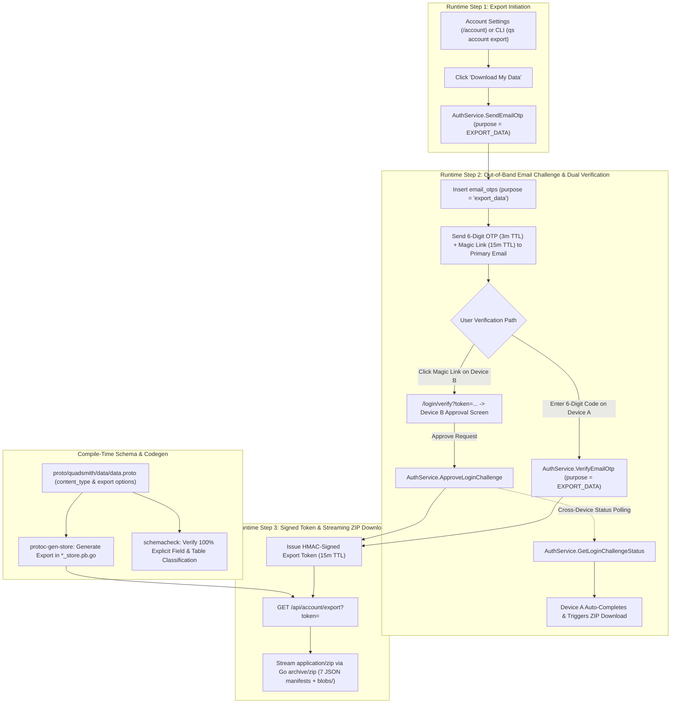

# <a id="self-service-gdpr-data-archive-export" >Self-Service GDPR Data Archive Export</a>

## <a id="table-of-contents" >Table of Contents</a>

- [1. Background](#1-background)
- [2. Goal](#2-goal)
- [3. Proposal](#3-proposal)
  - [Account Settings Placement and Data & Privacy Card](#account-settings-placement-and-data-privacy-card)
  - [Out-of-Band Email Verification and Signed Export Token](#out-of-band-email-verification-and-signed-export-token)
  - [Declarative Data Classification with `quadsmith.data` Protobuf Options](#declarative-data-classification-with-quadsmithdata-protobuf-options)
  - [Compile-Time Export Code Generation in `protoc-gen-store`](#compile-time-export-code-generation-in-protoc-gen-store)
  - [Streaming ZIP Archive Endpoint and Modular JSON Layout](#streaming-zip-archive-endpoint-and-modular-json-layout)
  - [Exhaustive GDPR Data Scope and Surgical Security Filtering](#exhaustive-gdpr-data-scope-and-surgical-security-filtering)
  - [Single-Source-of-Truth Email Storage and Primary Email Constraint](#single-source-of-truth-email-storage-and-primary-email-constraint)
  - [Protobuf API Specifications and RPC Contracts](#protobuf-api-specifications-and-rpc-contracts)
  - [CLI Parity with `qs account export`](#cli-parity-with-qs-account-export)
- [4. Alternatives considered](#4-alternatives-considered)
- [5. Assumptions](#5-assumptions)
- [6. Future work](#6-future-work)

---

## <a id="1-background" >1. Background</a>

Under [GDPR Article 15](https://gdpr-info.eu/art-15-gdpr/) (Right of access by
the data subject) and [GDPR Article 20](https://gdpr-info.eu/art-20-gdpr/)
(Right to data portability), users have the right to obtain a copy of all
personal data concerning them in a structured, commonly used, and
machine-readable format.

In
[user_account_deletion.md](../../docs/plans/user_account_deletion.md#L619-L624),
Quadsmith identified **Self-Service GDPR Data Archive Export** under Future Work
so users can download a complete archive of their profile, aircraft builds,
custom components, collections, community contributions, and uploaded media
before or independent of account deletion. Additionally,
[email_delivery_architecture.md](../../docs/plans/email_delivery_architecture.md)
established Quadsmith's universal out-of-band Email Verification challenge model
(combining a 6-digit numeric OTP code with a 1-click magic link sent to the
user's primary email). This plan specifies the end-to-end architecture for
self-service GDPR data export across the Protobuf schema, store code generator,
API server, Web UI, and CLI without contradicting or superseding any existing
plan.

---

## <a id="2-goal" >2. Goal</a>

Enable authenticated users to securely verify their identity via out-of-band
Email Verification and download a complete, machine-readable `.zip` archive of
their personal data from `/account` and `qs account export`, driven entirely by
declarative `quadsmith.data` Protobuf field classifications and compile-time
`protoc-gen-store` code generation.

---

## <a id="3-proposal" >3. Proposal</a>

> **TL;DR:**
>
> - Add a "Data & Privacy" card with a "Download My Data" button on Account
>   Settings.
> - Require out-of-band Email Verification (6-digit OTP or magic link) before
>   exporting user data.
> - Classify every SQL-backed Protobuf field (and embedded message fields) with
>   `quadsmith.data.content_type` and enforce 100% coverage in `schemacheck`.
> - Generate zero-join `Export<PluralName>` store functions in
>   `protoc-gen-store` based purely on field categories.
> - Stream a `.zip` archive via `GET /api/account/export` and provide CLI parity
>   via `qs account export`.

Quadsmith implements GDPR data export by combining declarative Protobuf data
classification (`quadsmith.data`), compile-time store code generation
(`protoc-gen-store`), ConnectRPC email verification endpoints, and a streaming
HTTP `.zip` archive handler. Every SQL-backed message (plus any sub-messages it
references) and every field is explicitly annotated with its export domain and
`ContentType` (`USER_PROVIDED_PRIVATE`, `USER_PROVIDED_PUBLIC`, `USER_OBSERVED`,
`SYSTEM_METADATA_PUBLIC`, `SYSTEM_METADATA_PRIVATE`, or `SYSTEM_SECRET`). At
build time, `protoc-gen-store` generates single-table export queries that
project only exportable field categories while stripping
`SYSTEM_METADATA_PRIVATE` and `SYSTEM_SECRET` columns and omitting any empty or
metadata-only objects (objects with zero `USER_*` fields).



### <a id="account-settings-placement-and-data-privacy-card" >Account Settings Placement and Data & Privacy Card</a>

The self-service data export entry point is placed on the private Account
Settings page in
[AccountSettingsPage.tsx](../../src/frontend/web/app/src/pages/AccountSettingsPage.tsx)
at `/account`, inside a dedicated **Data & Privacy** section card positioned
below the **Profile Details** card:

- **Interactive Visual Previews**:
  - [Open Desktop Preview](file:///home/roramu/.gemini/antigravity/brain/a01dfff4-392e-4916-904f-f7f07efd8747/gdpr_data_export_preview_desktop.html)
  - [Open Mobile Preview](file:///home/roramu/.gemini/antigravity/brain/a01dfff4-392e-4916-904f-f7f07efd8747/gdpr_data_export_preview_mobile.html)
- **Section Layout & Account Settings Refinements**:
  - **Data & Privacy Card**: Displays a clean **Data & Privacy** section header
    and the **Download My Data** action button
    (`data-testid="download-data-button"`), without cluttering the UI with legal
    GDPR explanations or archive file breakdowns. Clicking **Download My Data**
    opens the unified `EmailVerificationModal` (wrapping `EmailVerificationForm`
    with `purpose = EXPORT_DATA` and `autoSend = true`), automatically calling
    `AuthService.SendEmailOtp` to dispatch the challenge to the user's primary
    email and presenting the OTP entry screen. Designed as a general-purpose
    **Data & Privacy** section so future privacy controls (e.g.,
    `"Show my email address on my user profile"`) can be added directly
    alongside this button.
  - **Associated Email Addresses Table**: Displays the `Primary` badge only on
    the primary email row and omits the redundant `"Secondary"` badge on
    additional email addresses. Login and email-addition verification codes are
    sent to whichever email address is being used to sign in or verified, while
    account-level verification codes (such as data export and account deletion)
    are sent to the primary email address.
  - **Profile Details Layout**: Displays the user's circular avatar preview
    directly next to the **Avatar Image URL (Optional)** input field (live
    auto-updating as a new URL is entered into the field, with automatic initial
    fallback when blank or invalid), and renders **Bio** as a multi-line
    `<textarea>`.

<details>
<summary><strong>Alternatives considered</strong></summary>

##### <a id="public-profile-page-owner-only-button" >Public Profile Page Owner-Only Button</a>

Placing the "Download Data" button directly on the public user profile page in
[UserProfilePage.tsx](../../src/frontend/web/app/src/pages/UserProfilePage.tsx)
(`/users/:username`), visible only when the authenticated viewer is the profile
owner (`user.id === username`). Clicking the button launches the export flow
from the public profile header.

**Pros:**

- Accessible directly when a user views their own public profile card.
- Avoids navigating to `/account` if the user starts on `/users/:username`.

**Cons:**

- Mixes private GDPR compliance controls into a public-facing showcase page.
- Separates data export from other private account management actions (email
  management, username changes, and account deletion) that live on `/account`.

##### <a id="dual-entry-points-on-settings-and-public-profile" >Dual Entry Points on Settings and Public Profile</a>

Rendering the "Download Data" button on both the Account Settings page
(`/account`) and the owner view of the Public Profile page (`/users/:username`).
Both buttons trigger the same verification modal component.

**Pros:**

- Maximizes discoverability regardless of which profile screen the user visits.
- Shares modal logic across both routes via a reusable React component.

**Cons:**

- Duplicates privacy action controls across two different pages in the UI.
- Clutters the public profile header alongside the existing "Account Settings"
  navigation button.

</details>

### <a id="out-of-band-email-verification-and-signed-export-token" >Out-of-Band Email Verification and Signed Export Token</a>

Because a GDPR data archive contains sensitive personal data—including all
verified email addresses, IP and user-agent access logs, private draft builds,
and uploaded files—an active session bearer token alone is insufficient to
authorize an export. Quadsmith enforces a mandatory out-of-band Email
Verification step using the universal challenge architecture in
[otp.go](../../src/backend/shared/pkg/auth/otp.go) and
[email.go](../../src/backend/shared/pkg/email/email.go):

1. **Challenge Dispatch (`SendEmailOtp`)**:
   - Looks up the authenticated user's primary email address
     (`user_emails.is_primary = true`) in
     [quadsmith_api.sql](../../src/backend/db/quadsmith_api.sql#L49-L60).
   - Enforces the standard per-email resend cooldown and hourly rate limit.
   - Inserts a challenge row into `email_otps` with `purpose = 'export_data'`
     and `requested_by_user_uuid = userUUID`, storing HMAC/SHA-256 hashes of the
     6-digit OTP (`code_hash`) and challenge ID (`challenge_id_hash`).
   - Sends a transactional email via `email.Sender` containing:
     - The **6-digit numeric verification code** (valid for 3 minutes).
     - The **1-click magic link** (`/login?token=<raw_token>`, valid for 15
       minutes).
2. **Challenge Verification & Cross-Device Approval Flow**:
   - **Device A Direct Code Entry**: Accepts the 6-digit `code` (bound to
     `challenge_id`) via `AuthService.VerifyEmailOtp` with
     `purpose = EMAIL_OTP_PURPOSE_EXPORT_DATA`. Enforces the 3-attempt limit on
     OTP code guesses, returning structured `OtpVerificationError` details
     (`remaining_attempts`, `is_exhausted`, `cooldown_seconds`) on mismatch.
   - **Device B Magic Link Approval**: When the user opens the magic link
     (`/login?token=<token>`), the unified `<ChallengeApprovalScreen />`
     displays the "Approve Data Export" challenge details regardless of whether
     an active session is present. Upon user confirmation,
     `AuthService.ApproveLoginChallenge` marks the challenge approved. To
     guarantee that the download only occurs on the device that requested it,
     Device B does not initiate a download or provide a fallback download
     button; instead, it displays the confirmation notice, while Device A
     automatically receives the approved token and starts the `.zip` download.
   - **Device A Reactive Completion**: While `EmailVerificationForm` displays
     the OTP input step, it continuously polls
     `AuthService.GetLoginChallengeStatus(challenge_id)`. Once approved on
     Device B, Device A automatically receives the `verify_response`, starts the
     `.zip` download, closes the modal, and presents the confirmation notice.
3. **Short-Lived Signed Export Token**:
   - Upon successful verification or challenge approval, the backend generates a
     stateless HMAC-SHA256 signed token (15-minute TTL, signed with the server's
     JWT secret and bound to `sub = userUUID`, `id = username`, and
     `purpose = "export_data_download"`).
   - Returns `export_token` and `download_url` (`/api/account/export?token=...`)
     in `VerifyEmailOtpResponse`.

<details>
<summary><strong>Alternatives considered</strong></summary>

##### <a id="immediate-single-click-download-with-active-session" >Immediate Single-Click Download with Active Session</a>

Streaming the `.zip` archive immediately when the user clicks "Download Data"
using only their current `Authorization: Bearer <access_token>` session, without
sending an email challenge. The download starts in a single click.

**Pros:**

- Zero verification friction for the user.
- Requires no email dispatch or OTP modal state.

**Cons:**

- Allows an attacker with a hijacked session or unattended unlocked browser to
  silently exfiltrate the victim's entire personal data archive and IP history.
- Inconsistent with Quadsmith's out-of-band email verification security posture
  for sensitive account operations.

##### <a id="asynchronous-background-job-with-email-download-link" >Asynchronous Background Job with Email Download Link</a>

Enqueuing a background worker job in `server-jobs` that builds the `.zip` file
asynchronously, uploads it to temporary storage, and emails a download link when
complete. The user cannot download the archive directly in the modal.

**Pros:**

- Decouples archive generation from HTTP request timeouts for multi-gigabyte
  datasets.
- Combines email verification and archive delivery into a single email link.

**Cons:**

- Requires persistent temporary archive storage and a cleanup cron job for
  expired `.zip` files.
- Introduces unnecessary queueing delay for typical user archives that stream in
  under one second.

</details>

### <a id="declarative-data-classification-with-quadsmithdata-protobuf-options" >Declarative Data Classification with `quadsmith.data` Protobuf Options</a>

Rather than maintaining ad-hoc, error-prone column allowlists in Go, Quadsmith
introduces a dedicated `quadsmith.data` Protobuf extensions package in
`proto/quadsmith/data/data.proto` (following the pattern of
[sql.proto](../../proto/quadsmith/sql/sql.proto) and
[common.proto](../../proto/quadsmith/common/common.proto)):

```protobuf
syntax = "proto3";

package quadsmith.data;

import "google/protobuf/descriptor.proto";

option go_package = "quadsmith/shared/gen/quadsmith/data;data";

extend google.protobuf.MessageOptions {
  ExportOptions export = 52000;
}

extend google.protobuf.FieldOptions {
  ContentType content_type = 52000;
}

message ExportOptions {
  // Archive file domain that owns this table in the GDPR export.
  ExportDomain domain = 1;

  // Optional SQL WHERE predicate (using $1 for user_uuid) when row ownership
  // is not a direct `uuid = $1` or `user_uuid = $1` check.
  string user_filter = 2;
}

enum ExportDomain {
  EXPORT_DOMAIN_UNSPECIFIED = 0;
  EXPORT_DOMAIN_NONE = 1;        // System/ops tables not exported in user archives
  EXPORT_DOMAIN_ACCOUNT = 2;     // -> account.json
  EXPORT_DOMAIN_SECURITY = 3;    // -> security.json
  EXPORT_DOMAIN_BUILDS = 4;      // -> builds.json
  EXPORT_DOMAIN_COMPONENTS = 5;  // -> components.json
  EXPORT_DOMAIN_COLLECTIONS = 6; // -> collections.json
  EXPORT_DOMAIN_SOCIAL = 7;      // -> social.json
  EXPORT_DOMAIN_BLOBS = 8;       // -> blobs.json + blobs/
}

enum ContentType {
  CONTENT_TYPE_UNSPECIFIED = 0;
  // User-provided private data (GDPR Art. 15 & Art. 20, e.g. email addresses).
  CONTENT_TYPE_USER_PROVIDED_PRIVATE = 1;
  // User-provided public data (GDPR Art. 15 & Art. 20, e.g. User.id, bio, builds).
  CONTENT_TYPE_USER_PROVIDED_PUBLIC = 2;
  // Observed personal data (GDPR Art. 15, e.g. created_at, ip_address, score).
  CONTENT_TYPE_USER_OBSERVED = 3;
  // System-generated public metadata (e.g. `uuid` primary/foreign keys and
  // system-generated `id` slugs). Included alongside exported `USER_*` fields to
  // preserve relational links and identifiers, but never triggers exporting an
  // object on its own.
  CONTENT_TYPE_SYSTEM_METADATA_PUBLIC = 4;
  // Internal system state and anti-abuse counters (omitted from user export).
  CONTENT_TYPE_SYSTEM_METADATA_PRIVATE = 5;
  // Cryptographic hashes and secret tokens (strictly redacted from export).
  CONTENT_TYPE_SYSTEM_SECRET = 6;
}
```

To guarantee zero classification drift as schemas evolve, a test in
[schemacheck](../../src/backend/shared/pkg/schemacheck/schemacheck_test.go)
enforces five invariants across all Protobuf files during `make test`:

1. **100% Table Domain Coverage**: Every message with
   `option (quadsmith.sql.table)` must explicitly set
   `option (quadsmith.data.export).domain` to a non-unspecified `ExportDomain`.
2. **100% Explicit Field Coverage (Including Embedded Sub-Messages)**: Every
   field on a `(quadsmith.sql.table)` message—and every field on any non-table
   message transitively referenced by a `(quadsmith.sql.table)` message (such as
   [Media](../../proto/quadsmith/api/media.proto#L15-L20) and
   [ReferenceLink](../../proto/quadsmith/api/reference_link.proto#L18-L21),
   excluding `google.protobuf.Timestamp`)—must explicitly declare
   `[(quadsmith.data.content_type)]` (never `CONTENT_TYPE_UNSPECIFIED`).
3. **Identifier & Relational Key Provenance (`SYSTEM_METADATA_PUBLIC` vs.
   `USER_PROVIDED_PUBLIC`)**:
   - System-generated `uuid` primary keys, `user_uuid` / relational foreign
     keys, and system-generated `id` slugs (`Entity.id`, `Collection.id`,
     `Review.id`, `Question.id`, `Blob.id`, as well as API-only projected
     `CollectionItem.entity_id`, `Review.entity_id`, and `Question.entity_id`)
     are categorized as `CONTENT_TYPE_SYSTEM_METADATA_PUBLIC`.
   - User-chosen identifiers and component selections (`User.id` and the
     component selection fields on `Build` such as `frame_uuid`, `motor_uuid`,
     `flight_controller_uuid`, etc.) are categorized as
     `CONTENT_TYPE_USER_PROVIDED_PUBLIC`.
4. **No Empty or Metadata-Only Exported Objects**: Any message or runtime object
   that has no exported fields—or where the only exported fields are
   `CONTENT_TYPE_SYSTEM_METADATA_PUBLIC` (zero `USER_PROVIDED_PRIVATE`,
   `USER_PROVIDED_PUBLIC`, or `USER_OBSERVED` fields, such as `BlobReference`,
   `JitGrantRecord`, `InternalTokenRecord`, and `InternalApiCallRecord`)—must
   not be exported (`domain: EXPORT_DOMAIN_NONE` at the table level, and omitted
   at runtime if all `USER_*` fields on an object or embedded sub-message are
   empty).
5. **Operations Schema Isolation (`quadsmith.ops` / `store/ops.proto`)**: Every
   table in
   [`src/proto/quadsmith/store/ops.proto`](../../src/proto/quadsmith/store/ops.proto)
   must categorize all fields exclusively as `CONTENT_TYPE_SYSTEM_METADATA_*` or
   `CONTENT_TYPE_SYSTEM_SECRET` (zero `USER_*` fields, and therefore excluded
   from export by Rule 4).

<details>
<summary><strong>Alternatives considered</strong></summary>

##### <a id="hardcoded-sql-projection-queries-in-go" >Hardcoded SQL Projection Queries in Go</a>

Writing manual `SELECT col1, col2 FROM ...` queries inside a dedicated Go
package without adding Protobuf field options. Developers manually update the Go
export queries whenever a `.proto` message changes.

**Pros:**

- Requires no changes to `.proto` files or custom Protobuf option extensions.
- Avoids modifying `protoc-gen-store` or `schemacheck`.

**Cons:**

- Prone to silent compliance drift when new columns or tables are added to
  `.proto` files without updating the exporter.
- Couples export logic to hand-maintained column lists instead of declarative
  schema metadata.

##### <a id="binary-exportable-vs-redacted-field-enum" >Binary Exportable vs. Redacted Field Enum</a>

Defining a simple two-state enum (`EXPORTABLE` vs. `REDACTED`) on fields instead
of the six-value `ContentType` taxonomy (`USER_PROVIDED_PRIVATE`,
`USER_PROVIDED_PUBLIC`, `USER_OBSERVED`, `SYSTEM_METADATA_PUBLIC`,
`SYSTEM_METADATA_PRIVATE`, `SYSTEM_SECRET`). All exported fields share a single
enum value.

**Pros:**

- Slightly fewer enum constants to choose from when annotating `.proto` fields.
- Sufficient for a basic include/exclude filter.

**Cons:**

- Cannot distinguish GDPR Article 20 portable data (`USER_PROVIDED_*`) from
  Article 15 observed data (`USER_OBSERVED`) or public system metadata
  (`SYSTEM_METADATA_PUBLIC`).
- Cannot distinguish non-sensitive internal counters (`SYSTEM_METADATA_PRIVATE`)
  from cryptographic secrets (`SYSTEM_SECRET`).

##### <a id="implicit-default-categorization-for-unannotated-fields" >Implicit Default Categorization for Unannotated Fields</a>

Allowing fields to omit `(quadsmith.data.content_type)` and silently defaulting
unannotated fields to `CONTENT_TYPE_SYSTEM_METADATA_PRIVATE` (omitted from
export) without failing `schemacheck`. Only exported fields require annotations.

**Pros:**

- Reduces the number of option annotations needed in existing `.proto` files.
- New fields do not break `make test` if a developer forgets to annotate them.

**Cons:**

- Violates fail-closed GDPR compliance by silently omitting newly added personal
  data fields from user exports if an annotation is forgotten.
- Removes the compile-time forcing function that requires engineers to classify
  every new database column.

</details>

### <a id="compile-time-export-code-generation-in-protoc-gen-store" >Compile-Time Export Code Generation in `protoc-gen-store`</a>

Using the `quadsmith.data` annotations,
[`protoc-gen-store/main.go`](../../src/go/shared/cmd/protoc-gen-store/main.go)
generates a type-safe `Export<PluralName>` function in `*_store.pb.go` for every
`(quadsmith.sql.table)` message that contains at least one `USER_*` field:

1. **Exportable Column Selection**:
   - At code-generation time, `protoc-gen-store` filters the table's persisted
     SQL columns (`!isInheritedField(tblOpts, fieldName)`) to those whose
     `content_type` is one of:
     - `CONTENT_TYPE_USER_PROVIDED_PRIVATE`
     - `CONTENT_TYPE_USER_PROVIDED_PUBLIC`
     - `CONTENT_TYPE_USER_OBSERVED`
     - `CONTENT_TYPE_SYSTEM_METADATA_PUBLIC`
   - Columns marked `CONTENT_TYPE_SYSTEM_METADATA_PRIVATE` or
     `CONTENT_TYPE_SYSTEM_SECRET` are excluded from the generated `SELECT`
     statement and never scanned into the returned struct.
2. **Omission of Empty & Metadata-Only Objects**:
   - Any object that has no exported fields—or where the only exported fields
     are `CONTENT_TYPE_SYSTEM_METADATA_PUBLIC` (zero `USER_*` fields)—is never
     exported (i.e., no empty or metadata-only skeleton objects):
     - **Compile-Time Table Exclusion**: `protoc-gen-store` skips generating
       `Export<PluralName>` for any message that has zero `USER_*` fields
       (`USER_PROVIDED_PRIVATE`, `USER_PROVIDED_PUBLIC`, or `USER_OBSERVED`) or
       where all exportable fields are UUID keys (primary key or foreign keys).
       For example, `UserReputation` retains `domain: EXPORT_DOMAIN_ACCOUNT` for
       domain taxonomy, but because its score and timestamp fields are private
       system metadata, its only remaining exportable columns are `uuid` and
       `user_uuid`, so it is automatically excluded from code generation and
       export archives.
     - **Runtime Row & Sub-Message Pruning**: Before appending a scanned record
       to the exported slice (or serializing an embedded sub-message such as
       `Media` or `ReferenceLink`), if all non-UUID `USER_*` fields on that
       object are empty/unset, the object is omitted so no empty or
       metadata-only objects ever appear in the exported JSON.
3. **Zero-Join Single-Table Queries**:
   - Every generated
     `Export<PluralName>(ctx context.Context, db *pgxpool.Pool, userUUID string)`
     queries **only its own table**
     (`SELECT <export_cols> FROM <table_name> WHERE <user_where> ORDER BY uuid ASC`)
     with **no SQL `JOIN`s** and no foreign-key auto-expansion.
   - Because `uuid` relational keys and system-generated `id` slugs are
     categorized as `CONTENT_TYPE_SYSTEM_METADATA_PUBLIC`, they are included
     directly alongside the `USER_*` fields in the exported JSON objects without
     any risk of circular reference expansion.
4. **Row Ownership Predicate Resolution**:
   - If `(quadsmith.data.export).user_filter` is set on the message,
     `protoc-gen-store` uses that exact `WHERE` predicate (with `$1` bound to
     `userUUID`).
   - Otherwise, if the table is `users`, it uses `uuid = $1::uuid`.
   - Otherwise, if the table has a `user_uuid` column, it uses
     `user_uuid = $1::uuid`.

<details>
<summary><strong>Alternatives considered</strong></summary>

##### <a id="runtime-descriptor-reflection-exporter" >Runtime Descriptor Reflection Exporter</a>

Using Go's `protoreflect` package at runtime during `GET /api/account/export` to
inspect message descriptors, dynamically construct SQL strings, and populate
`map[string]any` structures on the fly. No `Export<PluralName>` functions are
generated in `*_store.pb.go`.

**Pros:**

- Keeps `*_store.pb.go` smaller by avoiding generated `Export*` functions.
- Centralizes SQL string construction in a single runtime loop.

**Cons:**

- Replaces compile-time type-checked `pgx` scanning with slower runtime
  reflection and dynamic SQL string building.
- Diverges from Quadsmith's architecture where all store queries (`Create`,
  `Get`, `Update`, `Delete`, `List`) are generated at compile time by
  `protoc-gen-store`.

##### <a id="automatic-foreign-key-join-expansion-in-store" >Automatic Foreign-Key Join Expansion in Store</a>

Teaching `protoc-gen-store` to automatically follow
`references: "<table>(uuid)"` annotations and emit SQL `LEFT JOIN`s or
correlated subqueries to replace `*_uuid` fields with target rows or target `id`
columns. Referenced records are expanded inline during export.

**Pros:**

- Inline human-readable target names without requiring the reader to cross-check
  UUIDs across tables.
- Hides raw `uuid` values from the exported JSON files.

**Cons:**

- Introduces circular reference hazards when tables mutually or transitively
  reference one another.
- Breaks when a referenced table (such as `answers` or `oauth_accounts`) lacks a
  human-readable `id` column, and adds complex multi-join query overhead.

</details>

### <a id="streaming-zip-archive-endpoint-and-modular-json-layout" >Streaming ZIP Archive Endpoint and Modular JSON Layout</a>

ConnectRPC endpoints in
[server-api/main.go](../../src/backend/server-api/main.go#L118-L120) enforce a
strict 1 MB request read limit (`connect.WithReadMaxBytes(1 << 20)`) and buffer
unary protobuf responses in memory. Following the pattern established for binary
media in [handler.go](../../src/backend/shared/pkg/blob/handler.go), Quadsmith
serves the archive via a dedicated HTTP endpoint:

- **Endpoint**: `GET /api/account/export?token=<export_token>` mounted on
  [server-api/main.go](../../src/backend/server-api/main.go) and reverse-proxied
  in [server-web/main.go](../../src/backend/server-web/main.go#L41-L45).
- **Authentication**: Validates the HMAC-signed `export_token` query parameter
  (or `Authorization: Bearer <export_token>` header for CLI requests), verifying
  its signature, `purpose == "export_data_download"`, and 15-minute expiration.
- **Response Headers**:
  - `Content-Type: application/zip`
  - `Content-Disposition: attachment; filename="quadsmith-data-<username>-<YYYY-MM-DD>.zip"`
  - `Cache-Control: no-store`
- **Streaming Assembly**: Uses the standard library
  [Go `archive/zip` package](https://pkg.go.dev/archive/zip)
  (`zip.NewWriter(w)`) to invoke the generated `Export<PluralName>` store
  functions for each `ExportDomain`, write seven indented UTF-8 JSON manifests,
  and stream raw binary files into `blobs/`:

| Archive Path                           | `ExportDomain`              | Generated Store Functions Invoked                                                                                                                                                              |
| :------------------------------------- | :-------------------------- | :--------------------------------------------------------------------------------------------------------------------------------------------------------------------------------------------- |
| `account.json`                         | `EXPORT_DOMAIN_ACCOUNT`     | `ExportUsers`, `ExportUserProfiles`, `ExportUserEmails`, `ExportOAuthAccounts`, `ExportUserEmailOAuthAccounts`, `ExportUsernameHistories`                                                      |
| `security.json`                        | `EXPORT_DOMAIN_SECURITY`    | `ExportRefreshTokens`                                                                                                                                                                          |
| `builds.json`                          | `EXPORT_DOMAIN_BUILDS`      | `ExportEntities` (filtered to `collection = 'builds'`), `ExportBuilds`                                                                                                                         |
| `components.json`                      | `EXPORT_DOMAIN_COMPONENTS`  | `ExportEntities` (filtered to `collection != 'builds'`), plus `Export<ComponentPlural>` across all 20 component tables                                                                         |
| `collections.json`                     | `EXPORT_DOMAIN_COLLECTIONS` | `ExportCollections`, `ExportCollectionItems`                                                                                                                                                   |
| `social.json`                          | `EXPORT_DOMAIN_SOCIAL`      | `ExportReviews`, `ExportReviewVotes`, `ExportReviewComments`, `ExportQuestions`, `ExportAnswers`, `ExportQuestionVotes`, `ExportAnswerVotes`, `ExportQuestionComments`, `ExportAnswerComments` |
| `blobs.json` + `blobs/<id>_<filename>` | `EXPORT_DOMAIN_BLOBS`       | `ExportBlobs` (metadata written to `blobs.json`; raw `bytes` streamed into `blobs/<id>_<sanitized_filename>`)                                                                                  |

<details>
<summary><strong>Alternatives considered</strong></summary>

##### <a id="single-monolithic-json-file-download" >Single Monolithic JSON File Download</a>

Returning a single `quadsmith-data-<username>.json` file containing only
database metadata and URL references to uploaded blobs, without bundling raw
binary files in a `.zip` archive. Users would need to download each blob URL
separately.

**Pros:**

- Trivial to serialize with a single `json.NewEncoder(w)` call.
- Smaller payload size when a user has uploaded many 3D CAD models or images.

**Cons:**

- Fails to provide a self-contained offline archive of user-uploaded images and
  3D STL/STEP/3MF files.
- Blob URLs become inaccessible once an account and its blobs are purged.

##### <a id="monolithic-data-json-plus-blobs-inside-zip" >Monolithic data.json Plus Blobs Inside ZIP</a>

Packaging a single top-level `data.json` file containing all data domains
combined into one large JSON object alongside the `blobs/` directory inside the
`.zip` archive. All domains share a single JSON file.

**Pros:**

- Requires only one JSON file write call inside the `zip.Writer` loop.
- Allows searching all text metadata in a single file.

**Cons:**

- Produces an unwieldy, deeply nested JSON file when a user has many builds,
  components, and social posts.
- Harder for users and third-party portability tools to inspect specific domains
  compared to modular files mapped 1:1 to `ExportDomain`.

##### <a id="buffering-full-zip-payload-in-connectrpc-protobuf-response" >Buffering Full ZIP Payload in ConnectRPC Protobuf Response</a>

Returning `bytes zip_payload = 1;` directly inside a unary ConnectRPC response
message instead of streaming over an HTTP `GET /api/account/export` handler. The
entire `.zip` archive is assembled in memory and serialized into Protobuf.

**Pros:**

- Avoids registering a separate HTTP route on `server-api` and `server-web`.
- Uses generated ConnectRPC client methods for both verification and download.

**Cons:**

- Buffers the entire `.zip` archive (including multi-megabyte 3D models and
  images) in server RAM twice during Protobuf marshaling.
- Prevents streaming browser file downloads with native `Content-Disposition`
  progress reporting.

</details>

### <a id="exhaustive-gdpr-data-scope-and-surgical-security-filtering" >Exhaustive GDPR Data Scope and Surgical Security Filtering</a>

To satisfy both [GDPR Article 15](https://gdpr-info.eu/art-15-gdpr/) (Right of
access, including observed personal data) and
[GDPR Article 20](https://gdpr-info.eu/art-20-gdpr/) (Right to data portability)
without exposing anti-abuse mechanics or third-party data under Article 15(4),
`security.json` exports persistent user device sessions while treating
transient, in-flight authentication challenges as internal operational data:

1. **Exclusion of Ephemeral `EmailOtp` Challenges (`EXPORT_DOMAIN_NONE`)**:
   - `EmailOtp` rows represent short-lived operational tokens (15-minute
     expiration, with used/expired records purged automatically after 24 hours).
   - Because they are ephemeral and in-flight, they do not constitute a durable
     session audit log. Furthermore, exporting unverified challenges risks
     leaking IP/device metadata of third parties who mistyped the user's email
     address under GDPR Article 15(4).
   - `EmailOtp` declares `domain: EXPORT_DOMAIN_NONE` and is excluded from user
     exports.
2. **Surgical Field Categorization on `RefreshToken`**:
   - On `RefreshToken`, `token_hash` is marked `CONTENT_TYPE_SYSTEM_SECRET`,
     while `uuid` and `user_uuid` (`SYSTEM_METADATA_PUBLIC`) and `device_hint`,
     `created_at`, `last_used_at`, and `expires_at` (`USER_OBSERVED`) are
     exported.
   - On `OAuthAccount`, `access_token`, `refresh_token`, and `token_expires_at`
     are marked `CONTENT_TYPE_SYSTEM_SECRET`.

<details>
<summary><strong>Alternatives considered</strong></summary>

##### <a id="omitting-security-json-entirely" >Omitting security.json Entirely</a>

Exporting only user-provided content (`account.json`, `builds.json`,
`components.json`, `collections.json`, `social.json`, `blobs.json`) and omitting
`security.json` (`RefreshToken`) completely. No session or access logs are
included in the archive.

**Pros:**

- Reduces the archive to strictly Article 20 user-provided portability data.
- Slightly simpler archive generation logic.

**Cons:**

- Falls short of GDPR Article 15 Right of Access, which covers observed personal
  data (`device_hint`, `created_at`, and session timestamps) stored about the
  user.
- Prevents users from inspecting their own historical login and session
  activity.

##### <a id="exporting-ephemeral-email-otps-in-security-json" >Exporting Ephemeral email_otps in security.json</a>

Exporting `email_otps` challenge rows matching the user's verified email
addresses in `security.json` alongside `RefreshToken`.

**Pros:**

- Provides visibility into recent in-flight login and verification challenges
  generated within the last 24 hours.

**Cons:**

- Incomplete as an audit trail since all rows are purged after 24 hours.
- Mixes transient protocol handshake buffers with durable session history.
- Risks exposing IP/device metadata from mistyped third-party requests or
  anti-abuse counters.

</details>

### <a id="single-source-of-truth-email-storage-and-primary-email-constraint" >Single-Source-of-Truth Email Storage and Primary Email Constraint</a>

All user email addresses are stored exclusively in the `user_emails` table, and
the redundant `users.email` SQL column in
[quadsmith_api.sql](../../src/backend/db/quadsmith_api.sql#L21) is removed:

1. **Drop Redundant `users.email` Column**:
   - In
     [`src/proto/quadsmith/store/user.proto`](../../src/proto/quadsmith/store/user.proto),
     `User` omits `email` entirely, while in
     [`src/proto/quadsmith/api/user.proto`](../../src/proto/quadsmith/api/user.proto),
     `User.email` remains available on API responses populated from
     `user_emails WHERE is_primary = true` without persisting a duplicate column
     in `users`.
   - All dual-write queries in
     [service.go](../../src/backend/shared/pkg/auth/service.go)
     (`CompleteAccountSetup`, `SetPrimaryEmail`, `MergeAccount`,
     `OAuthCallback`, `userExistsForEmail`) read and write email addresses
     solely in `user_emails`.
   - When
     [PurgeDeletedAccounts](../../src/backend/shared/pkg/auth/job.go#L135-L166)
     wipes a deleted account after 30 days, it simply deletes the user's
     `user_emails` rows without needing to invent a fake
     `deleted-<uuid>@deleted.quadsmith.internal` placeholder on `users`.
   - In `account.json`, the user's email addresses are exported cleanly once in
     `user_emails` (`ExportUserEmails`) with their full verification metadata,
     rather than duplicating the primary email inside `user` (`ExportUsers`).
2. **Enforce 1 and Only 1 Primary Email (`is_primary = true`)**:
   - Extend `TableOptions` in
     [sql.proto](../../proto/quadsmith/sql/sql.proto#L13-L26) with
     `repeated UniqueIndex unique_indexes = 4;` and update
     [protoc-gen-sql/main.go](../../src/backend/shared/cmd/protoc-gen-sql/main.go)
     to emit partial unique indexes in `quadsmith_api.sql`:

     ```sql
     CREATE UNIQUE INDEX IF NOT EXISTS idx_user_emails_one_primary_per_user
       ON user_emails (user_uuid)
       WHERE is_primary = true;
     ```

   - This partial unique index guarantees at the database level that a user can
     have **at most 1** primary email (`is_primary = true`).
   - Combined with atomic transactions in `CompleteAccountSetup` (inserting the
     initial email with `is_primary = true`), `SetPrimaryEmail` (atomically
     updating
     `SET is_primary = (LOWER(email) = LOWER($1)) WHERE user_uuid = $2`), and
     `RemoveUserEmail` (forbidding deletion of the `is_primary = true` row),
     every active user is guaranteed to have **1 and only 1** primary email.

<details>
<summary><strong>Alternatives considered</strong></summary>

##### <a id="dual-write-primary-email-on-users-table" >Dual-Write Primary Email on Users Table</a>

Retaining `email TEXT UNIQUE NOT NULL` on the `users` table alongside
`user_emails` and dual-writing the primary email to both tables during signup,
primary email changes, and account merges. Both `users.email` and
`user_emails.email` are persisted in PostgreSQL.

**Pros:**

- Avoids a subquery or join on `user_emails` when fetching a `users` row alone.
- Requires no schema changes to the existing `users` table definition.

**Cons:**

- Violates third normal form (3NF) and risks synchronization drift between
  `users.email` and `user_emails (is_primary = true)`.
- Forces `PurgeDeletedAccounts` to write fake
  `deleted-<uuid>@deleted.quadsmith.internal` strings to satisfy
  `NOT NULL UNIQUE`, and duplicates the primary email in `account.json`.

##### <a id="option-2-primary-email-uuid-foreign-key-on-users" >Option 2: primary_email_uuid Foreign Key on Users</a>

Dropping `is_primary` from `user_emails` and instead storing a
`primary_email_uuid UUID REFERENCES user_emails(uuid)` foreign key column on the
`users` table. All email strings remain in `user_emails`, while `users` points
to the active primary row.

**Pros:**

- Enforces that a user references at most one primary email row using a scalar
  column on `users`.
- Eliminates toggling boolean flags across multiple rows in `user_emails` when
  switching the primary email.

**Cons:**

- Introduces a circular foreign-key dependency between
  `users(primary_email_uuid)` and `user_emails(user_uuid)`, requiring
  `DEFERRABLE INITIALLY DEFERRED` constraints during user creation and account
  purge.
- Requires nullable or deferred foreign-key handling when purging `user_emails`
  for tombstoned `deleted-<uuid>` accounts.

</details>

### <a id="protobuf-api-specifications-and-rpc-contracts" >Protobuf API Specifications and RPC Contracts</a>

Unify email verification across the entire platform in
[auth.proto](../../proto/quadsmith/api/auth.proto) using standard `SendEmailOtp`
and `VerifyEmailOtp` RPCs parameterized by the `EmailOtpPurpose` enum (`LOGIN`,
`ADD_EMAIL`, `EXPORT_DATA`, `DELETE_ACCOUNT`):

```protobuf
service AuthService {
  // Dispatches an out-of-band email verification challenge (purpose = EXPORT_DATA)
  // to the authenticated user's primary email address.
  rpc SendEmailOtp(SendEmailOtpRequest) returns (SendEmailOtpResponse);

  // Verifies the 6-digit OTP code or magic link token for data export and
  // returns a short-lived signed export token and download URL.
  rpc VerifyEmailOtp(VerifyEmailOtpRequest) returns (VerifyEmailOtpResponse);
}

message SendEmailOtpRequest {
  string email = 1;
  EmailOtpPurpose purpose = 2;
}

message SendEmailOtpResponse {
  bool success = 1;
  string message = 2;
  int32 cooldown_seconds = 3;
  bool is_existing_account = 4;
  optional string challenge_id = 5;
  string email = 6;
  optional google.protobuf.Timestamp expires_at = 7;
}

message VerifyEmailOtpRequest {
  string email = 1;
  string code = 2;
  optional string challenge_id = 3;
  optional string token = 4;
  EmailOtpPurpose purpose = 5;
}

message VerifyEmailOtpResponse {
  bool success = 1;
  string message = 2;
  EmailOtpPurpose purpose = 3;
  optional string email = 4;

  // Data Export details (EXPORT_DATA)
  optional string export_token = 20;
  optional string download_url = 21;
  optional string filename = 22;
  optional google.protobuf.Timestamp export_expires_at = 23;
}
```

<details>
<summary><strong>Alternatives considered</strong></summary>

##### <a id="dedicated-separate-rpcs-for-every-verification-purpose" >Dedicated Separate RPCs for Every Verification Purpose</a>

Defining dedicated standalone RPCs for each email challenge flow (such as
`SendDataExportVerification` and `VerifyDataExport`, `SendAddEmailOtp` and
`VerifyAddEmailOtp`, `SendDeleteAccountVerification`). Each workflow maintains
its own distinct request and response message types.

**Pros:**

- Keeps request/response messages strictly isolated to a single flow.
- Explicit method names in the Protobuf service definition.

**Cons:**

- Proliferates duplicate RPCs with identical rate limiting, hashing, and TTLs.
- Fragments frontend implementation across separate React components and state.
- Violates the universal Email Verification architecture across Quadsmith.

</details>

### <a id="cli-parity-with-qs-account-export" >CLI Parity with `qs account export`</a>

To maintain full parity between the Web UI and CLI in
[auth_cmd.go](../../src/frontend/cli/auth_cmd.go), Quadsmith adds an `account`
subcommand group with `qs account export`:

- **Command Signature**:
  `qs account export [-o / --output <path>] [--code <6-digit-code>]`
- **Interactive & Flag Workflow**:
  1. Verifies that the user is logged in via `authStore.LoadToken()`.
  2. Calls `AuthService.SendEmailOtp` with
     `purpose = EMAIL_OTP_PURPOSE_EXPORT_DATA` (unless `--token` or pre-sent
     challenge is supplied) and prints:
     `Verification code sent to <primary_email>. Enter the 6-digit code:`
  3. Reads the 6-digit code from `stdin` (or `--code` flag in non-interactive
     scripts/tests) and calls `AuthService.VerifyEmailOtp`.
  4. Performs an HTTP `GET` request to
     `<api-url>/api/account/export?token=<export_token>` and streams the
     response body to `quadsmith-data-<username>-<YYYY-MM-DD>.zip` (or the path
     specified by `-o / --output`).
  5. Prints the saved file path and byte size upon completion (supporting
     `--format json` and `--format textproto` structured output modes).

<details>
<summary><strong>Alternatives considered</strong></summary>

##### <a id="web-only-export-via-account-settings-ui" >Web-Only Export via Account Settings UI</a>

Implementing the GDPR data export feature exclusively in the React web
application (`AccountSettingsPage.tsx`) without adding a corresponding command
to the `qs` CLI. Terminal users would need to open a browser to export their
data.

**Pros:**

- Slightly smaller implementation footprint by skipping CLI command wiring.
- Avoids interactive OTP prompt handling in `src/frontend/cli/auth_cmd.go`.

**Cons:**

- Breaks feature parity between the Quadsmith Web UI and `qs` CLI.
- Prevents automated E2E CLI testing and terminal-first workflows for exporting
  user archives.

</details>

---

## <a id="4-alternatives-considered" >4. Alternatives considered</a>

<details>
<summary><strong>Alternatives considered</strong></summary>

### <a id="asynchronous-s3-object-storage-export-pipeline" >Asynchronous S3 Object Storage Export Pipeline</a>

Offloading data export generation to an asynchronous job queue (`server-jobs`)
that queries the database, writes a `.zip` file to an external S3-compatible
object bucket, and emails a pre-signed bucket URL to the user minutes or hours
later. This architecture is common in large social networks with terabytes of
media per user.

**Pros:**

- Handles multi-gigabyte media archives without holding open an HTTP connection
  on `server-api`.
- Allows users to close their browser immediately after requesting an export.

**Cons:**

- Introduces external object storage infrastructure dependencies and bucket
  lifecycle policies.
- Degrades user experience with unnecessary waiting times for archives that can
  be streamed on the fly in milliseconds.

### <a id="manual-support-ticket-data-export-workflow" >Manual Support Ticket Data Export Workflow</a>

Handling GDPR Article 15 and Article 20 requests manually via an operator CLI
command in `qsops` triggered when a user emails privacy support. An operator
generates the archive and emails it back within the statutory 30-day GDPR
window.

**Pros:**

- Requires zero self-service frontend UI or public export endpoints.
- Allows human review of every export request before fulfillment.

**Cons:**

- Creates operational toil for administrators and delays user access to their
  own data.
- Fails to fulfill the self-service user experience goal on the Account Settings
  page.

</details>

---

## <a id="5-assumptions" >5. Assumptions</a>

1. Every active Quadsmith user has a verified primary email address
   (`user_emails.is_primary = true`) capable of receiving the `export_data`
   verification challenge.
2. User-uploaded blobs in the `blobs` table fit comfortably within a streaming
   HTTP response when written sequentially via `archive/zip` without buffering
   all blob bytes in memory simultaneously.
3. The HMAC-signed `export_token` uses the API server's configured JWT signing
   secret (`auth.GetSecret()`) with a dedicated `export_data_download` purpose
   claim so it cannot be used as a general session access token.
4. Soft-deleted users who log back in and restore their account within the
   30-day grace period can immediately use the data export feature on
   `/account`.

---

## <a id="6-future-work" >6. Future work</a>

### <a id="direct-build-and-component-import-from-archive" >Direct Build and Component Import from Archive</a>

Allow users to upload a previously exported `quadsmith-data-*.zip` archive (or
individual `builds.json` and `components.json` files) via the Web UI and
`qs account import` CLI command to restore or migrate drafts and custom parts
into a new account.

### <a id="declarative-account-deletion-scrubber-via-content-type" >Declarative Account Deletion Scrubber via `content_type`</a>

Extend `protoc-gen-store` to generate the 30-day account purge scrubber logic
directly from `(quadsmith.data.content_type)`, automatically wiping
`CONTENT_TYPE_USER_PROVIDED_PRIVATE` and `CONTENT_TYPE_USER_OBSERVED` records
while preserving anonymized `CONTENT_TYPE_USER_PROVIDED_PUBLIC` communal
contributions.

### <a id="scheduled-pre-deletion-archive-delivery" >Scheduled Pre-Deletion Archive Delivery</a>

Offer an optional checkbox inside the "Delete Account" confirmation modal that
automatically bundles and downloads the user's GDPR `.zip` data archive using
the same `delete_account` email verification challenge before soft-deletion
takes effect.

### <a id="additional-privacy-settings-in-data-privacy-section" >Additional Privacy Settings in Data & Privacy Section</a>

Expand the **Data & Privacy** section on
[AccountSettingsPage.tsx](../../src/frontend/web/app/src/pages/AccountSettingsPage.tsx)
with user-configurable visibility toggles such as
`"Show my email address on my user profile"`.
