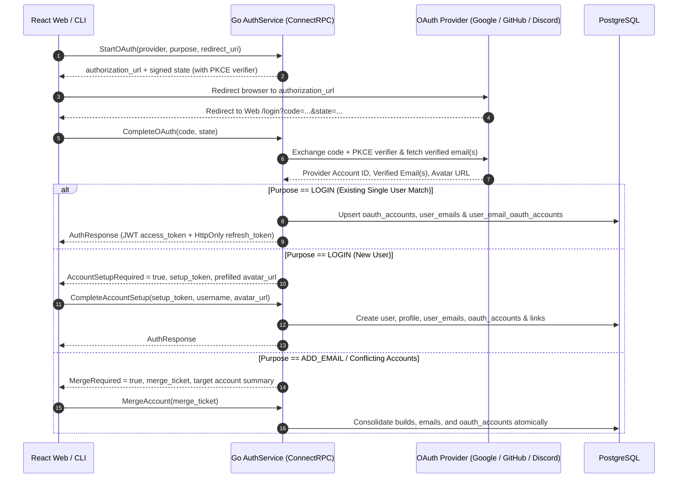

# <a id="oauth-integration-design-google-github-and-discord" >OAuth Integration Design: Google, GitHub, and Discord</a>

## <a id="table-of-contents" >Table of Contents</a>

- [1. Background](#1-background)
- [2. Goal](#2-goal)
- [3. Proposal](#3-proposal)
  - [ConnectRPC OAuth Handshake and Callback Architecture](#connectrpc-oauth-handshake-and-callback-architecture)
  - [Provider Scopes, Real Email Extraction, and Multi-Email Import](#provider-scopes-real-email-extraction-and-multi-email-import)
  - [Account Matching, Explicit Merge Confirmation, and New-User Setup](#account-matching-explicit-merge-confirmation-and-new-user-setup)
  - [Associated Emails Provenance Badges and Inline Unlinking](#associated-emails-provenance-badges-and-inline-unlinking)
  - [Stateless OAuth Database Schema and Uniqueness Constraints](#stateless-oauth-database-schema-and-uniqueness-constraints)
  - [Cross-Device CLI OAuth Authentication](#cross-device-cli-oauth-authentication)
  - [Declarative Server Configuration and Sandbox Mock OAuth Mode](#declarative-server-configuration-and-sandbox-mock-oauth-mode)
- [4. Alternatives considered](#4-alternatives-considered)
- [5. Assumptions](#5-assumptions)
- [6. Future work](#6-future-work)

---

## <a id="1-background" >1. Background</a>

Quadsmith's authentication and email provenance architecture is defined in
[user_auth.md](user_auth.md) and
[email_delivery_architecture.md](email_delivery_architecture.md). The backend
already provides database tables (`oauth_accounts` and
`user_email_oauth_accounts`) in
[`src/db/quadsmith_api.sql`](../../src/db/quadsmith_api.sql#L314-L388) and
internal helper functions (`LinkOAuthAccount` and `UnlinkOAuthAccount`) in
[`src/go/shared/pkg/auth/service.go`](../../src/go/shared/pkg/auth/service.go).

However, the end-to-end OAuth 2.0 /
[OpenID Connect (OIDC)](https://openid.net/developers/how-connect-works/)
handshake, ConnectRPC service endpoints, provider token exchange clients, React
login and email management UI controls, and CLI browser login handoff have not
yet been implemented. Additionally, [user_auth.md](user_auth.md) and
[email_delivery_architecture.md](email_delivery_architecture.md) previously
listed Microsoft (and future Meta support) alongside Google, GitHub, and
Discord, and included unused third-party token columns (`access_token`,
`refresh_token`, `token_expires_at`) on `oauth_accounts`. Both active plans will
be updated in-place alongside this plan to reflect the finalized three-provider
scope (**Google**, **GitHub**, **Discord**) and stateless provider schema.

---

## <a id="2-goal" >2. Goal</a>

Deliver a complete, secure OAuth 2.0 / OIDC integration for **Google**,
**GitHub**, and **Discord** across the Go API server, Protobuf contracts,
PostgreSQL schema, React web client, and `qs` CLI—verifying real user email
addresses, tracking multi-email provenance, enforcing explicit account merge
confirmations, and supporting zero-credential local sandbox testing.

---

## <a id="3-proposal" >3. Proposal</a>

> **TL;DR:**
>
> - Add `StartOAuth`, `CompleteOAuth`, and `UnlinkOAuth` RPCs to `AuthService`
>   using [RFC 7636 PKCE](https://datatracker.ietf.org/doc/html/rfc7636) and
>   HMAC-signed state tokens.
> - Integrate Google, Discord, and GitHub (importing all verified real emails
>   from GitHub's `/user/emails` endpoint).
> - Pre-fill OAuth avatar URLs during new-account setup while leaving the
>   username field blank for manual entry.
> - Manage OAuth links inline within "Associated Email Addresses" via
>   `[Provider ×]` badges and the "Add Email" modal.
> - Support `qs login --provider <google|github|discord>` via web `/login`
>   callback and CLI challenge polling, plus sandbox mock OAuth.

The proposed integration unifies OAuth sign-in, account linking, and CLI browser
authentication around Quadsmith's existing ConnectRPC session and multi-email
provenance architecture.



### <a id="connectrpc-oauth-handshake-and-callback-architecture" >ConnectRPC OAuth Handshake and Callback Architecture</a>

We will expose three new RPCs on `AuthService` in
[`src/proto/quadsmith/api/auth.proto`](../../src/proto/quadsmith/api/auth.proto):

- `StartOAuth(StartOAuthRequest) returns (StartOAuthResponse)`:
  - Validates the requested `OAuthProvider` (`GOOGLE`, `GITHUB`, `DISCORD`) and
    `OAuthPurpose` (`LOGIN`, `ADD_EMAIL`, `CLI_LOGIN`).
  - Generates a cryptographic
    [PKCE](https://datatracker.ietf.org/doc/html/rfc7636) `code_verifier` and
    `S256` `code_challenge`.
  - Signs a stateless HMAC-SHA256 `state` token (10-minute TTL, derived via HKDF
    in
    [`src/go/shared/pkg/auth/tokens.go`](../../src/go/shared/pkg/auth/tokens.go))
    binding the `provider`, `purpose`, `code_verifier`, `redirect_uri`, optional
    authenticated `requester_user_uuid` (for `ADD_EMAIL`), and optional
    `challenge_id_hash` (for `CLI_LOGIN`).
  - Returns the provider `authorization_url` (or sandbox mock callback URL) and
    optional `challenge_id` for CLI polling.
- `CompleteOAuth(CompleteOAuthRequest) returns (CompleteOAuthResponse)`:
  - Receives `code` and `state` from the React frontend when the provider
    redirects back to `/login` or `/settings/account`.
  - Verifies the HMAC signature and expiration of `state`, exchanges `code` +
    `code_verifier` at the provider's token endpoint, fetches the user's
    verified profile and email(s), and executes the login, setup, link, or merge
    flow.
- `UnlinkOAuth(UnlinkOAuthRequest) returns (UnlinkOAuthResponse)`:
  - Wraps `UnlinkOAuthAccount` in
    [`src/go/shared/pkg/auth/service.go`](../../src/go/shared/pkg/auth/service.go#L2099-L2185)
    as a ConnectRPC endpoint for the authenticated user.

```protobuf
// Additions to src/proto/quadsmith/api/auth.proto:
service AuthService {
  // ... existing RPCs ...
  rpc StartOAuth(StartOAuthRequest) returns (StartOAuthResponse);
  rpc CompleteOAuth(CompleteOAuthRequest) returns (CompleteOAuthResponse);
  rpc UnlinkOAuth(UnlinkOAuthRequest) returns (UnlinkOAuthResponse);
}

message StartOAuthRequest {
  OAuthProvider provider = 1;
  OAuthPurpose purpose = 2;
  string redirect_path = 3;
}

message StartOAuthResponse {
  string authorization_url = 1;
  string state = 2;
  optional string challenge_id = 3;
}

message CompleteOAuthRequest {
  string code = 1;
  string state = 2;
}

message CompleteOAuthResponse {
  bool success = 1;
  string message = 2;
  OAuthProvider provider = 3;
  OAuthPurpose purpose = 4;
  string primary_email = 5;
  repeated string verified_emails = 6;
  optional string suggested_avatar_url = 7;

  // Populated for LOGIN (existing user or new user setup)
  optional AuthResponse auth_response = 8;

  // Populated when ADD_EMAIL or multi-email LOGIN encounters another account
  bool merge_required = 9;
  optional string merge_ticket = 10;
  string other_user_username = 11;
  int32 other_build_count = 12;
  repeated string other_build_names = 13;
  repeated string other_emails = 14;
  repeated string other_oauth_providers = 15;
}

message UnlinkOAuthRequest {
  OAuthProvider provider = 1;
}

message UnlinkOAuthResponse {
  bool success = 1;
  string message = 2;
}

enum OAuthProvider {
  OAUTH_PROVIDER_UNSPECIFIED = 0;
  OAUTH_PROVIDER_GOOGLE = 1;
  OAUTH_PROVIDER_GITHUB = 2;
  OAUTH_PROVIDER_DISCORD = 3;
}

enum OAuthPurpose {
  OAUTH_PURPOSE_UNSPECIFIED = 0;
  OAUTH_PURPOSE_LOGIN = 1;
  OAUTH_PURPOSE_ADD_EMAIL = 2;
  OAUTH_PURPOSE_CLI_LOGIN = 3;
}
```

<details>
<summary><a id="alternatives-considered-handshake-architecture" ><strong>Alternatives considered</strong></a></summary>

##### <a id="pure-backend-http-redirect-endpoints" >Pure Backend HTTP Redirect Endpoints</a>

Implementing server-side HTTP routes (`/api/auth/oauth/:provider` and
`/api/auth/oauth/:provider/callback`) that handle token exchange directly on the
Go HTTP mux and `302`-redirect the browser to the React frontend with URL query
parameters.

**Pros:**

- Completes the OAuth token exchange before the React SPA bundle loads on the
  callback page.

**Cons:**

- Requires passing complex state (`setup_token`, `suggested_avatar_url`, or full
  `merge_required` preview payloads) through URL query parameters or temporary
  cookies.
- Bypasses the standard ConnectRPC client transport and mock interceptors used
  by unit tests in
  [`src/react/app-web/src/test/mocks/transport.ts`](../../src/react/app-web/src/test/mocks/transport.ts).

</details>

### <a id="provider-scopes-real-email-extraction-and-multi-email-import" >Provider Scopes, Real Email Extraction, and Multi-Email Import</a>

A new provider client package in `src/go/shared/pkg/auth/oauth.go` will
implement strict real-email extraction for each provider:

| Provider    | Scopes                 | Endpoints                                                                                                                                      | Real Email & Verification Rules                                                                                                                                                                                                                                                                  |
| :---------- | :--------------------- | :--------------------------------------------------------------------------------------------------------------------------------------------- | :----------------------------------------------------------------------------------------------------------------------------------------------------------------------------------------------------------------------------------------------------------------------------------------------- |
| **Google**  | `openid email profile` | Token: `https://oauth2.googleapis.com/token`<br>UserInfo: `https://openidconnect.googleapis.com/v1/userinfo`                                   | Require `email != ""` and `email_verified == true`. Extract `sub` as `provider_account_id` and `picture` as `avatar_url`.                                                                                                                                                                        |
| **GitHub**  | `read:user user:email` | Token: `https://github.com/login/oauth/access_token`<br>Profile: `https://api.github.com/user`<br>Emails: `https://api.github.com/user/emails` | Query [`GET /user/emails`](https://docs.github.com/en/rest/users/emails) so private GitHub emails are still returned. Filter for `verified == true` and exclude `@users.noreply.github.com`. Import **all** verified real emails, marking GitHub's `primary: true` address as the primary email. |
| **Discord** | `identify email`       | Token: `https://discord.com/api/v10/oauth2/token`<br>Profile: `https://discord.com/api/v10/users/@me`                                          | Require `email != ""` and `verified == true` on the [Discord User object](https://discord.com/developers/docs/resources/user#user-object) (rejecting unverified Discord accounts). Construct avatar URL from `id` and `avatar` hash.                                                             |

<details>
<summary><a id="alternatives-considered-multi-email-import" ><strong>Alternatives considered</strong></a></summary>

##### <a id="import-only-primary-github-email" >Import Only Primary GitHub Email</a>

Fetching `GET /user/emails` from GitHub but discarding all verified addresses
except the single `primary: true` entry.

**Pros:**

- Avoids checking whether secondary GitHub emails conflict with other Quadsmith
  accounts.

**Cons:**

- Underutilizes the `user_email_oauth_accounts` many-to-many junction table
  specifically designed in
  [email_delivery_architecture.md](email_delivery_architecture.md#L378-L381) for
  GitHub multi-email payloads.
- Prevents users from signing in via Email OTP or magic link using their
  secondary verified GitHub email addresses.

</details>

### <a id="account-matching-explicit-merge-confirmation-and-new-user-setup" >Account Matching, Explicit Merge Confirmation, and New-User Setup</a>

When `CompleteOAuth` resolves the provider identity (`provider`,
`provider_account_id`, `primary_email`, `verified_emails`, `avatar_url`), it
applies deterministic account resolution:

- **1. Unauthenticated Sign-In (`OAUTH_PURPOSE_LOGIN` /
  `OAUTH_PURPOSE_CLI_LOGIN`)**:
  - **Existing Single Account Match**: If `(provider, provider_account_id)` in
    `oauth_accounts` or the provider's `verified_emails` in `user_emails` map to
    exactly **one** existing user (active or within the 30-day soft-delete
    resurrection window), Quadsmith links the OAuth account and all
    non-conflicting verified emails via
    [`LinkOAuthAccount`](../../src/go/shared/pkg/auth/service.go#L2026-L2095),
    backfills `user_profiles.avatar_url` if currently empty, and issues an
    authenticated session.
  - **Multi-Account Email Conflict on Login**: If a multi-email provider (such
    as GitHub) returns `email_A` belonging to `@user_a` and `email_B` belonging
    to `@user_b`, Quadsmith logs the user into the account matching the existing
    `oauth_accounts` link (or `primary_email`), links non-conflicting emails,
    and returns `merge_required = true` with a signed `merge_ticket` for the
    second account so the user must explicitly confirm before merging.
  - **Brand-New User (Account Setup)**: If no existing user matches the OAuth
    account or any of its verified emails, `CompleteOAuth` signs an enhanced
    `setup_token` (encoding `email`, `verified_emails`, `provider`,
    `provider_account_id`, and `avatar_url` in `SetupTokenClaims` in
    [`src/go/shared/pkg/auth/tokens.go`](../../src/go/shared/pkg/auth/tokens.go#L246-L250))
    and returns `account_setup_required = true` with `suggested_avatar_url`.
  - On
    [`LoginPage.tsx`](../../src/react/app-web/src/pages/LoginPage.tsx#L411-L585),
    the Account Setup screen **pre-fills the Display Image URL (`avatarUrl`)**
    from the OAuth profile while **leaving the `username` field blank** for the
    user to type manually. Calling
    [`CompleteAccountSetup`](../../src/go/shared/pkg/auth/service.go#L1105-L1203)
    atomically creates the `users`, `user_profiles`, `user_emails`,
    `oauth_accounts`, and `user_email_oauth_accounts` rows.
- **2. Authenticated Account Linking (`OAUTH_PURPOSE_ADD_EMAIL`)**:
  - If the OAuth account and all verified emails are unallocated (or already
    belong to the current user), Quadsmith links them immediately and refreshes
    the email list in
    [`AccountSettingsPage.tsx`](../../src/react/app-web/src/pages/AccountSettingsPage.tsx).
  - If the OAuth account or any of its verified emails belongs to another active
    Quadsmith user (`@other_user`), `CompleteOAuth` does **not** auto-merge; it
    returns `merge_required = true` and a signed `merge_ticket` (containing the
    pending OAuth link payload) so
    [`AccountSettingsPage.tsx`](../../src/react/app-web/src/pages/AccountSettingsPage.tsx#L1303-L1500)
    opens the existing **Confirm Account Merge** dialog.

<details>
<summary><a id="alternatives-considered-account-matching-and-setup" ><strong>Alternatives considered</strong></a></summary>

##### <a id="silent-multi-account-auto-merging" >Silent Multi-Account Auto-Merging</a>

Automatically merging two separate existing Quadsmith accounts without user
confirmation whenever an OAuth login or link spans both accounts.

**Pros:**

- Eliminates the confirmation modal step when consolidating two accounts.

**Cons:**

- Destructively deletes the secondary user handle and reassigns all builds
  without warning the user which username will survive.

##### <a id="pre-filled-or-auto-generated-oauth-usernames" >Pre-Filled or Auto-Generated OAuth Usernames</a>

Pre-populating the username input with the user's sanitized GitHub/Discord
handle or skipping the Account Setup screen by auto-generating a username.

**Pros:**

- Reduces typing by one field during initial registration.

**Cons:**

- Encourages users to accept auto-suggested handles without deliberate review,
  which is undesirable given Quadsmith's 30-day username rename cooldown.

</details>

### <a id="associated-emails-provenance-badges-and-inline-unlinking" >Associated Emails Provenance Badges and Inline Unlinking</a>

OAuth connections will be managed strictly inside the **Associated Email
Addresses** section of
[`AccountSettingsPage.tsx`](../../src/react/app-web/src/pages/AccountSettingsPage.tsx#L716-L841)
and the **Add Email Address** modal
([`EmailVerificationModal.tsx`](../../src/react/app-web/src/components/EmailVerificationModal.tsx)
/
[`EmailVerificationForm.tsx`](../../src/react/app-web/src/components/EmailVerificationForm.tsx)),
without adding a separate "Connected Accounts" section:

- **Inline Provenance Badges**: Each email row in "Associated Email Addresses"
  renders badges reflecting its verification sources from `UserEmail`:
  - `Email Verification` badge when `verified_via_otp == true`.
  - `[Google ×]`, `[GitHub ×]`, and `[Discord ×]` badges for each entry in
    `oauth_providers`.
- **Inline Provider Unlinking (`×`)**: Clicking `×` on a provider badge calls
  `UnlinkOAuth(provider)`:
  - Deletes the user's `oauth_accounts` row for that provider (cascading to
    `user_email_oauth_accounts`) and removes any secondary emails verified
    exclusively by that provider.
  - Enforces the primary email safeguard in
    [`UnlinkOAuthAccount`](../../src/go/shared/pkg/auth/service.go#L2161-L2169):
    if the provider is the sole verification source for the user's primary email
    (or only email), the server rejects the request with `FAILED_PRECONDITION`.
- **Orphaned OAuth Cleanup on Secondary Email Removal**: Updating
  [`RemoveUserEmail`](../../src/go/shared/pkg/auth/service.go#L1977-L2023) so
  that deleting a secondary email row also deletes any `oauth_accounts` row for
  that user that has zero remaining links in `user_email_oauth_accounts`.
- **Add Email Modal OAuth Buttons**: When `EmailVerificationForm` renders in
  `ADD_EMAIL` mode on the email input step, it displays an `"OR LINK VIA OAUTH"`
  divider followed by **Google**, **GitHub**, and **Discord** buttons.

<details>
<summary><a id="alternatives-considered-account-settings-ui" ><strong>Alternatives considered</strong></a></summary>

##### <a id="dedicated-connected-accounts-section" >Dedicated Connected Accounts Section</a>

Adding a separate "Connected Accounts" card on `AccountSettingsPage.tsx` listing
Google, GitHub, and Discord alongside Connect/Disconnect buttons.

**Pros:**

- Mirrors traditional settings pages that separate social connections from email
  addresses.

**Cons:**

- Duplicates provider state across two sections on `AccountSettingsPage.tsx` and
  obscures the direct relationship between OAuth providers and the emails they
  verify.

##### <a id="display-only-provenance-badges" >Display-Only Provenance Badges Without Inline Unlink</a>

Rendering `[Google]`, `[GitHub]`, and `[Discord]` badges as static labels
without an `×` button, allowing removal only via the row-level Trash button.

**Pros:**

- Slightly simpler badge markup on each email row.

**Cons:**

- Makes it impossible to unlink an OAuth provider from a primary email that is
  also verified via Email OTP without first changing the primary email.

</details>

### <a id="stateless-oauth-database-schema-and-uniqueness-constraints" >Stateless OAuth Database Schema and Uniqueness Constraints</a>

Because Quadsmith uses OAuth providers strictly to verify identity and email
ownership—immediately issuing its own JWT access tokens and database-backed
`refresh_tokens`—persisting third-party `access_token`, `refresh_token`, and
`token_expires_at` values at rest introduces unnecessary secret-storage risk.

We will update `OAuthAccount` in
[`src/proto/quadsmith/store/user.proto`](../../src/proto/quadsmith/store/user.proto#L139-L160),
regenerate
[`src/db/quadsmith_api.sql`](../../src/db/quadsmith_api.sql#L314-L326), and
update
[`src/db/quadsmith_api.mermaid`](../../src/db/quadsmith_api.mermaid#L88-L98) to
drop `access_token`, `refresh_token`, and `token_expires_at`, while enforcing
`UNIQUE (provider, provider_account_id)` and `UNIQUE (user_uuid, provider)`:

```protobuf
// In src/proto/quadsmith/store/user.proto:
message OAuthAccount {
  option (quadsmith.sql.table) = {
    name: "oauth_accounts"
    unique_constraints: "provider, provider_account_id"
    unique_constraints: "user_uuid, provider"
  };
  option (quadsmith.data.export) = {domain: EXPORT_DOMAIN_ACCOUNT};

  string uuid = 1 [
    (quadsmith.sql.column) = {is_primary_key: true},
    (quadsmith.data.content_type) = CONTENT_TYPE_SYSTEM_METADATA_PUBLIC
  ];
  string user_uuid = 2 [
    (quadsmith.sql.column) = {
      references: "users(uuid)"
      create_index: true
    },
    (quadsmith.data.content_type) = CONTENT_TYPE_SYSTEM_METADATA_PUBLIC
  ];
  string provider = 3 [(quadsmith.data.content_type) = CONTENT_TYPE_USER_OBSERVED]; // "google", "github", "discord"
  string provider_account_id = 4 [(quadsmith.data.content_type) = CONTENT_TYPE_USER_OBSERVED];
  google.protobuf.Timestamp created_at = 5 [
    (quadsmith.sql.column) = {default_value: "NOW()"},
    (quadsmith.data.content_type) = CONTENT_TYPE_USER_OBSERVED
  ];
}
```

<details>
<summary><a id="alternatives-considered-oauth-schema" ><strong>Alternatives considered</strong></a></summary>

##### <a id="retain-provider-tokens-in-database" >Retain Provider Tokens in Database</a>

Keeping `access_token`, `refresh_token`, and `token_expires_at` on
`oauth_accounts` and storing the provider's tokens upon every login.

**Pros:**

- Allows background API calls to Google, GitHub, or Discord on the user's behalf
  if needed in the future.

**Cons:**

- Stores third-party bearer secrets in PostgreSQL despite Quadsmith having no
  background provider API calls after login.

</details>

### <a id="cross-device-cli-oauth-authentication" >Cross-Device CLI OAuth Authentication</a>

We will extend [`src/go/cli/auth_cmd.go`](../../src/go/cli/auth_cmd.go) with
three enhancements:

1. **Browser OAuth Login (`qs login --provider <google|github|discord>`)**:
   - Invokes `StartOAuth` with `purpose = OAUTH_PURPOSE_CLI_LOGIN`.
   - The server records a pending challenge row in `email_otps` (keyed by
     `challenge_id_hash`, with `purpose = 'cli_oauth'`) and embeds the
     `challenge_id_hash` in the signed OAuth `state` token.
   - The CLI prints the `authorization_url`, attempts to open the user's
     browser, and polls `GetLoginChallengeStatus(challenge_id)` every 2 seconds.
   - The browser completes the OAuth flow on the web `/login` page (including
     Account Setup if the user is new), which marks the CLI challenge approved
     so the CLI receives the issued `AuthResponse` tokens and saves
     `~/.quadsmith/config.json`.
2. **Email Provenance Column (`qs email list`)**:
   - Adds a `VERIFIED BY` column to `qs email list` displaying `otp`, `google`,
     `github`, and/or `discord` for each associated email address.
3. **CLI OAuth Unlinking (`qs email unlink-oauth <provider>`)**:
   - Calls `UnlinkOAuth` so users can disconnect `google`, `github`, or
     `discord` directly from the terminal.

<details>
<summary><a id="alternatives-considered-cli-oauth" ><strong>Alternatives considered</strong></a></summary>

##### <a id="ephemeral-localhost-callback-listener" >Ephemeral Localhost HTTP Callback Listener</a>

Spinning up a temporary `127.0.0.1:<random_port>` HTTP server in the CLI and
passing that localhost URL as the OAuth `redirect_uri`.

**Pros:**

- Completes the OAuth redirect without loading the React web frontend.

**Cons:**

- Fails when running `qs` over remote SSH sessions or headless containers where
  `127.0.0.1` is unreachable from the user's browser.
- Rejected by GitHub and Discord OAuth apps unless `http://127.0.0.1` loopback
  redirect URIs are separately registered and maintained.

</details>

### <a id="declarative-server-configuration-and-sandbox-mock-oauth-mode" >Declarative Server Configuration and Sandbox Mock OAuth Mode</a>

Mirroring `EmailConfig` in
[`src/proto/quadsmith/config/server_api.proto`](../../src/proto/quadsmith/config/server_api.proto#L25-L60),
we will add `OAuthConfig` to `AuthConfig` supporting both real provider
credentials (`staging.textproto`, `prod.textproto`) and a deterministic `mock`
mode (`sandbox.textproto`, `test.textproto`):

```protobuf
// In src/proto/quadsmith/config/server_api.proto:
message AuthConfig {
  // ... fields 1-10 ...
  AuthOAuthConfig oauth = 11;
}

message AuthOAuthConfig {
  optional string web_base_url = 1;
  oneof mode {
    MockOAuthConfig mock = 2;
    OAuthProvidersConfig providers = 3;
  }
}

message MockOAuthConfig {}

message OAuthProvidersConfig {
  OAuthProviderCredentials google = 1;
  OAuthProviderCredentials github = 2;
  OAuthProviderCredentials discord = 3;
}

message OAuthProviderCredentials {
  optional string client_id = 1;
  optional string client_secret = 2;
}
```

In `mock` mode, `StartOAuth` redirects directly back to the web callback route
with a deterministic synthetic authorization code (e.g., `mock_google_default`
or test-specified persona codes) that `CompleteOAuth` resolves in-memory without
external network calls, enabling full offline development and Playwright E2E
test coverage.

<details>
<summary><a id="alternatives-considered-oauth-config" ><strong>Alternatives considered</strong></a></summary>

##### <a id="external-credentials-only-in-config" >External Credentials Only in Config</a>

Requiring real Google, GitHub, and Discord `client_id` / `client_secret` values
in all environments without a `mock` configuration mode.

**Pros:**

- Avoids maintaining a mock code resolver in `src/go/shared/pkg/auth/oauth.go`.

**Cons:**

- Breaks offline sandbox testing and prevents automated CI/Playwright tests from
  verifying OAuth sign-in, multi-email import, and account merging.

</details>

---

<details>
<summary><a id="4-alternatives-considered" ><strong>4. Alternatives considered</strong></a></summary>

### <a id="integrating-microsoft-apple-meta-reddit-or-steam-oauth" >Integrating Microsoft, Apple, Meta, Reddit, or Steam OAuth</a>

Expanding the initial OAuth provider suite beyond Google, GitHub, and Discord to
include Microsoft Entra ID, Sign in with Apple, Meta (Facebook/Instagram),
Reddit, or Steam.

**Pros:**

- Provides additional brand logos on the sign-in screen for niche preferences.

**Cons:**

- Reddit, Steam, and Instagram do not expose user email addresses via OAuth,
  making them incompatible with Quadsmith's email-anchored account architecture.
- Apple's `@privaterelay.appleid.com` email masking breaks automatic email-based
  account recognition and requires a paid Apple Developer membership plus SPF
  relay registration.
- Microsoft personal accounts permit phone-only signups and unverified external
  email aliases (`xms_edov` edge cases), while Outlook/Hotmail users are already
  served by Quadsmith's passwordless Email OTP / Magic Link flow.

</details>

---

## <a id="5-assumptions" >5. Assumptions</a>

1. Every production OAuth app (Google, GitHub, Discord) is configured with a
   single web callback URI (`<web_base_url>/login` and
   `<web_base_url>/settings/account`, or unified `<web_base_url>/login` routing
   via the signed `state` token).
2. Users with unverified Discord accounts (`verified: false`) or GitHub accounts
   lacking any verified real email address will receive an actionable error
   instructing them to verify their email with their OAuth provider or use
   Quadsmith's Email OTP flow.

---

## <a id="6-future-work" >6. Future work</a>

### <a id="passkey-webauthn-hardware-authentication" >Passkey (WebAuthn) Hardware Authentication</a>

Allow users to register FIDO2 / WebAuthn passkeys (Touch ID, Windows Hello,
YubiKey) as an additional phishing-resistant passwordless factor alongside Email
OTP and OAuth.
