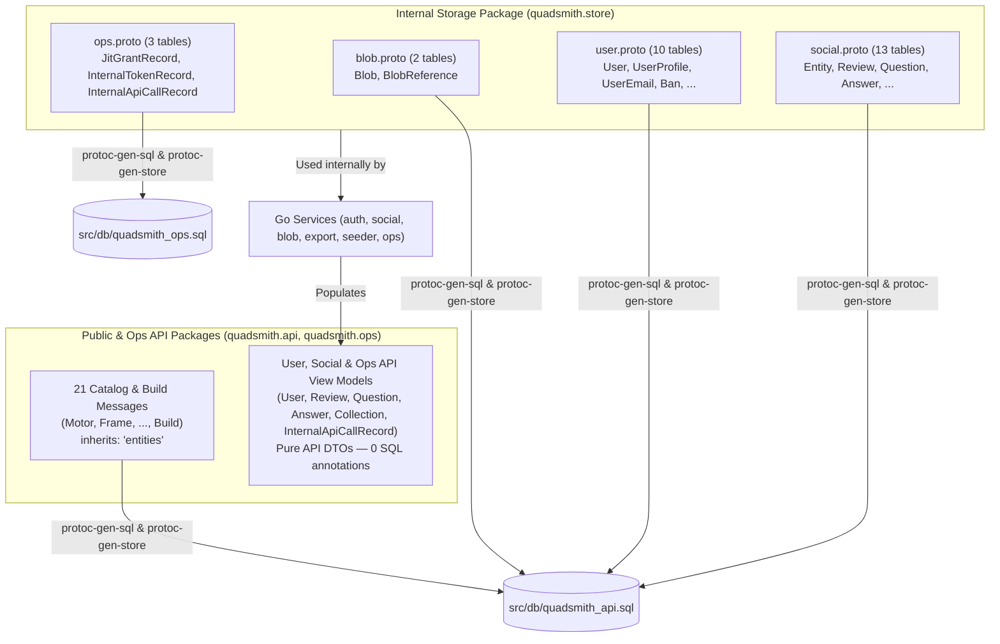

# <a id="storage-and-api-protobuf-schema-separation" >Storage and API Protobuf Schema Separation</a>

## <a id="table-of-contents" >Table of Contents</a>

- [1. Background](#1-background)
- [2. Goal](#2-goal)
- [3. Proposal](#3-proposal)
  - [Class-Table Inheritance for Catalog and Build Entities (`inherits: "entities"`)](#class-table-inheritance-for-catalog-and-build-entities-inherits-entities)
  - [Dedicated Internal Storage Proto Package (`quadsmith.store`) for Auth, User, Social, Blob, and Ops Tables](#dedicated-internal-storage-proto-package-quadsmithstore-for-auth-user-social-blob-and-ops-tables)
  - [Normalized Social Storage Schema and Removal of Dead SQL Columns](#normalized-social-storage-schema-and-removal-of-dead-sql-columns)
  - [Elimination of `ignore: true` and Strict 1:1 Table-to-Column Invariant](#elimination-of-ignore-true-and-strict-1-1-table-to-column-invariant)
  - [Generator, GDPR Schema Check, and Export Pipeline Alignment](#generator-gdpr-schema-check-and-export-pipeline-alignment)
- [4. Alternatives considered](#4-alternatives-considered)
- [5. Assumptions](#5-assumptions)
- [6. Future work](#6-future-work)

---

## <a id="1-background" >1. Background</a>

Currently, Quadsmith defines both its public-facing
[ConnectRPC](https://connectrpc.com/docs/introduction) API contracts and its
[PostgreSQL](https://www.postgresql.org/docs/current/ddl.html) database schemas
within the [`quadsmith.api`](../../src/proto/quadsmith/api) and
[`quadsmith.ops`](../../src/proto/quadsmith/ops/ops.proto)
[Protocol Buffers](https://protobuf.dev/programming-guides/proto3/) packages.
Custom options in [`sql.proto`](../../src/proto/quadsmith/sql/sql.proto)
(`quadsmith.sql.table` and `quadsmith.sql.column`) drive three custom compiler
plugins:

- [`protoc-gen-sql`](../../src/go/shared/cmd/protoc-gen-sql/main.go): Emits
  declarative SQL DDL into [`quadsmith_api.sql`](../../src/db/quadsmith_api.sql)
  and [`quadsmith_ops.sql`](../../src/db/quadsmith_ops.sql) for
  [`psqldef`](https://github.com/sqldef/sqldef).
- [`protoc-gen-store`](../../src/go/shared/cmd/protoc-gen-store/main.go): Emits
  typed Go data-access functions (`Create*`, `Get*`, `Update*`, `Delete*`,
  `List*`, and `Export*`) in `*_store.pb.go`.
- [`protoc-gen-server`](../../src/go/shared/cmd/protoc-gen-server/main.go):
  Emits ConnectRPC service handlers (`*_server.pb.go`) that wire
  [`cel2sql.Compile`](../../src/go/shared/internal/cel2sql/cel2sql.go) and
  pagination into the generated store functions.

While this unified model works well when a resource's storage representation and
public API representation are identical, coupling every database table to API
messages has created three architectural problems across the 46 tables in
`quadsmith_api.sql` and 3 tables in `quadsmith_ops.sql` (resulting in **208**
occurrences of `(quadsmith.sql.column) = {ignore: true}` across the repository):

1. **168 Repetitive `ignore: true` Annotations on Catalog and Build Protos**:
   All 20 hardware and software component protos (such as
   [`motor.proto`](../../src/proto/quadsmith/api/motor.proto) and
   [`frame.proto`](../../src/proto/quadsmith/api/frame.proto)) plus
   [`build.proto`](../../src/proto/quadsmith/api/build.proto) use
   [Class Table Inheritance](https://martinfowler.com/eaaCatalog/classTableInheritance.html)
   ([`user_created_components.md`](user_created_components.md)), storing common
   metadata (`id`, `name`, `description`, `reference_links`,
   `primary_display_image`, `media`, `user_uuid`) in the base `entities` table
   and resolving `author_username` via a `LEFT JOIN` on `users`. Although
   [`protoc-gen-store`](../../src/go/shared/cmd/protoc-gen-store/main.go)
   already knows about this `entities` join,
   [`protoc-gen-sql`](../../src/go/shared/cmd/protoc-gen-sql/main.go) does not,
   forcing all 21 messages to repeat `(quadsmith.sql.column) = {ignore: true}`
   on those 8 fields ($21 \times 8 = 168$ occurrences).
2. **40 `ignore: true` Annotations and Leaked Internal Storage Tables in Auth,
   User, Social, Blob, and Ops Protos**:
   [`user.proto`](../../src/proto/quadsmith/api/user.proto),
   [`social.proto`](../../src/proto/quadsmith/api/social.proto), `blob.proto`,
   and [`ops.proto`](../../src/proto/quadsmith/ops/ops.proto) do not use
   generated ConnectRPC handlers from `protoc-gen-server`; their services are
   hand-written in [`auth`](../../src/go/shared/pkg/auth),
   [`social`](../../src/go/shared/pkg/social/service.go),
   [`blob`](../../src/go/shared/pkg/blob), and
   [`ops`](../../src/go/server-ops/pkg/ops/service.go). However, because their
   SQL table definitions lived in `quadsmith.api` and `quadsmith.ops`:
   - 13 purely internal storage tables (`RefreshToken`, `EmailOtp`,
     `UsernameHistory`, `OAuthAccount`, `UserEmailOAuthAccount`, `BannedEmail`,
     `Entity`, `ReviewVote`, `QuestionVote`, `AnswerVote`, `UserReputation`,
     `Blob`, and `BlobReference`) were exported into the public `quadsmith.api`
     package and generated into frontend TypeScript files
     (`src/react/shared/src/gen/quadsmith/api/`).
   - Shared messages like `Review`, `Question`, `Answer`, `Collection`,
     `CollectionItem`, `User`, `UserEmail`, and `InternalApiCallRecord` mixed
     physical database columns (`deleted_at`, `accepted_at`, `endorsed_at`,
     `jit_grant_uuid`) with 40 computed or joined API view fields
     (`upvote_count`, `current_user_vote`, `author_avatar_url`, `active_ban`,
     `entity_id`, `collection`, `comments`, `jit_grant_id`) marked
     `ignore: true`.
3. **Fragile Opt-Out Schema Generation (`ignore: true`)**: As documented in
   [`uuid_foreign_key_normalization.md`](uuid_foreign_key_normalization.md),
   relying on developers to remember `(quadsmith.sql.column) = {ignore: true}`
   whenever adding a display field to a table-annotated message previously
   caused 11 denormalized social fields to leak into `quadsmith_api.sql` as
   physical columns. Even after those 11 fields were marked `ignore: true`,
   `reviews.is_author_verified_owner` in
   [`social.proto`](../../src/proto/quadsmith/api/social.proto) remained a dead
   physical `BOOLEAN NOT NULL` column in
   [`quadsmith_api.sql`](../../src/db/quadsmith_api.sql) (hardcoded to `false`
   on `INSERT` and never read back in SQL).

We evaluated whether to split the architecture into a separate Data Plane
microservice (`server-data`) and Control Plane microservice (`server-api`) with
two completely separate sets of protos, or to replace `protoc-gen-sql` with
hand-written SQL files. As detailed in
[4. Alternatives considered](#4-alternatives-considered), a full networked Data
Plane split introduces unnecessary RPC serialization overhead, cross-table
transaction complexity, non-invertible CEL filter translation, and redundant DTO
mapping across all 21 Catalog and Build types where storage and API schemas are
already isomorphic. Instead, a targeted separation within the existing codebase
captures all the schema-hygiene benefits at a fraction of the complexity.

---

## <a id="2-goal" >2. Goal</a>

Achieve a clean separation between physical database table schemas and API
contracts where they diverge, while preserving zero-copy Protobuf reuse where
they are identical:

- Keep the 21 Catalog and Build messages in `quadsmith.api` with first-class
  `inherits: "entities"` support in `sql.proto`.
- Extract all 28 non-entity SQL table definitions (25 Auth, User, Social, Blob,
  and Entity tables in `quadsmith_api.sql` plus 3 Ops tables in
  `quadsmith_ops.sql`) into a dedicated internal storage package
  (`quadsmith.store`).
- Remove the remaining dead `reviews.is_author_verified_owner` column from
  [`quadsmith_api.sql`](../../src/db/quadsmith_api.sql).
- Delete `bool ignore = 8;` from
  [`sql.proto`](../../src/proto/quadsmith/sql/sql.proto) so every field on a
  `(quadsmith.sql.table)` message is a real database column.

---

## <a id="3-proposal" >3. Proposal</a>

> **TL;DR:** Separate divergent storage schemas from API packages and eliminate
> `ignore: true`:
>
> - Add `inherits: "entities"` to `sql.proto` so all 21 Catalog/Build messages
>   stay in `quadsmith.api` with zero `ignore: true` fields.
> - Move all 28 Auth, User, Social, Blob, Entity, and Ops SQL table messages
>   into `src/proto/quadsmith/store/` (`package quadsmith.store`).
> - Keep pure, annotation-free API view models and RPCs in `api/user.proto`,
>   `api/social.proto`, and `ops/ops.proto`; delete `api/blob.proto`.
> - Remove the dead `reviews.is_author_verified_owner` SQL column and delete
>   `bool ignore = 8` from `sql.proto`.

The proposed architecture recognizes that Quadsmith's 49 database tables fall
into two distinct categories:



First, for the **21 Catalog and Build types** (`Antenna`, `Battery`, `Camera`,
`Charger`, `ElectronicSpeedController`, `EscFirmware`, `FcFirmware`,
`FieldTool`, `FlightController`, `Frame`, `Goggles`, `GpsReceiver`, `Motor`,
`Propeller`, `RadioFirmware`, `Receiver`, `SoftwareTool`, `Transmitter`,
`VideoTransmitter`, `VtxFirmware`, and `Build`), the public API object _is_ the
logical entity (`child_table INNER JOIN entities USING (uuid)`). Adding
`inherits: "entities"` to `TableOptions` in
[`sql.proto`](../../src/proto/quadsmith/sql/sql.proto) allows these 21 messages
to remain directly in `quadsmith.api`—preserving zero-copy reuse across
ConnectRPC, CLI, React, WASM engines, and `cel2sql`—while eliminating all 168
`ignore: true` annotations.

Second, for the **28 Auth, User, Social, Blob, Entity, and Ops tables**, the
physical storage tables and API view models have fundamentally different shapes
and lifecycles. Moving these 28 table definitions into
`src/proto/quadsmith/store/` (`package quadsmith.store`) keeps internal tables
(`RefreshToken`, `EmailOtp`, `BannedEmail`, `Blob`, `BlobReference`, `Entity`,
vote tables, etc.) completely out of `quadsmith.api`, leaves pure API view
models in `quadsmith.api` and `quadsmith.ops`, removes the remaining dead
`reviews.is_author_verified_owner` column from
[`quadsmith_api.sql`](../../src/db/quadsmith_api.sql), and allows
`bool ignore = 8;` to be deleted from
[`sql.proto`](../../src/proto/quadsmith/sql/sql.proto) entirely.

### <a id="class-table-inheritance-for-catalog-and-build-entities-inherits-entities" >Class-Table Inheritance for Catalog and Build Entities (`inherits: "entities"`)</a>

In
[`src/proto/quadsmith/sql/sql.proto`](../../src/proto/quadsmith/sql/sql.proto),
we add `string inherits = 5;` to `TableOptions`:

```protobuf
message TableOptions {
  string name = 1;
  repeated string checks = 2;
  repeated string unique_constraints = 3;
  repeated UniqueIndex unique_indexes = 4;
  // Base table that this table inherits shared columns from via a 1:1 PK/FK
  // relationship (e.g., "entities").
  string inherits = 5;
}
```

Each of the 20 component protos and
[`build.proto`](../../src/proto/quadsmith/api/build.proto) declares
`inherits: "entities"` on its `quadsmith.sql.table` option, and removes
`(quadsmith.sql.column) = {ignore: true}` from the 8 inherited fields (`id`,
`name`, `description`, `reference_links`, `primary_display_image`, `media`,
`user_uuid`, and `author_username`):

```protobuf
message Motor {
  option (quadsmith.sql.table) = {
    name: "motors"
    inherits: "entities"
  };
  option (quadsmith.common.collection_path) = "components/hardware/motors";
  option (quadsmith.data.export) = {
    domain: EXPORT_DOMAIN_COMPONENTS
    user_filter: "uuid IN (SELECT uuid FROM entities WHERE collection = 'motors' AND user_uuid = $1::uuid)"
  };

  string uuid = 1 [
    (quadsmith.sql.column) = {
      is_primary_key: true
      references: "entities(uuid) ON DELETE CASCADE"
    },
    (quadsmith.data.content_type) = CONTENT_TYPE_SYSTEM_METADATA_PUBLIC
  ];
  string id = 2 [(quadsmith.data.content_type) = CONTENT_TYPE_SYSTEM_METADATA_PUBLIC];
  string manufacturer = 3 [
    (quadsmith.sql.column) = {create_index: true},
    (quadsmith.data.content_type) = CONTENT_TYPE_USER_PROVIDED_PUBLIC
  ];
  string name = 4 [(quadsmith.data.content_type) = CONTENT_TYPE_USER_PROVIDED_PUBLIC];
  // ... remaining inherited and motor-specific fields with zero ignore: true ...
}
```

Both [`protoc-gen-sql`](../../src/go/shared/cmd/protoc-gen-sql/main.go) and
[`protoc-gen-store`](../../src/go/shared/cmd/protoc-gen-store/main.go) use a
shared definition of the `entities`-inherited field set (`id`, `name`,
`description`, `reference_links`, `primary_display_image`, `media`, `user_uuid`,
`author_username`) when `tblOpts.GetInherits() == "entities"`:

- **`protoc-gen-sql`**: Skips the 8 inherited fields when generating
  `CREATE TABLE` columns and indexes for the child table (e.g., `motors`),
  emitting only the primary key `uuid` (referencing `entities(uuid)`) and the
  child-specific columns. The generated DDL in
  [`quadsmith_api.sql`](../../src/db/quadsmith_api.sql) for all 21 tables
  remains byte-for-byte identical.
- **`protoc-gen-store`**: Excludes the 8 inherited fields from `activeFields`
  (`INSERT INTO <child>`, `UPDATE <child>`, and `Export<PluralName>`) while
  keeping all fields in `readableFields`
  (`SELECT ... FROM <child> INNER JOIN entities USING (uuid) LEFT JOIN (SELECT uuid AS u_uuid, id AS author_username FROM users) u ON u.u_uuid = entities.user_uuid`).
  Because `activeFields` for `inherits: "entities"` tables contains the exact
  same child-table columns as before, the `hasNonUUIDField` check in
  [`protoc-gen-store/main.go`](../../src/go/shared/cmd/protoc-gen-store/main.go)
  and the generated `ExportBuilds` and `Export<Component>s` functions remain
  100% unchanged.

<details>
<summary><strong>Alternatives considered</strong></summary>

##### <a id="moving-all-21-catalog-and-build-table-definitions-into-quadsmithstore" >Moving All 21 Catalog and Build Table Definitions into `quadsmith.store`</a>

Defining 21 child-only storage protos in `quadsmith.store` (containing only
`uuid` and component-specific columns) alongside the 21 full API protos in
`quadsmith.api`, and writing or generating conversion functions between
`*storepb.Motor` + `*storepb.Entity` and `*apipb.Motor`.

**Pros:**

- Every message in `quadsmith.store` maps strictly to a single physical table
  without class-table inheritance metadata.

**Cons:**

- Duplicates ~500 specification fields across 21 `.proto` files (`motor.proto`,
  `frame.proto`, `build.proto`, etc.) even though their storage and API types
  are 100% identical.
- Requires 21 struct-mapping functions on every `Get*`, `List*`, `Create*`, and
  `Update*` call, breaking direct reuse of `protoc-gen-store` outputs in
  `protoc-gen-server`.

##### <a id="shared-spec-sub-messages-embedded-in-storage-and-api-protos" >Shared Spec Sub-Messages Embedded in Storage and API Protos</a>

Extracting component specifications into shared sub-messages (such as
`MotorSpec`) and embedding `MotorSpec spec = 2;` inside both a storage
`MotorRow` message and an API `Motor` message.

**Pros:**

- Avoids repeating the component-specific scalar fields between storage and API
  messages while keeping the messages distinct.

**Cons:**

- Nesting fields under `.spec.*` changes the wire JSON/textproto structure and
  breaks flat CEL filter expressions (`kv >= 1800` would become
  `spec.kv >= 1800`).
- Forces [`protoc-gen-sql`](../../src/go/shared/cmd/protoc-gen-sql/main.go) and
  [`protoc-gen-store`](../../src/go/shared/cmd/protoc-gen-store/main.go) to
  flatten nested sub-messages into top-level SQL columns instead of treating
  message fields as `JSONB`.

##### <a id="sub-package-quadsmithapientity-for-entity-inheriting-protos" >Sub-Package `quadsmith.api.entity` for Entity-Inheriting Protos</a>

Moving the 20 component protos and `build.proto` into a dedicated sub-package
`package quadsmith.api.entity` (`src/proto/quadsmith/api/entity/`) while keeping
non-entity services (`UserService`, `AuthService`, `SocialService`,
`EvaluatorService`, `CompatibilityService`, `SearchService`) in
`package quadsmith.api`.

**Pros:**

- Allows [`protoc-gen-sql`](../../src/go/shared/cmd/protoc-gen-sql/main.go),
  [`protoc-gen-store`](../../src/go/shared/cmd/protoc-gen-store/main.go), and
  [`protoc-gen-server`](../../src/go/shared/cmd/protoc-gen-server/main.go) to
  infer `entities` inheritance and CRUD handler generation from the package name
  (`quadsmith.api.entity`) rather than a per-table `inherits: "entities"`
  option.
- Visually separates the 21 auto-generated catalog/build protos from the 7
  hand-written service protos in the directory tree.

**Cons:**

- Because [`buf.gen.yaml`](../../src/proto/buf.gen.yaml) uses
  `paths=source_relative`, moving `src/proto/quadsmith/api/entity/*.proto` into
  a subdirectory splits the generated Go and TypeScript API types across two
  packages (`quadsmith/shared/gen/quadsmith/api` and
  `quadsmith/shared/gen/quadsmith/api/entity`), forcing cross-package imports in
  [`evaluator.proto`](../../src/proto/quadsmith/api/evaluator.proto),
  [`compatibility.proto`](../../src/proto/quadsmith/api/compatibility.proto),
  [`components.proto`](../../src/proto/quadsmith/api/components.proto), the WASM
  engines, the CLI, and the React frontend.
- Still requires a separate `quadsmith.store` package for the 28 Auth, User,
  Social, Blob, Entity, and Ops tables whose physical columns diverge from the
  API view models.

</details>

### <a id="dedicated-internal-storage-proto-package-quadsmithstore-for-auth-user-social-blob-and-ops-tables" >Dedicated Internal Storage Proto Package (`quadsmith.store`) for Auth, User, Social, Blob, and Ops Tables</a>

We introduce `src/proto/quadsmith/store/` (`package quadsmith.store`,
`option go_package = "quadsmith/shared/gen/quadsmith/store;store";`) to house
all 28 non-catalog SQL table definitions across four files:

| Storage Proto File                                                                       | SQL Tables Defined (`(quadsmith.sql.table)`)                                                                                                                                                                                                                                                                                                                                                                                | Corresponding Public / Ops API Changes                                                                                                                                                                                                                                                                                                                              |
| :--------------------------------------------------------------------------------------- | :-------------------------------------------------------------------------------------------------------------------------------------------------------------------------------------------------------------------------------------------------------------------------------------------------------------------------------------------------------------------------------------------------------------------------- | :------------------------------------------------------------------------------------------------------------------------------------------------------------------------------------------------------------------------------------------------------------------------------------------------------------------------------------------------------------------ |
| [`src/proto/quadsmith/store/blob.proto`](../../src/proto/quadsmith/store/blob.proto)     | `Blob` (`blobs`), `BlobReference` (`blob_references`, including `entity_uuid`, `user_uuid`, and `CHECK (num_nonnulls(entity_uuid, user_uuid) = 1)`)                                                                                                                                                                                                                                                                         | Delete `src/proto/quadsmith/api/blob.proto` completely (contains 0 RPCs).                                                                                                                                                                                                                                                                                           |
| [`src/proto/quadsmith/store/user.proto`](../../src/proto/quadsmith/store/user.proto)     | `Ban` (`bans`), `BannedEmail` (`banned_emails`), `EmailOtp` (`email_otps`), `OAuthAccount` (`oauth_accounts`), `RefreshToken` (`refresh_tokens`), `User` (`users`), `UserEmail` (`user_emails`), `UserEmailOAuthAccount` (`user_email_oauth_accounts`), `UserProfile` (`user_profiles`), `UsernameHistory` (`username_histories`)                                                                                           | [`src/proto/quadsmith/api/user.proto`](../../src/proto/quadsmith/api/user.proto) retains only `UserService` and pure API view models (`PublicUserProfile`, `User`, `UserEmail`, `UserProfile`, `Ban`) with zero `quadsmith.sql` or `quadsmith.data` annotations.                                                                                                    |
| [`src/proto/quadsmith/store/social.proto`](../../src/proto/quadsmith/store/social.proto) | `Answer` (`answers`), `AnswerComment` (`answer_comments`), `AnswerVote` (`answer_votes`), `Collection` (`collections`), `CollectionItem` (`collection_items`), `Entity` (`entities`), `Question` (`questions`), `QuestionComment` (`question_comments`), `QuestionVote` (`question_votes`), `Review` (`reviews`), `ReviewComment` (`review_comments`), `ReviewVote` (`review_votes`), `UserReputation` (`user_reputations`) | [`src/proto/quadsmith/api/social.proto`](../../src/proto/quadsmith/api/social.proto) retains only `SocialService` and pure API view models (`Answer`, `AnswerComment`, `Collection`, `CollectionItem`, `EntitySocialSummary`, `Question`, `QuestionComment`, `Review`, `ReviewComment`, `ReviewSummary`) with zero `quadsmith.sql` or `quadsmith.data` annotations. |
| [`src/proto/quadsmith/store/ops.proto`](../../src/proto/quadsmith/store/ops.proto)       | `InternalApiCallRecord` (`internal_api_calls`, storing `jit_grant_uuid` without `jit_grant_id`), `InternalTokenRecord` (`internal_tokens`), `JitGrantRecord` (`jit_grants`)                                                                                                                                                                                                                                                 | [`src/proto/quadsmith/ops/ops.proto`](../../src/proto/quadsmith/ops/ops.proto) retains `OpsService` and pure API messages (`InternalApiCallRecord` with `optional string jit_grant_id = 8`, `InternalTokenRecord`, `JitGrantRecord`) with zero `quadsmith.sql` or `quadsmith.data` annotations.                                                                     |

Because [`store/social.proto`](../../src/proto/quadsmith/store/social.proto)
references `ReferenceLink` and `Media` (for the `entities.reference_links` and
`entities.media` `JSONB` columns), `quadsmith.store` imports
[`src/proto/quadsmith/api/reference_link.proto`](../../src/proto/quadsmith/api/reference_link.proto)
and
[`src/proto/quadsmith/api/media.proto`](../../src/proto/quadsmith/api/media.proto)
without introducing any circular dependency (`quadsmith.api` and `quadsmith.ops`
never import `quadsmith.store`).

In Go, internal packages import `storepb "quadsmith/shared/gen/quadsmith/store"`
alongside `pb "quadsmith/shared/gen/quadsmith/api"` following the `*pb` aliasing
rules in [`AGENTS.md`](../../AGENTS.md).

<details>
<summary><strong>Alternatives considered</strong></summary>

##### <a id="keeping-storage-messages-in-quadsmithapi-with-separate-view-model-messages" >Keeping Storage Messages in `quadsmith.api` with Separate View Model Messages</a>

Keeping all SQL-annotated messages in `src/proto/quadsmith/api/` (for example,
renaming the table messages to `UserRow`, `ReviewRow`, `EntityRow`) while
defining separate `UserView`, `ReviewView` messages in the same `quadsmith.api`
package.

**Pros:**

- Avoids creating a new `src/proto/quadsmith/store/` directory and Go package.

**Cons:**

- Continues to expose internal database tables (`RefreshToken`, `EmailOtp`,
  `BannedEmail`, `Blob`, `*Row` messages) in the public `quadsmith.api`
  namespace and generated TypeScript client code.
- Forces awkward `*Row` or `*View` suffixes onto public API message names in
  `quadsmith.api`.

</details>

### <a id="normalized-social-storage-schema-and-removal-of-dead-sql-columns" >Normalized Social Storage Schema and Removal of Dead SQL Columns</a>

In commit `c31f0d8`
([`uuid_foreign_key_normalization.md`](uuid_foreign_key_normalization.md)), 11
denormalized display fields across `Review`, `Question`, `Answer`, and
`CollectionItem` (`collection`, `entity_id`, `comments`, `name`,
`primary_display_image`, and `author_or_manufacturer`) were marked
`[(quadsmith.sql.column) = {ignore: true}]` and removed from
[`quadsmith_api.sql`](../../src/db/quadsmith_api.sql), with
[`social/service.go`](../../src/go/shared/pkg/social/service.go) joining
`entities` to project them dynamically.

When separating
[`src/proto/quadsmith/store/social.proto`](../../src/proto/quadsmith/store/social.proto)
from
[`src/proto/quadsmith/api/social.proto`](../../src/proto/quadsmith/api/social.proto),
we replace all 36 `ignore: true` annotations in `social.proto` with clean
single-purpose definitions:

- **[`src/proto/quadsmith/store/social.proto`](../../src/proto/quadsmith/store/social.proto)**:
  Contains **only** genuine persisted database columns for the 13 social and
  entity tables. In addition to excluding the 36 fields previously marked
  `ignore: true`, we also remove the remaining dead `is_author_verified_owner`
  column from `store.Review` and
  [`src/db/quadsmith_api.sql`](../../src/db/quadsmith_api.sql) (and
  [`src/db/quadsmith_api.mermaid`](../../src/db/quadsmith_api.mermaid)),
  updating `CreateReview` in
  [`social/service.go`](../../src/go/shared/pkg/social/service.go) to omit
  `is_author_verified_owner` from the `INSERT INTO reviews` statement.
- **[`src/proto/quadsmith/api/social.proto`](../../src/proto/quadsmith/api/social.proto)**:
  Retains all enriched API response fields (`author_username`,
  `author_avatar_url`, `is_author_verified_owner`, `helpful_count`,
  `upvote_count`, `current_user_vote`, `collection`, `entity_id`, `comments`,
  etc.) with zero `quadsmith.sql` or `quadsmith.data` annotations.

<details>
<summary><strong>Alternatives considered</strong></summary>

##### <a id="retaining-is-author-verified-owner-column-on-reviews-table" >Retaining `is_author_verified_owner` on the `reviews` SQL Table</a>

Keeping `bool is_author_verified_owner` on `store.Review` and in
`src/db/quadsmith_api.sql`.

**Pros:**

- Avoids touching the `INSERT INTO reviews` SQL statement in `social/service.go`
  or `src/db/quadsmith_api.sql`.

**Cons:**

- Preserves a dead `BOOLEAN NOT NULL` column in PostgreSQL that is hardcoded to
  `false` on insert and never read by `GetReview`, `UpdateReview`, or
  `ListReviews`.

</details>

### <a id="elimination-of-ignore-true-and-strict-1-1-table-to-column-invariant" >Elimination of `ignore: true` and Strict 1:1 Table-to-Column Invariant</a>

With all 168 catalog/build occurrences replaced by `inherits: "entities"` and
all 40 user/social/ops occurrences (3 in `user.proto`, 36 in `social.proto`, and
1 in `ops.proto`) eliminated by moving those table definitions into
`quadsmith.store`, zero occurrences of `ignore: true` remain anywhere in the
repository.

We therefore delete `bool ignore = 8;` from `ColumnOptions` in
[`src/proto/quadsmith/sql/sql.proto`](../../src/proto/quadsmith/sql/sql.proto):

```protobuf
message ColumnOptions {
  string name = 1;
  bool is_primary_key = 2;
  bool is_unique = 3;
  string references = 4;
  bool create_index = 5;
  string column_type = 6;
  string default_value = 7;
}
```

We also remove all `colOpt.Ignore` branches from
[`src/go/shared/cmd/protoc-gen-sql/main.go`](../../src/go/shared/cmd/protoc-gen-sql/main.go)
and
[`src/go/shared/cmd/protoc-gen-store/main.go`](../../src/go/shared/cmd/protoc-gen-store/main.go).
Going forward, the compiler enforces a strict invariant: **every field on a
message annotated with `(quadsmith.sql.table)` is a real persisted database
column** (either directly on that table or on its declared `inherits` parent
table). If an API message needs computed or joined view-only fields, its
physical table schema must live in `quadsmith.store` while the view model lives
in `quadsmith.api` or `quadsmith.ops`.

<details>
<summary><strong>Alternatives considered</strong></summary>

##### <a id="retaining-ignore-true-for-future-computed-fields-on-table-protos" >Retaining `ignore: true` for Future Computed Fields on Table Protos</a>

Leaving `bool ignore = 8;` in `ColumnOptions` in `sql.proto` even after removing
all 208 current occurrences.

**Pros:**

- Allows developers to tack a quick UI-only field onto a table-annotated proto
  without splitting out a storage message.

**Cons:**

- Re-invites the exact schema-erosion anti-pattern that produced 208 ignored
  fields and accidental database columns when developers forgot to add
  `ignore: true`.

</details>

### <a id="generator-gdpr-schema-check-and-export-pipeline-alignment" >Generator, GDPR Schema Check, and Export Pipeline Alignment</a>

Moving the 28 Auth, User, Social, Blob, Entity, and Ops table messages into
`quadsmith.store` updates the following internal Go packages and build files
cleanly:

1. **Database Output Routing in
   [`protoc-gen-sql`](../../src/go/shared/cmd/protoc-gen-sql/main.go) and
   [`buf.gen.yaml`](../../src/proto/buf.gen.yaml)**: We configure
   `strategy: all` for `plugin: sql` in
   [`src/proto/buf.gen.yaml`](../../src/proto/buf.gen.yaml) and update
   [`protoc-gen-sql`](../../src/go/shared/cmd/protoc-gen-sql/main.go) so that
   `quadsmith/store/ops.proto` (or `quadsmith.ops`) emits into
   `quadsmith_ops.sql`, while `quadsmith/store/{blob,user,social}.proto` and
   `quadsmith.api` emit into `quadsmith_api.sql` in a single pass (with
   `quadsmith.store` tables emitted first so base tables like `users` and
   `entities` precede child tables).
2. **Compile-Time GDPR Verification in
   [`schemacheck/data_check.go`](../../src/go/shared/pkg/schemacheck/data_check.go)**:
   - [`CheckAllProtoDataClassification`](../../src/go/shared/pkg/schemacheck/data_check.go)
     iterates over all registered files whose package starts with `"quadsmith"`
     and inspects every message with `(quadsmith.sql.table)`.
   - We import `_ "quadsmith/shared/gen/quadsmith/store"` in
     [`schemacheck/data_check_test.go`](../../src/go/shared/pkg/schemacheck/data_check_test.go)
     so `protoregistry.GlobalFiles` includes all `quadsmith.store` descriptors,
     include `store/ops.proto` in the `isOps` check, and update the `User.id`
     provenance check from `"quadsmith.api.User"` to `"quadsmith.store.User"`.
   - Because pure API view models in `api/user.proto`, `api/social.proto`, and
     `ops/ops.proto` no longer carry `(quadsmith.sql.table)`, they no longer
     require `(quadsmith.data.content_type)` annotations on UI-only fields.
3. **GDPR Archive Streaming in
   [`export/handler.go`](../../src/go/shared/pkg/export/handler.go)**:
   `protoc-gen-store` generates `ExportUsers`, `ExportUserProfiles`,
   `ExportUserEmails`, `ExportUserEmailOAuthAccounts`,
   `ExportUsernameHistories`, `ExportOAuthAccounts`, `ExportRefreshTokens`,
   `ExportBans`, `ExportBannedEmails`, `ExportEntities`, `ExportReviews`,
   `ExportReviewVotes`, `ExportReviewComments`, `ExportQuestions`,
   `ExportQuestionVotes`, `ExportQuestionComments`, `ExportAnswers`,
   `ExportAnswerVotes`, `ExportAnswerComments`, `ExportCollections`,
   `ExportCollectionItems`, `ExportBlobs`, and `ExportBlobReferences` in package
   `store` (`quadsmith/shared/gen/quadsmith/store`), while `ExportBuilds` and
   the 20 `Export<Component>s` functions remain in package `api`
   (`quadsmith/shared/gen/quadsmith/api`).
   [`export/handler.go`](../../src/go/shared/pkg/export/handler.go) imports
   `storepb "quadsmith/shared/gen/quadsmith/store"` to call the
   user/social/blob/entity export functions and
   `pb "quadsmith/shared/gen/quadsmith/api"` for builds and components.
4. **Seeder & Internal Services
   ([`seeder/main.go`](../../src/go/shared/cmd/seeder/main.go))**:
   - [`seeder/main.go`](../../src/go/shared/cmd/seeder/main.go) imports
     `storepb "quadsmith/shared/gen/quadsmith/store"` for `storepb.CreateUser`,
     `storepb.CreateUserProfile`, `storepb.CreateUserEmail`, and
     `storepb.CreateUserReputation`, while continuing to use `pb`
     (`quadsmith/shared/gen/quadsmith/api`) for all 20 component types and
     `Build`.

<details>
<summary><strong>Alternatives considered</strong></summary>

##### <a id="explicit-database-file-option-in-sqlproto-instead-of-package-level-mapping" >Explicit `database` File Option in `sql.proto` Instead of Package-Level Mapping</a>

Adding a `FileOptions` extension
`option (quadsmith.sql.database) = "quadsmith_api";` to every `.proto` file that
defines SQL tables.

**Pros:**

- Allows arbitrary `.proto` files in any package to target any `.sql` output
  file.

**Cons:**

- Requires repeating boilerplate file options across 25 `.proto` files when
  Quadsmith only has two databases (`quadsmith_api` for application tables in
  `quadsmith.store` + `quadsmith.api`, and `quadsmith_ops` for operations tables
  in `quadsmith/store/ops.proto`).

</details>

---

## <a id="4-alternatives-considered" >4. Alternatives considered</a>

<details>
<summary><strong>Alternatives considered</strong></summary>

### <a id="networked-data-plane-microservice-server-data-and-control-plane-api-split" >Networked Data Plane Microservice (`server-data`) and Control Plane API Split</a>

Splitting the backend into two separate network services and two completely
disjoint Protobuf trees: a Data Plane (`quadsmith.data` / `server-data`) that
owns PostgreSQL and exposes table-level or query-level gRPC/ConnectRPC methods,
and a Control Plane (`quadsmith.api` / `server-api`) that handles
authentication, validation, and business logic by making RPC calls over the
network to `server-data`.

**Pros:**

- Enforces physical network isolation so `server-api` cannot execute raw SQL or
  access database credentials directly.
- Allows `server-data` and `server-api` to be scaled or deployed independently
  in multi-service environments.

**Cons:**

- **Transaction Boundary Breakdown**: Multi-table mutations (such as creating a
  build across `entities`, `builds`, and `blob_references`, or casting a vote
  across `question_votes`, `questions`, and `user_reputations`) can no longer
  use a single-process `pgx.Tx` transaction without either moving domain logic
  into coarse-grained Data Plane RPCs or building distributed transactions.
- **Double Serialization & Latency**: Every query (such as `ListSimilarBuilds`
  fetching 200 candidate builds and their components) incurs extra Protobuf
  serialization and loopback network hops between `server-api` and
  `server-data`.
- **Massive DTO Duplication**: Requires duplicating all 21 Catalog and Build
  messages across two proto packages and maintaining 21 field-by-field Go struct
  mappers even though their storage and API schemas are identical.

### <a id="atomic-single-table-crud-only-in-a-separate-data-plane" >Atomic Single-Table CRUD Only in a Separate Data Plane</a>

Restricting the Data Plane to strictly generated, single-table `Create`, `Get`,
`Update`, `Delete`, and `List` RPCs per physical SQL table (1:1 with tables),
and performing all cross-table joins, aggregations, and multi-row workflows in
the Control Plane (`server-api`).

**Pros:**

- Keeps the Data Plane 100% auto-generated with zero custom SQL joins or
  hand-written RPCs.

**Cons:**

- **Severe $N+1$ Query Amplification**: Because catalog components and builds
  split their columns across `entities` and child tables (`motors`, `frames`,
  `builds`), a filtered `ListMotors` or `ListQuestions` query cannot filter,
  sort, and paginate across both tables in a single SQL `JOIN` if only
  single-table CRUD exists.
- **Loss of Atomic Mutations**: Multi-table writes cannot roll back atomically
  on partial failure across stateless single-table RPCs.

### <a id="two-stage-cel-compiler-pipeline-cp-cel-to-dp-cel-to-sql" >Two-Stage CEL Compiler Pipeline (`CP-CEL -> DP-CEL -> SQL`)</a>

Allowing Control Plane and Data Plane schemas to diverge arbitrarily while
building a two-stage [Common Expression Language (CEL)](https://cel.dev/)
compiler: translating client CEL filters over Control Plane protos (`CP-CEL`)
into CEL filters over Data Plane protos (`DP-CEL`), and then compiling `DP-CEL`
into SQL `WHERE` clauses via
[`cel2sql`](../../src/go/shared/internal/cel2sql/cel2sql.go).

**Pros:**

- Theoretically decouples client filter expressions from physical SQL column
  names.

**Cons:**

- **Non-Invertibility of Arbitrary Business Logic**: If a Control Plane field
  $C$ is computed from Data Plane fields $D$ in Go code ($C = f(D)$), a filter
  predicate $P(C)$ cannot be automatically inverted into a Data Plane predicate
  $P'(D)$ from `.proto` definitions alone unless the mapping is declared as a
  pushdown expression or materialized at write time.
- Unnecessary for the 21 Catalog and Build services where client CEL filters
  already map 1:1 to columns on `entities` and the child component table.

### <a id="hand-written-sql-schemas-without-protoc-gen-sql" >Hand-Written SQL Schemas Without `protoc-gen-sql`</a>

Deleting [`protoc-gen-sql`](../../src/go/shared/cmd/protoc-gen-sql/main.go) and
[`sql.proto`](../../src/proto/quadsmith/sql/sql.proto) entirely, maintaining
[`src/db/quadsmith_api.sql`](../../src/db/quadsmith_api.sql) and
[`src/db/quadsmith_ops.sql`](../../src/db/quadsmith_ops.sql) by hand for
`psqldef`, and defining protos purely around query/mutation payloads.

**Pros:**

- Eliminates custom Protobuf options (`quadsmith.sql.table` and
  `quadsmith.sql.column`) and allows raw PostgreSQL DDL features without
  extending `protoc-gen-sql`.

**Cons:**

- **Breaks Single-Source-of-Truth GDPR Enforcement**: Quadsmith's
  [GDPR Art. 15 and Art. 20](https://gdpr-info.eu/art-15-gdpr/) compliance
  architecture relies on
  [`schemacheck.CheckAllProtoDataClassification`](../../src/go/shared/pkg/schemacheck/data_check.go)
  and [`protoc-gen-store`](../../src/go/shared/cmd/protoc-gen-store/main.go)
  reading `(quadsmith.sql.table)` and `(quadsmith.data.content_type)` from the
  same Protobuf descriptors that generate `quadsmith_api.sql`. Hand-writing SQL
  would require building a custom SQL comment parser and a new SQL-based export
  code generator to prevent unclassified database columns from slipping in.
- Requires manually synchronizing column additions across `.sql` files, `.proto`
  files, and Go store queries.

</details>

---

## <a id="5-assumptions" >5. Assumptions</a>

1. This codebase is not yet deployed to production, so dropping the dead
   `reviews.is_author_verified_owner` column from
   [`src/db/quadsmith_api.sql`](../../src/db/quadsmith_api.sql) and removing
   internal storage messages from `quadsmith.api` requires no
   backwards-compatibility shims or data migrations.
2. All 21 Catalog and Build entities share the same 8 inherited fields (`id`,
   `name`, `description`, `reference_links`, `primary_display_image`, `media`,
   `user_uuid`, and `author_username`) resolved from `entities` and `users`.

---

## <a id="6-future-work" >6. Future work</a>

### <a id="proto-driven-entity-inheritance-validation-in-schemacheck" >Proto-Driven Entity Inheritance Validation in `schemacheck`</a>

Extend
[`src/go/shared/pkg/schemacheck`](../../src/go/shared/pkg/schemacheck/data_check.go)
to assert at test time that every message declaring
`option (quadsmith.sql.table) = {inherits: "entities"}` defines the exact field
types and `(quadsmith.data.content_type)` classifications as
`quadsmith.store.Entity` for its inherited fields, preventing any drift between
`store.Entity` and the 21 child messages in `quadsmith.api`.
