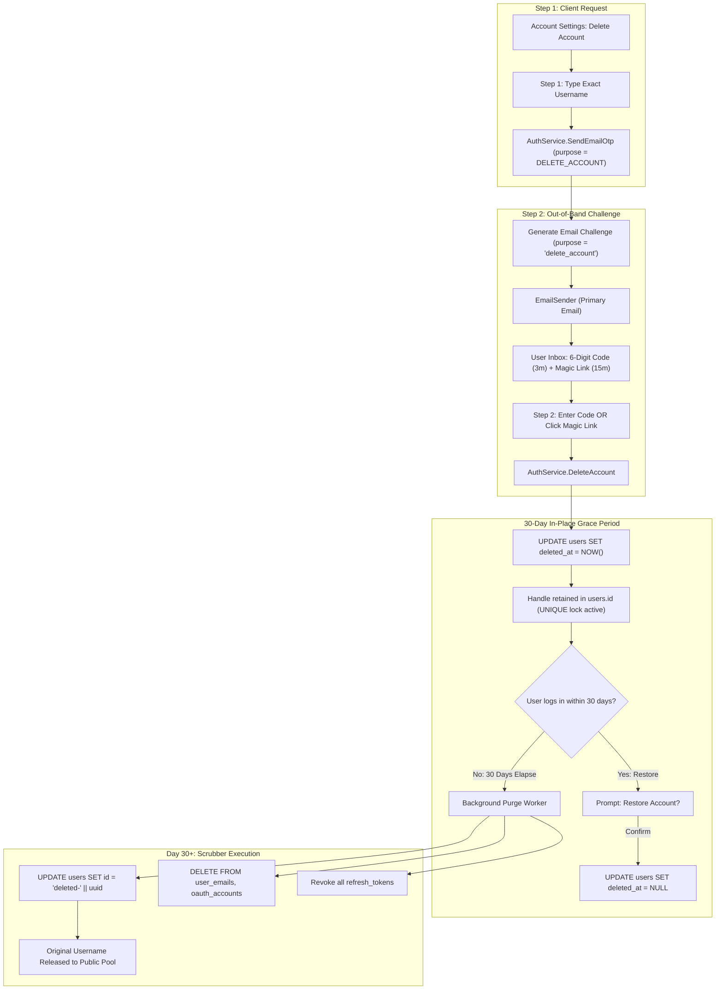

# <a id="user-account-deletion-and-lifecycle-architecture" >User Account Deletion and Lifecycle Architecture</a>

## <a id="table-of-contents" >Table of Contents</a>

- [1. Background](#1-background)
- [2. Goal](#2-goal)
- [3. Proposal](#3-proposal)
  - [Two-Step Deletion Safeguard: Username Typing and Email Verification](#two-step-deletion-safeguard-username-typing-and-email-verification)
  - [In-Place Handle Retention Lifecycle (Option 3)](#in-place-handle-retention-lifecycle-option-3)
  - [Architectural Relationship: `users.deleted_at` and `username_histories`](#architectural-relationship-usersdeleted_at-and-username_histories)
  - [Single-Source-of-Truth Grace Period and 1-Line Resurrection](#single-source-of-truth-grace-period-and-1-line-resurrection)
  - [Automated 30-Day Purge Scrubber Worker](#automated-30-day-purge-scrubber-worker)
  - [Preserving Communal Content with Anonymized Attribution](#preserving-communal-content-with-anonymized-attribution)
  - [Protobuf API Specifications and RPC Contracts](#protobuf-api-specifications-and-rpc-contracts)
- [4. Alternatives considered](#4-alternatives-considered)
- [5. Assumptions](#5-assumptions)
- [6. Future work](#6-future-work)

---

## <a id="1-background" >1. Background</a>

In [user_auth.md](user_auth.md), Quadsmith outlined a preliminary soft-deletion
model where accounts could mark `users.deleted_at` and preserve communal content
under masked attribution. However, the original specification did not define:

1. Multi-factor verification safeguards required to prevent accidental or
   malicious deletion via stolen session tokens.
2. The exact lifecycle and persistence mechanism for public username handles
   during the 30-day grace period.
3. The relationship between `users.deleted_at` and the `username_histories`
   table.
4. The background purge worker responsible for anonymizing accounts and
   releasing handles once the 30-day grace period expires.
5. The Protobuf API contracts governing account deletion, verification
   challenges, and resurrection.

During architectural review, the user requested that account deletion and email
delivery be decoupled into two separate, focused planning documents. This plan
defines the comprehensive deletion architecture, establishing Option 3 (In-Place
Handle Retention) as the chosen model to maintain a single source of truth in
PostgreSQL.

---

## <a id="2-goal" >2. Goal</a>

Architect a resilient, user-friendly account deletion system for Quadsmith
featuring two-step deletion safeguards (exact username typing and out-of-band
Email Verification), a 30-day grace period with in-place handle locking and
1-line resurrection, an automated background purge scrubber, and strict
preservation of communal knowledge.

---

## <a id="3-proposal" >3. Proposal</a>

> **TL;DR:**
>
> - Require typing the exact username and completing Email Verification to
>   initiate account deletion.
> - Retain username in `users.id` during the 30-day grace period using
>   PostgreSQL unique constraints.
> - Store deletion reference point solely in `users.deleted_at` to prevent
>   synchronization drift.
> - Restore accounts instantly during login within 30 days by clearing
>   `users.deleted_at`.
> - Purge personal data and release handle to public pool via automated scrubber
>   after 30 days.



### <a id="two-step-deletion-safeguard-username-typing-and-email-verification" >Two-Step Deletion Safeguard: Username Typing and Email Verification</a>

Account deletion is an irreversible destructive action once finalized. To
prevent catastrophic accidental clicks or account hijacking via stolen bearer
tokens:

1. **Step 1: Explicit Username Confirmation**:
   - The user opens the "Delete Account" modal in their settings.
   - The user must explicitly type their exact current username handle
     ([`users.id`](../../src/backend/db/quadsmith_api.sql#L13)).
   - The client verifies the string matches before enabling the challenge
     button.
   - The server verifies in `SendEmailOtp` that the caller is authenticated.
2. **Step 2: Universal Email Verification Challenge**:
   - The server issues a challenge token (`challenge_id`) bound to
     `purpose = "delete_account"`.
   - The server dispatches an email to the user's primary verified email address
     ([`user_emails.is_primary = true`](../../src/backend/db/quadsmith_api.sql#L54)).
   - In accordance with the universal Email Verification flow, the email
     contains both:
     - A 6-digit numeric verification code (3-minute TTL).
     - A 1-click magic link button (`[Confirm Account Deletion]`, 15-minute
       TTL).
   - The user can finalize deletion on the modal by submitting the code, or by
     clicking the magic link in their email client.
   - Either method confirms the deletion request and marks the challenge used.

This two-step sequence ensures that an attacker who compromises an active web
session cannot delete the victim's account without gaining access to the
victim's external primary mailbox.

#### <a id="alternatives-considered-deletion-safeguards" >Alternatives considered</a>

##### <a id="single-click-confirmation-modal" >Single-Click Confirmation Modal</a>

Displaying a standard dialog modal asking "Are you sure you want to delete your
account?" with an immediate confirmation button, bypassing username typing and
email verification. The account is deleted immediately upon clicking the button.

**Pros:**

- Minimal user friction allowing account deletion in two clicks.
- Eliminates outbound verification email dispatch and challenge tracking.

**Cons:**

- Vulnerable to session hijacking, cross-site script attacks, and shared-device
  tampering.
- High risk of accidental deletions caused by careless clicks or misreading the
  prompt.

##### <a id="password-re-entry-challenge" >Password Re-Entry Challenge</a>

Requiring the user to input their account password before authorizing deletion.
This common security pattern requires authentication credentials to confirm
destructive actions.

**Pros:**

- Familiar security pattern widely used across consumer web applications.
- Provides immediate synchronous confirmation without waiting for an email.

**Cons:**

- Incompatible with Quadsmith's passwordless authentication architecture.
- Cannot be satisfied by OAuth-only users who do not possess a password.

### <a id="in-place-handle-retention-lifecycle-option-3" >In-Place Handle Retention Lifecycle (Option 3)</a>

When account deletion is verified, Quadsmith places the account into a 30-day
soft-deleted grace period using **Option 3: In-Place Handle Retention**:

```sql
UPDATE users
SET deleted_at = NOW()
WHERE uuid = $1;
```

Why Option 3 is simpler and architecturally superior:

- **Zero Schema Overhead**: Requires no new tables, shadow columns, or complex
  triggers.
- **Native Database Locking**: The username remains stored in `users.id`.
  Because `users.id` carries a `UNIQUE NOT NULL` constraint in PostgreSQL, no
  other user can claim or register the handle during the 30-day grace period.
- **Immediate Conflict Protection**: Any registration or rename attempt against
  that username automatically fails at the database level and returns
  `USERNAME_AVAILABILITY_STATUS_UNAVAILABLE` via `CheckUsernameAvailable`.
- **Public Profile Concealment**: Public API endpoints (`GetUser`,
  `GetPublicProfile`) inspect `deleted_at`. If `deleted_at IS NOT NULL`, the
  endpoint returns a `NOT_FOUND` or deactivation message, shielding the
  soft-deleted user's profile from the public.

#### <a id="alternatives-considered-handle-retention" >Alternatives considered</a>

##### <a id="option-1-immediate-handle-release" >Option 1: Immediate Handle Release</a>

Clearing the username from `users.id` (or prepending `'deleted-'`) at the moment
the account is soft-deleted, releasing the handle back to the public pool on
day 0. The account remains soft-deleted for 30 days without holding its original
handle.

**Pros:**

- Makes vacated username handles available for registration immediately.
- Eliminates holding inactive usernames during the 30-day grace period.

**Cons:**

- Enables handle sniping where a third party claims the username immediately.
- Prevents resurrecting the account with its original username if claimed by
  another user.

##### <a id="option-2-shadow-history-reservation" >Option 2: Shadow History Reservation</a>

Removing the username handle from `users.id` on day 0 and recording a temporary
reservation row in `username_histories`. When resurrecting, the system moves the
handle back from `username_histories` to `users.id`.

**Pros:**

- Consolidates all inactive and previously held usernames in
  `username_histories`.
- Keeps the `users.id` column free of soft-deleted handles.

**Cons:**

- Stores the deletion reference point in two places, causing synchronization
  drift.
- Requires coordinating two separate timestamps across `users` and
  `username_histories`.

### <a id="architectural-relationship-usersdeleted_at-and-username_histories" >Architectural Relationship: `users.deleted_at` and `username_histories`</a>

A core design consideration is clarifying the functional boundary between
`users.deleted_at` and
[`username_histories`](../../src/backend/db/quadsmith_api.sql#L71):

1. **Purpose of `username_histories`**:
   - Designed exclusively for **explicit username renames** by active accounts
     (e.g. changing handle from `@fpv_pilot` to `@sky_racer`).
   - Tracks previously used handles to power vanity URL redirects and enforce a
     30-day reservation hold before release to the public pool.
2. **State of a Soft-Deleted Account**:
   - A user who soft-deletes their account has **not renamed away** from their
     handle. The handle still belongs to them throughout their 30-day grace
     period.
   - Storing the handle in `username_histories` during soft-deletion would
     duplicate the handle and the timestamp across two tables.
   - Storing the reference point in two places introduces synchronization drift:
     if an administrator or background task updates one table, the other becomes
     inconsistent.
3. **Architectural Separation**:
   - While an account is soft-deleted, `username_histories` is **untouched**.
   - The handle remains securely in `users.id`.
   - The reference point for deletion is stored in exactly **one place**:
     `users.deleted_at`.
   - Only when the 30-day grace period fully expires does the scrubber alter
     `users.id`.

#### <a id="alternatives-considered-relationship-to-username-histories" >Alternatives considered</a>

##### <a id="dual-timestamp-history-synchronization" >Dual-Timestamp History Synchronization</a>

Inserting a row into `username_histories` at the moment of soft deletion and
attempting to keep its timestamp synchronized with `users.deleted_at`. Any
cancellation or purge must update both tables in parallel.

**Pros:**

- Consolidates all username reservations into a single database table.
- Allows the username reservation query to inspect only `username_histories`.

**Cons:**

- Violates the single-source-of-truth principle by storing timestamps in two
  places.
- Introduces synchronization drift if an update succeeds in one table but fails
  in the other.

### <a id="single-source-of-truth-grace-period-and-1-line-resurrection" >Single-Source-of-Truth Grace Period and 1-Line Resurrection</a>

By anchoring the entire lifecycle to `users.deleted_at`, Quadsmith achieves
sub-millisecond resurrection with zero data migration or schema gymnastics:

1. **Authentication Interception**:
   - When a user authenticates (via OAuth or Email Verification), the auth
     service retrieves the `users` row.
   - If `deleted_at IS NOT NULL`:
     - If `NOW() < deleted_at + INTERVAL '30 days'`:
       - The server issues an `AuthResponse` with
         `account_setup_required = false` and a dedicated
         `account_status: "PENDING_DELETION"` field including the scheduled
         purge timestamp (`deleted_at + 30 days`).
       - The client routes the user to an Account Resurrection screen:
         > _"Your account was scheduled for deletion on [Date]. Your 30-day
         > grace period ends on [Target Date]. Would you like to restore your
         > account?"_
     - If `NOW() >= deleted_at + INTERVAL '30 days'`:
       - The grace period has expired; the account is either already purged or
         currently being scrubbed. Authentication treats the email as
         unregistered.
2. **1-Line Resurrection**:
   - When the user clicks `[Restore Account]`, the client invokes
     `AuthService.CancelAccountDeletion`:

     ```sql
     UPDATE users
     SET deleted_at = NULL
     WHERE uuid = $1;
     ```

   - Because the handle, emails, profile, builds, and settings remained intact
     in place during the grace period, the account is instantly and completely
     restored with zero risk of broken foreign keys or lost associations.

#### <a id="alternatives-considered-resurrection-flow" >Alternatives considered</a>

##### <a id="automatic-login-resurrection" >Automatic Login Resurrection</a>

Clearing `users.deleted_at` automatically whenever a user successfully
authenticates during their 30-day grace period, without prompting for
confirmation. The account returns to normal active status immediately upon
login.

**Pros:**

- Eliminates an extra confirmation dialog for returning users.
- Reduces friction for users who change their mind and log back in.

**Cons:**

- Restores accounts unintentionally if a user logs in solely to check status or
  export data.
- Overrides a deliberate deletion decision without explicit confirmation from
  the user.

### <a id="automated-30-day-purge-scrubber-worker" >Automated 30-Day Purge Scrubber Worker</a>

A lightweight background worker (running as a scheduled daemon job or periodic
cron) continuously enforces final data purges for accounts whose 30-day grace
period has elapsed:

```sql
SELECT uuid, id FROM users
WHERE deleted_at IS NOT NULL
  AND deleted_at <= NOW() - INTERVAL '30 days';
```

For each expired account, the scrubber executes an atomic transaction:

```sql
BEGIN;

-- 1. Anonymize user handle, releasing the original username to the public pool
UPDATE users
SET id = 'deleted-' || uuid
WHERE uuid = $1;

-- 2. Clear personal profile details
UPDATE user_profiles
SET bio = '', avatar_url = ''
WHERE user_uuid = $1;

-- 3. Hard delete email addresses and OAuth junction records
DELETE FROM user_email_oauth_accounts
WHERE user_email_uuid IN (SELECT uuid FROM user_emails WHERE user_uuid = $1);

DELETE FROM user_emails
WHERE user_uuid = $1;

-- 4. Hard delete linked OAuth provider credentials
DELETE FROM oauth_accounts
WHERE user_uuid = $1;

-- 5. Revoke all active sessions and refresh tokens
DELETE FROM refresh_tokens
WHERE user_uuid = $1;

COMMIT;
```

Key architectural outcomes:

- **Handle Released Naturally**: By setting `users.id = 'deleted-' || uuid`, the
  original username handle is vacated from `users.id`. Any new user can
  immediately register the vacated handle without conflicting with the deleted
  user's UUID.
- **Privacy Compliance**: All personal identifiers (emails, OAuth tokens, avatar
  URLs, bios, sessions) are permanently wiped from the database.
- **Referential Integrity Maintained**: The underlying `users` row (`uuid`)
  remains present as an anonymous placeholder (`deleted-<uuid>`), preserving all
  foreign keys in published aircraft builds, questions, and replies.

#### <a id="alternatives-considered-purge-scrubber" >Alternatives considered</a>

##### <a id="hard-cascading-deletion" >Hard Cascading Deletion</a>

Executing a direct `DELETE FROM users WHERE uuid = $1` upon grace period
expiration, letting foreign key cascades delete all rows linked to that user
record. All builds, posts, and comments are permanently wiped.

**Pros:**

- Completely purges all user-associated database rows without lingering records.
- Simpler execution requiring a single SQL statement.

**Cons:**

- Destroys public aircraft builds, wiring schematics, and component
  compatibility notes.
- Corrupts community Q&A threads by orphaning discussions and breaking reply
  chains.

### <a id="preserving-communal-content-with-anonymized-attribution" >Preserving Communal Content with Anonymized Attribution</a>

Quadsmith is a collaborative engineering and hardware knowledge platform.
Purging published aircraft builds or forum discussions harms other pilots who
rely on shared wiring schematics and flight configurations:

1. **Anonymized Attribution**:
   - Foreign key relationships to `users(uuid)` remain intact.
   - When public queries join on `users` and detect an ID matching `deleted-%`
     (or `deleted_at IS NOT NULL`), the API formats the author name as
     `[Deleted User]`.
2. **Build Ownership**:
   - Published public builds remain visible and forkable by the community.
   - Private, unpublished draft builds are pruned during the 30-day scrubber
     execution.

#### <a id="alternatives-considered-communal-content" >Alternatives considered</a>

##### <a id="user-elected-per-build-deletion" >User-Elected Per-Build Deletion</a>

Providing checkboxes in the deletion modal allowing users to selectively choose
which public builds to delete and which to preserve before confirming account
deletion. Each selected build is deleted while unselected builds are anonymized.

**Pros:**

- Gives users granular control over their intellectual property and build
  history.
- Accommodates pilots who strictly want their proprietary designs removed.

**Cons:**

- Introduces complex, cluttered UI into an already critical security modal.
- Risks breaking community builds that reference or fork the deleted
  configurations.

### <a id="protobuf-api-specifications-and-rpc-contracts" >Protobuf API Specifications and RPC Contracts</a>

Extend [`proto/quadsmith/api/auth.proto`](../../proto/quadsmith/api/auth.proto)
to define the deletion and resurrection RPC contracts:

```protobuf
// ---------------------------------------------------------
// Account Deletion Requests & Responses
// ---------------------------------------------------------

message DeleteAccountRequest {
  string username = 1;
  string challenge_id = 2;
  oneof verification {
    string code = 3;
    string magic_token = 4;
  }
}

message DeleteAccountResponse {
  bool success = 1;
  string message = 2;
  google.protobuf.Timestamp scheduled_purge_at = 3;
}

message CancelAccountDeletionRequest {}

message CancelAccountDeletionResponse {
  bool success = 1;
  string message = 2;
  User user = 3;
}
```

Add the corresponding RPCs to `AuthService` in
[`proto/quadsmith/api/auth.proto`](../../proto/quadsmith/api/auth.proto#L257):

```protobuf
service AuthService {
  // Universal email OTP verification challenge
  rpc SendEmailOtp(SendEmailOtpRequest) returns (SendEmailOtpResponse);

  // Verifies email challenge (code or magic token) and marks the account as soft-deleted
  rpc DeleteAccount(DeleteAccountRequest) returns (DeleteAccountResponse);

  // Restores a soft-deleted account within the 30-day grace period
  rpc CancelAccountDeletion(CancelAccountDeletionRequest) returns (CancelAccountDeletionResponse);
}
```

#### <a id="alternatives-considered-rpc-specifications" >Alternatives considered</a>

##### <a id="dedicated-senddeleteaccountverification-rpc" >Dedicated SendDeleteAccountVerification RPC</a>

Introducing a dedicated `SendDeleteAccountVerification` RPC with bespoke request
and response message schemas instead of the unified `SendEmailOtp` procedure.

**Pros:**

- Keeps delete verification RPC distinct in the Protobuf service definition.
- Permits embedding explicit username verification in the request proto message.

**Cons:**

- Proliferates duplicate RPCs with identical rate limiting, hashing, and TTLs.
- Fragments frontend implementation across separate React components and state.
- Violates the universal Email Verification architecture across Quadsmith.

---

## <a id="4-alternatives-considered" >4. Alternatives considered</a>

### <a id="immediate-hard-deletion-without-grace-period" >Immediate Hard Deletion Without Grace Period</a>

Permanently purging the user and all associated database records the moment
account deletion is verified. No 30-day grace period is provided, and all
profile data and builds are removed instantly.

**Pros:**

- Eliminates background scrubber worker logic and scheduled deletion state.
- Maximizes user privacy by removing all records immediately without delay.

**Cons:**

- Offers zero recourse for recovering accidentally or maliciously deleted
  accounts.
- Permanently destroys community knowledge by breaking shared aircraft builds
  and forum threads.

### <a id="immediate-username-release-option-1" >Immediate Username Release (Option 1)</a>

Retaining user records during a 30-day recovery grace period, but immediately
releasing the public username handle into the registration pool on day 0. The
account is soft-deleted, but its username can be claimed immediately by anyone.

**Pros:**

- Releases inactive usernames to active community members immediately.
- Prevents inactive accounts from tying up popular handles during the grace
  period.

**Cons:**

- Enables handle sniping where a third party claims the username right after
  deletion.
- Prevents the original user from restoring their account under their original
  username.

### <a id="shadow-table-handle-reservation-option-2" >Shadow Table Handle Reservation (Option 2)</a>

Moving the username handle out of `users.id` and inserting a reservation record
into `username_histories` or a dedicated shadow table on day 0. Account
restoration moves the handle back from the reservation table into `users.id`.

**Pros:**

- Centralizes all inactive and held handles in `username_histories`.
- Keeps the `users.id` column clear of soft-deleted account identifiers.

**Cons:**

- Duplicates the deletion reference point across two tables, violating the
  single-source-of-truth principle.
- Introduces synchronization drift if cancellation or purge logic fails across
  tables.

---

## <a id="5-assumptions" >5. Assumptions</a>

1. The 30-day grace period begins precisely at the timestamp recorded in
   `users.deleted_at`.
2. Public profile queries for soft-deleted accounts return deactivated or masked
   statuses during the grace period.
3. The background scrubber runs as an asynchronous worker process at regular
   intervals (e.g. hourly or daily).
4. Out-of-band verification emails for account deletion are delivered to the
   user's designated primary email address.

---

## <a id="6-future-work" >6. Future work</a>

### <a id="self-service-gdpr-data-archive-export" >Self-Service GDPR Data Archive Export</a>

Provide a self-service data export feature in account settings allowing users to
download a complete machine-readable archive (JSON/ZIP) of their profile, build
configurations, parts reviews, and forum contributions before initiating
deletion.

### <a id="configurable-username-cooldown-hold" >Configurable Username Cooldown Hold</a>

Introduce a post-purge quarantine period where released usernames are held in
`username_histories` for an additional 30 days before becoming available for
registration by other users, preventing immediate impersonation of prominent
community builders.
