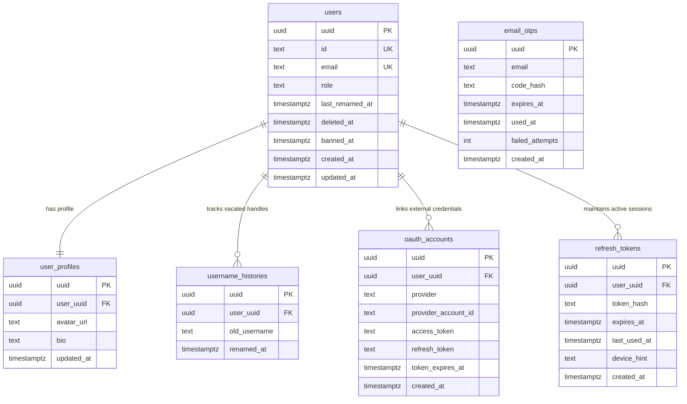

# <a id="user-identity-authentication-and-account-lifecycle-design" >User Identity, Authentication, and Account Lifecycle Design</a>

## <a id="table-of-contents" >Table of Contents</a>

- [1. Goal](#1-goal)
- [2. Proposal](#2-proposal)
  - [Passwordless Authentication via Email OTP and OAuth](#passwordless-authentication-via-email-otp-and-oauth)
  - [Hybrid JWT Access Tokens and Revocable DB Refresh Tokens](#hybrid-jwt-access-tokens-and-revocable-db-refresh-tokens)
  - [Two-Tier Per-Code and Per-IP Throttling Safeguards](#two-tier-per-code-and-per-ip-throttling-safeguards)
  - [Unified Email Identity Auto-Merging](#unified-email-identity-auto-merging)
  - [Relational UUID v7 Database Architecture](#relational-uuid-v7-database-architecture)
  - [Public Username Holds and Rate-Limited Renaming](#public-username-holds-and-rate-limited-renaming)
  - [Soft-Deletion, Account Banning, and Resurrection Lifecycle](#soft-deletion-account-banning-and-resurrection-lifecycle)
- [3. Assumptions](#3-assumptions)
- [4. Future work](#4-future-work)
  - [Meta OAuth Provider Support](#meta-oauth-provider-support)
  - [Automated OTP Pruning Worker](#automated-otp-pruning-worker)
  - [Active Sessions Management UI](#active-sessions-management-ui)
  - [Fine-Grained Temporary Bans and Audit Trail](#fine-grained-temporary-bans-and-audit-trail)

---

## <a id="1-goal" >1. Goal</a>

Provide a secure, passwordless authentication, user management, and session architecture for Quadsmith that supports multi-provider OAuth, email verification, instant token revocation, rate-limited username management, and soft-delete content preservation.

---

## <a id="2-proposal" >2. Proposal</a>

> **TL;DR:**
>
> - Eliminate passwords entirely in favor of passwordless Email OTP (3-minute TTL) and multi-provider OAuth (Google, GitHub, Discord, Microsoft).
> - Deploy a hybrid session strategy: short-lived stateless JWT access tokens (1 hour) paired with database-backed revocable refresh tokens (30 days).
> - Mitigate brute force attacks via two-tier throttling: 3 failed attempts per code, and 3 failed challenges per IP triggering a 60-minute lockout.
> - Anchor database models to hidden UUID v7 primary keys with unique public username handles (`id`) matching project conventions.
> - Safeguard communal knowledge during account deletion or administrative bans by soft-deleting user records and masking public attributions as `[Deleted User]`.

The authentication architecture balances user convenience with robust security safeguards. By avoiding legacy password storage, Quadsmith eliminates credential stuffing vulnerabilities, password resets, and hash maintenance. The session architecture pairs fast, stateless JWT verification on API routes with centralized session revocation in PostgreSQL, ensuring administrative actions (such as bans or forced logouts) propagate promptly without burdening every API request with database lookups.

### <a id="passwordless-authentication-via-email-otp-and-oauth" >Passwordless Authentication via Email OTP and OAuth</a>

Users authenticate without static passwords via two pathways:

- **Email OTP**: A 6-digit cryptographic numeric code sent to the user's email address with a 3-minute time-to-live (TTL). Codes are hashed using Argon2 before database persistence. Users enter the code directly on the web application without navigating away.
- **OAuth Providers**: Integrations with major developer and enthusiast platforms (Google, GitHub, Discord, Microsoft). OAuth accounts link provider account IDs and automatically ingest user avatars and verified email addresses.

#### <a id="alternatives-considered-passwordless-auth" >Alternatives considered</a>

Traditional password-based authentication with salt and bcrypt hashing.

**Pros:**

- Universal familiarity across legacy web applications.

**Cons:**

- Vulnerable to credential stuffing from external breaches and weak user passwords.
- Requires complex password reset flows, email confirmation links, and progressive hashing upgrade mechanisms.

### <a id="hybrid-jwt-access-tokens-and-revocable-db-refresh-tokens" >Hybrid JWT Access Tokens and Revocable DB Refresh Tokens</a>

Session state uses a two-tier token model:

- **Access Token (JWT, 1-hour TTL)**: Signed using a server secret (HMAC-SHA256 or asymmetric Ed25519). Validated purely by cryptographic signature without hitting the database, enabling low-latency API verification across distributed microservices.
- **Refresh Token (DB-Stored, 30-day TTL)**: An opaque cryptographically random 256-bit secret stored as a SHA-256 hash in the `refresh_tokens` table. Used exclusively at `/auth/refresh` to issue new JWT access tokens.
- **Revocation**: Deleting a user's refresh token rows instantly terminates their ability to obtain new access tokens, forcing re-authentication once the current 1-hour JWT expires.

#### <a id="alternatives-considered-hybrid-jwt-tokens" >Alternatives considered</a>

Pure stateless JWTs without database-backed refresh tokens.

**Pros:**

- Completely removes database hits during both authentication and token refresh.

**Cons:**

- Cannot revoke compromised sessions or enforce immediate user bans without maintaining distributed token blocklists.

### <a id="two-tier-per-code-and-per-ip-throttling-safeguards" >Two-Tier Per-Code and Per-IP Throttling Safeguards</a>

To safeguard the OTP endpoint against brute-force attacks:

- **Tier 1 (Per-Code Exhaustion)**: Each issued OTP permits a maximum of 3 failed verification attempts before it is permanently invalidated (`failed_attempts = 3`), requiring a 15-second cooldown before a replacement code can be requested.
- **Tier 2 (Per-IP Lockout)**: If a client IP accumulates 3 exhausted challenges within a rolling 60-minute window, the server imposes an IP-wide 60-minute lockout on all OTP requests and verification attempts from that address.

### <a id="unified-email-identity-auto-merging" >Unified Email Identity Auto-Merging</a>

To prevent split accounts when users sign in across different identity providers:

- If a user signs in via OAuth with an email address that matches an existing verified `users` record, the platform automatically links the external `oauth_accounts` row to the existing user.
- All subsequent logins through either Email OTP or any linked OAuth provider grant access to the identical account.

### <a id="relational-uuid-v7-database-architecture" >Relational UUID v7 Database Architecture</a>

In adherence to Quadsmith schema standards:

- All authentication tables ([`src/backend/db/quadsmith_api.sql`](../../src/backend/db/quadsmith_api.sql)) utilize hidden UUID v7 primary keys (`uuid UUID PRIMARY KEY`).
- Foreign keys explicitly reference `user_uuid UUID REFERENCES users(uuid) ON DELETE CASCADE`.
- The public user handle is stored as a unique text column (`id TEXT UNIQUE NOT NULL`), which serves as the public username in all URLs (e.g., `/@roramu`).

### <a id="public-username-holds-and-rate-limited-renaming" >Public Username Holds and Rate-Limited Renaming</a>

To maintain consistent referencing across social interactions, forum threads, and build attribution:

- **Rename Rate Limit**: Users may update their username handle at most once every 30 days (`last_renamed_at`).
- **30-Day Redirect Hold**: Vacated usernames are recorded in `username_histories`. During the 30-day window, incoming requests for the old handle redirect to the user's new handle, preventing account impersonation while existing links update.
- **Release to Pool**: After 30 days, vacated usernames expire from the hold window and return to the public pool for registration.

### <a id="soft-deletion-account-banning-and-resurrection-lifecycle" >Soft-Deletion, Account Banning, and Resurrection Lifecycle</a>

To balance privacy rights with community knowledge preservation:

- **Soft-Deletion**: Users may delete their accounts at any time, setting `deleted_at`. User profile details are cleared, but published aircraft builds, questions, and answers remain intact with the author handle displayed as `[Deleted User]`.
- **Administrative Ban**: Moderators can flag abusive accounts with `banned_at`, terminating active refresh tokens and presenting the account as `[Deleted User]` to public clients.
- **Resurrection**: Re-authenticating with the verified email of a soft-deleted account clears `deleted_at` and restores profile ownership. Accounts marked with `banned_at` are permanently barred from resurrection.

#### <a id="alternatives-considered-soft-deletion-lifecycle" >Alternatives considered</a>

Hard cascading deletion that purges user records and all associated builds, questions, and answers.

**Pros:**

- Immediate and complete removal of all user-generated rows from the database.

**Cons:**

- Corrupts community troubleshooting threads, creating orphaned replies, broken links, and missing build configurations.

---

## <a id="3-assumptions" >3. Assumptions</a>

1. Users authenticate via a verified email address, confirmed either through direct Email OTP or pre-verified OAuth provider profile metadata.
2. Accounts sharing an identical verified email address are merged under a single unified user record.
3. Access tokens (JWT) are verified statelessly by API handlers using signature validation without querying PostgreSQL on each request.

---

## <a id="4-future-work" >4. Future work</a>

### <a id="meta-oauth-provider-support" >Meta OAuth Provider Support</a>

Expand social login capabilities to include Meta (Facebook/Instagram) OAuth once developer app credentials and review requirements are finalized.

### <a id="automated-otp-pruning-worker" >Automated OTP Pruning Worker</a>

Deploy an automated background task to periodically purge expired `email_otps` rows older than 1 hour, preventing table bloat while retaining data within the rolling throttle window.

### <a id="active-sessions-management-ui" >Active Sessions Management UI</a>

Provide a self-service session management dashboard in user account settings allowing users to inspect active login sessions (IP address, approximate location, device hints) and revoke individual refresh tokens.

### <a id="fine-grained-temporary-bans-and-audit-trail" >Fine-Grained Temporary Bans and Audit Trail</a>

Introduce structured administrative moderation models (`bans` table) recording suspension durations, infractions, and moderating admin identities to support automated ban expiries.
