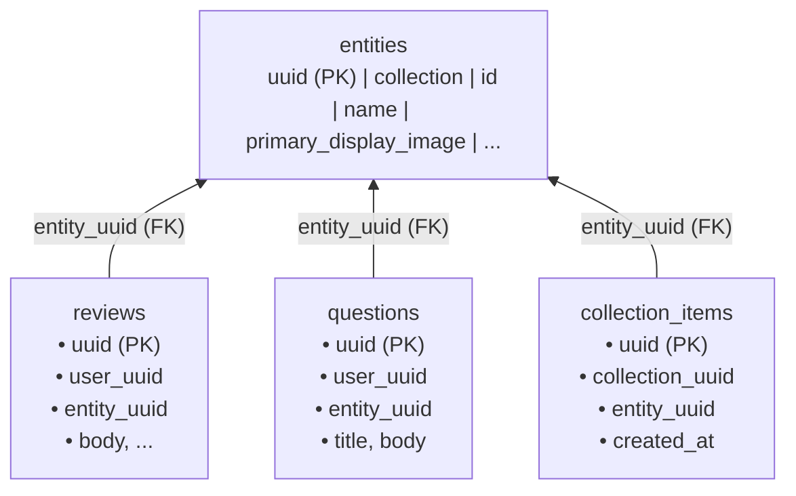

# <a id="uuid-foreign-key-normalization-and-denormalized-column-cleanup" >UUID Foreign Key Normalization and Denormalized Column Cleanup</a>

## <a id="table-of-contents" >Table of Contents</a>

- [1. Background](#1-background)
- [2. Goal](#2-goal)
- [3. Proposal](#3-proposal)
  - [Design Decision 1: Normalize `internal_api_calls.jit_grant_id` to `jit_grant_uuid`](#design-decision-1-normalize-internal-api-calls-jit-grant-id-to-jit-grant-uuid)
  - [Design Decision 2: Remove Accidental Denormalized Columns on Social Tables](#design-decision-2-remove-accidental-denormalized-columns-on-social-tables)
  - [Design Decision 3: Enforce Relational Foreign Keys on `blob_references`](#design-decision-3-enforce-relational-foreign-keys-on-blob-references)
  - [Design Decision 4: Retain Hardware Firmware and OS Columns as Domain Attributes](#design-decision-4-retain-hardware-firmware-and-os-columns-as-domain-attributes)
  - [Design Decision 5: Preserve Pre-Account and Post-Purge `TEXT` Email Snapshots (`email_otps`, `banned_emails`)](#design-decision-5-preserve-pre-account-and-post-purge-text-email-snapshots-email-otps-banned-emails)
  - [Design Decision 6: Retain Operator Principal Names with Optional Token UUID Linkage](#design-decision-6-retain-operator-principal-names-with-optional-token-uuid-linkage)
- [4. Alternatives considered](#4-alternatives-considered)
- [5. Assumptions](#5-assumptions)
- [6. Future work](#6-future-work)

---

## <a id="1-background" >1. Background</a>

Under the database conventions defined in
[AGENTS.md](../../AGENTS.md#L181-L191), every database table in Quadsmith uses a
hidden UUIDv7 primary key (`uuid`) alongside a human-readable `id`
(`UNIQUE TEXT`), and all foreign keys must reference `uuid` rather than `id`.
The API, CLI, and Protobuf layers expose the human-readable `id` for ergonomics
while performing UUID translation internally in backend SQL queries.

Furthermore, two recent architectural plans established strict
single-source-of-truth invariants across the schema:

- **Table-Per-Type (TPT) Entity Hierarchy
  ([user_created_components.md](user_created_components.md#L100-L131))**: The
  unified [`entities`](../../src/db/quadsmith_api.sql#L465-L481) table is the
  single source of truth for resource identity (`id`, `collection`) and common
  metadata (`name`, `description`, `primary_display_image`,
  `author_or_manufacturer`). Subtype and social tables reference
  `entities(uuid)` and dynamically project human-readable fields via indexed
  primary-key joins.
- **Canonical Email Storage & GDPR Data Classification
  ([gdpr_data_export.md](gdpr_data_export.md#L695-L740))**: The redundant
  `users.email` SQL column was removed in favor of
  [`user_emails`](../../src/db/quadsmith_api.sql#L46-L61) (enforced by
  `idx_user_emails_one_primary_per_user`), and every persisted Protobuf table
  field now requires a `[(quadsmith.data.content_type)]` annotation verified by
  [`schemacheck`](../../src/go/shared/pkg/schemacheck/data_check.go) and used by
  [`protoc-gen-store`](../../src/go/shared/cmd/protoc-gen-store/main.go#L528-L555)
  to generate `Export<PluralName>` functions.

An audit of the [`quadsmith_api.sql`](../../src/db/quadsmith_api.sql) and
[`quadsmith_ops.sql`](../../src/db/quadsmith_ops.sql) schemas showed that while
every explicit SQL `FOREIGN KEY` constraint targets a `(uuid)` column, six
categories of columns across the two databases either referenced other tables by
non-UUID columns, duplicated non-UUID columns alongside a UUID foreign key, or
stored unconstrained polymorphic/domain references:

| Category                       | Table & Column(s)                                                                                                                                                                                                                     | Target Table & Column                                                                                                                                                        | Previous Mechanism                                                                                                        |
| :----------------------------- | :------------------------------------------------------------------------------------------------------------------------------------------------------------------------------------------------------------------------------------ | :--------------------------------------------------------------------------------------------------------------------------------------------------------------------------- | :------------------------------------------------------------------------------------------------------------------------ |
| **1. Direct Non-UUID FK**      | [`internal_api_calls.jit_grant_id`](../../src/db/quadsmith_ops.sql#L46)                                                                                                                                                               | [`jit_grants.id`](../../src/db/quadsmith_ops.sql#L5)                                                                                                                         | Stored `TEXT` `id` with no `uuid` column or FK constraint                                                                 |
| **2. Social Denormalization**  | [`reviews`](../../src/db/quadsmith_api.sql#L504-L514), [`questions`](../../src/db/quadsmith_api.sql#L552-L564), [`answers`](../../src/db/quadsmith_api.sql#L590-L604), [`collection_items`](../../src/db/quadsmith_api.sql#L685-L691) | [`entities`](../../src/db/quadsmith_api.sql#L468-L475), [`question_comments`](../../src/db/quadsmith_api.sql#L616), [`answer_comments`](../../src/db/quadsmith_api.sql#L631) | Missing `ignore: true` in [`social.proto`](../../src/proto/quadsmith/api/social.proto) generated 11 redundant SQL columns |
| **3. Polymorphic & URL Blobs** | [`blob_references.entity_uuid`](../../src/db/quadsmith_api.sql#L208-L219), `avatar_url`, `primary_display_image`, `media`                                                                                                             | [`entities.uuid`](../../src/db/quadsmith_api.sql#L466), [`users.uuid`](../../src/db/quadsmith_api.sql#L18), [`blobs.id`](../../src/db/quadsmith_api.sql#L190)                | Unconstrained UUID spanned two tables; URLs embed SHA-256 `blobs.id`                                                      |
| **4. Hardware Firmware Specs** | [`electronic_speed_controllers.firmware`](../../src/db/quadsmith_api.sql#L276), [`transmitters.operating_system`](../../src/db/quadsmith_api.sql#L710)                                                                                | [`electronic_speed_controller_firmwares`](../../src/db/quadsmith_api.sql#L407), [`radio_firmwares`](../../src/db/quadsmith_api.sql#L459)                                     | `TEXT` firmware family names vs. versioned release rows                                                                   |
| **5. Lifecycle Email Strings** | [`email_otps.email`](../../src/db/quadsmith_api.sql#L94), [`banned_emails.email`](../../src/db/quadsmith_api.sql#L171)                                                                                                                | [`user_emails.email`](../../src/db/quadsmith_api.sql#L48)                                                                                                                    | Pre-registration OTP lookup and post-GDPR-purge ban enforcement by `TEXT`                                                 |
| **6. Ops Principals**          | [`jit_grants.operator`](../../src/db/quadsmith_ops.sql#L7), [`internal_api_calls.caller`](../../src/db/quadsmith_ops.sql#L43)                                                                                                         | [`internal_tokens.name`](../../src/db/quadsmith_ops.sql#L27)                                                                                                                 | `TEXT` operator handles spanning static config tokens and DB tokens                                                       |

---

## <a id="2-goal" >2. Goal</a>

Eliminate non-UUID table references and accidental schema denormalization across
`quadsmith_api.sql` and `quadsmith_ops.sql` so that all true inter-table
relationships are backed by strict `UUID` foreign keys and canonical single
sources of truth, while preserving ergonomic human-readable IDs in Protobuf
responses, maintaining full compatibility with GDPR data export codegen, and
avoiding over-normalization of domain attributes or lifecycle-independent
identifiers.

---

## <a id="3-proposal" >3. Proposal</a>

> **TL;DR:**
>
> - Replace `internal_api_calls.jit_grant_id` with a `jit_grant_uuid` foreign
>   key referencing `jit_grants(uuid)` and project `jit_grant_id` via
>   `LEFT JOIN`.
> - Exclude 11 denormalized display fields on `reviews`, `questions`, `answers`,
>   and `collection_items` from the SQL storage schema (`store/social.proto`),
>   retaining them only on the API view models (`api/social.proto`).
> - Enforce database-level referential integrity on `blob_references` using
>   explicit nullable `entity_uuid` and `user_uuid` foreign keys with `CHECK`.
> - Retain `firmware` and `operating_system` hardware spec columns as `TEXT`
>   attributes rather than versioned software foreign keys.
> - Preserve `email_otps.email`, `banned_emails.email`, and ops principal `TEXT`
>   columns (`operator`, `caller`) where records precede or outlive target rows.

This proposal distinguishes between **true relational linkages** (which must use
enforced `UUID` foreign keys and single-source-of-truth projections) and
**domain or lifecycle values** (which intentionally store `TEXT` because the
referenced row either does not exist yet, has already been purged under GDPR
retention rules, or represents a distinct conceptual tier). For true relational
linkages, we normalize the underlying SQL tables in
[`quadsmith_api.sql`](../../src/db/quadsmith_api.sql) and
[`quadsmith_ops.sql`](../../src/db/quadsmith_ops.sql) (defined in
[`src/proto/quadsmith/store/`](../../src/proto/quadsmith/store) per
[`storage_and_api_proto_separation.md`](storage_and_api_proto_separation.md)) to
store only `UUID` foreign keys while keeping the API-facing human-readable
fields on the API view-model Protobuf messages in `quadsmith.api` and
`quadsmith.ops`.

### <a id="design-decision-1-normalize-internal-api-calls-jit-grant-id-to-jit-grant-uuid" >Design Decision 1: Normalize `internal_api_calls.jit_grant_id` to `jit_grant_uuid`</a>

In
[`src/proto/quadsmith/ops/ops.proto`](../../src/proto/quadsmith/ops/ops.proto),
`InternalApiCallRecord` previously defined `optional string jit_grant_id = 7;`,
which caused [`protoc-gen-sql`](../../src/go/shared/cmd/protoc-gen-sql/main.go)
to generate an unconstrained `jit_grant_id TEXT` column on
[`internal_api_calls`](../../src/db/quadsmith_ops.sql). This was the only column
in either database that directly referenced another table exclusively by its
human-readable `id` without a `uuid` column.

We replace the persisted SQL column in
[`src/proto/quadsmith/store/ops.proto`](../../src/proto/quadsmith/store/ops.proto)
with `jit_grant_uuid UUID` referencing `jit_grants(uuid)` and retain
`jit_grant_id` as an API-only projected field on `InternalApiCallRecord` in
[`src/proto/quadsmith/ops/ops.proto`](../../src/proto/quadsmith/ops/ops.proto):

```protobuf
// In src/proto/quadsmith/store/ops.proto:
message InternalApiCallRecord {
  option (quadsmith.sql.table) = {name: "internal_api_calls"};
  option (quadsmith.data.export) = {domain: EXPORT_DOMAIN_NONE};

  string uuid = 1 [
    (quadsmith.sql.column) = {is_primary_key: true},
    (quadsmith.data.content_type) = CONTENT_TYPE_SYSTEM_METADATA_PUBLIC
  ];
  string id = 2 [
    (quadsmith.sql.column) = {is_unique: true},
    (quadsmith.data.content_type) = CONTENT_TYPE_SYSTEM_METADATA_PUBLIC
  ];
  string method = 3 [(quadsmith.data.content_type) = CONTENT_TYPE_SYSTEM_METADATA_PRIVATE];
  string caller = 4 [
    (quadsmith.sql.column) = {create_index: true},
    (quadsmith.data.content_type) = CONTENT_TYPE_SYSTEM_METADATA_PRIVATE
  ];
  string caller_type = 5 [(quadsmith.data.content_type) = CONTENT_TYPE_SYSTEM_METADATA_PRIVATE];
  string group_name = 6 [(quadsmith.data.content_type) = CONTENT_TYPE_SYSTEM_METADATA_PRIVATE];
  optional string jit_grant_uuid = 7 [
    (quadsmith.sql.column) = {
      references: "jit_grants(uuid)"
      create_index: true
    },
    (quadsmith.data.content_type) = CONTENT_TYPE_SYSTEM_METADATA_PRIVATE
  ];
  string status = 8 [(quadsmith.data.content_type) = CONTENT_TYPE_SYSTEM_METADATA_PRIVATE];
  optional string error_message = 9 [(quadsmith.data.content_type) = CONTENT_TYPE_SYSTEM_METADATA_PRIVATE];
  int64 duration_ms = 10 [(quadsmith.data.content_type) = CONTENT_TYPE_SYSTEM_METADATA_PRIVATE];
  google.protobuf.Timestamp created_at = 11 [
    (quadsmith.sql.column) = {
      create_index: true
      default_value: "NOW()"
    },
    (quadsmith.data.content_type) = CONTENT_TYPE_SYSTEM_METADATA_PRIVATE
  ];
}
```

- **Write Path
  ([`OpsInterceptor`](../../src/go/shared/pkg/opsauth/interceptor.go))**:
  `checkJitGrant` queries `SELECT uuid::text, id, expires_at FROM jit_grants`,
  storing both `JitGrantUUID` and `JitGrantID` in `OperatorContext` and
  inserting `jit_grant_uuid` into `internal_api_calls`.
- **Read Path
  ([`OpsService.ListInternalApiCalls`](../../src/go/server-ops/pkg/ops/service.go#L335-L398))**:
  Performs `LEFT JOIN jit_grants j ON j.uuid = c.jit_grant_uuid` to populate
  both `r.JitGrantUuid` and `r.JitGrantId` (`j.id`), preserving identical CLI
  output in [`cli-ops`](../../src/go/cli-ops/main.go#L780-L782) and the Ops Web
  UI.
- **Schema Diagram**: Updated
  [`src/db/quadsmith_ops.mermaid`](../../src/db/quadsmith_ops.mermaid) to
  reflect `jit_grant_uuid` and the foreign key relationship
  `jit_grants ||--o{ internal_api_calls : authorizes`.

<details>
<summary><strong>Alternatives considered</strong></summary>

##### <a id="add-foreign-key-on-jit-grant-id-text" >Add a Foreign Key Constraint Directly on `jit_grant_id TEXT`</a>

Keep `jit_grant_id TEXT` on `internal_api_calls` and annotate it with
`references: "jit_grants(id)"` so PostgreSQL enforces a foreign key against the
`UNIQUE TEXT` column `jit_grants.id`.

**Pros:**

- Requires no changes to `OpsInterceptor.checkJitGrant` or `LEFT JOIN` queries
  in `ListInternalApiCalls`.

**Cons:**

- Directly violates the [AGENTS.md](../../AGENTS.md#L185-L186) rule requiring
  all foreign keys to reference `uuid` rather than `id`.
- Uses variable-length `TEXT` B-Tree keys instead of compact 16-byte native
  `UUID` keys.

##### <a id="dual-store-jit-grant-uuid-and-jit-grant-id" >Dual-Store Both `jit_grant_uuid` and `jit_grant_id` in SQL</a>

Add `jit_grant_uuid UUID REFERENCES jit_grants(uuid)` while also keeping
`jit_grant_id TEXT` as a physical column in `internal_api_calls`.

**Pros:**

- Avoids a `LEFT JOIN jit_grants` when reading `internal_api_calls`.

**Cons:**

- Duplicates identity data across tables and permits inconsistency if
  `jit_grant_uuid` and `jit_grant_id` ever diverge.
- Saves negligible query time because `ListInternalApiCalls` is bounded to at
  most 500 rows (`LIMIT 500`) and joins on `jit_grants(uuid)` primary key in
  memory.

##### <a id="leave-jit-grant-id-unconstrained" >Leave `jit_grant_id` as an Unconstrained Text Column</a>

Treat `internal_api_calls` as an unlinked flat text log with no foreign key to
`jit_grants`.

**Pros:**

- Allows hard-deleting rows from `jit_grants` without updating or cascading to
  historical audit logs.

**Cons:**

- `jit_grants` are never hard-deleted (they transition to `EXPIRED` or `REVOKED`
  in [`ops/service.go`](../../src/go/server-ops/pkg/ops/service.go)), so
  sacrificing referential integrity provides no practical benefit.

</details>

### <a id="design-decision-2-remove-accidental-denormalized-columns-on-social-tables" >Design Decision 2: Remove Accidental Denormalized Columns on Social Tables</a>

In
[`src/proto/quadsmith/api/social.proto`](../../src/proto/quadsmith/api/social.proto),
most resolved UI display fields (`author_username`, `author_avatar_url`,
`helpful_count`, `upvote_count`) are annotated with
`[(quadsmith.sql.column) = {ignore: true}]`. However, 11 display fields across
four messages omitted `ignore: true`, causing
[`protoc-gen-sql`](../../src/go/shared/cmd/protoc-gen-sql/main.go) to generate
redundant SQL columns in [`quadsmith_api.sql`](../../src/db/quadsmith_api.sql):

1. **[`Review`](../../src/proto/quadsmith/api/social.proto#L194-L201)**:
   `collection` and `entity_id` duplicated `entities.collection` and
   `entities.id` alongside `reviews.entity_uuid`. Worse,
   [`CreateReview`](../../src/go/shared/pkg/social/service.go#L275-L282) wrote
   `req.Msg.GetEntityId()` verbatim into `reviews.entity_id`, so if a caller
   passed an entity's UUID in the request, `reviews.entity_id` stored a UUID
   instead of the canonical slug.
2. **[`Question`](../../src/proto/quadsmith/api/social.proto#L363-L374)**:
   `comments` (`JSONB`), `collection`, and `entity_id` duplicated the
   `question_comments` table and `entities` metadata alongside
   `questions.entity_uuid`. `questions.comments` was never read or written by
   [`SocialService`](../../src/go/shared/pkg/social/service.go).
3. **[`Answer`](../../src/proto/quadsmith/api/social.proto#L500-L503)**:
   `comments` (`JSONB`) duplicated the `answer_comments` table and was never
   read or written in SQL.
4. **[`CollectionItem`](../../src/proto/quadsmith/api/social.proto#L736-L755)**:
   `entity_id`, `collection`, `name`, `primary_display_image`, and
   `author_or_manufacturer` were explicitly commented in `social.proto` as
   `// Resolved item details for display`, yet lacked `ignore: true`.
   [`ListCollectionItems`](../../src/go/shared/pkg/social/service.go#L2067-L2078)
   already ignored those columns on `collection_items` and read `e.id`,
   `e.collection`, `e.name`, `e.primary_display_image`, and
   `e.author_or_manufacturer` via `JOIN entities e ON e.uuid = ci.entity_uuid`.



We:

- Omit all 11 denormalized fields (plus the dead `is_author_verified_owner`
  column) from the SQL storage definitions in
  [`src/proto/quadsmith/store/social.proto`](../../src/proto/quadsmith/store/social.proto)
  while keeping them on the pure API view models in
  [`src/proto/quadsmith/api/social.proto`](../../src/proto/quadsmith/api/social.proto)
  (see
  [`storage_and_api_proto_separation.md`](storage_and_api_proto_separation.md)).
- Update [`resolveEntity`](../../src/go/shared/pkg/social/service.go#L46-L81) to
  also return `resolvedID` (`entities.id`) so `CreateReview`, `CreateQuestion`,
  and `AddCollectionItem` always return the canonical slug even when called with
  a UUID.
- Update [`UpdateReview`](../../src/go/shared/pkg/social/service.go#L329-L334),
  [`ListReviews`](../../src/go/shared/pkg/social/service.go#L437-L460),
  [`UpdateQuestion`](../../src/go/shared/pkg/social/service.go#L805-L810), and
  [`ListQuestions`](../../src/go/shared/pkg/social/service.go#L916-L942) to
  `JOIN entities e ON e.uuid = ...` and project `e.collection` and
  `e.id AS entity_id`.
- Simplify the `INSERT INTO collection_items` statements in
  [`ToggleLikeItem`](../../src/go/shared/pkg/social/service.go#L1721-L1724) and
  [`AddCollectionItem`](../../src/go/shared/pkg/social/service.go#L1996-L2000)
  to insert only `(uuid, collection_uuid, entity_uuid, created_at)`.
- **GDPR Data Export Compatibility
  ([`protoc-gen-store`](../../src/go/shared/cmd/protoc-gen-store/main.go))**:
  `protoc-gen-store` generates `Export<PluralName>` in
  `quadsmith/shared/gen/quadsmith/store` by iterating over the persisted SQL
  columns of `store/social.proto`, automatically excluding the denormalized
  display fields from `ExportReviews`, `ExportQuestions`, `ExportAnswers`, and
  `ExportCollectionItems`. Because `CollectionItem.created_at`
  (`CONTENT_TYPE_USER_OBSERVED`) remains an active non-UUID SQL column,
  `ExportCollectionItems` continues to be generated for
  [`export/handler.go`](../../src/go/shared/pkg/export/handler.go) and exports
  `(uuid, collection_uuid, entity_uuid, created_at)`, matching how
  `ExportReviewVotes`, `ExportQuestionVotes`, and `ExportAnswerVotes` export
  their canonical UUIDs and timestamps.

<details>
<summary><strong>Alternatives considered</strong></summary>

##### <a id="composite-fk-on-collection-and-entity-id" >Keep Denormalized Columns and Add Composite Foreign Keys</a>

Retain `collection` and `entity_id` on `reviews`, `questions`, and
`collection_items` and add
`FOREIGN KEY (collection, entity_id) REFERENCES entities(collection, id) ON UPDATE CASCADE`.

**Pros:**

- Prevents invalid `(collection, entity_id)` pairs from being written to the
  database.

**Cons:**

- Violates [AGENTS.md](../../AGENTS.md#L185-L186) by referencing
  `entities(collection, id)` instead of `entities(uuid)`.
- Stores two separate foreign keys (`entity_uuid` and `(collection, entity_id)`)
  pointing to the exact same `entities` row in every social table.
- Does not prevent `collection_items.name`, `primary_display_image`, or
  `author_or_manufacturer` from becoming stale when an entity is edited.

##### <a id="sync-denormalized-columns-via-triggers" >Synchronize Denormalized Social Columns via PostgreSQL Triggers</a>

Maintain the denormalized columns on `reviews`, `questions`, and
`collection_items` using `AFTER UPDATE ON entities` triggers.

**Pros:**

- Avoids `JOIN entities` in `ListReviews` and `ListQuestions`.

**Cons:**

- `ListReviews` and `ListQuestions` are already filtered to a single
  `entity_uuid = $1` (which is already resolved via `resolveEntity` before the
  query runs), meaning the join or projection adds zero measurable overhead.
- Introduces hidden procedural SQL triggers outside the declarative
  `protoc-gen-sql` workflow.

</details>

### <a id="design-decision-3-enforce-relational-foreign-keys-on-blob-references" >Design Decision 3: Enforce Relational Foreign Keys on `blob_references`</a>

Previously, [`blob_references`](../../src/db/quadsmith_api.sql#L208-L219)
tracked uploaded binary usage via
`blob_uuid UUID REFERENCES blobs(uuid) ON DELETE CASCADE`, `entity_type TEXT`,
and an unconstrained `entity_uuid UUID` column. Because `entity_uuid` was
designed to polymorphically store either an `entities.uuid` (when `entity_type`
is `'build'` or a component collection) or a `users.uuid` (when `entity_type` is
`'user_avatar'`), `entity_uuid` lacked a SQL `FOREIGN KEY` constraint, forcing
every delete handler in
[`protoc-gen-server`](../../src/go/shared/cmd/protoc-gen-server/main.go#L519-L593)
to manually delete `blob_references` rows.

Meanwhile, display URL columns (`user_profiles.avatar_url`,
`entities.primary_display_image`, and `entities.media`) store URL strings such
as `/api/blobs/<sha256_id>` or external URLs (e.g., YouTube video links for
`MEDIA_TYPE_YOUTUBE` or static seed SVG paths).

We implement a two-part design for blob references:

1. **Enforce Exclusive Polymorphic Foreign Keys on `blob_references`**: Follow
   the polymorphic relational foreign key pattern from
   [social_interactions_and_collections.md](social_interactions_and_collections.md#L56-L69)
   by giving `BlobReference` in
   [`src/proto/quadsmith/store/blob.proto`](../../src/proto/quadsmith/store/blob.proto)
   explicit nullable `entity_uuid`
   (`REFERENCES entities(uuid) ON DELETE CASCADE`) and `user_uuid`
   (`REFERENCES users(uuid) ON DELETE CASCADE`) columns (annotated with
   `(quadsmith.data.content_type) = CONTENT_TYPE_SYSTEM_METADATA_PUBLIC`),
   enforced by a table-level check constraint:

   ```sql
   CHECK (num_nonnulls(entity_uuid, user_uuid) = 1)
   ```

   We also wire
   [`AuthService.UpdateProfile`](../../src/go/shared/pkg/auth/service.go#L1500-L1510)
   and
   [`HandlePurgeSoftDeletedAccounts`](../../src/go/shared/pkg/auth/job.go#L172-L176)
   to link and unlink `user_avatar` blobs using `user_uuid` in `blob_references`
   so custom user avatar blobs are protected from orphan pruning while active
   and automatically garbage-collected after account purge.

2. **Retain URL Strings on Display Fields (`avatar_url`,
   `primary_display_image`, `media`)**: Keep URL strings on `user_profiles` and
   `entities` rather than replacing them with `UUID` foreign keys to
   `blobs(uuid)`, because those fields legitimately hold external URLs (such as
   YouTube embeds, external images, or static asset paths) and allow browsers to
   render `` directly with immutable HTTP cache headers
   (`Cache-Control: public, max-age=31536000, immutable`) keyed by the
   content-addressable SHA-256 hash.

<details>
<summary><strong>Alternatives considered</strong></summary>

##### <a id="keep-unconstrained-polymorphic-entity-uuid" >Keep Unconstrained `entity_uuid` on `blob_references`</a>

Leave `blob_references.entity_uuid` as a single unconstrained `UUID` column
paired with `entity_type TEXT`, relying on application-level `DELETE` queries
when entities or users are deleted.

**Pros:**

- Zero changes required to `store/blob.proto`, `blob/store.go`, or
  `protoc-gen-server`.

**Cons:**

- Lacks database-enforced referential integrity on `entity_uuid`; if any future
  deletion path forgets to call `UnlinkEntityBlobs`, orphaned `blob_references`
  rows will permanently block `PruneOrphanBlobs` from garbage-collecting unused
  `BYTEA` blobs.

##### <a id="replace-url-columns-with-blob-uuid-fks" >Replace Display URL Columns with `blob_uuid` Foreign Keys</a>

Replace `user_profiles.avatar_url` and `entities.primary_display_image` with
`avatar_blob_uuid UUID REFERENCES blobs(uuid)` and
`primary_display_blob_uuid UUID REFERENCES blobs(uuid)`.

**Pros:**

- Eliminates `blob_references` for primary images and avatars by using direct
  foreign keys on `user_profiles` and `entities`.

**Cons:**

- Breaks support for external image URLs, OAuth provider avatar URLs (e.g.,
  GitHub/Google avatars), static seed SVG paths, and YouTube URLs in
  `entities.media`.
- Still requires `blob_references` for multi-item `entities.media` galleries.

</details>

### <a id="design-decision-4-retain-hardware-firmware-and-os-columns-as-domain-attributes" >Design Decision 4: Retain Hardware Firmware and OS Columns as Domain Attributes</a>

[`electronic_speed_controllers.firmware`](../../src/db/quadsmith_api.sql#L276)
(`TEXT`, e.g., `"BLHeli_32"`, `"BLHeli_S"`, `"AM32"`, `"Bluejay"`) and
[`transmitters.operating_system`](../../src/db/quadsmith_api.sql#L710) (`TEXT`,
e.g., `"EdgeTX"`, `"ETHOS"`) coexist with the software catalog tables
[`electronic_speed_controller_firmwares`](../../src/db/quadsmith_api.sql#L407-L415)
and [`radio_firmwares`](../../src/db/quadsmith_api.sql#L459-L466).

We **retain** `electronic_speed_controllers.firmware` and
`transmitters.operating_system` as `TEXT` hardware specification attributes
rather than converting them to `UUID` foreign keys referencing the `*_firmwares`
tables:

- **Firmware Family vs. Versioned Software Release**: In FPV hardware, an ESC's
  `firmware` spec denotes the hardware's MCU/bootloader firmware family (such as
  `"BLHeli_S"` on an EFM8BB21 8-bit MCU), whereas
  [`electronic_speed_controller_firmwares`](../../test/seed_data/esc_firmwares.textproto)
  catalogs specific software releases (such as `Bluejay v0.19.2`, `AM32 v2.1.6`,
  and `BLHeli_32 v32.9`). Notably, `"BLHeli_S"` is a hardware ecosystem target
  flashed with `Bluejay` in practice and does not correspond to a single row in
  `electronic_speed_controller_firmwares`.
- **Consistent with Flight Controllers and VTXs**: Neither `flight_controllers`
  nor `video_transmitters` has a foreign key to `flight_controller_firmwares` or
  `video_transmitter_firmwares`, because a single flight controller board can
  run Betaflight, INAV, ArduPilot, or Quicksilver depending on the pilot's
  preference.

<details>
<summary><strong>Alternatives considered</strong></summary>

##### <a id="replace-esc-firmware-with-uuid-fk" >Replace `electronic_speed_controllers.firmware` with `esc_firmware_uuid`</a>

Replace `string firmware` on `ElectronicSpeedController` with
`string esc_firmware_uuid [(quadsmith.sql.column) = {references: "electronic_speed_controller_firmwares(uuid)"}]`
and project the firmware name via `JOIN`.

**Pros:**

- Enforces a strict foreign key between every ESC and a row in
  `electronic_speed_controller_firmwares`.

**Cons:**

- Conflates a hardware board's factory firmware family (`"BLHeli_S"`) with a
  specific versioned software release (`"bluejay-0.19"` / version `"0.19.2"`).
- Forces users creating a new ESC via the quick-add modal to select a specific
  firmware version record rather than entering the manufacturer's spec sheet
  firmware family.

##### <a id="many-to-many-firmware-uuid-arrays" >Model Compatible Firmwares as `UUID[]` Arrays on Hardware Tables</a>

Add `esc_firmware_uuids UUID[]` on `electronic_speed_controllers` and
`radio_firmware_uuids UUID[]` on `transmitters`.

**Pros:**

- Accurately models that an 8-bit ESC can run both stock `BLHeli_S` and
  `Bluejay`.

**Cons:**

- Postgres does not support native `FOREIGN KEY` constraints on `UUID[]` array
  elements without custom triggers.
- Adds unnecessary relational complexity to hardware catalog entries where
  compatibility checks only need the protocol/family string.

</details>

### <a id="design-decision-5-preserve-pre-account-and-post-purge-text-email-snapshots-email-otps-banned-emails" >Design Decision 5: Preserve Pre-Account and Post-Purge `TEXT` Email Snapshots (`email_otps`, `banned_emails`)</a>

Following the implementation of
[gdpr_data_export.md](gdpr_data_export.md#L695-L740) and
[storage_and_api_proto_separation.md](storage_and_api_proto_separation.md),
`users.email` is omitted from `User` in
[`src/proto/quadsmith/store/user.proto`](../../src/proto/quadsmith/store/user.proto)
and exists only as a resolved API field on `User` in
[`src/proto/quadsmith/api/user.proto`](../../src/proto/quadsmith/api/user.proto),
leaving [`user_emails`](../../src/db/quadsmith_api.sql#L46-L61) as the sole
canonical table for active user email addresses (enforced by
`idx_user_emails_one_primary_per_user`).

Two remaining tables in [`quadsmith_api.sql`](../../src/db/quadsmith_api.sql)
store `TEXT` email strings rather than `user_email_uuid` foreign keys:

1. **[`email_otps.email`](../../src/db/quadsmith_api.sql#L94)**: Stores the
   target `TEXT` email address alongside the nullable
   [`requested_by_user_uuid`](../../src/db/quadsmith_api.sql#L102)
   (`REFERENCES users(uuid)`). Because `AuthService.SendEmailOtp` issues OTP
   challenges to prospective users **before** a `users` or `user_emails` row
   exists (`PURPOSE_LOGIN` signup flow) and to unverified secondary emails
   before they are inserted into `user_emails` (`PURPOSE_ADD_EMAIL`),
   `email_otps` cannot use a `user_email_uuid` foreign key.
2. **[`banned_emails.email`](../../src/db/quadsmith_api.sql#L171)**: Introduced
   in
   [structured_bans_and_account_restrictions.md](structured_bans_and_account_restrictions.md#L131-L150),
   `banned_emails` links to `bans` via
   `ban_uuid UUID REFERENCES bans(uuid) ON DELETE CASCADE` and snapshots the
   banned user's verified email strings as `TEXT`. This must remain a `TEXT`
   column rather than `user_email_uuid REFERENCES user_emails(uuid)` because
   when a banned user deletes their account,
   [`HandlePurgeSoftDeletedAccounts`](../../src/go/shared/pkg/auth/job.go#L188)
   hard-deletes all of the user's `user_emails` rows after 30 days, whereas
   `banned_emails` must outlive `user_emails` to permanently block
   re-registration under those email addresses.

<details>
<summary><strong>Alternatives considered</strong></summary>

##### <a id="replace-banned-emails-email-with-user-email-uuid" >Replace `banned_emails.email` with `user_email_uuid REFERENCES user_emails(uuid)`</a>

Store `user_email_uuid UUID REFERENCES user_emails(uuid)` on `banned_emails`
instead of snapshotting `email TEXT`.

**Pros:**

- Avoids duplicating the email string between `user_emails` and `banned_emails`
  while the banned user account still has rows in `user_emails`.

**Cons:**

- Breaks ban enforcement after 30-day GDPR account deletion because
  `PurgeDeletedAccounts` deletes the user's `user_emails` rows, which would
  either fail on the foreign key constraint or cascade-delete the ban's blocked
  email addresses.

##### <a id="insert-unverified-user-emails-before-otp" >Insert Unverified `user_emails` Rows Before Sending `email_otps`</a>

Create a stub `users` and `user_emails` row before sending any OTP challenge so
`email_otps` can reference `user_email_uuid UUID REFERENCES user_emails(uuid)`.

**Pros:**

- Allows `email_otps` to reference `user_emails(uuid)` via a strict foreign key.

**Cons:**

- Pollutes `users` and `user_emails` with unverified phantom accounts whenever a
  visitor mistypes an email address or abandons the login/signup screen before
  completing `VerifyEmailOtp`.

</details>

### <a id="design-decision-6-retain-operator-principal-names-with-optional-token-uuid-linkage" >Design Decision 6: Retain Operator Principal Names with Optional Token UUID Linkage</a>

In [`quadsmith_ops.sql`](../../src/db/quadsmith_ops.sql),
[`jit_grants.operator`](../../src/db/quadsmith_ops.sql#L7) and
[`internal_api_calls.caller`](../../src/db/quadsmith_ops.sql#L43) store `TEXT`
operator handles (such as `"developer@quadsmith.dev"` or `"ci-bot"`), which also
appear in [`internal_tokens.name`](../../src/db/quadsmith_ops.sql#L27).

Because operators can authenticate via static `bootstrap_tokens` defined in
[`OpsServerConfig`](../../src/go/shared/pkg/opsauth/interceptor.go) (which have
no row in `internal_tokens`), and because a single human operator acquires
multiple ephemeral 24-hour OAuth session tokens in `internal_tokens` over time
while their JIT grants apply across sessions to their operator principal name,
`jit_grants.operator` and `internal_api_calls.caller` remain `TEXT` principal
identifiers.

<details>
<summary><strong>Alternatives considered</strong></summary>

##### <a id="create-dedicated-operators-table" >Create a Dedicated `operators` Table in `quadsmith_ops.sql`</a>

Introduce an `operators (uuid PK, id UNIQUE TEXT, ...)` table in
`quadsmith_ops.sql` and replace `internal_tokens.name`, `jit_grants.operator`,
and `internal_api_calls.caller` with
`operator_uuid UUID REFERENCES operators(uuid)`.

**Pros:**

- Achieves 100% relational normalization for operator identities across all
  three tables in `quadsmith_ops.sql`.

**Cons:**

- Requires synchronizing static config `bootstrap_tokens` and OAuth developer
  mappings from `OpsServerConfig` into the `operators` table on server startup.
- Adds an extra table and join to a lightweight internal operations database
  that only has three tables.

</details>

---

## <a id="4-alternatives-considered" >4. Alternatives considered</a>

<details>
<summary><strong>Alternatives considered</strong></summary>

### <a id="status-quo-no-schema-changes" >Status Quo (Make No Schema Changes)</a>

Leave both `quadsmith_api.sql` and `quadsmith_ops.sql` completely unchanged,
relying on the fact that all existing `FOREIGN KEY` constraints already point to
`uuid` columns.

**Pros:**

- Zero code, schema, or test modifications required.

**Cons:**

- Leaves `internal_api_calls.jit_grant_id` referencing `jit_grants.id` by text
  without referential integrity.
- Leaves 11 accidental denormalized columns (`entity_id`, `collection`, `name`,
  `primary_display_image`, `author_or_manufacturer`, `comments`) in `reviews`,
  `questions`, `answers`, and `collection_items`, perpetuating the bug where
  passing a UUID to `CreateReview` or `CreateQuestion` stores a UUID inside
  `entity_id` and exporting redundant columns in GDPR archives.
- Leaves `blob_references.entity_uuid` without database-enforced foreign key
  integrity.

### <a id="strict-relational-normalization-everywhere" >Strict Relational Normalization of All 6 Categories</a>

Convert every single non-UUID correspondence across all 6 categories into UUID
foreign keys—including replacing `electronic_speed_controllers.firmware` with
`esc_firmware_uuid`, replacing `transmitters.operating_system` with
`radio_firmware_uuid`, replacing `banned_emails.email` with `user_email_uuid`,
and creating an `operators` table in `quadsmith_ops.sql`.

**Pros:**

- Eliminates every non-UUID cross-table value correspondence in both databases.

**Cons:**

- Over-normalizes hardware specification attributes (`firmware`,
  `operating_system`) into versioned software release foreign keys, breaking
  real-world FPV hardware modeling where an ESC supports a firmware family
  (`BLHeli_S`) rather than a single software release row.
- Breaks post-purge ban enforcement (`banned_emails`) when `user_emails` rows
  are deleted after 30 days under GDPR retention rules, and requires startup
  config-to-DB syncing for ops bootstrap tokens.

</details>

---

## <a id="5-assumptions" >5. Assumptions</a>

1. Because Quadsmith is iterating toward its first version and is not deployed
   in production (per [AGENTS.md](../../AGENTS.md#L42-L50)), we can cleanly drop
   redundant columns and replace `jit_grant_id` in the SQL schema and Protobuf
   definitions without legacy migration shims.
2. Keeping API-level Protobuf fields (`Review.entity_id`, `Question.entity_id`,
   `CollectionItem.entity_id`, `InternalApiCallRecord.jit_grant_id`) on the API
   view models in `quadsmith.api` and `quadsmith.ops` populated via SQL joins
   while omitting them from the storage schemas in `quadsmith.store` preserves
   full frontend and CLI ergonomics while keeping the database and GDPR data
   exports normalized.

---

## <a id="6-future-work" >6. Future work</a>

### <a id="protoc-gen-sql-lint-rule-for-non-uuid-references" >`protoc-gen-sql` Lint Rule for Non-UUID Foreign Keys and Display Fields</a>

Add a compile-time check in
[`protoc-gen-sql`](../../src/go/shared/cmd/protoc-gen-sql/main.go) (or
[`schemacheck`](../../src/go/shared/pkg/schemacheck/data_check.go)) that fails
`make generate` / `make test` if any `references` annotation targets a column
other than `(uuid)` or if a column named `*_id` (other than
`provider_account_id`) is generated on a SQL table.
