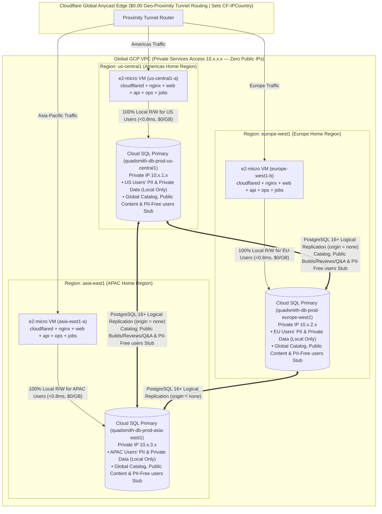

# <a id="adding-deployment-regions" >Telemetry-Driven Multi-Region Expansion and Regional User Data Residency</a>

## <a id="table-of-contents" >Table of Contents</a>

- [1. Background](#1-background)
- [2. Goal](#2-goal)
- [3. Proposal](#3-proposal)
  - [Telemetry Triggers for Adding a New Geographic Region](#telemetry-triggers-for-adding-a-new-geographic-region)
  - [Multi-Region Cloudflare Tunnel Geo-Proximity Routing](#multi-region-cloudflare-tunnel-geo-proximity-routing)
  - [Regional User Data Residency via Home-Region Cloud SQL Primaries and PostgreSQL Logical Replication](#regional-user-data-residency-via-home-region-cloud-sql-primaries-and-postgresql-logical-replication)
  - [Region-Aware Pool Routing and Traveler Forwarding in `server-api`](#region-aware-pool-routing-and-traveler-forwarding-in-server-api)
  - [Idempotent Multi-Region Job Execution Across All Regions](#idempotent-multi-region-job-execution-across-all-regions)
  - [Step-by-Step Instructions for Adding and Verifying a New Region](#step-by-step-instructions-for-adding-and-verifying-a-new-region)
- [4. Alternatives considered](#4-alternatives-considered)
  - [Distributed SQL with Native Row-Level Geo-Partitioning (CockroachDB `REGIONAL BY ROW` or GCP Cloud Spanner)](#distributed-sql-with-native-row-level-geo-partitioning-cockroachdb-regional-by-row-or-gcp-cloud-spanner)
  - [Single `us-central1` Writable Primary with Cross-Region Physical Read-Only Replicas](#single-us-central1-writable-primary-with-cross-region-physical-read-only-replicas)
  - [Scale Vertically in `us-central1` Instead of Adding International Regions](#scale-vertically-in-us-central1-instead-of-adding-international-regions)
  - [Multi-Region Managed Kubernetes (GKE Autopilot)](#multi-region-managed-kubernetes-gke-autopilot)
- [5. Assumptions](#5-assumptions)

---

## <a id="1-background" >1. Background</a>

In [`deployment_architecture.md`](deployment_architecture.md) (which, together
with this plan and
[`scaling_deployment_regions.md`](scaling_deployment_regions.md), supersedes
[`e2_micro_deployment_and_evolution.md`](archive/e2_micro_deployment_and_evolution.md)),
Quadsmith's initial production deployment runs all five stateless Go services
([`server-web`](../src/go/server-web), [`server-api`](../src/go/server-api),
[`server-ops-web`](../src/go/server-ops-web),
[`server-ops-api`](../src/go/server-ops-api), and
[`server-cron`](../src/go/server-cron)) alongside an ultra-lean Nginx gateway on
a single Google Cloud Platform `e2-micro` VM in `us-central1`, connected to a
Private-IP **GCP Cloud SQL for PostgreSQL** instance (`db-f1-micro`) in
`us-central1` and exposed outbound via a standalone `cloudflared` container.

While Cloudflare's 300+ global edge PoPs and Smart Tiered Cache serve static
assets (`/assets/*`), the 12 MB stripped WebAssembly physics engine
(`/quadsmith-engine.wasm?v=<hash>`), and immutable media blobs (`/blobs/{id}`)
locally from the edge closest to every user worldwide, **uncached dynamic
requests**—initial `index.html` document loads, social crawler Open Graph SSR
lookups, and all ConnectRPC API reads and writes—must travel from the user's
nearest Cloudflare edge PoP down the Cloudflare Tunnel to the nearest regional
compute node. When users in Europe, Asia-Pacific, South America, or Oceania
connect to a compute topology that only has nodes in North America
(`us-central1`), every uncached API call suffers **120 ms – 220 ms of
transoceanic round-trip latency**, and all user personal data (PII) is stored in
the United States.

Crucially, [`src/db/quadsmith_api.sql`](../src/db/quadsmith_api.sql) already
separates the public [`users`](../src/db/quadsmith_api.sql) identity stub
(`uuid`, `id`/username, `role`, timestamps—containing **zero raw PII**) from
sensitive personal data and credential tables (`user_emails`, `oauth_accounts`,
`user_email_oauth_accounts`, `refresh_tokens`, `email_otps`), while all public
community tables (`entities`, `builds`, `reviews`, `questions`, `answers`)
reference `users(uuid)`. This schema boundary enables true **per-user regional
data residency** when expanding into new regions.

---

## <a id="2-goal" >2. Goal</a>

Define the telemetry thresholds, architecture, and step-by-step operator
instructions for expanding Quadsmith into new geographic regions (such as
`europe-west1`, `asia-east1`, `southamerica-east1`, or `australia-southeast1`)
whenever telemetry indicates significant user traffic in an unserved region,
storing each user's private data and PII exclusively in their own home region's
**GCP Cloud SQL Primary** (`<0.8 ms` local read **and** write latency,
`$0.00/GB` same-region bandwidth, and strict GDPR/regional data residency) while
synchronizing the shared hardware catalog and public community tables globally
via **PostgreSQL Logical Replication** over the global GCP VPC.

---

## <a id="3-proposal" >3. Proposal</a>

> **TL;DR:**
>
> - Monitor Cloudflare geographic request distribution and origin RTT telemetry
>   to detect underserved regions.
> - Add a new region by appending a `regions { ... }` block to
>   `deploy/config/prod.textproto` and running `make deploy ENV=prod`.
> - Provision a writable Private-IP **GCP Cloud SQL Primary** in each region
>   over the global GCP VPC.
> - Pin each user's PII, auth credentials, private builds/collections, and media
>   blobs strictly to their `users.home_region` (<0.8 ms local reads & writes).
> - Replicate only the PII-free `users` stub, hardware catalog, and public
>   community content across regions via PostgreSQL 16+ Logical Replication.

Rather than pre-allocating idle international infrastructure on a fixed calendar
schedule, new regions are added **on demand when telemetry confirms significant
user traffic in a geography not covered by the current compute topology**. When
a new region is added to
[`deploy/config/prod.textproto`](../deploy/config/prod.textproto), `make deploy`
provisions a regional Compute Engine VM and a writable Private-IP **GCP Cloud
SQL Primary** (`quadsmith-db-prod-<region>`) inside the global GCP VPC. Users
registering in that region are assigned `home_region = "<region>"`: their
sensitive PII, credentials, and private data remain physically pinned to that
region's Cloud SQL instance and regional R2 bucket (giving `<0.8 ms` local reads
and writes with 100% regional data residency), while the shared hardware
component catalog, PII-free `users` stub, and public community contributions are
synchronized across all regional primaries via native PostgreSQL Logical
Replication.

### <a id="telemetry-triggers-for-adding-a-new-geographic-region" >Telemetry Triggers for Adding a New Geographic Region</a>

We distinguish strictly between **capacity saturation within an existing
region** (handled by per-region vertical or intra-region horizontal scaling in
[`scaling_deployment_regions.md`](scaling_deployment_regions.md)) and
**geographic latency or data residency requirements for underserved regions**
(handled by adding a new region in this plan):

| Telemetry Signal                                          | Source / Metric                                                                                                                      | Threshold to Add a New Region                                                                                                                                     | Candidate Target GCP Region                                                                                                                                                                                                     |
| :-------------------------------------------------------- | :----------------------------------------------------------------------------------------------------------------------------------- | :---------------------------------------------------------------------------------------------------------------------------------------------------------------- | :------------------------------------------------------------------------------------------------------------------------------------------------------------------------------------------------------------------------------ |
| **Regional Request Share**                                | Cloudflare Zone Analytics &rarr; _Traffic by Country / Continent_ (filtered to dynamic `api.quadsmith.com` & HTML document requests) | **$\ge 15\%$ of total dynamic requests** _(or **$\ge 10,000$ MAU** / **$\ge 50,000$ app loads/month**)_ originating from a continent without a local compute node | Europe &rarr; `europe-west1` (Belgium)<br>Asia-Pacific &rarr; `asia-east1` (Taiwan) or `asia-southeast1` (Singapore)<br>South America &rarr; `southamerica-east1` (São Paulo)<br>Oceania &rarr; `australia-southeast1` (Sydney) |
| **Edge-to-Origin Tunnel RTT**                             | Cloudflare Zero Trust &rarr; _Networks &rarr; Tunnels &rarr; Metrics_ & Cloudflare HTTP `OriginResponseTime` by client continent     | **P50 Origin Response Time $> 120\text{ ms}$** _(or P95 $> 250\text{ ms}$)_ for users in that geographic region compared to $< 25\text{ ms}$ in covered regions   | Closest GCP region with direct Cloudflare Upper-Tier PoP peering                                                                                                                                                                |
| **Regional Data Residency / Multi-Region HA Requirement** | Regulatory compliance (e.g., EU GDPR residency) or multi-region availability SLO                                                     | Requirement to keep regional users' PII within jurisdiction or survive a full single-region outage                                                                | `europe-west1` (EU jurisdiction), `asia-east1` (APAC)                                                                                                                                                                           |

<details>
<summary><strong>Alternatives considered</strong></summary>

##### <a id="alt-pre-provision-all-regions-at-launch" >Pre-Provision 3+ Global Regions at Initial Launch Before Telemetry Justification</a>

Deploy VMs and Cloud SQL instances in `us-central1`, `europe-west1`, and
`asia-east1` on day one before observing international user traffic.

**Pros:**

- Low international latency from the very first day of launch.

**Cons:**

- Multiplies monthly baseline costs by ~4.5x (~$47.50/month for 3 regions vs.
  ~$10.50/month for `us-central1` alone) to serve regions that may initially
  have negligible traffic.

</details>

### <a id="multi-region-cloudflare-tunnel-geo-proximity-routing" >Multi-Region Cloudflare Tunnel Geo-Proximity Routing</a>

Cloudflare Tunnel natively supports up to 25 active `cloudflared` connector
replicas (100 total QUIC connections) sharing a single tunnel token across
distinct data centers worldwide:

- **Zero-Cost Geo-Proximity Routing**: Each regional VM establishes 4 outbound
  QUIC/HTTP2 connections from its standalone `cloudflared` container to the
  nearest Cloudflare PoPs. When an uncached API or SSR request arrives at a
  Cloudflare edge PoP, Cloudflare routes the request down the tunnel connection
  with the lowest network RTT—serving European users from `europe-west1` and
  Asian users from `asia-east1` without requiring paid Cloudflare Load Balancing
  subscriptions.
- **Automatic Multi-Region High Availability**: If any regional `cloudflared`
  connector disconnects during a VM reboot or regional maintenance event,
  Cloudflare immediately fails over traffic to the remaining connected regional
  VMs with zero dropped requests.

<details>
<summary><strong>Alternatives considered</strong></summary>

##### <a id="alt-cloudflare-paid-load-balancer" >Cloudflare Paid Geo-Steering Load Balancer with Public Regional IPs</a>

Assign static public IPv4 addresses to each regional VM and use Cloudflare's
paid Load Balancing add-on with active geo-steering health monitors.

**Pros:**

- Supports custom weight ratios and fine-grained per-country steering rules.

**Cons:**

- Incurs $3.65/month per VM for GCP static IPv4 addresses ($7.30–$10.95/month)
  plus $5.00–$15.00+/month for Cloudflare Load Balancing and active health check
  queries.
- Requires opening inbound firewall ports on every regional VM.

</details>

### <a id="regional-user-data-residency-via-home-region-cloud-sql-primaries-and-postgresql-logical-replication" >Regional User Data Residency via Home-Region Cloud SQL Primaries and PostgreSQL Logical Replication</a>

To store each user's data in their own region while keeping the hardware catalog
and public community unified across the globe, each region in
[`deploy/config/prod.textproto`](../deploy/config/prod.textproto) runs its own
**writable GCP Cloud SQL Primary** (`quadsmith-db-prod-<region>`, configured
with `--no-assign-ip` and
`--database-flags=cloudsql.logical_replication=on,max_connections=100`):



#### 1. Schema Partitioning: Region-Pinned User Tables vs. Globally Replicated Tables

Because [`users`](../src/db/quadsmith_api.sql) in `src/db/quadsmith_api.sql`
already contains zero raw PII, adding `home_region TEXT NOT NULL` to `users` and
a non-reversible `user_auth_routing` lookup table divides all tables in
`quadsmith_api` into two clean replication classes:

| Table Classification                                                                                                                | Tables in `src/db/quadsmith_api.sql`                                                                                                                                                                                                                                                                                                                                                                                                                                                                                                                                                                                                                        | Storage & Replication Policy                                                                                                                                                                       | Read & Write Latency (in User's Home Region)                                                                                  |
| :---------------------------------------------------------------------------------------------------------------------------------- | :---------------------------------------------------------------------------------------------------------------------------------------------------------------------------------------------------------------------------------------------------------------------------------------------------------------------------------------------------------------------------------------------------------------------------------------------------------------------------------------------------------------------------------------------------------------------------------------------------------------------------------------------------------- | :------------------------------------------------------------------------------------------------------------------------------------------------------------------------------------------------- | :---------------------------------------------------------------------------------------------------------------------------- |
| **Category A: Region-Pinned Private User Data & PII**<br>_(Excluded from Logical Replication)_                                      | `user_emails`, `oauth_accounts`, `user_email_oauth_accounts`, `refresh_tokens`, `email_otps`, `bans`, `banned_emails`, `user_profiles`, private `collections`, draft/private `builds`, user `blobs` & `blob_references`                                                                                                                                                                                                                                                                                                                                                                                                                                     | Stored **exclusively** in the Cloud SQL primary for `users.home_region`. **Never replicated outside the user's home region.**                                                                      | **0.3 – 0.8 ms** _(Both reads AND writes execute 100% locally at $0.00/GB)_                                                   |
| **Category B: Globally Replicated Identity Stub, Catalog & Public Community**<br>_(Included in `quadsmith_global_pub` Publication)_ | **Identity Stub**: `users` (`uuid`, `id`/username, `role`, `home_region`, timestamps), `username_histories`, `user_auth_routing` (`lookup_hash`, `user_uuid`, `home_region`)<br>**Catalog**: `entities`, `frames`, `motors`, `flight_controllers`, `electronic_speed_controllers`, `propellers`, `batteries`, `video_transmitters`, `cameras`, `antennas`, `receivers`, `gps_receivers`, `goggles`, `transmitters`, `chargers`, `field_tools`, `software_tools`, `*firmwares`<br>**Public Community**: published `builds`, `reviews`, `review_comments`, `review_votes`, `questions`, `answers`, `question_comments`, `answer_comments`, `user_reputations` | Synchronized across all regional Cloud SQL primaries via **PostgreSQL 16+ Logical Replication** (`CREATE PUBLICATION` / `CREATE SUBSCRIPTION ... WITH (origin = 'none')`) over the global GCP VPC. | **0.3 – 0.8 ms** _(Both reads AND writes execute locally on the regional primary and replicate asynchronously in ~50–150 ms)_ |

- **Intact Foreign Keys Across Regions**: Because the PII-free `users` stub
  (`uuid`, `id`, `role`, `home_region`) is replicated in Category B across all
  regions, every database-level foreign key
  (`FOREIGN KEY (user_uuid) REFERENCES users (uuid)`) on public `builds`,
  `reviews`, `questions`, and `answers` remains **100% satisfied on every
  regional Cloud SQL primary**.
- **Conflict-Free Multi-Origin Logical Replication**: All primary keys in
  Quadsmith are time-ordered `UUIDv7` (`uuid`), eliminating primary-key sequence
  collisions across regional primaries. PostgreSQL 16+'s native
  `CREATE SUBSCRIPTION ... WITH (origin = 'none')` option instructs each
  regional primary to replicate only locally originated transactions, preventing
  infinite replication loops between regions.
- **Independent Per-Region Storage & Jurisdiction-Pinned Media Blobs**:
  - User-uploaded media blobs (`blobs` table, or regional Cloudflare R2 buckets
    such as `quadsmith-blobs-eu` configured with `cf-r2-jurisdiction: eu` once
    offloaded per
    [`scaling_deployment_regions.md`](scaling_deployment_regions.md)) are stored
    **only** in the uploading user's `home_region`, avoiding multiplying `BYTEA`
    disk storage costs across every region's Cloud SQL instance.

<details>
<summary><strong>Alternatives considered</strong></summary>

##### <a id="alt-physical-wal-read-replicas" >Physical Cloud SQL Read-Only Replicas (`--master-instance-name`) Instead of Regional Primaries with Logical Replication</a>

Use a single writable Cloud SQL primary in `us-central1` and provision read-only
physical WAL replicas in `europe-west1` and `asia-east1`.

**Pros:**

- Simpler one-way physical WAL replication setup without defining a logical
  replication publication list.

**Cons:**

- **No Regional Data Residency**: Physical WAL replication copies 100% of rows
  (including every EU user's email address, OAuth tokens, and `BYTEA` blobs)
  onto disks in the US, EU, and Asia.
- **High International Write Latency**: Every write mutation (`CreateBuild`,
  `UpdateBuild`, profile updates, auth OTPs) from Europe or Asia must traverse
  the ocean back to `us-central1` (85–140 ms RTT).
- **Multiplied Blob Disk Costs**: Every gigabyte of `BYTEA` blobs is billed on
  the primary and duplicated onto every read replica.

</details>

### <a id="region-aware-pool-routing-and-traveler-forwarding-in-server-api" >Region-Aware Pool Routing and Traveler Forwarding in `server-api`</a>

Each regional `server-api` deployment knows its own `QS_REGION` (e.g.,
`"europe-west1"`), connects to its local Cloud SQL primary via
`QS_DATABASE_URL`, and maintains a map of peer regional `pgxpool.Pool`
connections
(`QS_PEER_DATABASE_URLS="us-central1=postgres://...,asia-east1=postgres://..."`)
over the global GCP VPC (`10.x.x.x`):

1. **Registration & Home-Region Assignment**:
   - When a new user registers via Email OTP or OAuth on a regional `server-api`
     node, `users.home_region` is set to that node's `QS_REGION` (e.g.,
     `"europe-west1"`), their `users` stub and salted HMAC lookup entry in
     `user_auth_routing` (`HMAC_SHA256(email)` &rarr; `user_uuid`,
     `home_region`) are inserted (replicating globally via Logical Replication),
     and their PII (`user_emails`, `oauth_accounts`, `refresh_tokens`) is
     inserted strictly into the local `europe-west1` Cloud SQL primary.
   - The issued JWT access token includes `"region": "europe-west1"`.
2. **Normal Path — User in Their Home Region (99% of Traffic)**:
   - When the user makes authenticated ConnectRPC calls, Cloudflare Tunnel
     routes them to their nearest regional VM (`europe-west1`).
   - `server-api` checks `jwt.Region == cfg.Region` (`"europe-west1"` ==
     `"europe-west1"`), executing **both reads and writes against the local
     `QS_DATABASE_URL` pool in `<0.8 ms`**.
3. **Traveler & Cross-Region Login Path (1% of Traffic)**:
   - If an `europe-west1` user travels to North America (connecting to the
     `us-central1` VM), `server-api` in `us-central1` sees
     `jwt.Region == "europe-west1"` (or during login, queries
     `user_auth_routing` by `HMAC_SHA256(email)` and discovers
     `home_region = "europe-west1"`).
   - For any RPC touching Category A private/PII tables (`GetUserProfile`,
     `UpdateUserProfile`, `RefreshSession`, private `collections`), `server-api`
     executes the query against `peerPools["europe-west1"]` over the internal
     global GCP VPC (`~85 ms` RTT), guaranteeing that the user's PII is never
     written to `us-central1` disks even while traveling.

<details>
<summary><strong>Alternatives considered</strong></summary>

##### <a id="alt-http-proxy-forwarding-between-regional-apis" >Forward Entire HTTP/ConnectRPC Requests Between Regional `server-api` Containers Instead of Using Peer `pgxpool` Connections</a>

Have the `us-central1` `server-api` proxy the HTTP request to the `europe-west1`
`server-api` container over the VPC instead of querying
`peerPools["europe-west1"]` directly.

**Pros:**

- Avoids opening cross-region `pgxpool` connections
  (`min_connections: 0, max_connections: 5`) from `server-api` to peer regional
  Cloud SQL instances.

**Cons:**

- Requires managing internal cross-region service discovery and mTLS/auth
  between regional `server-api` VMs, whereas each Cloud SQL primary already has
  a stable Private VPC IP (`10.x.x.x`) reachable directly via `pgxpool`.

</details>

### <a id="idempotent-multi-region-job-execution-across-all-regions" >Idempotent Multi-Region Job Execution Across All Regions</a>

Because each region owns its own Category A private user tables (`email_otps`,
`refresh_tokens`, `blobs`, `users` soft-deletes) on its local Cloud SQL primary,
and because all five maintenance tasks in
[`src/go/shared/pkg/auth/job.go`](../src/go/shared/pkg/auth/job.go) and
[`src/go/shared/pkg/blob/cleanup.go`](../src/go/shared/pkg/blob/cleanup.go) are
strictly idempotent (`FOR UPDATE OF hh SKIP LOCKED`), running the identical
zero-profile [`deploy/docker-compose.yaml`](../deploy/docker-compose.yaml)
(including `server-ops-api`, `server-ops-web`, and the `server-cron` cron
daemon) in every region cleans up that region's expired OTPs, expired refresh
tokens, orphaned blobs, and soft-deleted accounts locally against its own
regional Cloud SQL primary (`<0.8 ms` RTT).

<details>
<summary><strong>Alternatives considered</strong></summary>

##### <a id="alt-centralized-cron-in-us-only" >Run `server-cron` Only in `us-central1` Targeting All Regional Databases</a>

Run a single `server-cron` scheduler in `us-central1` that iterates over all
regional Cloud SQL databases across the global VPC.

**Pros:**

- Saves ~10 MB of idle `server-cron` container RAM in secondary regions.

**Cons:**

- Introduces asymmetric Compose configuration across regions and halts regional
  token/OTP/blob cleanup in Europe and Asia if the `us-central1` VM is
  undergoing maintenance.

</details>

### <a id="step-by-step-instructions-for-adding-and-verifying-a-new-region" >Step-by-Step Instructions for Adding and Verifying a New Region</a>

The following operational workflow (also included in
[`deploy/README.md`](../deploy/README.md)) covers adding a new geographic region
and verifying regional data residency and logical replication:

#### 1. Add the Region to `deploy/config/prod.textproto`

Append a new `regions` block specifying the target GCP region, the regional
Cloud SQL tier (`db_tier`), and the regional Compute Engine VM node (`zone`,
`machine_type`):

```textproto
# deploy/config/prod.textproto
environment: "prod"
gcp_project_id: "quadsmith-prod"
registry_region: "us-central1"

regions {
  region: "us-central1"
  db_tier: "db-f1-micro"
  nodes {
    zone: "us-central1-a"
    machine_type: "e2-micro"
  }
}

# Added when European traffic reaches >= 15% of dynamic requests:
regions {
  region: "europe-west1"
  db_tier: "db-f1-micro"
  nodes {
    zone: "europe-west1-b"
    machine_type: "e2-micro"
  }
}

db_backup_retention_count: 5
```

#### 2. Validate Configuration and Run `make deploy ENV=prod`

```bash
# 1. Verify the updated textproto passes schema validation:
make verify

# 2. Converge the new region's Cloud SQL primary, logical replication & VM:
make deploy ENV=prod
```

During `make deploy ENV=prod`, [`deploy/deploy.sh`](../deploy/deploy.sh)
automatically:

1. Creates the writable Private-IP Cloud SQL Primary
   `quadsmith-db-prod-europe-west1` in `europe-west1` (`--no-assign-ip`,
   `--database-flags=cloudsql.logical_replication=on,max_connections=100`,
   automated backups & PITR enabled).
2. Creates the `quadsmith_api` and `quadsmith_ops` logical databases on
   `quadsmith-db-prod-europe-west1` and applies `make db-migrate` (`psqldef`) so
   its schema matches `src/db/*.sql`.
3. Ensures the `quadsmith_global_pub` PostgreSQL Logical Replication publication
   (covering Category B catalog, public community, and PII-free `users` stub
   tables) and mesh subscriptions (`WITH (origin = 'none', copy_data = true)` on
   initial creation) are active between `quadsmith-db-prod-us-central1` and
   `quadsmith-db-prod-europe-west1`.
4. Creates the `--no-address` Debian 12 VM `quadsmith-prod-europe-west1-b-1`,
   configures its 2 GB swapfile, Docker log rotation, and standalone
   `cloudflared` container connected to the shared `quadsmith-prod` Cloudflare
   Tunnel.
5. Writes `/opt/quadsmith/.env` on each regional VM with `QS_REGION`, local
   `QS_DATABASE_URL`, and `QS_PEER_DATABASE_URLS`, then executes
   [`deploy/deploy_blue_green.sh`](../deploy/deploy_blue_green.sh) sequentially
   across each region.

#### 3. Verify Regional Cloud SQL Residency and Logical Replication Health

```bash
# 1. Verify the regional Cloud SQL primary is RUNNABLE on its Private VPC IP:
gcloud sql instances describe quadsmith-db-prod-europe-west1 \
  --project=quadsmith-prod \
  --format="table(name,region,state,ipAddresses[0].ipAddress,settings.databaseFlags)"

# 2. Verify the new regional VM's containers, /healthz endpoint & subscription status:
gcloud compute ssh quadsmith-prod-europe-west1-b-1 \
  --zone=europe-west1-b \
  --project=quadsmith-prod \
  --tunnel-through-iap \
  --command="curl -sf http://127.0.0.1:9000/healthz && docker ps"
```

#### 4. Regional Cost Progression Summary

| Deployed Regions                               | Compute Topology                                | Cloud SQL Topology (Regional Primaries)                                       | Local Read & Write Latency (Home Region)                      | Incremental Cost to Add Region                             | Total Monthly Cost (`prod`) |
| :--------------------------------------------- | :---------------------------------------------- | :---------------------------------------------------------------------------- | :------------------------------------------------------------ | :--------------------------------------------------------- | :-------------------------- |
| **1 Region (`us-central1`)**                   | `1x e2-micro` ($0.00 Always Free)               | `1x db-f1-micro` Primary + 10 GB SSD (~$10.50/mo)                             | **<0.8 ms** _(Americas)_                                      | —                                                          | **~$10.50 / mo**            |
| **2 Regions (`us-central1` + `europe-west1`)** | `1x e2-micro` ($0) + `1x e2-micro` (~$7.50/mo)  | `2x db-f1-micro` Regional Primaries (~$21.00/mo + ~$0.50 logical replication) | **<0.8 ms** _(Americas & Europe — both Reads & Writes)_       | **+~$18.50 / mo** _(~$7.50 VM + ~$10.50 DB + ~$0.50 sync)_ | **~$29.00 / mo**            |
| **3 Regions (`us` + `eu` + `asia-east1`)**     | `1x e2-micro` ($0) + `2x e2-micro` (~$15.00/mo) | `3x db-f1-micro` Regional Primaries (~$31.50/mo + ~$1.00 logical replication) | **<0.8 ms** _(Americas, Europe & APAC — both Reads & Writes)_ | **+~$18.50 / mo**                                          | **~$47.50 / mo**            |

---

## <a id="4-alternatives-considered" >4. Alternatives considered</a>

<details>
<summary><strong>Alternatives considered</strong></summary>

### <a id="distributed-sql-with-native-row-level-geo-partitioning-cockroachdb-regional-by-row-or-gcp-cloud-spanner" >Distributed SQL with Native Row-Level Geo-Partitioning (CockroachDB `REGIONAL BY ROW` or GCP Cloud Spanner)</a>

Migrate from GCP Cloud SQL for PostgreSQL to a multi-region distributed SQL
database—such as **CockroachDB Cloud** (`LOCALITY REGIONAL BY ROW` /
`LOCALITY GLOBAL`) or **Google Cloud Spanner** (Geo-Partitioning)—so the
database engine automatically pins user rows to regional disks based on a
`region` column while exposing a single logical SQL endpoint.

**Pros:**

- **Single Logical Database Endpoint**: Eliminates managing PostgreSQL Logical
  Replication publications/subscriptions and peer `pgxpool` maps in
  `server-api`.
- **Automatic Raft Leaseholder Placement**: Moving a user between regions
  requires only `UPDATE users SET region = 'europe-west1'`, and the database
  engine automatically migrates the row's physical storage replicas.

**Cons:**

- **8x to 15x Higher Minimum Monthly Cost**: Multi-region CockroachDB Standard /
  Dedicated or multi-region Cloud Spanner with geo-partitioning costs **~$250 –
  $600+/month** minimum across 3 regions, compared to **~$31.50/month** for 3
  regional `db-f1-micro` Cloud SQL primaries.
- **Breaks `psqldef` & Standard PostgreSQL Tooling**: Requires custom
  CockroachDB (`LOCALITY REGIONAL BY ROW AS region`) or Spanner
  (`INTERLEAVE IN PARENT` / `PLACEMENT KEY`) DDL extensions that are
  incompatible with `psqldef` and our local `postgres:16-alpine` sandbox
  container.
- **Higher Local Write Latency**: Distributed Raft/Paxos consensus writes take
  ~2–15 ms even within a region, compared to **0.3 – 0.8 ms** on a local
  single-region Cloud SQL primary.

### <a id="single-us-central1-writable-primary-with-cross-region-physical-read-only-replicas" >Single `us-central1` Writable Primary with Cross-Region Physical Read-Only Replicas</a>

Keep a single writable Cloud SQL primary in `us-central1` and deploy read-only
physical Cloud SQL replicas (`--master-instance-name`) in `europe-west1` and
`asia-east1`, routing all writes from international users back to the US.

**Pros:**

- Does not require `users.home_region` assignment or PostgreSQL Logical
  Replication publications.

**Cons:**

- Stores every international user's PII (`user_emails`, `oauth_accounts`,
  `refresh_tokens`) on US disks and replicates US users' PII onto EU and APAC
  disks, failing regional data residency isolation.
- Forces every international write mutation (`CreateBuild`, `UpdateBuild`, auth
  OTPs) to pay 85 ms – 140 ms of cross-ocean network latency.
- Duplicates every gigabyte of `BYTEA` media blobs onto every region's disk.

### <a id="scale-vertically-in-us-central1-instead-of-adding-international-regions" >Scale Vertically in `us-central1` Instead of Adding International Regions</a>

Upgrade the single `us-central1` VM to `e2-small` or `e2-medium` instead of
provisioning secondary regions when international traffic grows.

**Pros:**

- Keeps all compute and database state consolidated in a single region.

**Cons:**

- Vertical scaling in Iowa (`us-central1`) cannot overcome the speed-of-light
  fiber latency (>120–200 ms RTT) experienced by users in Europe or Asia-Pacific
  or satisfy regional data residency requirements.

### <a id="multi-region-managed-kubernetes-gke-autopilot" >Multi-Region Managed Kubernetes (GKE Autopilot)</a>

Migrate from Docker Compose on Compute Engine VMs to Google Kubernetes Engine
(GKE Autopilot) clusters across `us-central1`, `europe-west1`, and `asia-east1`.

**Pros:**

- Native Kubernetes `Deployment` rolling updates and pod-level health probes.

**Cons:**

- GKE cluster management fees and minimum pod resource floors cost >$70–$150/mo
  across three regions—3x to 5x more expensive than running stateless Docker
  Compose on `e2-micro` VMs.

</details>

---

## <a id="5-assumptions" >5. Assumptions</a>

1. All tables in `src/db/quadsmith_api.sql` continue to use `UUIDv7` primary
   keys (`uuid`), preventing primary-key collisions when multiple regional Cloud
   SQL primaries insert into globally replicated Category B tables (`users`
   stub, `entities`, `builds`, `reviews`, `questions`, `answers`).
2. Usernames (`users.id`) and entity slugs (`entities(collection, id)`) are
   checked locally and verified across peer regional pools at creation time to
   preserve global human-readable ID uniqueness across regions.
3. Secondary regional VMs authenticate to the `us-central1` Google Artifact
   Registry using their Compute Engine default service account
   (`roles/artifactregistry.reader`), incurring only ~$0.01/GB in cross-region
   image pull egress during deployments.
