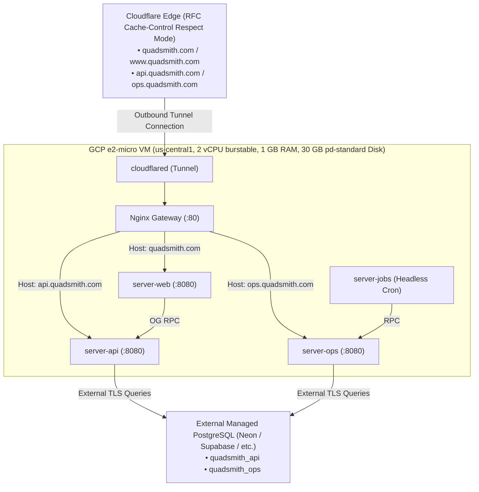

# <a id="e2-micro-deployment-and-evolution" >e2-micro Production Deployment and Evolution Architecture</a>

## <a id="table-of-contents" >Table of Contents</a>

- [1. Background](#1-background)
- [2. Goal](#2-goal)
- [3. Proposal](#3-proposal)
  - [Cloud Infrastructure and Zero-IP Tunnel Ingress](#cloud-infrastructure-and-zero-ip-tunnel-ingress)
  - [Ultra-Lean Nginx Reverse Proxy and Subdomain Routing](#ultra-lean-nginx-reverse-proxy-and-subdomain-routing)
  - [Portable RFC HTTP Caching for Static Assets, WASM, and Blobs](#portable-rfc-http-caching-for-static-assets-wasm-and-blobs)
  - [Stateless Container Topology and Host Memory Hygiene](#stateless-container-topology-and-host-memory-hygiene)
  - [Colocated Artifact Registry and GitHub Actions CD](#colocated-artifact-registry-and-github-actions-cd)
  - [Phased Architecture Evolution Roadmap](#phased-architecture-evolution-roadmap)
- [4. Alternatives considered](#4-alternatives-considered)
  - [Fly.io Independent Micro-VM Deployment](#fly-io-independent-micro-vm-deployment)
  - [Direct Cloud Run and Cloud Scheduler Deployment](#direct-cloud-run-and-cloud-scheduler-deployment)
- [5. Assumptions](#5-assumptions)
- [6. Future work](#6-future-work)
  - [Automated Zero-Downtime Blue-Green Switchover](#automated-zero-downtime-blue-green-switchover)
  - [Automated Database Migration Gate in CI/CD](#automated-database-migration-gate-in-cicd)

---

## <a id="1-background" >1. Background</a>

Quadsmith's service architecture was recently aligned by language into
[`src/go`](../src/go) and [`src/react`](../src/react) in
[`infrastructure_alignment_and_container_architecture.md`](infrastructure_alignment_and_container_architecture.md).
Subsequently, background workers and operations maintenance were refactored in
[`tasks_and_jobs.md`](tasks_and_jobs.md) to establish clean boundaries:

1. **Tasks & Jobs** (5 maintenance procedures: `CleanupExpiredOtps` every 6h,
   `CleanupExpiredTokens` every 12h, `CleanupOrphanedBlobs` every 10m,
   `PurgeSoftDeletedAccounts` every 8h, and `SendUsernameReleaseWarnings` every
   24h—with SQL-engine maintenance delegated natively to PostgreSQL
   `autovacuum`, alongside `ListTasks`, `GetTask`, `ListJobs`, and `GetJob`) are
   owned and served by [`server-ops`](../src/go/server-ops) under `OpsService`.
2. **Headless Scheduler** ([`server-jobs`](../src/go/server-jobs)) operates
   purely as a headless cron daemon with zero HTTP APIs or database connections,
   running typed background schedulers via `robfig/cron/v3` that trigger task
   RPCs on `server-ops`.
3. **Public APIs & Blobs** are served by [`server-api`](../src/go/server-api)
   via ConnectRPC alongside plain HTTP media endpoints (`/api/blobs`,
   `/blobs/{id}`) documented in
   [`blob_storage_and_streaming_architecture.md`](blob_storage_and_streaming_architecture.md).
4. **Web Frontend & Social Previews** are served by
   [`server-web`](../src/go/server-web), which serves the React 19 SPA, the 17.5
   MB WebAssembly physics engine
   ([`quadsmith-engine.wasm`](../src/react/app-web/public/quadsmith-engine.wasm)),
   and dynamically injects Open Graph / Twitter Card metadata for social media
   crawlers via [`static.go`](../src/go/shared/pkg/static/static.go).

The local sandbox environment in
[`test/sandbox/docker-compose.yaml`](../test/sandbox/docker-compose.yaml)
coordinates these four services alongside a local PostgreSQL container. However,
we require an initial production deployment that costs **$0.00/month**, avoids
managing stateful database instances on the host VM, keeps the stack 100%
cloud-portable without proprietary edge lock-in, and provides a clear evolution
roadmap—scaling first across global regions and later vertically and
elastically—as user traffic grows.

---

## <a id="2-goal" >2. Goal</a>

Deploy Quadsmith's four stateless Go services (`server-web`, `server-api`,
`server-ops`, `server-jobs`) to a single Google Cloud Platform Always Free
`e2-micro` VM running Docker Compose with zero public IP and zero open inbound
firewall ports via Cloudflare Tunnel, backed by an external managed PostgreSQL
database at **$0.00/month**, accompanied by a four-phase architectural evolution
roadmap with concrete traffic capacities and cost estimates.

---

## <a id="3-proposal" >3. Proposal</a>

> **TL;DR:**
>
> - Deploy 4 stateless Go services + Nginx on 1 GCP `e2-micro` VM ($0/mo).
> - Expose subdomains via Cloudflare Tunnel with zero public IP or open ports.
> - Route subdomains using an ultra-lean Nginx gateway (~4 MB RAM).
> - Offload 99% of bandwidth via RFC `Cache-Control` headers with zero lock-in.
> - Scale first to multi-region `e2-micro` replicas, then vertically and to
>   Cloud Run.

This proposal defines an initial zero-dollar production architecture leveraging
GCP's Always Free tier and Cloudflare's edge security while preserving 100%
portability across cloud and CDN providers. By delegating PostgreSQL persistence
to an external managed database provider, all four services on the VM become
entirely stateless ("cattle, not pets"). Cloudflare Tunnel (`cloudflared`)
connects outbound to Cloudflare, eliminating the need for a public IPv4 address
(avoiding GCP's $3.65/mo charge) and closing all inbound firewall ports. An
ultra-lean Nginx gateway inspects incoming `Host` headers to route subdomains to
their respective containers, while standard HTTP `Cache-Control` headers allow
any upstream CDN to absorb static asset, WASM, and media blob traffic at the
edge.



### <a id="cloud-infrastructure-and-zero-ip-tunnel-ingress" >Cloud Infrastructure and Zero-IP Tunnel Ingress</a>

The host VM is provisioned under the GCP Compute Engine Always Free tier, which
grants **744 instance-hours per month** (1 concurrent 24/7 VM) per billing
account:

- **Instance Type**: `e2-micro` (2 shared vCPUs burstable, 1 GB RAM).
- **Region**: `us-central1` (Iowa), `us-east1` (South Carolina), or `us-west1`
  (Oregon). Colocating in `us-central1` aligns with Artifact Registry defaults.
- **Boot Disk**: 30 GB `pd-standard` (Standard Persistent Disk), which is 100%
  covered by the 30 GB/month free tier allowance.
- **External IP**: **None** (`--no-address`). The VM is provisioned with zero
  public IPv4 address.
- **Inbound Firewall**: All ingress firewall rules are disabled. Only outbound
  connections on port 443/7844 are allowed to establish the Cloudflare Tunnel
  and reach the external database.

A lightweight `cloudflared` container runs inside Docker Compose, authenticating
via a tunnel token (`QS_CLOUDFLARE_TUNNEL_TOKEN`). It establishes redundant,
outbound-only QUIC/HTTP2 tunnels to Cloudflare's global Anycast edge. In
Cloudflare DNS, `CNAME` records for `@`, `www`, `api`, and `ops` point to
`<tunnel-uuid>.cfargotunnel.com`, routing all traffic down the tunnel to
`http://nginx:80` inside the VM's Docker network.

This delivers two critical advantages:

1. **$0.00 Cost Guarantee**: Eliminates Google's $0.005/hour ($3.65/month)
   in-use external IPv4 address fee.
2. **Zero Inbound Attack Surface**: The VM cannot be port-scanned,
   DDoS-attacked, or directly probed from the public internet.

<details>
<summary><strong>Alternatives considered</strong></summary>

##### <a id="alt-public-static-ipv4" >Public Static IPv4 with GCP Firewall Rules</a>

Allocate a GCP external static IPv4 address, point Cloudflare DNS `A` records to
it, and restrict GCP ingress firewall rules to Cloudflare's published IP ranges.

**Pros:**

- Standard DNS architecture allowing direct IP diagnostics if needed.
- Does not require running the `cloudflared` daemon container.

**Cons:**

- Costs ~$3.65/month due to Google's mandatory in-use IPv4 billing.
- Exposes an internet-reachable network interface susceptible to firewall rule
  misconfiguration.

##### <a id="alt-direct-cloudflared-ingress" >Direct cloudflared Ingress Without Nginx</a>

Configure `cloudflared`'s ingress rules to route each hostname directly to its
respective container (`api.quadsmith.com` &rarr; `http://api:8080`,
`quadsmith.com` &rarr; `http://web:8080`).

**Pros:**

- Eliminates the Nginx container entirely, saving ~4 MB of RAM.
- Simplifies Compose file by having one fewer service.

**Cons:**

- Couples internal routing strictly to Cloudflare's proprietary tunnel schema.
- Precludes local offline testing or unified reverse proxy access logging on the
  VM without an active Cloudflare Tunnel.

</details>

### <a id="ultra-lean-nginx-reverse-proxy-and-subdomain-routing" >Ultra-Lean Nginx Reverse Proxy and Subdomain Routing</a>

A dedicated, Alpine-based Nginx container (`nginx:alpine`) acts as the internal
ingress gateway on port 80 within the Docker Compose network.

To ensure all three HTTP-serving Go services listen on a uniform internal port
(`8080`) behind Nginx and redirect OAuth flows to the canonical domain,
[`src/go/server-web/config/prod.textproto`](../src/go/server-web/config/prod.textproto)
and
[`src/go/server-api/config/prod.textproto`](../src/go/server-api/config/prod.textproto)
(along with their `staging.textproto` counterparts) are updated from `port: 443`
to `port: 8080`, matching
[`server-ops`](../src/go/server-ops/config/prod.textproto), and `server-api`'s
`oauth.web_base_url`, `from_address`, and `reply_to` fields are aligned from
`quadsmith.net` to `quadsmith.com`.

Furthermore, two critical proxy behaviors are configured in `nginx.conf`:

1. **Single-Hop `X-Forwarded-For` Preservation**:
   [`src/go/shared/pkg/auth/service.go`](../src/go/shared/pkg/auth/service.go)
   resolves the client IP using `trusted_proxy_hops: 1` in
   [`src/go/server-api/config/prod.textproto`](../src/go/server-api/config/prod.textproto).
   Because Nginx is only reachable internally from `cloudflared`, Nginx passes
   `proxy_set_header X-Forwarded-For $http_x_forwarded_for;` rather than
   `$proxy_add_x_forwarded_for`, avoiding appending `cloudflared`'s internal
   Docker bridge IP (`172.18.0.x`) and keeping `trusted_proxy_hops: 1` accurate
   across both Docker Compose and Cloud Run.
2. **Unbuffered 100 MB Blob Uploads**:
   [`server-api`](../src/go/server-api/main.go) accepts up to 100 MB on
   `/api/blobs` (matching Cloudflare Free Tier's 100 MB upload limit). Nginx's
   default 1 MB limit is raised via `client_max_body_size 100m;` with
   `proxy_request_buffering off;` so large flight video uploads stream directly
   to `server-api` without buffering into VM memory.

```nginx
# src/deploy/nginx/nginx.conf
events {
    worker_connections 1024;
}

http {
    include /etc/nginx/mime.types;
    default_type application/octet-stream;
    sendfile on;
    keepalive_timeout 65;

    upstream web_upstream  { server web:8080; }
    upstream api_upstream  { server api:8080; }
    upstream ops_upstream  { server ops:8080; }

    proxy_http_version 1.1;
    proxy_set_header Host $host;
    proxy_set_header X-Real-IP $http_cf_connecting_ip;
    proxy_set_header X-Forwarded-For $http_x_forwarded_for;
    proxy_set_header X-Forwarded-Proto https;

    # Web SPA & Dynamic Open Graph Server
    server {
        listen 80;
        server_name quadsmith.com www.quadsmith.com;
        client_max_body_size 10m;

        location / {
            proxy_pass http://web_upstream;
        }
    }

    # Public ConnectRPC API & Plain HTTP Blob Streaming
    server {
        listen 80;
        server_name api.quadsmith.com;
        client_max_body_size 100m;

        location /api/blobs {
            proxy_request_buffering off;
            proxy_pass http://api_upstream;
        }

        location / {
            proxy_pass http://api_upstream;
        }
    }

    # Internal Ops ConnectRPC API
    server {
        listen 80;
        server_name ops.quadsmith.com;
        client_max_body_size 2m;

        location / {
            proxy_pass http://ops_upstream;
        }
    }
}
```

Nginx was selected over Caddy because its compiled C runtime consumes only **~3
MB – 5 MB RAM** at idle compared to Caddy's ~20 MB Go runtime.

<details>
<summary><strong>Alternatives considered</strong></summary>

##### <a id="alt-caddy-gateway" >Caddy Reverse Proxy Gateway</a>

Use Caddy in Docker Compose instead of Nginx.

**Pros:**

- Concise Caddyfile configuration syntax.
- Shares the same Go ecosystem as Quadsmith's backend services.

**Cons:**

- Consumes ~15 MB – 25 MB RAM (5x more memory than Nginx).
- Caddy's primary advantage—automatic Let's Encrypt TLS termination—is redundant
  because Cloudflare Tunnel terminates TLS at the edge.

</details>

### <a id="portable-rfc-http-caching-for-static-assets-wasm-and-blobs" >Portable RFC HTTP Caching for Static Assets, WASM, and Blobs</a>

To keep the architecture 100% portable across any CDN (Cloudflare, AWS
CloudFront, Fastly, Google Cloud CDN) while staying within GCP's **1 GB/month
free network egress limit**, all caching policies are driven strictly by
standard RFC 9111 `Cache-Control` headers emitted by our Go binaries:

1. **Hashed Vite Bundles (`/assets/*` in
   [`static.go`](../src/go/shared/pkg/static/static.go))**:
   - Vite compiles JS and CSS bundles with content hashes in their filenames
     (e.g., `/assets/index-D8f3a1b2.js`).
   - [`ServeSPA()`](../src/go/shared/pkg/static/static.go) sets
     `Cache-Control: public, max-age=31536000, immutable` on all requests under
     `/assets/`.
2. **Unhashed Public Assets & 17.5 MB WASM Engine (`/quadsmith-engine.wasm`,
   `/wasm_exec.js`, `/og-default.png`)**:
   - [`src/react/app-web/public/quadsmith-engine.wasm`](../src/react/app-web/public/quadsmith-engine.wasm)
     is **17.5 MB**—by far the largest asset in the SPA (30x larger than all JS
     and CSS bundles combined). Without edge caching, just 58 page loads would
     exhaust GCP's 1 GB/month free egress.
   - **Out-of-the-Box Cloudflare Trap**: Cloudflare's default cached extension
     allowlist excludes `.wasm` files, marking them `CF-Cache-Status: DYNAMIC`
     and pulling all 17.5 MB from the origin VM on every visit unless a Cache
     Rule is configured. With the single blanket Cache Rule below, Cloudflare
     caches `.wasm` across all 300+ global PoPs (well within Cloudflare Free
     Tier's **512 MB per-file cache limit**) and automatically applies **Brotli
     compression** to `application/wasm` responses (~3.5–4.0 MB over the wire).
   - **Size & Cache-Busting Optimization**:
     - Update [`Makefile`](../Makefile) and
       [`src/go/server-web/Dockerfile`](../src/go/server-web/Dockerfile) to
       compile `quadsmith-engine.wasm` with `-ldflags="-w -s"`, stripping DWARF
       debug symbols and reducing the raw binary size by ~30% (~17.5 MB &rarr;
       ~12 MB) across both local and CI Docker builds.
     - [`ServeSPA()`](../src/go/shared/pkg/static/static.go) precomputes content
       SHA-256 `ETag` values at startup for static files in `dir` and emits
       `Cache-Control: public, max-age=3600, stale-while-revalidate=86400`
       alongside `ETag` (and `Content-Type: application/wasm`). Upstream CDNs
       serve the WASM binary from the edge and revalidate via `If-None-Match`
       (`304 Not Modified`, 0 body bytes) so deployments take effect cleanly.
3. **SPA HTML & Dynamic Open Graph Cards (`index.html`)**:
   - [`ServeSPA()`](../src/go/shared/pkg/static/static.go) emits
     `Cache-Control: no-cache` on rendered `index.html` responses so CDNs and
     browsers never cache crawler-injected Open Graph metadata across routes or
     retain stale asset references after deployments.
4. **Content-Addressed Media Blobs (`/blobs/{id}` in
   [`blob/handler.go`](../src/go/shared/pkg/blob/handler.go))**:
   - Already emits `Cache-Control: public, max-age=31536000, immutable` and
     `ETag: "<blob_id>"`.
5. **Single Standard-Compliance Rule & Smart Tiered Cache on Cloudflare**:
   - Unlike CloudFront or Fastly, Cloudflare's default proxy mode only caches a
     hardcoded list of file extensions and skips `.wasm` and extensionless paths
     like `/blobs/blob_<id>`.
   - We configure **one blanket Cloudflare Cache Rule** for the zone
     (`All incoming requests` &rarr; `Eligible for cache` &rarr;
     `Edge TTL: Use cache-control header if present, bypass cache if not`) and
     enable **Cloudflare Smart Tiered Cache** (free 1-click toggle). Tiered
     Cache designates Upper-Tier PoPs near `us-central1` as the cache
     concentrator for all 300+ global edge PoPs, so the 12 MB WASM binary and
     media blobs are pulled from the `e2-micro` VM only 1–3 times per deployment
     worldwide.

<details>
<summary><strong>Alternatives considered</strong></summary>

##### <a id="alt-cloudflare-pages-htmlrewriter" >Cloudflare Pages with Edge Functions (HTMLRewriter)</a>

Host the React SPA on Cloudflare Pages and rewrite `static.go`'s social crawler
Open Graph injection in TypeScript using Cloudflare Workers' `HTMLRewriter` API.

**Pros:**

- Retires `server-web` completely, saving ~25 MB of RAM on the VM.
- Serves both HTML and static assets from Cloudflare's edge.

**Cons:**

- High vendor lock-in: `HTMLRewriter` is proprietary to Cloudflare's V8 Workers
  runtime and cannot run on AWS, GCP, Fastly, or standard containers.
- Splits application logic across Go and TypeScript with two separate deployment
  pipelines.

##### <a id="alt-split-hosting-user-agent-routing" >Split Static Hosting with CDN User-Agent Routing</a>

Host static assets on Cloudflare Pages or S3 and configure CDN conditional
routing rules to proxy requests with social bot `User-Agent` headers to
`server-web` on the VM.

**Pros:**

- Avoids porting Go Open Graph logic to TypeScript.
- Offloads browser HTML requests to static storage.

**Cons:**

- Introduces "split-brain" deployment race conditions between the static host
  and backend container.
- Couples routing architecture to CDN-specific `User-Agent` regex rules that are
  difficult to test locally.

</details>

### <a id="stateless-container-topology-and-host-memory-hygiene" >Stateless Container Topology and Host Memory Hygiene</a>

The production deployment manifest
[`src/deploy/docker-compose.prod.yaml`](../src/deploy/docker-compose.prod.yaml)
packages the four application containers, Nginx, and Cloudflare Tunnel. Notably,
`server-web` sets `QS_API_URL=http://api:8080` so social crawler metadata RPCs
travel over the internal Docker bridge network rather than hair-pinning through
the public internet, and `jobs` uses `profiles: ["primary"]` so secondary
regional VMs in Phase 2 can run the exact same file without duplicating cron
executions:

```yaml
# src/deploy/docker-compose.prod.yaml
services:
  cloudflared:
    image: cloudflare/cloudflared:latest
    restart: unless-stopped
    environment:
      - TUNNEL_TOKEN=${QS_CLOUDFLARE_TUNNEL_TOKEN}
    command: tunnel run
    depends_on:
      - nginx

  nginx:
    image: nginx:alpine
    restart: unless-stopped
    volumes:
      - ./nginx/nginx.conf:/etc/nginx/nginx.conf:ro
    depends_on:
      - web
      - api
      - ops

  web:
    image: ${QS_IMAGE_REGISTRY}/server-web:latest
    restart: unless-stopped
    environment:
      - QS_CONFIG=/app/src/go/server-web/config/prod.textproto
      - QS_API_URL=http://api:8080

  api:
    image: ${QS_IMAGE_REGISTRY}/server-api:latest
    restart: unless-stopped
    environment:
      - QS_CONFIG=/app/src/go/server-api/config/prod.textproto
      - QS_DATABASE_URL=${QS_DATABASE_URL}
      - QS_AUTH_SECRET=${QS_AUTH_SECRET}
      - QS_SMTP_PASSWORD=${QS_SMTP_PASSWORD}
      - QS_GOOGLE_CLIENT_ID=${QS_GOOGLE_CLIENT_ID}
      - QS_GOOGLE_CLIENT_SECRET=${QS_GOOGLE_CLIENT_SECRET}
      - QS_GITHUB_CLIENT_ID=${QS_GITHUB_CLIENT_ID}
      - QS_GITHUB_CLIENT_SECRET=${QS_GITHUB_CLIENT_SECRET}
      - QS_DISCORD_CLIENT_ID=${QS_DISCORD_CLIENT_ID}
      - QS_DISCORD_CLIENT_SECRET=${QS_DISCORD_CLIENT_SECRET}

  ops:
    image: ${QS_IMAGE_REGISTRY}/server-ops:latest
    restart: unless-stopped
    environment:
      - QS_CONFIG=/app/src/go/server-ops/config/prod.textproto
      - QS_DATABASE_URL=${QS_DATABASE_URL}
      - QS_INTERNAL_DATABASE_URL=${QS_INTERNAL_DATABASE_URL}
      - QS_OAUTH_CLIENT_ID=${QS_OAUTH_CLIENT_ID}
      - QS_OAUTH_CLIENT_SECRET=${QS_OAUTH_CLIENT_SECRET}

  jobs:
    image: ${QS_IMAGE_REGISTRY}/server-jobs:latest
    profiles: ["primary"]
    restart: unless-stopped
    environment:
      - QS_CONFIG=/app/src/go/server-jobs/config/prod.textproto
      - QS_OPS_SERVER_URL=http://ops:8080
      - QS_JOB_SERVER_AUTH_TOKEN=${QS_JOB_SERVER_AUTH_TOKEN}
    depends_on:
      - ops
```

#### <a id="memory-budget-and-host-hygiene" >Memory Budget & Host Hygiene</a>

The memory budget for the 1 GB VM is strictly disciplined:

| Container / Process | Runtime / Language             | Expected Idle RAM | Peak RAM Under Load |
| :------------------ | :----------------------------- | :---------------- | :------------------ |
| `cloudflared`       | Go (Cloudflare binary)         | ~15 MB            | ~25 MB              |
| `nginx`             | C (Alpine)                     | ~4 MB             | ~10 MB              |
| `server-web`        | Go (static asset & OG handler) | ~25 MB            | ~40 MB              |
| `server-api`        | Go (ConnectRPC + pgxpool)      | ~25 MB            | ~45 MB              |
| `server-ops`        | Go (ConnectRPC + pgxpool)      | ~20 MB            | ~35 MB              |
| `server-jobs`       | Go (headless cron client)      | ~10 MB            | ~20 MB              |
| Linux OS / systemd  | Linux Kernel / Docker          | ~150 MB           | ~200 MB             |
| **Total**           |                                | **~249 MB**       | **~375 MB**         |

To guarantee host stability, prevent out-of-memory kernel panics, and stay
within Free Tier managed PostgreSQL connection and compute limits:

1. **Database Connection Pool Enforcement (`pgxpool`)**: Update
   [`src/go/server-api/main.go`](../src/go/server-api/main.go) to apply
   `max_connections` and `min_connections` via `pgxpool.ParseConfig` /
   `pgxpool.NewWithConfig`, matching
   [`server-ops`](../src/go/server-ops/main.go). Right-size `prod.textproto`
   connection pools for Phase 1 (`server-api`:
   `max_connections: 15, min_connections: 1`; `server-ops`:
   `max_connections: 5, min_connections: 1` on both `database` and
   `internal_database`), capping total VM connections at 20 on `quadsmith_api`
   and 5 on `quadsmith_ops` (with only 3 total idle connections, since
   `server-jobs` is a pure stateless RPC client with zero database pools).
2. **Database-Backed Operations Token Seeding**: Rather than embedding static
   `bootstrap_tokens` in
   [`server-ops/config/prod.textproto`](../src/go/server-ops/config/prod.textproto),
   initial `ROBOT` (`QS_JOB_SERVER_AUTH_TOKEN`, `group_name = 'robots'`) and
   operator `HUMAN` (`group_name = 'operators'`) token SHA-256 hashes are seeded
   directly into `quadsmith_ops.internal_tokens` via SQL during database setup,
   allowing every production token to be audited and revoked dynamically via
   `RevokeInternalToken`.
3. **Low-Overhead Background Task Schedules**: With `RunDatabaseMaintenance` and
   `SeedDatabase` removed in favor of PostgreSQL `autovacuum` and
   `cleanup_orphaned_blobs` scheduled every 10 minutes (`600s`), `server-jobs`
   executes only ~153 background task RPCs per day (~4,600/month across all 5
   tasks)—a 90% reduction in background database wakeups and
   `quadsmith_ops.internal_api_calls` audit log growth.
4. **2 GB Linux Swap File**: Provision a 2 GB swapfile on the boot disk
   (`fallocate -l 2G /swapfile && mkswap /swapfile && swapon /swapfile`) with
   `vm.swappiness=10`, providing a safety buffer for transient spikes.
5. **Docker JSON Log Rotation**: Configure Docker daemon-wide
   (`/etc/docker/daemon.json`) with `"log-driver": "json-file"`,
   `"log-opts": {"max-size": "10m", "max-file": "3"}` to prevent unpruned logs
   from consuming disk space.
6. **Daily Docker System Prune**: A daily cron job executes
   `docker image prune -af --filter "until=72h"` to automatically clean old
   images after deployments.

<details>
<summary><strong>Alternatives considered</strong></summary>

##### <a id="alt-host-database-on-vm" >Host PostgreSQL in Docker on the VM</a>

Include a `db` service running PostgreSQL in the production Compose file, backed
by a host volume mount.

**Pros:**

- Zero external database subscription or setup required.
- Sub-millisecond database queries over the local bridge network.

**Cons:**

- Consumes 150 MB – 250 MB of RAM, leaving negligible memory headroom on the
  `e2-micro`.
- Transforms the VM into a stateful pet requiring custom automated `pg_dump`
  cron scripts and disaster recovery backups.
- Host corruption or hypervisor reboot risks database corruption.

##### <a id="alt-config-bootstrap-tokens" >Static Bootstrap Tokens in Production Configs</a>

Define `bootstrap_tokens` entries templated with environment variables in
`server-ops/config/prod.textproto`.

**Pros:**

- Allows initial authentication before any rows are inserted into
  `quadsmith_ops.internal_tokens`.

**Cons:**

- Config-level bootstrap tokens bypass `internal_tokens` expiration and cannot
  be revoked dynamically via `RevokeInternalToken` without redeploying
  containers.

</details>

### <a id="colocated-artifact-registry-and-github-actions-cd" >Colocated Artifact Registry and GitHub Actions CD</a>

Docker images are hosted in a private **Google Artifact Registry** repository
(`quadsmith-docker`) located in the **same GCP region as the primary VM**
(`us-central1`):

- **$0.00 Egress**: Network egress between Google Artifact Registry and a
  Compute Engine VM in the same region is completely free (and only
  $0.01/GB–$0.02/GB when pulled by secondary regional VMs).
- **Native IAM Authentication**: The VM's attached Compute Engine default
  service account is granted the `roles/artifactregistry.reader` role. Running
  `gcloud auth configure-docker us-central1-docker.pkg.dev` allows the VM to
  pull private images without generating, storing, or rotating external personal
  access tokens.
- **Automated Retention Cleanup**: Configure an Artifact Registry cleanup policy
  retaining only the **3 most recent tagged versions** of each image. Because
  the four Alpine Go images total ~120 MB compressed per build, 3 versions
  consume ~360 MB, remaining comfortably within Artifact Registry's **500 MB
  free storage tier**.

#### <a id="github-actions-deployment-pipeline" >GitHub Actions Deployment Pipeline</a>

The CI/CD workflow in
[`.github/workflows/deploy.yml`](../.github/workflows/deploy.yml):

1. **Build & Push**: Builds the 4 images in parallel using BuildKit and pushes
   to `us-central1-docker.pkg.dev/<PROJECT_ID>/quadsmith-docker/<image>:latest`
   and `:sha-<COMMIT_SHA>`.
2. **Zero-Load Deployment Trigger**: GitHub Actions authenticates to the VM via
   SSH (using `gcloud compute ssh --tunnel-through-iap` since the VM has no
   public IP) and runs:

   ```bash
   cd /opt/quadsmith && \
   COMPOSE_PROFILES=primary docker compose -f src/deploy/docker-compose.prod.yaml pull && \
   COMPOSE_PROFILES=primary docker compose -f src/deploy/docker-compose.prod.yaml up -d --remove-orphans
   ```

   All compilation occurs entirely inside GitHub Actions runners, imposing zero
   CPU or memory load on the `e2-micro` VM.

<details>
<summary><strong>Alternatives considered</strong></summary>

##### <a id="alt-ghcr" >GitHub Container Registry (ghcr.io)</a>

Publish images to GitHub Container Registry instead of GCP Artifact Registry.

**Pros:**

- Keeps all code and container packaging consolidated under GitHub.
- 500 MB free storage included with GitHub Free.

**Cons:**

- Requires creating and managing a GitHub Personal Access Token (PAT) on the VM
  for `docker login`.
- Images are pulled over the public internet, consuming GitHub bandwidth (1 GB
  free/mo, then $0.50/GB).

##### <a id="alt-on-vm-build" >Compile and Build Docker Images on the VM</a>

Git pull the repository on the VM and execute `docker compose build`.

**Pros:**

- Eliminates the need for any container registry.

**Cons:**

- `npm run build` and `go build` will immediately trigger an out-of-memory
  kernel panic on a 1 GB RAM machine.
- Saturates the burstable CPU credits of the `e2-micro`, throttling performance.

</details>

### <a id="phased-architecture-evolution-roadmap" >Phased Architecture Evolution Roadmap</a>

Because Cloudflare caches 100% of `/assets/*`, `/quadsmith-engine.wasm` (12 MB
stripped), and `/blobs/{id}`, each user **app load** only hits the `e2-micro` VM
for the initial `index.html` (~2 KB) and 2–3 ConnectRPC JSON queries (~18 KB
total)—consuming just **~20 KB of origin egress** and **~3.5 ms of Go CPU time**
per app load. Consequently, a single `e2-micro` VM will hit **geographic latency
and single-node availability limits** long before it exhausts CPU or RAM. We
therefore scale **horizontally across global regions first** (Phase 2) before
scaling node sizes vertically and offloading blob storage (Phase 3) or moving to
elastic serverless (Phase 4):

```mermaid
flowchart TD
    P1["Phase 1: Single-Region Free Tier Launch ($0.00/mo [1 GB] – $1.00/mo [10 GB])
    • ~45k–60k App Loads/mo at strictly $0.00 | ~350k App Loads/mo with ~$1 egress overage
    • 1 GCP e2-micro VM (us-central1) + Cloudflare Tunnel + Tiered Edge Cache
    • External Managed PostgreSQL Free Tier (Supabase / Neon, 5 GB free transfer)"]

    P2["Phase 2: Multi-Region Horizontal Scaling ($15.00 – $35.00/mo | ~1.5M–3M App Loads/mo)
    • Add 1–2 secondary e2-micro VMs in europe-west1 (EU) and asia-east1 (APAC)
    • Run identical Compose stack connected as free cloudflared Tunnel Replicas
    • Cloudflare automatically routes users to closest healthy region & fails over on down
    • Upgrade external PostgreSQL to include regional read replicas & connection pooling"]

    P3["Phase 3: Vertical Sizing & Object Storage ($50.00 – $95.00/mo | ~5M–15M App Loads/mo)
    • In-place resize regional VMs: e2-micro (1 GB) -> e2-small (2 GB) / e2-medium (4 GB)
      (or lift-and-shift identical Compose stack to 4 GB Hetzner nodes at ~$4.50/mo each)
    • Offload /blobs/* binary storage from Postgres to S3-compatible object storage (R2)"]

    P4["Phase 4: Elastic Multi-Region Serverless ($100.00 – $350.00+/mo | 25M–100M+ App Loads)
    • Graduate server-web, server-api, and server-ops containers to multi-region Cloud Run
    • Replace server-jobs tickers with Google Cloud Scheduler ($0.20/mo)
    • Decommission VMs entirely; autoscale 0 to 1,000+ container instances on demand"]

    P1 -- "International latency (>150ms) or HA needed" --> P2
    P2 -- "Per-node RAM > 750 MB or DB blobs > 10 GB" --> P3
    P3 -- "Burst traffic spikes (>1,000 RPS) or zero-ops" --> P4
```



#### <a id="cost-and-app-load-capacity-summary-by-phase" >Cost and App Load Capacity Summary by Phase</a>

| Phase                                                                      | Infrastructure Topology                           | Supported App Loads / Month                                  | Monthly Active Users (MAU)  | Peak Origin RPS                                          | Estimated Monthly Cost                                    |
| :------------------------------------------------------------------------- | :------------------------------------------------ | :----------------------------------------------------------- | :-------------------------- | :------------------------------------------------------- | :-------------------------------------------------------- |
| **Phase 1a: Strictly $0.00 Free Tier**<br>_(Capped by 1 GB GCP Egress)_    | `1x e2-micro` (US) + Free Tier DB                 | **~45,000 – 60,000**<br>_(~1,500–2,000 loads/day)_           | **~10,000 – 20,000**        | **~50 – 70 RPS** _(sustained)_<br>**~500 RPS** _(burst)_ | **$0.00 / mo**                                            |
| **Phase 1b: Free Tier + $1 Egress**<br>_(Capped by 5 GB Free DB Transfer)_ | `1x e2-micro` (US) + Free Tier DB                 | **~300,000 – 350,000**<br>_(~10,000–12,000 loads/day)_       | **~50,000 – 80,000**        | **~50 – 70 RPS** _(sustained)_<br>**~500 RPS** _(burst)_ | **~$0.75 – $1.00 / mo**                                   |
| **Phase 2: Multi-Region Replicas**                                         | `2–3x e2-micro` (US, EU, APAC) + DB Read Replicas | **1,500,000 – 3,000,000**<br>_(~50,000–100,000 loads/day)_   | **100,000 – 250,000**       | **~150 – 200 RPS** _(sustained)_                         | **$15.00 – $35.00 / mo**                                  |
| **Phase 3: Vertical + Object Storage**                                     | `2–3x e2-small/medium` (or Hetzner) + R2/S3 Blobs | **5,000,000 – 15,000,000**<br>_(~160,000–500,000 loads/day)_ | **250,000 – 1,000,000**     | **~500 – 1,000 RPS**                                     | **$50.00 – $95.00 / mo**<br>_(or ~$35–$55/mo on Hetzner)_ |
| **Phase 4: Elastic Serverless**                                            | Multi-Region GCP Cloud Run + Cloud Scheduler      | **25,000,000 – 100,000,000+**                                | **1,000,000 – 10,000,000+** | **1,000 – 10,000+ RPS**                                  | **$100.00 – $350.00+ / mo**                               |

#### <a id="detailed-breakdown-of-each-phase-and-object-storage-options" >Detailed Breakdown of Each Phase & Object Storage Options</a>

1. **Phase 1: Single-Region Free Tier Launch (`us-central1`)**
   - **Per-App-Load Origin Math**:
     - Static JS/CSS (`/assets/*`), the 12 MB stripped WASM engine
       (`/quadsmith-engine.wasm`), and media blobs (`/blobs/{id}`) consume **0
       bytes of per-visit origin egress** once cached by Cloudflare Tiered Cache
       (~50–100 MB/month total to seed Upper-Tier PoPs across releases).
     - Each full app load only transfers `index.html` (~2 KB) + 2–3 ConnectRPC
       JSON responses (~18 KB) = **~20 KB of origin egress** and **~3.5 ms of Go
       CPU time**.
     - **At strictly $0.00 (1 GB GCP free egress)**: Supports **~45,000 – 60,000
       app loads/month** (~920,000 KB / 20 KB).
     - **With ~$1.00 of GCP egress (~8 GB total, matching Free Tier DB's 5 GB
       transfer limit)**: Supports **~300,000 – 350,000 app loads/month**.
     - **Pure `e2-micro` CPU capacity**: At 0.25 baseline vCPU (648,000
       vCPU-seconds/month) and 3.5 ms/load, the VM CPU itself can handle over
       **5,000,000 app loads/month** before throttling.
2. **Phase 2: Multi-Region Horizontal Scaling (`us-central1`, `europe-west1`,
   `asia-east1`)**
   - **Action**: Boot 1–2 additional `e2-micro` VMs in Europe (`europe-west1`)
     and Asia-Pacific (`asia-east1`) running the identical
     `docker-compose.prod.yaml` (without `COMPOSE_PROFILES=primary` so
     `server-jobs` only schedules tasks from the US primary VM) and using the
     **same `QS_CLOUDFLARE_TUNNEL_TOKEN`**.
   - **How Multi-Region Routing Works**: Cloudflare Tunnel natively routes each
     incoming request to the **geographically closest connected `cloudflared`
     replica** at **$0.00 extra cost** and fails over automatically if any VM
     restarts—delivering **zero-downtime rolling updates** and multi-region HA
     at half the cost of resizing a single VM to `e2-small`.
   - **Database Read Scaling**: Upgrade external PostgreSQL to a launch tier
     with regional read replicas in EU/APAC so read RPCs stay <5 ms locally.
3. **Phase 3: Vertical Node Sizing & S3-Compatible Object Storage Offloading**
   - **Action**: Resize regional VMs in-place to `e2-small`/`e2-medium` (or
     lift-and-shift to 4 GB Hetzner nodes at ~$4.50/mo) and offload `/blobs/*`
     binary storage from PostgreSQL `BYTEA` rows to an **S3-compatible object
     storage provider** using standard presigned URLs via
     `aws-sdk-go-v2/service/s3` as designed in
     [`blob_storage_and_streaming_architecture.md`](blob_storage_and_streaming_architecture.md).
   - **Zero Lock-In Object Storage Comparison**: Because our Go backend targets
     the standard S3 API (`S3_ENDPOINT`, `S3_BUCKET`, `S3_REGION`), switching
     providers requires only changing configuration strings:

| Object Storage Provider            | S3 API Portable    | Always Free Tier                           | Storage Cost ($/GB/mo) | Outbound Egress Cost ($/GB)                           | Cost for 200 GB Stored + 2 TB Monthly Video/Photo Streaming |
| :--------------------------------- | :----------------- | :----------------------------------------- | :--------------------- | :---------------------------------------------------- | :---------------------------------------------------------- |
| **Cloudflare R2 (Recommended)**    | **Yes (100%)**     | **10 GB storage**, 1M writes, 10M reads/mo | **$0.015 / GB**        | **$0.00 / GB (Free)**                                 | **~$2.85 / mo**                                             |
| **Backblaze B2** _(+ Cloudflare)_  | **Yes (100%)**     | **10 GB storage**                          | **$0.006 / GB**        | **$0.00 / GB** _(via Bandwidth Alliance)_ or $0.01/GB | **~$1.20 / mo** _(via Cloudflare)_                          |
| **Tigris Data** _(Global Edge S3)_ | **Yes (100%)**     | **5 GB storage**                           | **$0.020 / GB**        | **$0.00 / GB (Free)**                                 | **~$3.90 / mo**                                             |
| **Google Cloud Storage (GCS)**     | **Yes (XML/HMAC)** | **5 GB storage**, 1 GB egress/mo           | **$0.020 / GB**        | **$0.12 / GB** _(or $0.08/GB CDN)_                    | **~$244.00 / mo** _(due to egress)_                         |
| **AWS S3 Standard**                | **Yes (Native)**   | None _(12-mo trial only)_                  | **$0.023 / GB**        | **$0.09 / GB** _(after 100 GB)_                       | **~$175.60 / mo** _(due to egress)_                         |

1. **Phase 4: Elastic Multi-Region Serverless (`GCP Cloud Run` +
   `Cloud Scheduler`)**
   - **Action**: Deploy the exact same `server-web`, `server-api`, and
     `server-ops` container images from Artifact Registry directly to **GCP
     Cloud Run** across multiple regions (`us-central1`, `europe-west1`,
     `asia-east1`). Replace `server-jobs` background cron tickers with **Google
     Cloud Scheduler** ($0.20/mo) as detailed in
     [`tasks_and_jobs.md`](tasks_and_jobs.md) and retire `server-jobs`
     completely with zero client or API changes, since `qsops jobs` queries
     `server-ops` directly.

<details>
<summary><strong>Alternatives considered</strong></summary>

##### <a id="alt-backblaze-b2" >Backblaze B2 Instead of Cloudflare R2 for Phase 3 Object Storage</a>

Use Backblaze B2 paired with Cloudflare via the Bandwidth Alliance instead of
Cloudflare R2.

**Pros:**

- 60% lower raw storage cost ($0.006/GB/mo vs. R2's $0.015/GB/mo) while still
  providing $0.00 egress through Cloudflare.
- 100% compatible with the exact same `aws-sdk-go-v2` S3 client configuration.

**Cons:**

- Introduces an additional third-party billing and vendor account outside
  Cloudflare and GCP.
- Slightly higher cache-miss latency compared to R2's co-located Cloudflare edge
  storage.

##### <a id="alt-gcs-object-storage" >Google Cloud Storage (GCS) for Phase 3 Object Storage</a>

Use Google Cloud Storage buckets in `us-central1` for `/blobs/*` storage.

**Pros:**

- Consolidates storage under the existing GCP project and IAM service account.

**Cons:**

- Prohibitive internet egress pricing ($0.08–$0.12/GB = $80–$120 per TB), which
  rapidly inflates monthly bills when streaming 100 MB flight videos.

##### <a id="alt-vertical-before-multi-region" >Scale Vertically on a Single VM Before Scaling to Multiple Regions</a>

Upgrade the single `us-central1` VM to `e2-small` ($14/mo) or `e2-medium`
($25/mo) in Phase 2 before adding secondary regional VMs.

**Pros:**

- Keeps all compute consolidated on a single node without needing regional DB
  read replicas.

**Cons:**

- Costs ~$14/mo for a single `e2-small` while leaving the system with a single
  point of failure (SPOF) and high transatlantic/transpacific latency for
  European and Asian users.
- By contrast, adding a second `e2-micro` in Europe costs only ~$7.50/mo,
  doubles total RAM/CPU, provides multi-region proximity routing via
  `cloudflared` replicas, and enables zero-downtime rolling deployments.

##### <a id="alt-skip-to-cloud-run" >Direct Cloud Run and Cloud Scheduler Deployment in Phase 1</a>

Skip the `e2-micro` VM entirely and deploy directly to Cloud Run and Cloud
Scheduler from day one.

**Pros:**

- True serverless autoscaling from the start.
- Avoids writing Nginx configs and managing a Linux VM.

**Cons:**

- High configuration overhead: requires scripting and synchronizing 5 Cloud
  Scheduler jobs with cron expressions and IAM auth before launch.
- Cold starts of 1.5s–3.0s on sporadic initial traffic.
- Ephemeral scaling can overwhelm external database connection limits unless
  connection pooling infrastructure is configured immediately.

</details>

---

## <a id="4-alternatives-considered" >4. Alternatives considered</a>

<details>
<summary><strong>Alternatives considered</strong></summary>

### <a id="fly-io-independent-micro-vm-deployment" >Fly.io Independent Micro-VM Deployment</a>

Deploy Quadsmith's four services across four dedicated micro-VMs on Fly.io from
day one.

**Pros:**

- Fully managed Firecracker micro-VMs with zero Linux host administration.
- Built-in zero-config internal WireGuard mesh (`.internal`).

**Cons:**

- Costs ~$4.50 – $6.00/month compared to GCP's $0.00/month Always Free tier.
- Requires maintaining four separate `fly.toml` manifests and deployment
  pipelines.

### <a id="direct-cloud-run-and-cloud-scheduler-deployment" >Direct Cloud Run and Cloud Scheduler Deployment</a>

Deploy `server-web`, `server-api`, and `server-ops` as serverless containers on
GCP Cloud Run, using Cloud Scheduler for maintenance triggers.

**Pros:**

- Near-zero idle cost ($0.20/month for Cloud Scheduler).
- Zero host maintenance and automated scaling to zero.

**Cons:**

- High initial setup friction: requires provisioning Cloud Scheduler jobs and
  managing IAM authentication headers for ConnectRPC.
- Suffers from 1.5s – 3.0s cold starts on inactive services.

</details>

---

## <a id="5-assumptions" >5. Assumptions</a>

1. The Google Cloud billing account has not already consumed its 744 hours of
   free `e2-micro` usage or 30 GB of `pd-standard` persistent disk in another
   project.
2. The user has an active Cloudflare account managing DNS for `quadsmith.com`.
3. PostgreSQL databases (`quadsmith_api` and `quadsmith_ops`) are hosted on an
   external managed provider (e.g. Neon, Supabase, or GCP Cloud SQL) accessible
   over TLS with persistent connection pooling support.
4. All Docker images are built within GitHub Actions runners (Linux `amd64`) and
   pulled by the VM, imposing zero compilation overhead on the host.

---

## <a id="6-future-work" >6. Future work</a>

### <a id="automated-zero-downtime-blue-green-switchover" >Automated Zero-Downtime Blue-Green Switchover</a>

Implement a lightweight zero-downtime deployment script in `src/deploy/` that
launches new container versions on alternate ports, verifies `/healthz`
endpoints, and reloads Nginx (`nginx -s reload`) before terminating old
containers, eliminating the ~1s restart blip on single-node Phase 1 deployments.

### <a id="automated-database-migration-gate-in-cicd" >Automated Database Migration Gate in CI/CD</a>

Integrate declarative `psqldef` schema dry-runs into the GitHub Actions
deployment workflow to ensure database DDL migrations are verified against
`src/db/quadsmith_api.sql` and `src/db/quadsmith_ops.sql` prior to restarting
service containers.
