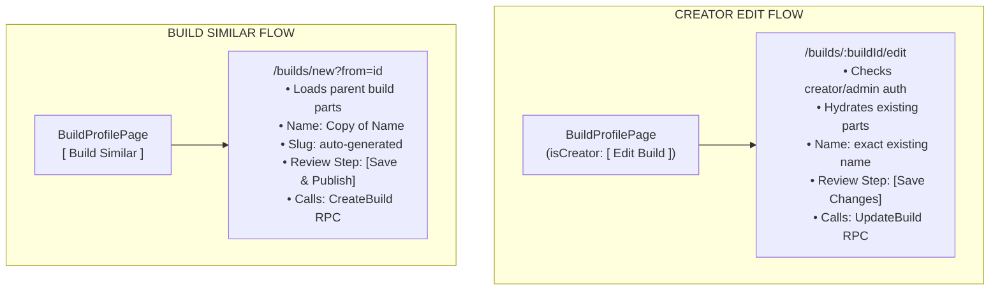

# <a id="create-similar-edit-builds-and-forge-streamlining-architecture" >Create Similar, Edit Builds, and Forge Streamlining Architecture</a>

## <a id="table-of-contents" >Table of Contents</a>

- [1. Background](#1-background)
- [2. Goal](#2-goal)
- [3. Proposal](#3-proposal)
  - [Architectural Decision: 'Create Similar' Over 'Suggest Edit'](#architectural-decision-create-similar-over-suggest-edit)
  - [Universal Automatic ID Slug Generation](#universal-automatic-id-slug-generation)
  - [Complete Elimination of Forge Step 0 and Direct Step 1 Entry](#complete-elimination-of-forge-step-0-and-direct-step-1-entry)
  - [Dedicated Creator Build Editing via /builds/:buildId/edit and UpdateBuild RPC](#dedicated-creator-build-editing-via-builds-buildid-edit-and-updatebuild-rpc)
  - [URL-Driven 'Build Similar' Flow and Multi-Step Pre-population](#url-driven-build-similar-flow-and-multi-step-pre-population)
  - [Catalog Component 'Create Similar' with Fully Editable Specs](#catalog-component-create-similar-with-fully-editable-specs)
  - [Build Feed and Build Profile UI Integration](#build-feed-and-build-profile-ui-integration)
- [4. Alternatives considered](#4-alternatives-considered)
  - [Approach A: Full Suggest Edit Workflow with Moderation Queue](#approach-a-full-suggest-edit-workflow-with-moderation-queue)
  - [Manual Custom ID Slugs](#manual-custom-id-slugs)
  - [In-Wizard Baseline Selector Retention](#in-wizard-baseline-selector-retention)
  - [Query Parameter Editing (?edit=) Over Dedicated Route](#query-parameter-editing-edit-over-dedicated-route)
- [5. Assumptions](#5-assumptions)
- [6. Verification Plan](#6-verification-plan)
  - [Automated Tests](#automated-tests)
  - [Manual Verification](#manual-verification)

---

## <a id="1-background" >1. Background</a>

In Quadsmith, entities fall into two primary categories: user-assembled aircraft
configurations ([`Builds`](src/proto/quadsmith/api/build.proto)) and 20 catalog
collections representing hardware specifications, pilot gear, and firmware
([`Components`](user_created_components.md)).

Currently, [The Forge](src/react/app-web/src/pages/BuildWizardPage.tsx) mandates
a Step 0 gate: `TemplateStep`. Every builder must either choose an existing
build as a baseline or click "Start from Scratch" before unlocking Step 1
(Frame). This friction interrupts the primary creation flow for pilots who
simply want to hand-pick components from a blank slate.

Simultaneously, pilots have no way to edit their own existing builds after
publishing them. While component creators can edit catalog items, the
[`BuildService`](src/proto/quadsmith/api/build.proto) lacks an `UpdateBuild`
RPC, and the UI has no edit pathway for aircraft builds.

Furthermore, on component pages
([`ProductPage.tsx`](src/react/app-web/src/pages/ProductPage.tsx)), only the
original creator or an administrator can edit a component. When a pilot wants to
author a product variant (e.g. creating a 2200KV motor from an existing 1900KV
model, or a 4S battery from a 6S model), they must manually re-type all physical
and electrical dimensions from scratch into the "Add Component" form. In
addition, component creation forms currently contain an ID slug input field
which creates unnecessary form complexity and risk of malformed URL slugs.

We evaluated two competing paradigms: **"Suggest Edit"** (proposing diffs to
existing entities) versus **"Create Similar"** (authoring new entities starting
with existing properties pre-populated in the creation flow). Through design
analysis, we confirmed that a single unified "Create Similar" mechanism solves
both problems cleanly with zero schema changes, while pairing naturally with
creator-owned build editing and universal automatic slug generation.

---

## <a id="2-goal" >2. Goal</a>

Implement "Create Similar", creator build editing, universal slug generation,
and Forge streamlining to:

- Completely eliminate Step 0 (`TemplateStep`) from The Forge, making clean
  entry (`/builds/new`) land immediately on Step 1: Frame Chassis with a blank
  slate.
- Introduce `UpdateBuild` RPC to `BuildService` and add a dedicated
  `/builds/:buildId/edit` route in The Forge, allowing creators and
  administrators to modify their own builds.
- Enforce **universal automatic ID slug generation**: remove all ID slug input
  fields from UI forms; the backend deterministically generates unique,
  SEO-friendly URL slugs for all builds and components.
- Enable one-click **"Build Similar"** on all build profiles and feed cards via
  URL navigation (`/builds/new?from=<buildId>`), pre-populating all 11 component
  slots, unlocking all wizard steps, and attributing the remix.
- Enable **"Create Similar"** on all 20 component catalog pages via
  `ComponentFormModal`, allowing any authenticated pilot to rapidly spawn
  product variants pre-filled with manufacturer specs, with **all** physical,
  electrical, and dimensional specs remaining 100% editable.

---

## <a id="3-proposal" >3. Proposal</a>

> **TL;DR:**
>
> - Implement "Create Similar" across all builds and catalog components.
> - Delete `TemplateStep.tsx` and eliminate Step 0 from The Forge.
> - ID slugs are universally autogenerated; slug inputs removed from UI.
> - Add `UpdateBuild` RPC and `/builds/:buildId/edit` for creator build editing.
> - All specifications remain fully editable in the component creation modal.



### <a id="architectural-decision-create-similar-over-suggest-edit" >Architectural Decision: 'Create Similar' Over 'Suggest Edit'</a>

We adopt "Create Similar" as the single canonical mutation/authoring pattern
across all entity types:

- **Build Domain Alignment**: Builds are personal drone configurations. Pilots
  do not submit diffs to edit someone else's quad; they clone proven builds to
  customize their own aircraft, while editing their _own_ quads directly.
- **Immediate Step 0 Removal**: "Build Similar" directly replaces the template
  selection step in The Forge. Users discover templates naturally by browsing
  the Build Feed or user profiles and clicking "Build Similar".
- **Zero Backend Overhead**: "Create Similar" requires no new database tables,
  no suggestion schemas, no moderation queues, and no merge conflict handling.
  It leverages existing `CreateBuild` and `Create<Component>` ConnectRPC
  endpoints.
- **Rapid Component Variants**: Pilots can quickly author new KV, cell count, or
  dimension variants in under 10 seconds without repetitive data entry.

<details>
<summary><strong>Alternatives considered</strong></summary>

##### <a id="approach-a-full-suggest-edit-workflow-with-moderation-queue" >Approach A: Full Suggest Edit Workflow with Moderation Queue</a>

Build an asynchronous proposal and review engine where non-owners submit spec
diffs that require author or admin approval.

**Pros:**

- Allows fixing typos in existing components without creating new catalog items.

**Cons:**

- Completely useless for drone builds: pilots want their own build copy, not to
  propose edits to someone's private drone.
- Does not solve the Forge Step 0 template problem.
- Heavyweight complexity: requires suggestion database tables, review APIs,
  email notifications, diff visualization, and merge conflict resolution.

</details>

### <a id="universal-automatic-id-slug-generation" >Universal Automatic ID Slug Generation</a>

ID slugs are strictly system-generated and immutable:

- **Complete Removal of Slug Inputs**: Remove the `ID Slug` input field entirely
  from
  [`ComponentFormModal.tsx`](src/react/app-web/src/components/ComponentFormModal.tsx)
  and
  [`ReviewStep.tsx`](src/react/app-web/src/components/forge/steps/ReviewStep.tsx).
  Users are never prompted for, and cannot choose, custom slugs.
- **Deterministic Slug Generation**: On creation (`CreateBuild` and
  `Create<Component>`), the backend slug generator automatically converts
  `manufacturer` and `name` (or `name` for builds) into a clean, hyphenated
  lowercase alphanumeric string (e.g. `tmotor-f80-pro-2200kv`).
- **Collision Deduplication**: If a collision occurs within the collection, the
  backend automatically appends the next numerical suffix (`-2`, `-3`) via the
  standard collision handler.
- **Immutability**: Once assigned, slugs remain immutable on updates to protect
  external links, bookmarks, and API references.

<details>
<summary><strong>Alternatives considered</strong></summary>

##### <a id="manual-custom-id-slugs" >Manual Custom ID Slugs</a>

Allow users to optionally type a custom URL slug in form inputs.

**Pros:**

- Gives advanced users manual control over URLs.

**Cons:**

- Adds visual clutter to creation modals.
- Introduces user errors (spaces, illegal characters, uppercase letters).
- Increases collision probability with primary key UUID patterns.

</details>

### <a id="complete-elimination-of-forge-step-0-and-direct-step-1-entry" >Complete Elimination of Forge Step 0 and Direct Step 1 Entry</a>

Step 0 is removed entirely from The Forge:

1. **Delete `TemplateStep.tsx`**:
   - Remove `src/react/app-web/src/components/forge/steps/TemplateStep.tsx`.
2. **Clean Entry (`/builds/new`)**:
   - `activeStep` initializes to `1` (Frame Chassis).
   - `unlockedSteps` initializes to `[1]`.
   - Builders immediately see frame choices and can begin assembly without any
     interruption.
3. **Step List & Numbering in Sidebar**:
   - The steps list in
     [`BuildWizardPage.tsx`](src/react/app-web/src/pages/BuildWizardPage.tsx)
     starts at Step 1:
     - Step 1: Frame Chassis
     - Step 2: Flight Controller
     - Step 3: Receiver
     - Step 4: Receiver Antenna
     - Step 5: ESC
     - Step 6: Motor
     - Step 7: Propeller
     - Step 8: Camera
     - Step 9: Video Transmitter
     - Step 10: VTX Antenna
     - Step 11: GPS Module
     - Step 12: Review & Save
4. **Context Simplification**:
   - Remove `templateBuilds`, `selectedTemplateId`, `isTemplateConfirmed`,
     `selectNoTemplate`, and `applyTemplate` from
     [`ForgeContext.tsx`](src/react/app-web/src/components/forge/ForgeContext.tsx).

<details>
<summary><strong>Alternatives considered</strong></summary>

##### <a id="renumber-steps-0-to-11" >Renumber Steps from 0 to 11 (Frame as Step 0)</a>

Renumber Frame as Step 0 and Review as Step 11.

**Pros:**

- Keeps 0-indexed internal numbering.

**Cons:**

- Confusing for users to see "Step 0" as their physical frame in UI badges.
- Step 1 is the natural starting point for human users.

</details>

### <a id="dedicated-creator-build-editing-via-builds-buildid-edit-and-updatebuild-rpc" >Dedicated Creator Build Editing via /builds/:buildId/edit and UpdateBuild RPC</a>

Creators can fully update their existing published builds:

1. **Protobuf Service Declaration**: In
   [`src/proto/quadsmith/api/build.proto`](src/proto/quadsmith/api/build.proto),
   declare `UpdateBuild` following the Top-Down Structural Invariant:

```protobuf
// Services
service BuildService {
  rpc GetBuild(GetBuildRequest) returns (Build);
  rpc ListBuilds(ListBuildsRequest) returns (ListBuildsResponse);
  rpc CreateBuild(CreateBuildRequest) returns (Build);
  rpc UpdateBuild(UpdateBuildRequest) returns (Build);
  rpc DeleteBuild(DeleteBuildRequest) returns (DeleteBuildResponse);
  rpc ListSimilarBuilds(ListSimilarBuildsRequest) returns (ListSimilarBuildsResponse);
}

// Request/response messages
message UpdateBuildRequest {
  Build build = 1;
}
```

1. **Backend Server Handler**:
   [`protoc-gen-server`](src/go/shared/cmd/protoc-gen-server/main.go)
   automatically generates the `UpdateBuild` RPC handler:
   - Validates authentication (`CodeUnauthenticated`).
   - Verifies creator ownership (`userCtx.UserUUID == entity.user_uuid` or
     `userCtx.Role == "ADMIN"`), returning `CodePermissionDenied` otherwise.
   - Atomically updates `entities` metadata (`name`, `description`,
     `updated_at = NOW()`) and `builds` component foreign keys (`frame_uuid`,
     `motor_uuid`, etc.) in a PostgreSQL transaction.
   - Preserves `id` slug and primary key `uuid`.
2. **Route & Page Integration**:
   - In [`src/react/app-web/src/App.tsx`](src/react/app-web/src/App.tsx),
     register:
     `<Route path="builds/:buildId/edit" element={<BuildWizardPage />} />`.
   - On
     [`BuildProfilePage.tsx`](src/react/app-web/src/pages/BuildProfilePage.tsx),
     if the logged-in user is the creator or an admin, render an **"Edit
     Build"** button linking to `/builds/${build.id}/edit`.
3. **Forge Edit Mode Behavior**:
   - When entering via `/builds/:buildId/edit`, `ForgeContext` fetches the build
     and pre-populates all 11 component slots.
   - `buildName` preserves the exact original build name.
   - `buildDesc` preserves the exact original build description.
   - `editingBuildUuid` and `editingBuildId` are stored in context.
   - All steps 1 through 12 are unlocked.
   - In Step 12
     ([`ReviewStep.tsx`](src/react/app-web/src/components/forge/steps/ReviewStep.tsx)),
     the primary submit button displays **"Save Changes"** (instead of "Save &
     Create Build").
   - Clicking submits via `BuildService.UpdateBuild({ build: { ... } })` and
     navigates back to `/builds/${buildId}` on success.

<details>
<summary><strong>Alternatives considered</strong></summary>

##### <a id="query-parameter-editing-edit-over-dedicated-route" >Query Parameter Editing (?edit=) Over Dedicated Route</a>

Route edit sessions via `/builds/new?edit=<buildId>`.

**Pros:**

- Reuses the `/builds/new` route string.

**Cons:**

- Semantic mismatch: `/builds/new` indicates creating a _new_ resource, not
  updating an existing one.
- Dedicated `/builds/:buildId/edit` is standard REST/AIP URL design.

</details>

### <a id="url-driven-build-similar-flow-and-multi-step-pre-population" >URL-Driven 'Build Similar' Flow and Multi-Step Pre-population</a>

When a user initiates "Build Similar":

1. **Routing**:
   - Navigation links use `/builds/new?from=<buildId>`.
2. **Data Hydration in `ForgeContext`**:
   - On mount, if `searchParams.get("from")` is present, `ForgeContext` queries
     the build via `BuildService.GetBuild({ id })`.
   - Populates all 11 component state slots (`selectedFrame`, `selectedFc`,
     `selectedEsc`, `selectedMotor`, `selectedProp`, `selectedCam`,
     `selectedVtx`, `selectedRx`, `selectedRxAnt`, `selectedVtxAnt`,
     `selectedGps`).
   - If an individual component is not cached in local query memory, the context
     asynchronously fetches it by UUID via its respective ConnectRPC service.
3. **Metadata Initialization**:
   - `buildName` defaults to `Copy of ${parentBuild.name}`.
   - `buildDesc` defaults to
     `Remix of ${parentBuild.name} by @${parentBuild.authorUsername}` (or
     `Remix of ${parentBuild.name}` if author username is unavailable).
4. **Step Unlocking**:
   - Because all components from the parent build are valid, all steps
     `[1, 2, 3, 4, 5, 6, 7, 8, 9, 10, 11, 12]` are marked as unlocked and
     completed.
   - The user lands on **Step 1: Frame Chassis** with the parent frame equipped,
     allowing them to immediately swap any part or jump straight to Step 12 to
     save as a new build via `CreateBuild`.

<details>
<summary><strong>Alternatives considered</strong></summary>

##### <a id="in-wizard-baseline-selector-retention" >In-Wizard Baseline Selector Retention</a>

Retain a "Load from Build..." button inside The Forge header toolbar.

**Pros:**

- Allows loading an existing build without leaving the wizard.

**Cons:**

- Adds redundant UI controls to The Forge header.
- The user explicitly preferred pure URL-driven loading from feed and profile
  pages.

</details>

### <a id="catalog-component-create-similar-with-fully-editable-specs" >Catalog Component 'Create Similar' with Fully Editable Specs</a>

For the 20 catalog component collections:

1. **Trigger on `ProductPage.tsx`**:
   - Add a **"Create Similar"** button with a `Copy` icon to the product header
     actions:
     - For the creator/admin: displayed alongside "Edit Component" and "Delete".
     - For non-owners: displayed prominently as the primary action.
2. **Modal Invocation**:
   - Sets `isCreateSimilarOpen = true` and passes `initialData={item}`.
3. **100% Fully Editable Form Fields (No Slug Input)**:
   - In
     [`ComponentFormModal.tsx`](src/react/app-web/src/components/ComponentFormModal.tsx),
     add a prop `isClone?: boolean`.
   - When `isClone` is true:
     - Mode is treated as **Create** (invoking `Create<Type>` instead of
       `Update<Type>`).
     - Modal title displays `Create Similar ${srvDef.singularLabel}`.
     - **No Slug Field**: The ID slug input is omitted entirely from the form;
       the slug is automatically derived and persisted on the backend.
     - **All Specs Fully Editable**: Every single physical, electrical, and
       mechanical specification (stator diameter, stator height, KV, weight,
       min/max voltage, max current, mount patterns, propeller interfaces, cell
       counts, capacity, etc.) is rendered as an active, unlocked input field
       pre-populated with the existing component's values. The pilot is free to
       edit any subset of specs or retain them.
     - `name` is pre-populated with `initialData.name`.
     - `manufacturer` is pre-populated with `initialData.manufacturer`.
     - Description, primary display image, and reference links are pre-populated
       and fully editable.
     - Submit button displays `Create ${srvDef.singularLabel}`.

### <a id="build-feed-and-build-profile-ui-integration" >Build Feed and Build Profile UI Integration</a>

1. **`BuildProfilePage.tsx`**:
   - If creator/admin: renders both **"Edit Build"** (linking to
     `/builds/${build.id}/edit`) and **"Build Similar"** (linking to
     `/builds/new?from=${build.id}`).
   - If non-creator: renders **"Build Similar"** as the primary action.
2. **`BuildCard.tsx`**:
   - In the card footer next to "View Profile", add a compact **"Build
     Similar"** link/button.

---

## <a id="4-alternatives-considered" >4. Alternatives considered</a>

<details>
<summary><strong>Alternatives considered</strong></summary>

All major design alternatives and their pros/cons have been documented in the
nested sub-sections above:

- [Approach A: Full Suggest Edit Workflow with Moderation Queue](#approach-a-full-suggest-edit-workflow-with-moderation-queue)
- [Manual Custom ID Slugs](#manual-custom-id-slugs)
- [Renumber Steps from 0 to 11](#renumber-steps-0-to-11)
- [Query Parameter Editing (?edit=) Over Dedicated Route](#query-parameter-editing-edit-over-dedicated-route)
- [In-Wizard Baseline Selector Retention](#in-wizard-baseline-selector-retention)

</details>

---

## <a id="5-assumptions" >5. Assumptions</a>

1. Authenticated users have permissions to create builds via `CreateBuild`,
   update their own builds via `UpdateBuild`, and create components via
   `Create<Component>`.
2. Existing builds fetched via `GetBuild` have valid component foreign keys that
   can be looked up by the client.
3. Unauthenticated pilots can configure a "Build Similar" session in The Forge,
   prompted to authenticate only upon clicking "Save Build" at Step 12.
4. Component and build URL slugs are generated deterministically by the backend
   from model name and manufacturer without user input.

---

## <a id="6-verification-plan" >6. Verification Plan</a>

### <a id="automated-tests" >Automated Tests</a>

Run the test suite using `make test`:

1. **`BuildWizardPage.test.tsx`**:
   - Verify clean entry at `/builds/new` renders Step 1 (Frame) as active with
     no Step 0 or baseline confirmation prompts.
   - Verify `/builds/:buildId/edit` loads existing build, displays "Save
     Changes", and calls `UpdateBuild` RPC on submit.
   - Verify `/builds/new?from=<id>` fetches parent build, sets name to
     `Copy of ...`, pre-populates components, and unlocks all 12 steps.
2. **`BuildProfilePage.test.tsx` & `BuildCard.test.tsx`**:
   - Verify "Edit Build" renders when logged in as the build creator.
   - Verify "Build Similar" renders for all users and links to
     `/builds/new?from=<id>`.
3. **`ProductPage.test.tsx` & `ComponentFormModal.test.tsx`**:
   - Verify "Create Similar" button opens `ComponentFormModal` with all specs
     pre-filled as active, editable inputs.
   - Verify no slug input is rendered in the modal.
   - Verify saving calls `create<Component>` mutation with backend slug
     generation.

### <a id="manual-verification" >Manual Verification</a>

1. **Desktop and Mobile Previews**:
   - Render `create_similar_preview_desktop.html` and
     `create_similar_preview_mobile.html` across viewports using headless
     Chrome.
   - Inspect screenshots for visual clarity, button alignment, and theme parity.
2. **End-to-End Browser Flow**:
   - Navigate to `/builds/:buildId` as creator -> click "Edit Build" -> modify a
     component -> click "Save Changes" -> verify build profile updated.
   - Navigate to `/builds/:buildId` -> click "Build Similar" -> verify Forge
     opens with `Copy of ...` and all parts pre-filled.
   - Navigate to `/builds/new` -> verify immediate landing on Step 1 (Frame)
     blank slate.
