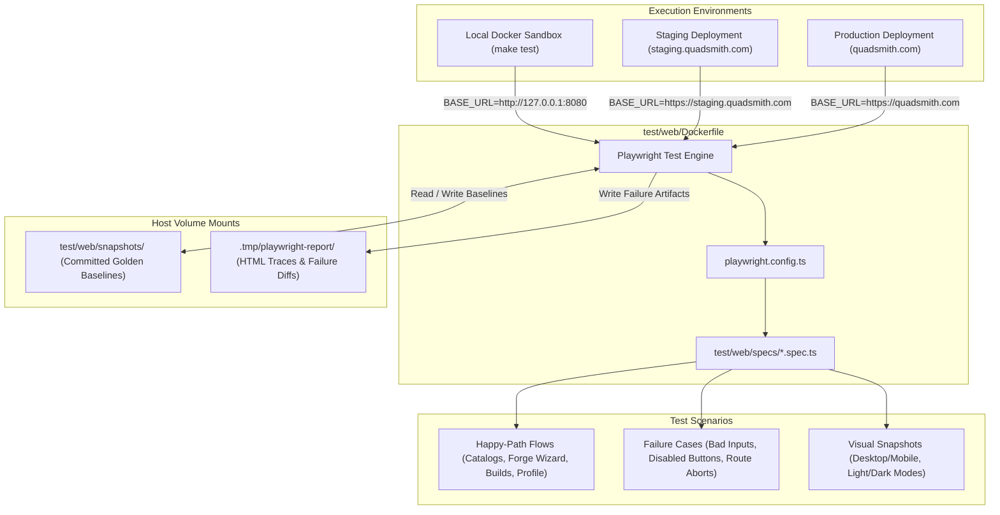

# <a id="e2e-and-visual-regression-ui-testing-architecture" >E2E and Visual Regression UI Testing Architecture</a>

## <a id="table-of-contents" >Table of Contents</a>

- [1. Background](#1-background)
- [2. Goal](#2-goal)
- [3. Proposal](#3-proposal)
  - [Containerized Playwright Runner for Universal Environment Execution](#containerized-playwright-runner-for-universal-environment-execution)
  - [Test Suite Organization and Directory Structure in test/web](#test-suite-organization-and-directory-structure-in-testweb)
  - [Visual Regression Snapshot Configuration and Diff Stability](#visual-regression-snapshot-configuration-and-diff-stability)
  - [Comprehensive User Journey and Surface Test Coverage](#comprehensive-user-journey-and-surface-test-coverage)
  - [Negative Scenarios, Failure Handling, and Resiliency Testing](#negative-scenarios-failure-handling-and-resiliency-testing)
  - [Snapshot Storage, Volume Mounts, and Update Workflow](#snapshot-storage-volume-mounts-and-update-workflow)
  - [Sandbox, Makefile, and CI Integration](#sandbox-makefile-and-ci-integration)
- [4. Assumptions](#4-assumptions)
- [5. Future work](#5-future-work)

---

## <a id="1-background" >1. Background</a>

In [ui_testing_plan.md](ui_testing_plan.md), Quadsmith established a sub-second,
in-memory frontend testing suite using [Vitest](https://vitest.dev/),
[React Testing Library](https://testing-library.com/), and
[JSDOM](https://github.com/jsdom/jsdom) with type-safe ConnectRPC router mocks.
While this provides rapid feedback on component state machines and client-side
routing, in-memory virtual DOMs cannot verify genuine browser CSS rendering,
typography rasterization, viewport responsiveness, WebAssembly runtime
execution, or cross-browser compatibility.

The future work section of [ui_testing_plan.md](ui_testing_plan.md) specified a
full-fidelity browser test suite using [Playwright](https://playwright.dev/) to
execute against live sandbox and deployed environments with visual snapshot
regression testing. Furthermore, recent platform additions—such as structured
administrative bans in
[structured_bans_and_account_restrictions.md](structured_bans_and_account_restrictions.md)
and GDPR account deletion in
[user_account_deletion.md](user_account_deletion.md)—introduced critical
security lockouts, banner alerts, and modal workflows that necessitate rigorous
end-to-end browser verification.

---

## <a id="2-goal" >2. Goal</a>

Establish a fully containerized, hermetic end-to-end (E2E) and visual regression
testing architecture using Playwright within `test/web`, running multi-browser
test suites across desktop and mobile viewports with light and dark themes
against any target environment via `BASE_URL`, validating core user journeys,
component catalogs, The Forge wizard, administrative ban lock screens, account
deletion flows, and negative failure modes (invalid inputs, disabled controls,
and network faults).

---

## <a id="3-proposal" >3. Proposal</a>

> **TL;DR:**
>
> - Containerize Playwright in a dedicated Docker runner targeting any
>   `BASE_URL`.
> - Group all browser E2E, visual, and resilience tests under `test/web`.
> - Test multi-browser matrix across desktop and mobile with dual themes.
> - Default to 1 worker per browser profile to maximize parallel throughput.
> - Verify negative failure modes: invalid inputs, disabled controls, and
>   network drops.



### <a id="containerized-playwright-runner-for-universal-environment-execution" >Containerized Playwright Runner for Universal Environment Execution</a>

All browser automation and visual regression tests execute within a dedicated,
hermetic Docker container defined in
[`test/web/Dockerfile`](../test/web/Dockerfile). Based on the official Microsoft
Playwright image (`mcr.microsoft.com/playwright:v1.51.1-noble`), the container
pre-installs system rendering libraries, fonts, and browser engines (Chromium,
Firefox, WebKit).

The runner container is completely decoupled from any specific host environment.
It accepts a dynamic `BASE_URL` environment variable:

- **Local Sandbox Execution**: When testing the local sandbox stack
  ([`deploy/docker-compose.yaml`](../deploy/docker-compose.yaml)), the container
  runs using Docker host networking (`--network host`), connecting directly to
  `http://127.0.0.1:8080` (Web SPA) and `http://127.0.0.1:8081` (API Server).
- **Remote Environment Execution**: When testing remote environments (such as
  staging or production), the same container runs with
  `-e BASE_URL=https://staging.quadsmith.com` without requiring local backend
  servers or code rebuilding.
- **Deterministic Rendering**: Running the browsers inside a fixed Ubuntu
  container guarantees 100% pixel-level font rendering, font metric, and GPU
  rasterization uniformity across different developer host operating systems
  (macOS, Linux, Windows) and CI workers.

<details>
<summary><strong>Alternatives considered</strong></summary>

##### <a id="host-only-playwright-cli-execution" >Host-Only Playwright CLI Execution</a>

Running Playwright directly on developer host machines using local Node.js and
npm scripts without containerization.

**Pros:**

- Eliminates the need to build and manage a Playwright Docker container image.
- Avoids container startup latency.

**Cons:**

- Generates subtle font anti-aliasing and subpixel rendering mismatches between
  macOS, Windows, and Linux machines, causing false-positive visual snapshot
  failures.
- Requires every developer and CI pipeline to manually install multi-browser OS
  packages (`npx playwright install-deps`).

##### <a id="cypress-container-runner" >Cypress Container Runner</a>

Running Cypress inside a container for E2E tests and using third-party visual
regression plugins.

**Pros:**

- Familiar interactive browser debugging tools.

**Cons:**

- Cypress lacks first-party visual snapshot comparisons, requiring external
  plugins with inconsistent maintenance.
- Poor multi-tab, multi-origin, and mobile viewport emulation compared to
  Playwright.

</details>

### <a id="test-suite-organization-and-directory-structure-in-testweb" >Test Suite Organization and Directory Structure in test/web</a>

All E2E, visual regression, and resilience test files, Playwright configuration,
and snapshot baselines are consolidated in [`test/web`](../test/web), preserving
a clean boundary between fast unit tests in
[`src/react/app-web`](../src/react/app-web) and full-stack integration suites:

```text
test/web/
├── Dockerfile                  # Containerized Playwright runner
├── package.json                # Playwright dependencies and test scripts
├── package-lock.json
├── tsconfig.json               # TypeScript configuration for tests
├── playwright.config.ts        # Multi-browser, viewport, and snapshot settings
├── helpers/
│   ├── auth.ts                 # Test authentication and token utilities
│   ├── faults.ts               # Network route aborts and mock failure helpers
│   └── stability.ts            # Animation suppression and clock freezing
├── specs/
│   ├── home.spec.ts            # Home page, navbar, theme toggles, footer
│   ├── catalog.spec.ts         # Component catalog, table columns, filter inputs
│   ├── product.spec.ts         # Product detail specs, compatibility hover card
│   ├── forge.spec.ts           # The Forge 11-step wizard and build editing
│   ├── build.spec.ts           # Build profile, battery simulator, similar builds
│   ├── auth.spec.ts            # Login OTP form and account setup flows
│   ├── restricted.spec.ts      # Banned lock screen and account settings states
│   └── failures.spec.ts        # Invalid inputs, disabled clicks, network drops
├── snapshots/                  # Committed baseline PNG screenshots
└── web_test.go                 # Existing Go HTTP healthz and SPA fallback test
```

<details>
<summary><strong>Alternatives considered</strong></summary>

##### <a id="co-locating-e2e-inside-srcreactapp-webe2e" >Co-locating E2E Inside src/react/app-web/e2e</a>

Placing Playwright tests directly in `src/react/app-web/e2e` within the React
application folder.

**Pros:**

- Single `package.json` for frontend unit and E2E tests.

**Cons:**

- Blurs the boundary between unit component tests and full-stack sandbox tests.
- Clutters the frontend application bundle directory with multi-megabyte image
  snapshots and container runner definitions.

##### <a id="top-level-e2e-directory" >Top-Level e2e Directory</a>

Creating a new `/e2e` top-level directory at the repository root.

**Pros:**

- High top-level prominence.

**Cons:**

- Quadsmith already centralizes integration and sandbox test suites under
  `test/` (`test/api/`, `test/sandbox/`, `test/web/`). Adding another root
  folder fragments test organization.

</details>

### <a id="visual-regression-snapshot-configuration-and-diff-stability" >Visual Regression Snapshot Configuration and Diff Stability</a>

Visual regression tests utilize Playwright's native
`expect(page).toHaveScreenshot()` assertions. To guarantee determinism and
prevent flaky tests:

1. **Multi-Browser & Multi-Viewport Matrix**:
   - **Chromium, Firefox, and WebKit**: Configured in `playwright.config.ts` to
     validate rendering engine parity.
   - **Desktop Viewport**: Standard `1280x800` viewport.
   - **Mobile Viewport**: Standard `390x844` viewport (emulating modern iPhone
     and Android displays).
2. **Dual Theme Coverage**:
   - Every surface is captured in both **Light Mode** and **Dark Mode**.
   - Tests toggle theme states deterministically via the UI theme button or by
     initializing `localStorage.setItem('theme', 'dark')`.
3. **Snapshot Diff Tolerance & Thresholds**:
   - `maxDiffPixelRatio: 0.005` (0.5% allowed pixel difference): Absorbs minor
     anti-aliasing and subpixel font rasterization differences across GPUs
     without masking genuine layout, alignment, or color defects.
   - `threshold: 0.2`: Strict color difference sensitivity per pixel.
4. **Deterministic Snapshot Stabilization (`helpers/stability.ts`)**:
   - **Disabled Animations**: `animations: 'disabled'` disables CSS keyframes,
     transitions, and pulse indicators during screenshot capture.
   - **Frozen Clock**: Uses `page.clock.setFixedTime('2026-10-15T12:00:00Z')` to
     freeze dynamic relative time counters (e.g. "3 hours ago").
   - **Dynamic Masking**: Dynamically generated UUIDs or volatile avatars are
     masked using `mask: [page.locator('[data-testid="dynamic-id"]')]`.
   - **Font Readiness**: Enforces `await document.fonts.ready` prior to snapshot
     capture.
5. **Dynamic Default Worker Allocation (50% CPU Threads)**:
   - Configured by default to allocate 50% of available CPU threads
     (`Math.max(2, Math.floor(os.cpus().length / 2))`).
   - Balances parallel test execution across browser profiles while leaving
     adequate CPU headroom for browser rendering processes, the Go ConnectRPC
     API server, and PostgreSQL without thread starvation or thrashing.
   - Developers can override this default via the `PLAYWRIGHT_WORKERS`
     environment variable (e.g., `PLAYWRIGHT_WORKERS=1` for single-threaded
     debugging or explicit worker counts).

<details>
<summary><strong>Alternatives considered</strong></summary>

##### <a id="unrestricted-cpu-core-workers" >Unrestricted CPU-Core Worker Allocation</a>

Allowing Playwright to default to unconstrained worker allocation based on host
CPU core count.

**Pros:**

- Maximizes CPU utilization on high-core development workstations.

**Cons:**

- Spawns dozens of simultaneous browser instances against the single sandbox
  server.
- Induces connection pool exhaustion, database lock contention, and flakiness on
  login endpoints.

##### <a id="zero-tolerance-strict-pixel-diffing" >Zero-Tolerance Strict Pixel Diffing</a>

Enforcing exact 0% pixel matching (`maxDiffPixelRatio: 0.0`).

**Pros:**

- Completely zero tolerance for any image variance.

**Cons:**

- Causes brittle, flaky test failures when minor font rendering micro-shifts
  occur between container revisions or graphics driver versions.

##### <a id="external-visual-regression-saas" >External Visual Regression SaaS (Percy / Chromatic)</a>

Routing screenshot diffs to a cloud-hosted visual testing SaaS service.

**Pros:**

- Web dashboard for reviewing and approving visual diffs.

**Cons:**

- Adds external vendor dependencies, proprietary billing, and API tokens.
- Violates the hermetic, self-contained open-source testing principle of
  Quadsmith.

</details>

### <a id="comprehensive-user-journey-and-surface-test-coverage" >Comprehensive User Journey and Surface Test Coverage</a>

The E2E suite covers the platform's core interactive user flows and visual
surfaces using deterministic seed data provided by
[`test/sandbox/db/seed_data`](../test/sandbox/db/seed_data):

1. **Home Page & Navigation (`home.spec.ts`)**:
   - Full page rendering with hero, featured builds, and footer.
   - Header navigation, search dialog toggle, and theme switching.
   - Desktop vs. mobile responsive drawer and menu layout.
2. **Component Catalogs & Customization (`catalog.spec.ts`)**:
   - Component catalog data tables (e.g. Motors, Frames, Flight Controllers).
   - Dynamic column picker (toggling visibility and order).
   - Real-time smart filter search, numeric range inputs, and sort dropdowns.
3. **Product Specification Detail (`product.spec.ts`)**:
   - Detailed component specification tables and media galleries.
   - Interactive Compatibility hover cards.
   - Documentation links, social review cards, and Q&A tabs.
4. **The Forge Build Wizard (`forge.spec.ts`)**:
   - Sequential 11-step creation workflow landing cleanly on Step 1 (Frame)
     without legacy Step 0.
   - Component selection, conditional ESC/AIO logic, and antenna skipping.
   - Dynamic build evaluation dashboard (weight calculation, thrust-to-weight,
     center of gravity).
   - In-place build editing flow via `/builds/:buildId/edit`.
5. **Build Profile Showcase (`build.spec.ts`)**:
   - Build metadata presentation, author badges, and hardware list.
   - Interactive runtime Battery Simulator with payload sliders and presets.
   - Similar Builds comparison tab and empty state handling.
6. **Authentication & Identity (`auth.spec.ts`)**:
   - Multi-step login flow: Step 1 (email entry) and Step 2 (6-digit OTP code).
   - Account setup dialog with username availability validation.
7. **Administrative Ban & Account Deletion (`restricted.spec.ts`)**:
   - **Dedicated Lock Screen**: Navigating to any standard route with an active
     ban renders the `AccountRestrictedPage` with crimson shield icon,
     suspension reason, and direct link to account settings.
   - **Account Settings Ban State**: Verifies the prominent alert banner,
     read-only locked username handle, editable bio textarea, and active auth
     sessions management card.
   - **Account Deletion Flow**: Opens the voluntary account deletion modal,
     verifies the 30-day grace period notice, and exercises confirmation and
     cancellation actions.

<details>
<summary><strong>Alternatives considered</strong></summary>

##### <a id="shallow-smoke-testing-only" >Shallow Smoke Testing Only</a>

Capturing screenshots of static pages without exercising multi-step interactive
flows (such as The Forge wizard or login form).

**Pros:**

- Faster test run times.

**Cons:**

- Fails to detect regressions in complex multi-step interactive state machines,
  form validations, or conditional wizard logic.

</details>

### <a id="negative-scenarios-failure-handling-and-resiliency-testing" >Negative Scenarios, Failure Handling, and Resiliency Testing</a>

To guarantee application stability under adverse real-world conditions, a
dedicated test suite in
[`test/web/specs/failures.spec.ts`](../test/web/specs/failures.spec.ts)
exercises error boundaries, invalid input validations, disabled control
enforcement, and network fault injections:

1. **Invalid Input Validations & Lockout State Assertions**:
   - **Malformed Email Input**: Entering invalid email strings (e.g.,
     `notanemail`, `pilot@`, `@domain.com`) in the login form, asserting inline
     field validation error display and that no network RPC is dispatched.
   - **Incorrect OTP Codes & Lockout Counter**: Submitting an incorrect 6-digit
     OTP code on `/login`, verifying that inputs clear, invalid code renders as
     greyed placeholder hints, remaining attempts counter decrements, and an
     alert banner appears above the buttons.
   - **Username Validation Rules**: Typing usernames violating Protobuf RE2
     regex rules (`^[a-z][a-z0-9_]{1,18}[a-z0-9]$`) during account setup (e.g.,
     leading digits, uppercase characters, hyphens, or length < 3), verifying
     immediate inline constraint warnings and submit action blocking.
   - **Invalid Filter & Search Syntax**: Entering malformed queries or extreme
     out-of-bounds numbers into catalog `SmartFilterInput`, asserting graceful
     zero-match states and error messages without JavaScript runtime exceptions.
2. **Disabled Button & Prohibited Action Guards**:
   - **Forge Step Progression Guard**: Clicking the disabled "Next Step" or
     "Save Build" button prior to completing mandatory component selections.
     Verifies that clicking is a non-operative action, button has `disabled` and
     `aria-disabled="true"`, and wizard steps remain locked.
   - **Login Submission Guard**: Clicking the "Continue" or "Verify" button with
     an empty or incomplete input, asserting disabled button suppression.
   - **Administrative Ban Restricted Actions**: Attempting prohibited mutation
     actions on `/settings` while suspended (e.g. attempting to change locked
     username handle or add new email addresses), asserting disabled input
     guards and explanatory lockout warnings.
3. **Network Drops, RPC Failures, and Backend Fault Injection**:
   - Using Playwright's route interception (`page.route()`) in
     `helpers/faults.ts` to simulate transport faults:

     ```typescript
     // Simulate network drop on API catalog queries
     await page.route("**/quadsmith.api.MotorService/ListMotors", (route) => {
       route.abort("failed");
     });
     await page.goto("/components/hardware/motors");
     await expect(
       page.locator('[data-testid="network-error-banner"]'),
     ).toBeVisible();
     await expect(page.getByRole("button", { name: "Retry" })).toBeEnabled();

     // Simulate internal server 500 error on build evaluator
     await page.route(
       "**/quadsmith.api.EvaluatorService/EvaluateBuild",
       (route) => {
         route.fulfill({
           status: 500,
           contentType: "application/json",
           body: JSON.stringify({
             code: "internal",
             message: "evaluator engine unavailable",
           }),
         });
       },
     );
     ```

   - **Graceful Error Recovery**: Asserts that error boundary banners render
     cleanly, no unhandled white-screen crashes occur, and clicking "Retry"
     after restoring the route successfully recovers the UI.

<details>
<summary><strong>Alternatives considered</strong></summary>

##### <a id="relying-strictly-on-vitest-for-error-states" >Relying Strictly on Vitest for Error States</a>

Verifying error states only within JSDOM unit tests and keeping Playwright tests
strictly focused on happy-path flows.

**Pros:**

- Slightly faster E2E test execution.

**Cons:**

- Fails to verify real browser network failure behavior, visual styling of error
  banners, disabled button cursor styles, or DOM recovery after connection
  drops.

</details>

### <a id="snapshot-storage-volume-mounts-and-update-workflow" >Snapshot Storage, Volume Mounts, and Update Workflow</a>

To enable seamless iteration while keeping the repository clean:

1. **Committed Golden Baselines (`test/web/snapshots/`)**:
   - Reference screenshots are tracked in Git under `test/web/snapshots/`.
   - Filenames follow Playwright's canonical naming convention:
     `<spec>-<test-name>-<browser>-<viewport>-<theme>.png`.
2. **Host Volume Mounting**:
   - When running the container, `test/web/snapshots` is volume-mounted into
     `/app/snapshots`.
   - Test result artifacts (HTML reports, failure traces, difference image
     diffs) are volume-mounted into `.tmp/playwright-report` on the host.
3. **Snapshot Update Workflow (`make update-snapshots`)**:
   - When intentional UI changes occur (such as a styling update or layout
     refactor), developers run:

     ```bash
     make update-snapshots
     ```

   - This executes the container runner with the `-u` (`--update-snapshots`)
     flag, writing new golden images directly back to `test/web/snapshots/`
     ready to be committed to Git.
4. **HTML Report Inspection**:
   - When tests fail, developers can inspect the full HTML report and visual
     diff viewer directly from the host at `.tmp/playwright-report/index.html`.

<details>
<summary><strong>Alternatives considered</strong></summary>

##### <a id="git-lfs-snapshot-storage" >Git LFS Snapshot Storage</a>

Storing all baseline PNG screenshots in Git Large File Storage (Git LFS).

**Pros:**

- Reduces Git repository clone sizes over time.

**Cons:**

- Requires Git LFS client installation and additional remote repository storage
  configuration.
- For Quadsmith's optimized PNG snapshots (~15-30KB each), standard Git handles
  hundreds of snapshots with minimal overhead.

</details>

### <a id="sandbox-makefile-and-ci-integration" >Sandbox, Makefile, and CI Integration</a>

The testing pipeline integrates cleanly into Quadsmith's established development
and CI workflows:

1. **Sandbox Test Script (`test/run_sandbox_tests.sh`)**:
   - When `test/run_sandbox_tests.sh` executes (as part of `make test` or
     `make update-snapshots`), it:
     1. Starts and verifies the health of the Docker sandbox (`db`, `api`,
        `ops`, `jobs`, `web`).
     2. Runs Go sandbox tests (`go test -count=1 -v ./test/...`).
     3. Builds the Playwright container image (`quadsmith-web-e2e`).
     4. Runs the Playwright container against `http://127.0.0.1:8080` across all
        5 browser profiles (`chromium-desktop`, `chromium-mobile`,
        `firefox-desktop`, `webkit-desktop`, `webkit-mobile`), mounting
        `test/web/snapshots` and `.tmp/playwright-report`.
     5. Automatically cleans up sandbox containers via the existing `trap` on
        exit.
2. **Targeted Makefile Commands**:

   ```makefile
   # Verify code generation, formatting, and linting without git diffs
   verify: generate fmt
       @git diff --exit-code

   # Run formatting, unit tests, and full sandbox E2E suite across all 5 browser profiles
   test: generate fmt bin/qs bin/qsops
       @./test/run_sandbox_tests.sh $(if $(PROJECT),--project=$(PROJECT)) $(if $(SHARD),--shard=$(SHARD)) $(TOOL_ARGS)

   # Re-baseline golden screenshots across all 5 browser profiles against a fresh sandbox
   update-snapshots:
       @UPDATE_SNAPSHOTS=true ./test/run_sandbox_tests.sh $(if $(PROJECT),--project=$(PROJECT)) $(TOOL_ARGS)
   ```

3. **Continuous Integration Pipeline with Sharding
   (`.github/workflows/ci.yml`)**:
   - `ci.yml` executes two independent jobs in parallel on every push and pull
     request:
     1. `verify`: Runs `make verify` to enforce code generation, formatting, and
        linting checks across Go, Protobuf, Textproto, TypeScript/HTML/CSS,
        Markdown, Python, and SQL.
     2. `test`: Executes `make test SHARD=${{ matrix.shard }}` in parallel
        across runner nodes using a sharding matrix (`shard: [1/2, 2/2]`).
   - Running `verify` and `test` in parallel ensures formatting or documentation
     linting errors never mask functional or visual regressions in the test
     shards.
   - Both jobs synchronize Go workspace vendor dependencies (`go work vendor`),
     cache Go dependencies via `src/go/go.work.sum`, and install frozen web
     dependencies via `npm ci` prior to execution, ensuring hermetic
     clean-runner builds without lockfile mutations.
   - Each CI runner node executes a disjoint slice of the multi-browser matrix
     concurrently, reducing CI wall-clock test execution time by ~50%.
   - On failure, individual shard test reports from `.tmp/playwright-report` are
     uploaded via `actions/upload-artifact` using sanitized shard identifiers
     (e.g., `playwright-report-shard-1`) for immediate debugging.

<details>
<summary><strong>Alternatives considered</strong></summary>

##### <a id="separate-make-test-from-test-e2e" >Separate make test from test-e2e</a>

Decoupling full multi-browser tests into a separate command without running any
E2E in `make test`.

**Pros:**

- Keeps `make test` strictly in-memory and under 3 seconds.

**Cons:**

- Increases the likelihood that developers skip E2E tests, allowing visual
  regressions to land on `main`.

</details>

---

## <a id="4-assumptions" >4. Assumptions</a>

1. Docker is available in both the local development environment and GitHub
   Actions runners.
2. The sandbox stack in
   [`deploy/docker-compose.yaml`](../deploy/docker-compose.yaml) exposes the Web
   SPA on port 8080 and API server on port 8081 with deterministic seed data.
3. Network host mode (`--network host`) operates reliably on Linux hosts (local
   Linux environment and Ubuntu CI).
4. The 0.5% snapshot tolerance (`maxDiffPixelRatio: 0.005`) sufficiently
   prevents anti-aliasing false positives while catching true visual defects.

---

## <a id="5-future-work" >5. Future work</a>

### <a id="playwright-component-testing" >Playwright Component Testing</a>

Explore Playwright Component Testing (`@playwright/experimental-ct-react`) as an
intermediate tier between in-memory Vitest tests and full-stack E2E tests for
isolated component visual diffing.

### <a id="synthetic-canary-monitoring" >Synthetic Canary Monitoring</a>

Deploy the containerized Playwright runner as a scheduled cron job against
production to continuously monitor end-to-end user flows and alert on unexpected
service regressions.
