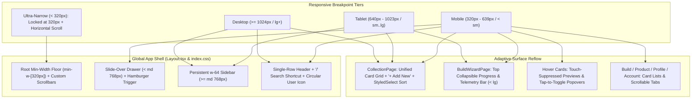

# <a id="mobile-responsive-ui-architecture-and-layout-overhaul" >Mobile-Responsive UI Architecture and Layout Overhaul</a>

## <a id="table-of-contents" >Table of Contents</a>

- [1. Background](#1-background)
- [2. Goal](#2-goal)
- [3. Proposal](#3-proposal)
  - [Slide-Over Mobile Navigation Drawer and Viewport Reclamation](#slide-over-mobile-navigation-drawer-and-viewport-reclamation)
  - [Single-Row Header, Responsive Search Hints, and Slash Shortcut](#single-row-header-responsive-search-hints-and-slash-shortcut)
  - [Unified Responsive Spec Card Grid and Toolbar Sorting in Component Catalogs](#unified-responsive-spec-card-grid-and-toolbar-sorting-in-component-catalogs)
  - [Custom-Styled Dropdown Menus and Scrollbars](#custom-styled-dropdown-menus-and-scrollbars)
  - [Compact Collapsible Build Progress and Live Telemetry Bar in The Forge](#compact-collapsible-build-progress-and-live-telemetry-bar-in-the-forge)
  - [Touch-Aware Hover Card Suppression and Tap-to-Toggle Popovers](#touch-aware-hover-card-suppression-and-tap-to-toggle-popovers)
  - [User Profile Page: Consistent Add Actions and Authoritative Component Styling](#user-profile-page-consistent-add-actions-and-authoritative-component-styling)
  - [Responsive Reflow for Detail Pages, Social Tabs, and Account Settings](#responsive-reflow-for-detail-pages-social-tabs-and-account-settings)
  - [Unit Test and Playwright Visual Regression Baseline Updates](#unit-test-and-playwright-visual-regression-baseline-updates)
- [4. Alternatives considered](#4-alternatives-considered)
- [5. Assumptions](#5-assumptions)
- [6. Future work](#6-future-work)

---

## <a id="1-background" >1. Background</a>

In [e2e_and_visual_regression_testing.md](e2e_and_visual_regression_testing.md),
Quadsmith introduced containerized multi-browser Playwright visual regression
testing across desktop (`1280×800`) and mobile (`390×844` iPhone 13) viewports.
Inspecting the mobile baseline screenshots under
[`test/web/snapshots/`](../test/web/snapshots/) exposed severe mobile usability
and layout defects across every primary surface of the React single-page
application in [`src/react/app-web`](../src/react/app-web):

- **Permanent Sidebar Viewport Starvation**: In
  [`Layout.tsx`](../src/react/app-web/src/components/Layout.tsx), the
  `<aside className="w-64 ...">` navigation sidebar remains permanently mounted
  at `256px` wide on a `390px` screen, leaving only `134px` for `<main>`.
  Combined with `
` (`64px` horizontal padding) and nested
  page padding, active page content is crushed into a `~70px` sliver where
  headings wrap 1–3 characters per line.
- **Top Header Crushing**: In
  [`Layout.tsx`](../src/react/app-web/src/components/Layout.tsx), fixed `w-64`
  left and right header zones squeeze the central search input and crush the
  brand logo whenever account restriction badges (from
  [structured_bans_and_account_restrictions.md](structured_bans_and_account_restrictions.md))
  are rendered.
- **Overflowing Multi-Column Tables & Native Controls**: In
  [`CollectionPage.tsx`](../src/react/app-web/src/pages/CollectionPage.tsx) and
  [`AccountSettingsPage.tsx`](../src/react/app-web/src/pages/AccountSettingsPage.tsx),
  multi-column HTML tables overflow horizontally on mobile and become cramped on
  desktop whenever several hardware specification columns are enabled, while
  native `<select>` dropdowns and default OS scrollbars clash with the
  application's dark aesthetic.
- **Buried Telemetry in The Forge**: In
  [`BuildWizardPage.tsx`](../src/react/app-web/src/pages/BuildWizardPage.tsx)
  (from
  [create_similar_edit_builds_and_forge_streamlining.md](create_similar_edit_builds_and_forge_streamlining.md)),
  the 12-column grid stacks the `lg:col-span-5` Selected Parts & Live Telemetry
  sidebar far below the component picker list on screens narrower than `1024px`.
- **Hover-Only Touch Traps**: Hover popovers in
  [`ProductHoverCard.tsx`](../src/react/app-web/src/components/ProductHoverCard.tsx),
  [`UserHoverCard.tsx`](../src/react/app-web/src/components/UserHoverCard.tsx),
  [`CompatibilityHoverCard.tsx`](../src/react/app-web/src/components/CompatibilityHoverCard.tsx),
  and the account menu in
  [`Layout.tsx`](../src/react/app-web/src/components/Layout.tsx) rely on
  `onMouseEnter`/`onMouseLeave`, causing sticky popovers or unreachable menus on
  touch devices.

---

## <a id="2-goal" >2. Goal</a>

Deliver a cohesive, first-class mobile, tablet, and desktop responsive UI across
all Quadsmith web surfaces (`< 640px` mobile, `640px–1023px` tablet, and
`>= 1024px` desktop) using
[Tailwind CSS](https://tailwindcss.com/docs/responsive-design) breakpoints and
[CSS Media Queries](https://developer.mozilla.org/en-US/docs/Web/CSS/CSS_media_queries),
reclaiming 100% of the mobile viewport width, enforcing a `320px` minimum width
floor with custom-styled scrollbars and dropdowns, replacing multi-column tables
in the Component Catalog and Account Settings with a unified responsive Card
Grid, normalizing the `+ Add New` action button and authoritative component
pill/icon colors on the User Profile page, adapting The Forge wizard for
one-handed touch ergonomics, and updating unit and Playwright visual regression
suites.

---

## <a id="3-proposal" >3. Proposal</a>

> **TL;DR:**
>
> - Replace the fixed `w-64` sidebar below `md` (`768px`) with a slide-over
>   drawer and `320px` min-width floor.
> - Use a single-row header with `/` search focus shortcut, viewport-aware
>   hints, and a circular user icon.
> - Replace catalog and account tables with a unified responsive Card Grid and
>   `+ Add New` action button.
> - Normalize `+ Add New` button across User Profile tabs and apply
>   authoritative component colors.
> - Replace native `<select>` menus and OS scrollbars with custom-styled
>   dropdown popovers and scrollbars.

The responsive architecture reorganizes Quadsmith around three primary viewport
tiers (`sm: 640px`, `md: 768px`, `lg: 1024px`) with a `320px` minimum width
floor, while unifying list displays around responsive cards and custom-styled
dropdown/scrollbar primitives across both mobile and desktop. Interactive visual
specifications are available in the Desktop Preview
(`mobile_responsive_ui_preview_desktop.html`) and Mobile Preview
(`mobile_responsive_ui_preview_mobile.html`).

### <a id="slide-over-mobile-navigation-drawer-and-viewport-reclamation" >Slide-Over Mobile Navigation Drawer and Viewport Reclamation</a>

In
[`src/react/app-web/src/components/Layout.tsx`](../src/react/app-web/src/components/Layout.tsx),
the persistent `<aside>` sidebar is hidden on viewports narrower than `768px`
(`hidden md:flex md:w-64 md:shrink-0`) and paired with a slide-over mobile
navigation drawer (`fixed inset-y-0 left-0 z-50 w-72 max-w-[82vw] md:hidden`)
coupled with a dimmed backdrop (`bg-slate-950/70 backdrop-blur-xs`).

- **Full Content Width & De-duplicated Padding**: Hiding the sidebar below `md`
  immediately reclaims `256px` of horizontal width. The inner wrapper inside
  `<main>` changes from `
` to
  `
`, and redundant outer horizontal/vertical
  paddings in child pages
  ([`BuildWizardPage.tsx`](../src/react/app-web/src/pages/BuildWizardPage.tsx),
  [`AccountSettingsPage.tsx`](../src/react/app-web/src/pages/AccountSettingsPage.tsx),
  [`UserProfilePage.tsx`](../src/react/app-web/src/pages/UserProfilePage.tsx),
  and
  [`UserCollectionsPage.tsx`](../src/react/app-web/src/pages/UserCollectionsPage.tsx))
  are normalized so `390px` screens get `358px` of usable content width (`5×`
  more than the previous `70px`).
- **Minimum Viewport Width Floor (`320px`) & Horizontal Scroll Fallback**: To
  prevent layout crushing when a desktop browser window is manually resized to
  an extreme narrow sliver (`< 320px`), we enforce `min-width: 320px` and
  `overflow-x: auto` on the root document and top-level shells
  ([`index.css`](../src/react/app-web/src/index.css),
  [`Layout.tsx`](../src/react/app-web/src/components/Layout.tsx),
  [`LoginPage.tsx`](../src/react/app-web/src/pages/LoginPage.tsx), and
  [`BannedScreen.tsx`](../src/react/app-web/src/components/BannedScreen.tsx)).
  At `>= 320px` (matching the
  [WCAG 2.1 Reflow 1.4.10 standard](https://www.w3.org/WAI/WCAG21/Understanding/reflow.html)),
  the layout is 100% fluid with zero horizontal scrollbars; below `320px`, the
  layout stops shrinking and scrolls horizontally.
- **Auto-Close & Keyboard Accessibility**: The mobile drawer automatically
  closes when `location.pathname` changes, when the user taps the backdrop or
  close button, or when `Escape` is pressed.
- **Landmark Visibility on Mobile**: To ensure a `<nav>` landmark is always
  visible across all viewports (including Playwright's
  `expect(page.locator("nav").first()).toBeVisible()` check in
  [`test/web/specs/home.spec.ts`](../test/web/specs/home.spec.ts)), the top
  header bar wraps its primary navigation controls in a semantic `<nav>`
  element.

<strong>Alternatives considered</strong>

##### <a id="fixed-bottom-navigation-tab-bar" >Fixed Bottom Navigation Tab Bar</a>

Render a persistent 4-tab bar (`Home`, `Catalog`, `The Forge`, `Account`) pinned
to the bottom of the mobile viewport, opening a bottom sheet for the 11
component categories.

**Pros:**

- Keeps primary destinations within thumb reach at the bottom of the screen.
- Eliminates the need to tap a top-left hamburger icon for top-level switches.

**Cons:**

- Consumes vertical viewport space permanently and still requires a secondary
  sheet or drawer to browse the 11 hardware component categories and counts.
- Introduces a second navigation paradigm separate from the desktop sidebar
  hierarchy.

##### <a id="collapsible-top-accordion-menu" >Collapsible Top Accordion Menu</a>

Expand navigation links vertically downward from the top header pushing main
content down when toggled.

**Pros:**

- Simple DOM structure without fixed overlay positioning.

**Cons:**

- Displaces page scroll position and requires long vertical scrolling through
  all 11 component categories before reaching page content.

##### <a id="unbounded-fluid-shrinking-without-a-minimum-width-floor" >Unbounded Fluid Shrinking Without a Minimum Width Floor</a>

Allow the layout to continue shrinking fluidly below `320px` with no `min-width`
constraint.

**Pros:**

- Avoids horizontal scrollbars even at extreme `< 250px` window widths.

**Cons:**

- Causes 2-column spec pills, navbar buttons, and 6-digit OTP inputs to collide
  or wrap single words into vertical character columns when a browser window is
  dragged abnormally narrow.

### <a id="single-row-header-responsive-search-hints-and-slash-shortcut" >Single-Row Header, Responsive Search Hints, and Slash Shortcut</a>

In
[`src/react/app-web/src/components/Layout.tsx`](../src/react/app-web/src/components/Layout.tsx),
the fixed `w-64` widths on the left brand container and right actions container
are replaced with responsive sizing (`w-auto md:w-64 shrink-0`):

- **Default Unfocused Header State**: Displays a single-row `h-14 sm:h-16`
  header containing:
  1. Hamburger drawer button (`md:hidden`).
  2. Compact brand mark (`⬢` SVG icon always visible; `Quadsmith` wordmark shown
     via `hidden sm:inline`), plus a compact status badge (`SUSPENDED`) when
     applicable.
  3. Flexible inline search input (`flex-1 min-w-0 max-w-md mx-1 sm:mx-4`).
  4. A consistent circular **User Avatar Icon** (`w-8 h-8 rounded-full`) across
     both mobile and desktop viewports (without expanding into a full-name text
     pill on desktop).
- **Viewport-Aware Search Hint & `/` Keyboard Shortcut**:
  - On mobile (`< 640px` / `< sm`), the search input placeholder renders as
    `"Search"`.
  - On tablet and desktop (`>= 640px` / `sm+`), the placeholder renders as
    `"Search builds, components, users..."` accompanied by a subtle
    `<kbd>/</kbd>` shortcut badge inside the right edge of the input.
  - Pressing `/` anywhere in the application (when focus is not inside an
    `<input>`, `<textarea>`, `<select>`, or `isContentEditable` element) calls
    `e.preventDefault()` and focuses the search bar.
- **Focus-Expanded Mobile Search State**: When the search input receives focus
  on mobile (`isSearchFocused`), the header temporarily hides the brand/left and
  right action clusters on `< sm` (`hidden sm:flex`) so the search input expands
  across the full header width with a clear/close (`✕`) button.
- **Full-Width Mobile Autocomplete Dropdown**: The instant search results
  popover uses `fixed inset-x-2 top-14 sm:absolute sm:inset-x-0 sm:top-full` so
  component and build matches span the full mobile viewport width without
  clipping inside the narrow input box.

<strong>Alternatives considered</strong>

##### <a id="search-icon-button-opening-modal-overlay" >Search Icon Button Opening Modal Overlay</a>

Replace the inline search input on mobile with a magnifying glass icon button
that opens a full-screen search modal when tapped.

**Pros:**

- Maximizes horizontal room in the top navbar for the full `Quadsmith` wordmark.

**Cons:**

- Adds an extra tap before users can type a query and breaks existing unit and
  E2E tests that locate `getByPlaceholder(/search/i)` directly in the header.

##### <a id="two-row-stacked-mobile-header" >Two-Row Stacked Mobile Header</a>

Render the brand and user actions on row 1 and a full-width search bar on row 2
across all pages on mobile.

**Pros:**

- Search input is always full width without focus transitions.

**Cons:**

- Permanently consumes `~104px` of vertical screen height on every page across
  the application.

### <a id="unified-responsive-spec-card-grid-and-toolbar-sorting-in-component-catalogs" >Unified Responsive Spec Card Grid and Toolbar Sorting in Component Catalogs</a>

In
[`src/react/app-web/src/pages/CollectionPage.tsx`](../src/react/app-web/src/pages/CollectionPage.tsx),
the traditional multi-column `<table>` is replaced across **all viewports** with
a **Unified Responsive Spec Card Grid**
(`grid grid-cols-1 lg:grid-cols-2 2xl:grid-cols-3 gap-4`), and the creation
action button label is streamlined to `+ Add New`:

| Element               | Mobile (`320px–639px` / `< sm`)                                                                          | Tablet (`640px–1023px`)              | Desktop (`>= 1024px` / `lg+`)                                                           |
| :-------------------- | :------------------------------------------------------------------------------------------------------- | :----------------------------------- | :-------------------------------------------------------------------------------------- |
| **Action Button**     | `+ Add New` compact emerald button                                                                       | `+ Add New` button                   | `+ Add New` button                                                                      |
| **Card Grid Columns** | 1 column (`grid-cols-1 gap-3`)                                                                           | 1–2 columns (`sm:grid-cols-2 gap-4`) | 2–3 columns (`lg:grid-cols-2 2xl:grid-cols-3 gap-4`)                                    |
| **Card Header**       | Component thumbnail/icon, `Name` link, `Manufacturer` subtitle, and category / `Community` badge         | Same unified card header             | Same unified card header with direct Details link (no redundant hover overlay)          |
| **Card Spec Pills**   | 2-column grid of labeled key-value spec pills (`Weight`, `KV`, `Stator`, etc.) for all active properties | 2-column labeled spec pill grid      | 2-column labeled spec pill grid that wraps cleanly as more `Properties (N)` are enabled |
| **Catalog Toolbar**   | Custom-styled **Sort Dropdown** (`Sort: Field ↑↓`) + `Properties (N)` popover                            | Same unified toolbar                 | Same unified toolbar                                                                    |

- **Zero Horizontal Overflow With Dynamic Properties**: When a user enables
  extra specification properties in the `Properties (N)` popover, additional
  labeled key-value pills flow naturally inside each component card's spec grid
  rather than forcing horizontal scrollbars.
- **Unified Sorting**: Because sorting is driven by an explicit custom-styled
  toolbar dropdown (field selection + ascending/descending toggle) rather than
  table header cells, sorting is equally discoverable on mobile, tablet, and
  desktop.

<strong>Alternatives considered</strong>

##### <a id="mobile-cards-with-traditional-desktop-table" >Mobile Cards with Traditional Desktop Table</a>

Transform rows into stacked cards only below `640px` (`< sm`) while keeping the
multi-column HTML `<table>` on desktop viewports.

**Pros:**

- Preserves strict vertical column alignment when scanning a single numeric spec
  down a desktop table.

**Cons:**

- Requires maintaining two divergent layout presentations and two sorting UIs
  (toolbar dropdown on mobile vs. `<th>` headers on desktop).
- Still overflows horizontally on `1280px` desktop screens when users enable 7+
  spec columns alongside the `256px` sidebar.

##### <a id="full-width-horizontal-spec-cards-on-desktop" >Full-Width Horizontal Spec Cards on Desktop</a>

Render 1 full-width card per row on desktop with the component title on the left
and inline spec pills on the right.

**Pros:**

- Allows scanning component titles down a single vertical axis on desktop.

**Cons:**

- Underutilizes horizontal space on wide desktop monitors when only 3–4 spec
  columns are active, showing fewer total components above the fold than a 2–3
  column card grid.

##### <a id="dual-cards-and-table-view-switcher" >Dual Cards and Table View Switcher</a>

Default to the responsive Card Grid on all viewports while providing a
`[ Cards | Table ]` toggle button in the desktop toolbar.

**Pros:**

- Gives desktop users a choice between card browsing and spreadsheet-style rows.

**Cons:**

- Doubles the component rendering code and test surface area in
  [`CollectionPage.tsx`](../src/react/app-web/src/pages/CollectionPage.tsx) for
  marginal benefit.

### <a id="custom-styled-dropdown-menus-and-scrollbars" >Custom-Styled Dropdown Menus and Scrollbars</a>

To eliminate unstyled native OS `<select>` menus and default browser scrollbars:

- **Reusable `StyledSelect` Popover Component
  ([`src/react/app-web/src/components/StyledSelect.tsx`](../src/react/app-web/src/components/StyledSelect.tsx))**:
  - Renders a styled button trigger
    (`rounded-lg border border-slate-800 bg-slate-900`) and a floating custom
    popover menu (`rounded-xl border shadow-xl z-50 max-h-60 overflow-y-auto`)
    with active option checkmarks (`✓`), hover highlights, `Escape` /
    outside-click dismissal, and accessible `role="listbox"` / `role="option"`
    semantics.
  - Replaces all native `<select>` elements across the application:
    1. [`CollectionPage.tsx`](../src/react/app-web/src/pages/CollectionPage.tsx):
       Toolbar **Sort** selector and **Page Size** (`10 / page`, `20 / page`,
       `50 / page`, `100 / page`) selector.
    2. [`BatteryPickerModal.tsx`](../src/react/app-web/src/components/BatteryPickerModal.tsx):
       Battery chemistry filter selector.
    3. [`SocialQaSection.tsx`](../src/react/app-web/src/components/SocialQaSection.tsx)
       and
       [`SocialReviewSection.tsx`](../src/react/app-web/src/components/SocialReviewSection.tsx):
       Discussion and review sort selectors.
- **Custom Scrollbars
  ([`src/react/app-web/src/index.css`](../src/react/app-web/src/index.css))**:
  - Configures both standard CSS Scrollbars
    (`scrollbar-width: thin; scrollbar-color: ...`) and WebKit scrollbar
    pseudo-elements (`::-webkit-scrollbar`, `::-webkit-scrollbar-track`,
    `::-webkit-scrollbar-thumb`) with pill-rounded thumbs and dark slate tokens
    so page scrollbars, dropdown menus, slide-over drawers, and horizontal tab
    bars match Quadsmith's design system.

<strong>Alternatives considered</strong>

##### <a id="native-select-elements-with-appearance-none-css" >Native Select Elements with appearance-none CSS</a>

Style the closed `<select>` button using `appearance: none` while leaving the
open `<option>` popup menu to the operating system.

**Pros:**

- Requires no custom popover state or outside-click listeners.

**Cons:**

- The open `<option>` list is still rendered by the OS window manager and cannot
  be styled with custom borders, padding, checkmarks, or dark theme tokens
  across browsers.

### <a id="compact-collapsible-build-progress-and-live-telemetry-bar-in-the-forge" >Compact Collapsible Build Progress and Live Telemetry Bar in The Forge</a>

In
[`src/react/app-web/src/pages/BuildWizardPage.tsx`](../src/react/app-web/src/pages/BuildWizardPage.tsx),
users on viewports narrower than `1024px` (`< lg`) previously had to scroll past
the entire component selection list to see their selected parts or live build
evaluation metrics. We introduce a **Compact Collapsible Build Progress & Live
Telemetry Bar** (`lg:hidden`) positioned directly above the active step card:

- **Always-Visible Summary Strip**: Displays:
  - Current step indicator (`Step X of 12 • <Step Label>`) and a thin progress
    bar.
  - Live headline telemetry pills (`Dry: <X>g` and `TWR: <X>:1` or compatibility
    status badge).
  - Two compact toggle buttons: `Parts (X/11) ▾` and `Telemetry ▾`.
- **Expandable Selected Parts Drawer**: Tapping `Parts (X/11) ▾` expands a
  compact 2-column step jumper grid inside the bar, allowing the user to review
  chosen components, clear a slot, or jump directly to any of the 12 wizard
  steps without scrolling down.
- **Expandable Telemetry Drawer**: Tapping `Telemetry ▾` reveals the live AUW,
  hover throttle, flight time estimate, and battery simulation controls right at
  the top of the wizard.
- **Desktop Preservation**: On `>= 1024px` (`lg+`), the existing side-by-side
  `lg:col-span-7` picker and `lg:col-span-5` sticky right-hand Selected Parts &
  Live Evaluator sidebar remain unchanged.

<strong>Alternatives considered</strong>

##### <a id="sticky-bottom-sheet-drawer-in-the-forge" >Sticky Bottom Sheet Drawer in The Forge</a>

Pin a floating summary bar to the bottom of the mobile viewport
(`fixed bottom-0 inset-x-0`) that pulls up into a modal sheet over the wizard.

**Pros:**

- Remains visible even when scrolled deep into a long component list.

**Cons:**

- Obscures bottom pagination and `Back`/`Next` navigation buttons unless extra
  scroll padding is managed, and can collide with mobile browser bottom
  toolbars.

##### <a id="top-tab-switcher-between-picker-and-telemetry" >Top Tab Switcher Between Picker and Telemetry</a>

Add a 3-tab bar (`[ 1. Pick Part ]`, `[ 2. Selected Parts ]`,
`[ 3. Telemetry ]`) at the top of The Forge on mobile.

**Pros:**

- Clean separation between picking and reviewing.

**Cons:**

- Hides live `Dry Weight` and `TWR` updates while picking components unless the
  user manually switches tabs after every selection.

### <a id="touch-aware-hover-card-suppression-and-tap-to-toggle-popovers" >Touch-Aware Hover Card Suppression and Tap-to-Toggle Popovers</a>

Touch devices do not support true cursor hover before tap activation, causing
`onMouseEnter` preview popovers to either flash/stick on tap or block navigation
links. We split popover behavior into two explicit interaction categories:

1. **Navigational / Selection Preview Hover Cards
   ([`ProductHoverCard.tsx`](../src/react/app-web/src/components/ProductHoverCard.tsx)
   &
   [`UserHoverCard.tsx`](../src/react/app-web/src/components/UserHoverCard.tsx))**:
   - Ignore touch-initiated pointer events (checking
     `window.matchMedia("(hover: hover) and (pointer: fine)")` or pointer type)
     so tapping a component card in the catalog, a card in The Forge, or a
     username link on mobile immediately selects the part or navigates without
     leaving a floating preview card stuck on screen.
   - Constrain desktop hover card positioning with viewport-safe clamping
     (`max-w-[calc(100vw-2rem)]`).
2. **Informational Badges & Account Menus
   ([`CompatibilityHoverCard.tsx`](../src/react/app-web/src/components/CompatibilityHoverCard.tsx)
   & Account Menu in
   [`Layout.tsx`](../src/react/app-web/src/components/Layout.tsx))**:
   - In
     [`CompatibilityHoverCard.tsx`](../src/react/app-web/src/components/CompatibilityHoverCard.tsx),
     add tap-to-toggle support (`onClick`) alongside desktop hover, clamping the
     popover width to `w-80 max-w-[calc(100vw-2rem)]` and dismissing on outside
     pointer down or `Escape`.
   - In [`Layout.tsx`](../src/react/app-web/src/components/Layout.tsx), support
     tap-to-toggle with outside-click dismissal on the circular user avatar
     button so mobile and desktop users can open `Public Profile`,
     `Saved Collections`, `Account Settings`, and `Sign Out` via click/tap as
     well as hover.

<strong>Alternatives considered</strong>

##### <a id="first-tap-previews-second-tap-navigates" >First-Tap Previews, Second-Tap Navigates</a>

Intercept the first tap on any product or user link on mobile to open the hover
card, requiring a second tap to navigate or select.

**Pros:**

- Exposes hover card preview metadata on mobile screens.

**Cons:**

- Doubles the tap count required to pick parts in The Forge or open a product
  page, frustrating mobile users and breaking standard link click expectations
  in automated E2E tests.

##### <a id="dedicated-info-icon-button-next-to-every-link" >Dedicated Info Icon Button Next to Every Link</a>

Render an `(i)` icon button beside every component name and username on mobile
to open a preview modal.

**Pros:**

- Keeps primary link taps single-tap while offering previews via the icon.

**Cons:**

- Clutters dense mobile cards with repetitive `(i)` buttons when all key specs
  are already shown inline on the card.

### <a id="user-profile-page-consistent-add-actions-and-authoritative-component-styling" >User Profile Page: Consistent Add Actions and Authoritative Component Styling</a>

In
[`src/react/app-web/src/pages/UserProfilePage.tsx`](../src/react/app-web/src/pages/UserProfilePage.tsx),
the pilot profile surfaces three distinct tabs for user content: **Builds**,
**Collections**, and **Components**. Previously, action triggers and visual
metadata suffered from stark inconsistencies:

- **Disjointed "Add" Button Paradigms**:
  - The **Builds** tab displayed a blue pill button labeled
    `"New Build in Forge"` in the subheader and `"Start a New Build in Forge"`
    in empty states.
  - The **Curated Collections** tab displayed a tiny icon-only square button
    (`<button className="p-2 ..."><Plus size={16} /></button>`) in the subheader
    when collections existed, but switched to a blue button labeled
    `"Add Collection"` in empty states.
  - The **Contributed Components** tab displayed a red pill button
    (`bg-red-600 hover:bg-red-700`) labeled `"Add Component"` in the subheader,
    and lacked an Add action entirely in the empty state.
- **Unified `+ Add New` Button Standard**:
  - When viewing one's own profile (`isOwner`), all three tabs now display the
    identical primary emerald button (`bg-emerald-600 hover:bg-emerald-500`
    `text-white font-semibold text-xs rounded-xl px-3.5 py-1.5 shadow-md`
    `shadow-emerald-500/20 inline-flex items-center gap-1.5 cursor-pointer`
    `self-start sm:self-auto`).
  - The button uses `<Plus size={14} />` with the clean text label `+ Add New`
    across both subheaders and empty states.
  - Accessible names (`aria-label="Add Build"`, `aria-label="Add Collection"`,
    and `aria-label="Add Component"`) preserve screen reader clarity and Testing
    Library query compatibility in
    [`UserProfilePage.test.tsx`](../src/react/app-web/src/pages/__tests__/UserProfilePage.test.tsx).
- **Authoritative Component Category Pills and Icons**:
  - Previously, contributed component cards rendered hardcoded neutral badge
    classes (`bg-zinc-800 text-zinc-400`) and a generic `<Cpu size={18} />`
    placeholder icon regardless of hardware category.
  - We replace the generic markup with `@quadsmith/shared`'s authoritative
    [`CollectionBadge`](../src/react/shared/src/components/CollectionBadge.tsx)
    and
    [`CollectionIcon`](../src/react/shared/src/components/CollectionIcon.tsx)
    primitives:
    1. **Category Pills**: Render `<CollectionBadge>` with
       `collection={collectionKey}`, `label={item.collectionName}`,
       `variant="pill"`, and `size="xs"`, instantly displaying the official
       design-system theme colors (e.g. red for Motors, slate for Frames, blue
       for Flight Controllers, lime for Batteries, teal for Propellers, and pink
       for Video Transmitters).
    2. **Component Icons**: Render
       `<CollectionIcon collection={collectionKey} color={true} size={18} />`
       housed inside an icon tile styled with `color.iconBgClass`, giving each
       component type its distinct SVG icon (DroneFrame for frames, Motor for
       motors, Propeller for props) and authoritative color rather than a
       monochrome `Cpu` chip.

<strong>Alternatives considered</strong>

##### <a id="divergent-action-labels-with-category-prefixes" >Divergent Action Labels with Category Prefixes</a>

Keep distinct text labels for each tab (e.g. `+ Add Build`, `+ Add Collection`,
`+ Add Component`) while standardizing only button colors and padding.

**Pros:**

- Explicitly repeats the noun in the button text.

**Cons:**

- Redundant since the tab title directly to the left already displays the noun
  (`Authored Builds`, `Curated Collections`, `Contributed Components`), and
  conflicts with the streamlined `+ Add New` convention established across the
  rest of the application.

##### <a id="neutral-monochrome-pills-for-user-contributions" >Neutral Monochrome Pills for User Contributions</a>

Keep contributed components muted in slate/zinc to visually distinguish
community submissions from official factory catalog components.

**Pros:**

- Emphasizes the difference between official and user-created parts through
  color saturation.

**Cons:**

- Makes the profile component list look drab and incomplete, and contradicts the
  color-coded visual hierarchy used on every other catalog and collection screen
  in Quadsmith.

### <a id="responsive-reflow-for-detail-pages-social-tabs-and-account-settings" >Responsive Reflow for Detail Pages, Social Tabs, and Account Settings</a>

All remaining detail, profile, authentication, and restriction surfaces are
updated to eliminate horizontal overflow and replace remaining list tables with
cards:

- **Account Settings Card Lists
  ([`AccountSettingsPage.tsx`](../src/react/app-web/src/pages/AccountSettingsPage.tsx))**:
  - Replace the Associated Emails `<table>` with a responsive Card list matching
    the Active Sessions card list below it. Each email card and session card
    stacks vertically on `< sm`
    (`flex-col sm:flex-row sm:items-center justify-between gap-3`) so email
    addresses, `Primary`/`Verified` badges, and action buttons (`Make Primary`,
    `Verify`, `Remove`, `Revoke`) never clip.
- **Build Profile & Product Detail Pages
  ([`BuildProfilePage.tsx`](../src/react/app-web/src/pages/BuildProfilePage.tsx),
  [`ProductPage.tsx`](../src/react/app-web/src/pages/ProductPage.tsx),
  [`BuildCard.tsx`](../src/react/app-web/src/components/BuildCard.tsx))**:
  - Reduce card padding from fixed `p-6`/`p-8` to `p-4 sm:p-6` and scale metric
    values (`text-xl sm:text-3xl`) so 2-column telemetry cards fit comfortably
    on `390px`.
  - Allow [`BuildCard.tsx`](../src/react/app-web/src/components/BuildCard.tsx)
    and
    [`SocialToolbar.tsx`](../src/react/app-web/src/components/SocialToolbar.tsx)
    action bars (`Like`, `Save to Collection`, `Share`, `Build Similar`) to wrap
    cleanly with `flex-wrap gap-2`.
  - Ensure component cards in the Hardware BOM section of
    [`BuildProfilePage.tsx`](../src/react/app-web/src/pages/BuildProfilePage.tsx)
    present a clean category header with the uppercase collection label alone,
    omitting redundant small collection icon and short-name badges next to the
    label.
  - Ensure battery selectors across
    [`BatteryCombobox.tsx`](../src/react/app-web/src/components/BatteryCombobox.tsx)
    and
    [`BatteryPickerModal.tsx`](../src/react/app-web/src/components/BatteryPickerModal.tsx)
    always maintain an active compatible battery selection without a redundant
    "None" option. When no compatible batteries exist in the database for the
    build's electrical envelope, the selector displays "No compatible batteries"
    and is disabled, and the evaluation section displays a prominent "No
    Compatible Batteries" notice card.
- **Horizontally Scrollable Tab Bars
  ([`SocialTabs.tsx`](../src/react/app-web/src/components/SocialTabs.tsx) &
  [`UserProfilePage.tsx`](../src/react/app-web/src/pages/UserProfilePage.tsx))**:
  - Apply `overflow-x-auto whitespace-nowrap` with compact mobile tab padding
    (`px-3 sm:px-5 py-2.5 sm:py-3 text-xs sm:text-sm`) so tab strips
    (`Discussions`, `Photos & Media`, `Flight Videos`, `Forks & Variants`) stay
    on a single clean horizontal line without awkward multi-line wrapping.
- **OTP Verification Inputs
  ([`LoginPage.tsx`](../src/react/app-web/src/pages/LoginPage.tsx) &
  [`AccountSettingsPage.tsx`](../src/react/app-web/src/pages/AccountSettingsPage.tsx))**:
  - Use responsive slot sizing (`w-10 h-12 sm:w-12 sm:h-14`) so 6-digit OTP
    inputs fit inside mobile modals with zero overflow.

<strong>Alternatives considered</strong>

##### <a id="two-by-two-grid-for-social-and-profile-tabs" >2x2 Grid for Social and Profile Tabs</a>

Wrap the 4 tabs in `SocialTabs` and `UserProfilePage` into a 2×2 button grid on
mobile viewports.

**Pros:**

- Shows all 4 tab labels simultaneously without horizontal scrolling.

**Cons:**

- Breaks the visual metaphor of a bottom-bordered tab bar and consumes double
  the vertical space above the tab content.

### <a id="unit-test-and-playwright-visual-regression-baseline-updates" >Unit Test and Playwright Visual Regression Baseline Updates</a>

- **Vitest Component & Integration Tests**:
  - Update and expand unit tests in
    [`src/react/app-web/src/components/__tests__/Layout.test.tsx`](../src/react/app-web/src/components/__tests__/Layout.test.tsx)
    to verify mobile drawer open/close toggling, auto-close on navigation, `/`
    keyboard shortcut to focus search, responsive search placeholders,
    focus-expanding mobile search, and tap-to-toggle account menu behavior.
  - Update
    [`CollectionPage.test.tsx`](../src/react/app-web/src/pages/__tests__/CollectionPage.test.tsx)
    and
    [`AccountSettingsPage.test.tsx`](../src/react/app-web/src/pages/__tests__/AccountSettingsPage.test.tsx)
    for the unified card grid, `+ Add New` button, and `StyledSelect` sort
    controls; update
    [`UserProfilePage.test.tsx`](../src/react/app-web/src/pages/__tests__/UserProfilePage.test.tsx)
    for the normalized `+ Add New` buttons and colored collection badges; and
    add tests for the collapsible mobile progress/telemetry bar in
    [`BuildWizardPage.test.tsx`](../src/react/app-web/src/pages/__tests__/BuildWizardPage.test.tsx).
- **Playwright E2E & Golden Visual Snapshots**:
  - Update [`test/web/specs/catalog.spec.ts`](../test/web/specs/catalog.spec.ts)
    to assert against the catalog card grid (`[data-testid="catalog-grid"]` and
    `[data-testid="catalog-card"]`) and verify all E2E specs under
    [`test/web/specs/`](../test/web/specs/) pass across desktop and mobile
    projects (`chromium-desktop`, `chromium-mobile`, `firefox-desktop`,
    `webkit-desktop`, `webkit-mobile`).
  - Regenerate the committed golden PNG baselines in
    [`test/web/snapshots/`](../test/web/snapshots/) via `make test-e2e-update`
    and inspect the resulting mobile and desktop screenshots to confirm zero
    text clipping or layout crushing.

<strong>Alternatives considered</strong>

##### <a id="disable-mobile-visual-snapshots-during-reflow" >Disable Mobile Visual Snapshots During Reflow</a>

Temporarily skip mobile visual snapshot assertions in Playwright and rely only
on DOM visibility assertions.

**Pros:**

- Avoids regenerating golden PNG files across browser engines.

**Cons:**

- Defeats the core purpose of
  [e2e_and_visual_regression_testing.md](e2e_and_visual_regression_testing.md),
  which caught the mobile layout regressions in the first place.

---

## <a id="4-alternatives-considered" >4. Alternatives considered</a>

<strong>Alternatives considered</strong>

### <a id="separate-mobile-subdomain-or-dedicated-mobile-route-tree" >Separate Mobile Subdomain or Dedicated Mobile Route Tree</a>

Maintain a separate set of mobile-only React page components rendered
conditionally via a JavaScript `useIsMobile()` viewport hook.

**Pros:**

- Allows completely independent DOM structures for mobile and desktop views.

**Cons:**

- Doubles frontend maintenance surface area, breaks state continuity when
  resizing browser windows or rotating tablets, and causes hydration/JSDOM
  divergences in unit tests.

### <a id="css-viewport-zoom-scaling-on-mobile" >CSS Viewport Zoom Scaling on Mobile</a>

Render the desktop layout at `1024px` virtual width and use
`<meta name="viewport" content="width=1024">` to scale the entire application
down on mobile screens.

**Pros:**

- Requires zero layout or CSS changes.

**Cons:**

- Produces microscopic, unreadable text (`~4px` effective font size) and tiny
  touch targets that require constant pinch-to-zoom.

---

## <a id="5-assumptions" >5. Assumptions</a>

1. Standard Tailwind CSS v4 breakpoints (`sm: 640px`, `md: 768px`, `lg: 1024px`,
   `2xl: 1536px`) and a `min-w-[320px]` root floor are sufficient for all
   responsive layout transitions without introducing custom breakpoint tokens.
2. Replacing `<table>` markup in
   [`CollectionPage.tsx`](../src/react/app-web/src/pages/CollectionPage.tsx) and
   [`AccountSettingsPage.tsx`](../src/react/app-web/src/pages/AccountSettingsPage.tsx)
   with semantic `<article>` card grids (`data-testid="catalog-grid"` /
   `data-testid="catalog-card"`) and updating
   [`test/web/specs/catalog.spec.ts`](../test/web/specs/catalog.spec.ts) aligns
   with Quadsmith's clean-slate architecture rules.

---

## <a id="6-future-work" >6. Future work</a>

### <a id="swipe-gestures-for-mobile-drawer-and-forge-steps" >Swipe Gestures for Mobile Drawer and Forge Steps</a>

Add touch-drag edge swipe gestures to open/close the mobile navigation drawer
and horizontal swipe navigation between steps in The Forge build wizard.

### <a id="progressive-web-app-manifest-and-safe-area-insets" >Progressive Web App Manifest and Safe-Area Insets</a>

Add a Web App Manifest (`manifest.json`), iOS/Android home-screen icons, and
`env(safe-area-inset-*)` padding for standalone full-screen mobile
installations.
