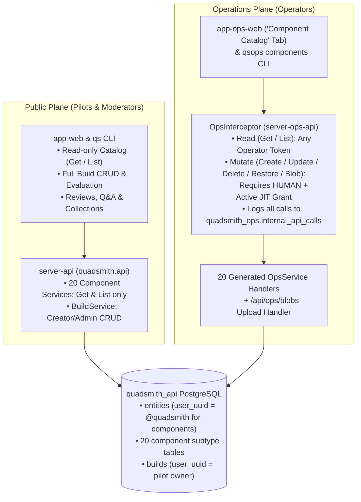
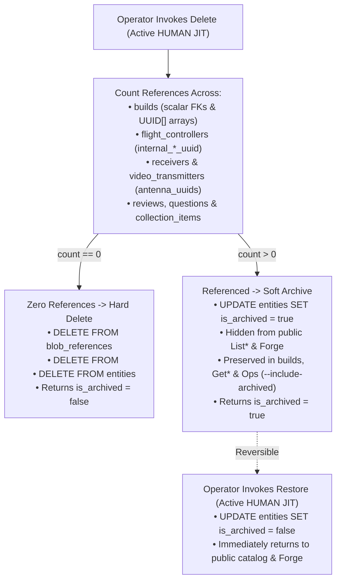

# <a id="ops-managed-component-catalog-and-build-only-user-ownership" >Ops-Managed Component Catalog and Build-Only User Ownership</a>

## <a id="table-of-contents" >Table of Contents</a>

- [1. Background](#1-background)
- [2. Goal](#2-goal)
- [3. Proposal](#3-proposal)
  - [Ops-Exclusive Component Mutation Plane and Read-Only Public Catalog](#ops-exclusive-component-mutation-plane-and-read-only-public-catalog)
  - [Code-Generated Typed Ops Component Services and qsops CLI](#code-generated-typed-ops-component-services-and-qsops-cli)
  - [Internal @quadsmith Entity Attribution and Public Ownership Removal](#internal-quadsmith-entity-attribution-and-public-ownership-removal)
  - [Steam-Style Hybrid Archive and Ops Restore Lifecycle](#steam-style-hybrid-archive-and-ops-restore-lifecycle)
  - [Streamlined Read-Only Public Web UI and Build-Only Q&A Endorsements](#streamlined-read-only-public-web-ui-and-build-only-qa-endorsements)
  - [Component Catalog Management Workspace in app-ops-web](#component-catalog-management-workspace-in-app-ops-web)
  - [Active Plan Archival and Synchronization](#active-plan-archival-and-synchronization)
- [4. Alternatives considered](#4-alternatives-considered)
- [5. Assumptions](#5-assumptions)

---

## <a id="1-background" >1. Background</a>

Under [`user_created_components.md`](archive/user_created_components.md),
Quadsmith allowed any authenticated pilot to create, edit, and delete catalog
components across all 20 hardware, gear, and software collections via `app-web`
and the `qs` CLI. Every component exposed `user_uuid` and `author_username`
ownership fields, rendered `Added by @username` badges on product pages, added a
`Components` tab on pilot profiles, and generated a `components.json` file in
personal GDPR exports.

In practice, treating physical drone hardware and firmware specifications as
user-owned content introduces significant domain friction:

- **Shared Physics & Compatibility Integrity**: Electrical limits, stator sizes,
  mount patterns, and weights drive compatibility checks and thrust evaluations
  across every pilot's builds. User-created variants risk duplicate SKUs and
  inaccurate specifications.
- **Artificial Seeder Ownership**: Pre-seeded catalog parts in
  [`seeder/main.go`](../src/go/shared/cmd/seeder/main.go) were artificially
  attributed to `@alex`, cluttering product pages and profile tabs with
  synthetic ownership.
- **Unnecessary Query & Export Overhead**: Projecting `author_username` forced
  all 20 component store `Get` and `List` queries in
  [`protoc-gen-store/main.go`](../src/go/shared/cmd/protoc-gen-store/main.go) to
  join `users`, while personal GDPR exports in
  [`export/handler.go`](../src/go/shared/pkg/export/handler.go) queried 21
  tables to emit `components.json`.

This plan **supersedes**
[`user_created_components.md`](archive/user_created_components.md) (archived in
`plans/archive/user_created_components.md`) while preserving its Table-Per-Type
(`entities`) relational schema foundation. Only `builds` retain user ownership
and customization; the 20 component collections become a platform-curated
catalog managed exclusively through the Ops plane.

---

## <a id="2-goal" >2. Goal</a>

Remove user component authoring and public component ownership so only aircraft
builds have user ownership and customization. Transition all 20 component
collections to a strictly read-only public surface (`server-api`, `app-web`, and
`qs`) while providing full component browsing, creation, cloning, editing,
archiving, and restoration in `server-ops-api`, `app-ops-web`, and `qsops` under
`HUMAN` JIT elevation.

---

## <a id="3-proposal" >3. Proposal</a>

> **TL;DR:**
>
> - Remove user component creation, editing, deletion, and public ownership
>   across all 20 catalog collections.
> - Make public component ConnectRPC services, `app-web`, and the `qs` CLI
>   strictly read-only.
> - Move component CRUD, hybrid archiving, and restoration to `server-ops-api`,
>   `app-ops-web`, and `qsops`.
> - Allow read-only Ops catalog browsing without JIT; require `HUMAN` JIT
>   elevation for all mutations.
> - Populate `entities.user_uuid` with `@quadsmith` internally, remove
>   `EXPORT_DOMAIN_COMPONENTS`, and restrict Q&A endorsements to builds.

Quadsmith cleanly separates pilot build customization from platform hardware
curation across its two isolated service planes. Public services expose fast,
ownerless, read-only component lookups alongside creator-owned builds, while
operators curate the 20 component collections directly inside the Ops console
and `qsops` CLI with full `internal_api_calls` auditability.



### <a id="ops-exclusive-component-mutation-plane-and-read-only-public-catalog" >Ops-Exclusive Component Mutation Plane and Read-Only Public Catalog</a>

Component mutations move completely off the public API plane onto the operations
plane:

1. **Read-Only Public Component Services (`quadsmith.api`)**:
   - Remove `Create<Component>`, `Update<Component>`, and `Delete<Component>`
     RPCs (and their request/response messages) from all 20 component `.proto`
     files under `src/proto/quadsmith/api/` (e.g.,
     [`motor.proto`](../src/proto/quadsmith/api/motor.proto)).
   - Public `*Service` interfaces expose strictly `Get<Component>` and
     `List<Components>`.
   - `BuildService` in [`build.proto`](../src/proto/quadsmith/api/build.proto)
     retains `CreateBuild`, `UpdateBuild`, and `DeleteBuild` for authenticated
     pilots (with `ADMIN`/`SYSTEM` moderation override).
2. **Read-Only Public CLI (`qs`)**:
   - Update [`generate_cli.go`](../src/go/cli/generate_cli.go) so the 20
     component collections generate only `get` and `list` subcommands.
   - Retain `create`, `update`, `delete`, and `evaluate` on `qs builds`.
3. **JIT-Split Authorization on `server-ops-api`**:
   - Any authenticated operator (`HUMAN` or `ROBOT` in an authorized group) can
     invoke component `Get` and `List` RPCs on `server-ops-api` without JIT
     elevation.
   - Component mutation RPCs (`Create`, `Update`, `Delete`, `Restore`) and
     component image uploads (`/api/ops/blobs`) require a `HUMAN` operator with
     an active JIT grant in
     [`interceptor.go`](../src/go/shared/pkg/opsauth/interceptor.go).
   - `ADMIN` user accounts on the public plane remain strictly scoped to
     community moderation (`BanUser`, `UpdateBan`, moderating abusive builds or
     social posts) and cannot mutate components.
4. **Ops Ingress Routing**:
   - Update [`nginx.conf`](../deploy/nginx/nginx.conf) on `ops.quadsmith.com` to
     proxy `/quadsmith.ops.` (covering `OpsService` and all 20
     `<Component>OpsService` routes) and `/api/ops/blobs` (with
     `client_max_body_size 100m`) to `http://ops_api_upstream`, plus `/blobs/`
     to `http://api_upstream` for rendering component images inside the Ops UI.

<details>
<summary><strong>Alternatives considered</strong></summary>

##### <a id="alt-public-api-mutations-gated-to-system" >Keep Component Mutations on server-api and qs Gated to @quadsmith</a>

Retain `Create*`, `Update*`, and `Delete*` on `server-api` (`quadsmith.api`) and
the `qs` CLI, rejecting requests unless `userCtx.IsSystem()` (`@quadsmith` via
`LoginAsQuadsmith`). Have `app-ops-web` mint a `@quadsmith` token to call
`server-api` cross-origin.

**Pros:**

- Avoids adding Ops component services on `server-ops-api`.
- Reuses existing `qs components ... create|update|delete` commands after
  running `qsops login-quadsmith`.

**Cons:**

- Leaves 60 privileged mutation endpoints exposed on the public `server-api`
  surface (`api.quadsmith.com`) and clutters regular pilots' `qs` CLI help and
  shell completions with unusable commands.
- Forces `app-ops-web` to coordinate cross-origin calls and secondary
  `@quadsmith` bearer tokens instead of using its native operator session and
  `internal_api_calls` audit pipeline.

##### <a id="alt-allow-admin-and-system-component-crud" >Allow Both SYSTEM and ADMIN Accounts to Mutate Components</a>

Authorize both `SYSTEM` (`@quadsmith`) and `ADMIN` pilot accounts to create,
edit, and delete catalog components.

**Pros:**

- Allows community moderators to fix component typos using their personal
  accounts.

**Cons:**

- Blurs the security boundary between community moderation (`ADMIN`) and
  JIT-audited platform catalog administration.
- Bypasses `quadsmith_ops` operator authentication and mandatory JIT lease
  justification.

##### <a id="alt-dedicated-ops-catalog-persona-roles" >Introduce Multiple Ops-Client Login Roles (e.g., CATALOG_ADMIN)</a>

Add new roles to `quadsmith_api.users` (such as `CATALOG_ADMIN` or `CURATOR`)
minted via separate `OpsService.LoginAs*` endpoints.

**Pros:**

- Enables finer-grained impersonation personas on `server-api`.

**Cons:**

- Unnecessary role and schema complexity once component mutations live directly
  on `server-ops-api` behind `OpsInterceptor` IAM groups and JIT grants.

##### <a id="alt-require-jit-for-catalog-reads" >Require Active HUMAN JIT Elevation for Both Browsing and Mutating Components</a>

Gate component `Get` and `List` calls in `app-ops-web` and `qsops` behind an
active JIT grant alongside mutations.

**Pros:**

- Uniform JIT check across every Ops catalog endpoint.

**Cons:**

- Adds pointless friction for read-only inspection of public hardware data,
  inconsistent with `GetDatabaseStats`, `ListTasks`, and `ListJobs`.

</details>

### <a id="code-generated-typed-ops-component-services-and-qsops-cli" >Code-Generated Typed Ops Component Services and qsops CLI</a>

Rather than hand-writing 20 services or sacrificing compile-time schema safety
with untyped JSON blobs, Quadsmith extends its Protobuf code generation pipeline
to the Ops plane:

1. **Ops Component Service Definitions
   ([`catalog.proto`](../src/proto/quadsmith/ops/catalog.proto))**:
   - Define 20 typed ConnectRPC services in `package quadsmith.ops`
     (`AntennaOpsService`, `BatteryOpsService`, ..., `VtxFirmwareOpsService`),
     importing and returning the canonical `quadsmith.api.<Component>` domain
     messages so specifications are defined in a single place:

```protobuf
service MotorOpsService {
  rpc GetMotor(GetMotorOpsRequest) returns (quadsmith.api.Motor);
  rpc ListMotors(ListMotorsOpsRequest) returns (ListMotorsOpsResponse);
  rpc CreateMotor(CreateMotorOpsRequest) returns (quadsmith.api.Motor);
  rpc UpdateMotor(UpdateMotorOpsRequest) returns (quadsmith.api.Motor);
  rpc DeleteMotor(DeleteMotorOpsRequest) returns (DeleteMotorOpsResponse);
  rpc RestoreMotor(RestoreMotorOpsRequest) returns (quadsmith.api.Motor);
}

message ListMotorsOpsRequest {
  string filter = 1;
  int32 page_size = 2;
  string page_token = 3;
  repeated string columns = 4;
  repeated string sort = 5;
  bool include_archived = 6;
}
```

1. **Generated Server Handlers (`protoc-gen-server`)**:
   - Update
     [`protoc-gen-server/main.go`](../src/go/shared/cmd/protoc-gen-server/main.go)
     so `quadsmith.api` component handlers generate strictly `Get<Type>` and
     `List<Plural>`, while generating `<Component>OpsServiceHandler`
     implementations (wired into
     [`server-ops-api/main.go`](../src/go/server-ops-api/main.go) using
     `publicPool` and `OpsInterceptor`) with full domain validation,
     deterministic slug generation, reference link validation, and blob
     reference linking.
   - Enhance `OpsInterceptor` in
     [`interceptor.go`](../src/go/shared/pkg/opsauth/interceptor.go) to
     automatically treat `<Component>OpsService` `Create*`, `Update*`,
     `Delete*`, and `Restore*` procedures as JIT-sensitive `HUMAN`-only
     operations without duplicating 80 method names across config textprotos.
2. **Ops Blob Upload Endpoint (`/api/ops/blobs`)**:
   - Mount an operator-authenticated, `HUMAN` JIT-gated blob upload handler at
     `/api/ops/blobs` on `server-ops-api` that writes uploaded images to
     `quadsmith_api.blobs` with `user_uuid = authcontext.SystemUserUUID`
     (`@quadsmith`).
3. **Generated `qsops components` CLI**:
   - Add [`generate_catalog_cli.go`](../src/go/cli-ops/generate_catalog_cli.go)
     for [`cli-ops`](../src/go/cli-ops/main.go) producing
     `qsops components <category> <collection> [list|get|create|update|delete|restore]`
     across all 20 collections alongside `qsops blob upload`:

```bash
# Browse components (including archived items) without JIT
qsops components hardware motors list --include-archived -f "kv >= 1900"

# Mutate components (requires active HUMAN JIT grant via 'qsops jit request')
qsops components hardware motors create --manufacturer "T-Motor" --name "F80 Pro" --kv 1900
qsops components hardware motors create -f motor.json
qsops components hardware motors update tmotor-f80-pro --max-current-a 55.0
qsops components hardware motors delete tmotor-f80-pro
qsops components hardware motors restore tmotor-f80-pro
```

<details>
<summary><strong>Alternatives considered</strong></summary>

##### <a id="alt-polymorphic-json-ops-rpcs" >Consolidated Generic JSON Catalog RPCs on OpsService</a>

Add 6 generic RPCs (`ListCatalogComponents`, `GetCatalogComponent`,
`CreateCatalogComponent`, `UpdateCatalogComponent`, `DeleteCatalogComponent`,
`RestoreCatalogComponent`) to `OpsService` accepting a `collection` string and
raw JSON or `google.protobuf.Struct` payloads.

**Pros:**

- Fewer generated service descriptors in `quadsmith.ops`.

**Cons:**

- Loses static Protobuf compile-time type checking across `server-ops-api`,
  `app-ops-web`, and `qsops`.
- Eliminates typed per-field CLI flags (`--kv`, `--wheelbase-mm`) and
  autocompletion in `qsops`.

</details>

### <a id="internal-quadsmith-entity-attribution-and-public-ownership-removal" >Internal @quadsmith Entity Attribution and Public Ownership Removal</a>

Database storage retains a uniform `entities` structure while stripping all
component ownership concepts from public APIs, exports, and client interfaces:

1. **Retain `entities.user_uuid` Populated with `@quadsmith`**:
   - Keep `user_uuid UUID REFERENCES users(uuid)` on `entities` in
     [`quadsmith_api.sql`](../src/db/quadsmith_api.sql).
   - Update `<Component>OpsService.Create<Component>` and
     [`seeder/main.go`](../src/go/shared/cmd/seeder/main.go) so all 20 component
     collections always write `user_uuid = authcontext.SystemUserUUID`
     (`@quadsmith`, `018f0000-0000-7000-8000-000000000000`) and
     `author_or_manufacturer = m.Manufacturer`.
   - Only `builds` populate `entities.user_uuid` with the creating pilot's UUID
     (or seeded pilot UUIDs such as `@alex`).
2. **Strip `user_uuid` and `author_username` from All 20 Component Protos**:
   - Remove `optional string user_uuid` and `optional string author_username`
     from all 20 component messages in `src/proto/quadsmith/api/*.proto`
     (keeping them strictly on `Build` in
     [`build.proto`](../src/proto/quadsmith/api/build.proto)).
   - Project `bool is_archived` from `entities.is_archived` across all 20
     component messages and `Build` via `entityInheritedFields` in
     [`protoc-gen-sql/main.go`](../src/go/shared/cmd/protoc-gen-sql/main.go) and
     [`protoc-gen-store/main.go`](../src/go/shared/cmd/protoc-gen-store/main.go)
     so archived status renders accurately in `ProductPage.tsx`, `app-ops-web`,
     and `qsops`.
   - Update
     [`protoc-gen-store/main.go`](../src/go/shared/cmd/protoc-gen-store/main.go)
     and [`search/engine.go`](../src/go/shared/pkg/engines/search/engine.go) to
     join `users` for `author_username` **only** when querying `builds`,
     eliminating the `LEFT JOIN users` across all 20 component tables.
3. **Remove `EXPORT_DOMAIN_COMPONENTS` (`components.json`) from GDPR Exports**:
   - Because regular users never own components (and `@quadsmith` has no email
     and never exports personal archives), remove `EXPORT_DOMAIN_COMPONENTS`
     from [`data.proto`](../src/proto/quadsmith/data/data.proto).
   - Set `option (quadsmith.data.export) = {domain: EXPORT_DOMAIN_NONE};` and
     reclassify fields to `CONTENT_TYPE_SYSTEM_METADATA_PUBLIC` across all 20
     component `.proto` files.
   - Update `Entity` in
     [`store/social.proto`](../src/proto/quadsmith/store/social.proto) to
     `domain: EXPORT_DOMAIN_BUILDS` with
     `user_filter: "collection = 'builds' AND user_uuid = $1::uuid"`, and remove
     `components.json` from
     [`export/handler.go`](../src/go/shared/pkg/export/handler.go).

<details>
<summary><strong>Alternatives considered</strong></summary>

##### <a id="alt-move-user-uuid-to-builds-table" >Move user_uuid Off entities Onto the builds Subtype Table</a>

Drop `user_uuid` from `entities` and add `user_uuid UUID REFERENCES users(uuid)`
directly to `builds`.

**Pros:**

- Physically prevents `entities` rows for components from storing a user foreign
  key.

**Cons:**

- Breaks uniformity of the `entities` supertype table and requires rewriting
  existing `entities.user_uuid` queries in `auth/service.go` and
  `social/service.go` instead of cleanly recording `@quadsmith` internally.

##### <a id="alt-retain-empty-gdpr-components-json" >Retain EXPORT_DOMAIN_COMPONENTS and Empty components.json in GDPR Exports</a>

Keep `EXPORT_DOMAIN_COMPONENTS` and emit an empty `components.json` file in user
GDPR ZIP downloads.

**Pros:**

- Fewer changes to `data.proto` and `export/handler.go`.

**Cons:**

- Executes 21 pointless SQL queries per export that always return empty slices
  and misleads users into thinking Quadsmith tracks personal component records.

</details>

### <a id="steam-style-hybrid-archive-and-ops-restore-lifecycle" >Steam-Style Hybrid Archive and Ops Restore Lifecycle</a>

To protect existing builds, AIO sub-component links, and community threads from
referential corruption, Ops component deletion preserves Steam-style hybrid
archiving paired with explicit restoration:



- **Comprehensive Reference Check**: Expand `getComponentRefQuery` in
  [`protoc-gen-server/main.go`](../src/go/shared/cmd/protoc-gen-server/main.go)
  to also count parent hardware references (`flight_controllers` referencing an
  internal ESC, RX, or VTX, and `receivers`/`video_transmitters` referencing
  `antenna_uuids`) in addition to `builds`, `questions`, `reviews`, and
  `collection_items`.
- **Ops Visibility & Restoration**: In `protoc-gen-store`, generate
  `List<Plural>IncludingArchived` (`includeArchived bool`) used exclusively by
  `<Component>OpsService.List<Plural>` so operators can inspect archived entries
  and restore them via `Restore<Component>`.

<details>
<summary><strong>Alternatives considered</strong></summary>

##### <a id="alt-hard-delete-only-no-archive" >Hard-Delete Only Without Component Archiving or Restore</a>

Remove component archiving and reject `Delete<Component>` with
`CodeFailedPrecondition` whenever a component is referenced by any build or
parent hardware item.

**Pros:**

- Eliminates archived state transitions for components.

**Cons:**

- Leaves operators unable to delist discontinued, recalled, or erroneous catalog
  parts from The Forge once even a single pilot build references them.

##### <a id="alt-one-way-archive-without-restore" >One-Way Component Archiving Without Restore</a>

Retain hybrid archiving on `Delete<Component>`, but omit `Restore<Component>`.

**Pros:**

- One fewer RPC per Ops component service.

**Cons:**

- Forces manual SQL intervention if an operator accidentally archives a
  referenced catalog component.

</details>

### <a id="streamlined-read-only-public-web-ui-and-build-only-qa-endorsements" >Streamlined Read-Only Public Web UI and Build-Only Q&A Endorsements</a>

All component authoring and ownership UI elements are removed from `app-web`,
leaving a clean, focused browsing and build-assembly experience:

1. **Catalog Pages
   ([`CollectionPage.tsx`](../src/react/app-web/src/pages/CollectionPage.tsx))**:
   - Remove the `+ Add New` button, `ComponentFormModal`, and `Community` badge.
2. **Product Detail Pages
   ([`ProductPage.tsx`](../src/react/app-web/src/pages/ProductPage.tsx))**:
   - Remove the `Added by @username` `UserBadge`, `Create Similar`,
     `Edit Component`, `Delete`, delete confirmation dialog, and
     `ComponentFormModal`.
   - Retain the `Archived Component` alert banner when `item.isArchived` is true
     on direct URL visits, alongside `SocialToolbar`, reviews, and Q&A.
3. **The Forge Wizard
   ([`BuildWizardPage.tsx`](../src/react/app-web/src/pages/BuildWizardPage.tsx))**:
   - Remove the `"Don't see your <part> in the catalog? + Add custom <part>"`
     banner and `ComponentFormModal`.
4. **Pilot Profiles
   ([`UserProfilePage.tsx`](../src/react/app-web/src/pages/UserProfilePage.tsx))**:
   - Remove the `Components` tab (`?tab=components`), contributed components
     counter, `ComponentFormModal`, and the 20-collection `SearchService.Search`
     query on profile load. Profile tabs show strictly **Builds** and
     **Collections**.
5. **Build-Only Q&A Answer Endorsements
   ([`social/service.go`](../src/go/shared/pkg/social/service.go))**:
   - Update `SocialService.EndorseAnswer` to verify `e.collection == 'builds'`,
     returning `CodeFailedPrecondition` if invoked on a component question.
   - Build Q&A retains dual-authority badges (`Accepted Answer` +
     `Author Verified`), while component Q&A relies cleanly on `Accepted Answer`
     (by the question asker) and community voting.

<details>
<summary><strong>Alternatives considered</strong></summary>

##### <a id="alt-gate-app-web-crud-to-system" >Show Component CRUD Controls in app-web Only When Logged In as @quadsmith</a>

Keep `ComponentFormModal` and the `+ Add New` / `Create Similar` / `Edit` /
`Delete` buttons in `app-web`, hidden behind `user?.role === "SYSTEM"`.

**Pros:**

- Reuses existing modals in `app-web` without building a catalog tab in
  `app-ops-web`.

**Cons:**

- Splits operational workflows across two separate web apps (`app-ops-web` and
  `app-web`) and ships dead CRUD form bundles to every public visitor.

##### <a id="alt-moderator-endorsed-component-qa" >Allow ADMIN and SYSTEM Accounts to Confer Moderator Verified Badges on Component Q&A</a>

Allow `ADMIN` and `SYSTEM` users to call `EndorseAnswer` on component questions
and render a `Moderator Verified` badge.

**Pros:**

- Lets staff highlight official hardware troubleshooting answers.

**Cons:**

- Introduces asymmetric badge semantics for a feature designed around build
  creators verifying physical fitment on their own aircraft; `Accepted Answer`
  and community voting already rank component Q&A solutions cleanly.

</details>

### <a id="component-catalog-management-workspace-in-app-ops-web" >Component Catalog Management Workspace in app-ops-web</a>

Shared collection metadata and Protobuf descriptor field helpers are centralized
in [`catalogRegistry.ts`](../src/react/shared/src/lib/catalogRegistry.ts) inside
`@quadsmith/shared` so both `app-web` (singular collection labels) and
`app-ops-web` (all 20 `<Component>OpsService` descriptors, CEL filter schemas,
and schema-driven form fields) consume a single source of truth.

In [`App.tsx`](../src/react/app-ops-web/src/App.tsx) and
[`OpsCatalogWorkspace.tsx`](../src/react/app-ops-web/src/components/OpsCatalogWorkspace.tsx),
add a top-level **`Component Catalog`** (`catalog`) tab in the primary
navigation bar:

| UI Region                      | Read-Only Mode (`JIT LOCKED`)                                                                                                                                                         | Elevated Mode (`JIT ELEVATED`)                                                                                                                                                                   |
| ------------------------------ | ------------------------------------------------------------------------------------------------------------------------------------------------------------------------------------- | ------------------------------------------------------------------------------------------------------------------------------------------------------------------------------------------------ |
| **Category & Collection Rail** | Switch across **Hardware (11)**, **Pilot Gear (4)**, and **Software & Firmware (5)** with collection icons and active item counts.                                                    | Identical navigation across all 20 collections.                                                                                                                                                  |
| **Catalog Toolbar**            | CEL `SmartFilterInput` with collection presets, sortable column headers, `Include Archived` checkbox toggle, pagination, and a disabled `🔒 + Add <Component> (JIT Required)` button. | Unlocks active **`+ Add <Component>`** button opening `OpsComponentFormModal` in Create mode.                                                                                                    |
| **Component Data Table**       | Displays `ID Slug`, `Manufacturer & Name`, dynamic collection spec columns, and status pills (`ACTIVE`, `ARCHIVED`, `INTERNAL`). Row mutation buttons remain disabled.                | Unlocks per-row **`Create Similar`** (clones all specs into editable Create modal), **`Edit`**, **`Delete`** (hybrid archive or hard-delete confirmation), and **`Restore`** (on archived rows). |
| **Component Form Modal**       | Unavailable until JIT lease is acquired.                                                                                                                                              | Schema-driven form with optional custom ID slugs, image upload via `/api/ops/blobs`, reference link editor, and strict client + server domain validation.                                        |

<details>
<summary><strong>Alternatives considered</strong></summary>

##### <a id="alt-cli-only-ops-component-management" >CLI-Only Component Management Without Ops Web UI</a>

Remove component CRUD from `app-web` and rely strictly on `qsops components` CLI
commands without adding a `Component Catalog` tab in `app-ops-web`.

**Pros:**

- Smaller frontend bundle in `app-ops-web`.

**Cons:**

- Makes visual image uploads, reference link curation, and rapid spec cloning
  (`Create Similar`) cumbersome compared to an integrated Ops UI workspace.

</details>

### <a id="active-plan-archival-and-synchronization" >Active Plan Archival and Synchronization</a>

In accordance with `AGENTS.md` plan lifecycle rules, the implementation commit
archives superseded plans and synchronizes all impacted active plans:

1. **Archive Superseded Plan**:
   - Move `plans/user_created_components.md` unmodified into
     [`archive/user_created_components.md`](archive/user_created_components.md).
2. **Update Impacted Active Plans**:
   - [`create_similar_edit_builds_and_forge_streamlining.md`](create_similar_edit_builds_and_forge_streamlining.md):
     Note that component `Create Similar` and component authoring modals now
     reside in `app-ops-web` rather than `app-web` `ProductPage.tsx`, while
     `Build Similar` and `Edit Build` remain in `app-web`.
   - [`gdpr_data_export.md`](gdpr_data_export.md): Remove
     `EXPORT_DOMAIN_COMPONENTS` (`components.json`), reclassify component tables
     to `EXPORT_DOMAIN_NONE`, and scope `Entity` export to
     `EXPORT_DOMAIN_BUILDS`.
   - [`storage_and_api_proto_separation.md`](storage_and_api_proto_separation.md)
     and
     [`uuid_foreign_key_normalization.md`](uuid_foreign_key_normalization.md):
     Reflect removal of `user_uuid`, `author_username`, and `LEFT JOIN users`
     from the 20 component API models and store queries.
   - [`social_interactions_and_collections.md`](social_interactions_and_collections.md):
     Specify that `Author Verified` Q&A answer endorsement applies strictly to
     builds.
   - [`deployment_architecture.md`](deployment_architecture.md): Document
     `/quadsmith.ops.` and `/api/ops/blobs` routing on `ops.quadsmith.com` and
     shared catalog definitions in `@quadsmith/shared`.

---

## <a id="4-alternatives-considered" >4. Alternatives considered</a>

<details>
<summary><strong>Alternatives considered</strong></summary>

### <a id="open-user-created-components-with-creator-ownership" >Retain User-Created Components with Creator Ownership</a>

Continue allowing any authenticated pilot to create, edit, and delete catalog
components under creator ownership (`user_created_components.md`).

**Pros:**

- Crowdsources new hardware parts without operator involvement.
- Lets pilots immediately add obscure or prototype parts inside The Forge.

**Cons:**

- Pollutes the global catalog with duplicate variants, typos, and unverified
  electrical ratings that undermine compatibility checks for all users.
- Forces ownership tracking, profile tabs, `users` table joins, and GDPR export
  machinery onto static manufacturer hardware specifications.

</details>

---

## <a id="5-assumptions" >5. Assumptions</a>

1. The immutable `@quadsmith` system user
   (`018f0000-0000-7000-8000-000000000000`) is guaranteed to exist via
   `auth.EnsureSystemUser` before seeding or Ops component creation, providing a
   valid foreign key target for `entities.user_uuid` and `blobs.user_uuid`.
2. `server-ops-api` already maintains direct `pgxpool` connections to both
   `quadsmith_api` (`publicPool`) and `quadsmith_ops` (`internalPool`), enabling
   atomic component transactions and `internal_api_calls` audit logging in a
   single service hop.
3. Updating Playwright visual regression baselines (`make update-snapshots`) is
   performed after verifying that strictly expected catalog and Forge
   screenshots change.
