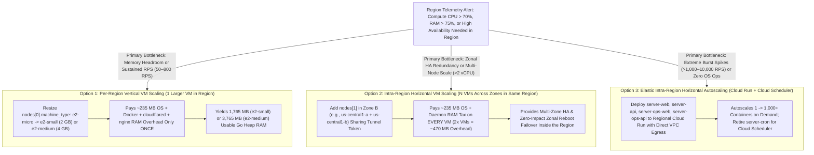
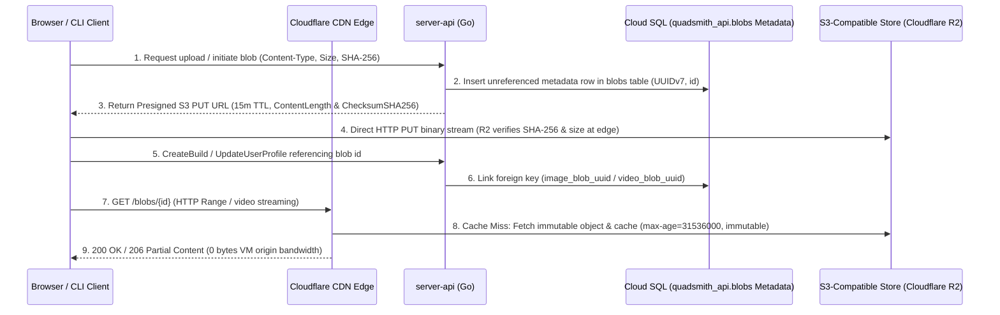
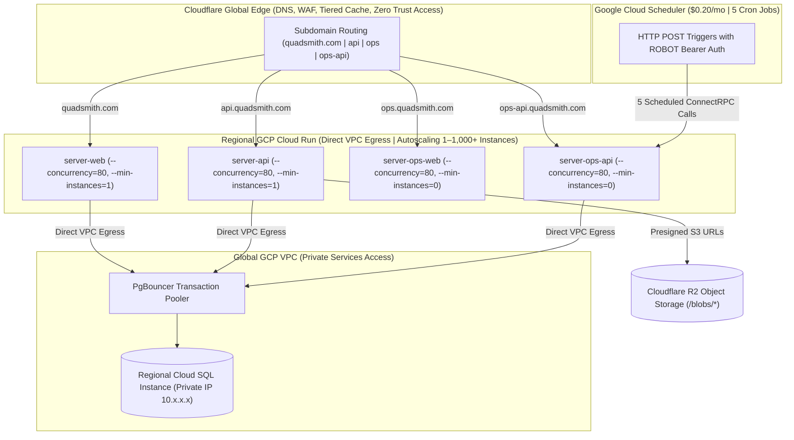

# <a id="scaling-deployment-regions" >Per-Region Vertical vs. Horizontal Compute, Database, and Object Storage Scaling</a>

## <a id="table-of-contents" >Table of Contents</a>

- [1. Background](#1-background)
- [2. Goal](#2-goal)
- [3. Proposal](#3-proposal)
  - [Per-Region Telemetry Triggers and Bottleneck Diagnosis](#per-region-telemetry-triggers-and-bottleneck-diagnosis)
  - [Per-Region Compute Scaling Comparison: Vertical VM Sizing vs. Intra-Region Horizontal VMs vs. Cloud Run](#per-region-compute-scaling-comparison-vertical-vm-sizing-vs-intra-region-horizontal-vms-vs-cloud-run)
  - [Per-Region Cloud SQL Scaling: Vertical Tier Sizing vs. Intra-Region Read Replicas](#per-region-cloud-sql-scaling-vertical-tier-sizing-vs-intra-region-read-replicas)
  - [Offloading `/blobs/*` Media Storage from Cloud SQL `BYTEA` to Cloudflare R2 (S3)](#offloading-blobs-media-storage-from-cloud-sql-bytea-to-cloudflare-r2-s3)
  - [Step-by-Step Instructions for Scaling a Region Vertically or Horizontally](#step-by-step-instructions-for-scaling-a-region-vertically-or-horizontally)
- [4. Alternatives considered](#4-alternatives-considered)
  - [Scale All Regions Lockstep Instead of Per-Region Scaling](#scale-all-regions-lockstep-instead-of-per-region-scaling)
  - [Continue Scaling Cloud SQL `BYTEA` Disk Storage Beyond 10 GB Instead of Offloading to R2](#continue-scaling-cloud-sql-bytea-disk-storage-beyond-10-gb-instead-of-offloading-to-r2)
  - [Proprietary Cloudflare Images and Cloudflare Stream APIs](#proprietary-cloudflare-images-and-cloudflare-stream-apis)
- [5. Assumptions](#5-assumptions)

---

## <a id="1-background" >1. Background</a>

In [`deployment_architecture.md`](deployment_architecture.md) and
[`adding_deployment_regions.md`](adding_deployment_regions.md) (which together
with this plan supersede
[`e2_micro_deployment_and_evolution.md`](archive/e2_micro_deployment_and_evolution.md)),
each deployed geographic region in
[`deploy/config/prod.textproto`](../deploy/config/prod.textproto) (`regions[]`)
starts with a minimal footprint: a single 1 GB RAM `e2-micro` VM (`nodes[]`) and
a 0.6 GB RAM `db-f1-micro` **GCP Cloud SQL for PostgreSQL** instance (with user
media blobs stored in `quadsmith_api.blobs` `BYTEA` columns up to the 10 GB SSD
baseline).

Real-world user growth is rarely uniform across regions: North America
(`us-central1`) might reach 500 sustained RPS and 75% memory utilization while
Europe (`europe-west1`) is comfortably serving 80 RPS on a single `e2-micro` VM.
Therefore, **capacity scaling must happen on an independent per-region basis**
when telemetry shows a specific region approaching its compute, memory, or
database limits—and before scaling a region, the operator must compare
**vertical scaling** against **horizontal scaling within that region** for both
performance and cost.

---

## <a id="2-goal" >2. Goal</a>

Provide a quantitative performance-and-cost decision framework and step-by-step
operator instructions for scaling any individual region in
[`deploy/config/prod.textproto`](../deploy/config/prod.textproto) **vertically**
(`machine_type` / `db_tier`) or **horizontally within the region** (adding zonal
VM nodes to `regions[i].nodes[]` or graduating to **GCP Cloud Run + Cloud
Scheduler**), alongside offloading `/blobs/*` binary payloads from Cloud SQL
`BYTEA` to **Cloudflare R2** via `aws-sdk-go-v2/service/s3` when media storage
outgrows the 10 GB database SSD tier.

---

## <a id="3-proposal" >3. Proposal</a>

> **TL;DR:**
>
> - Scale capacity **per region** in `deploy/config/prod.textproto`
>   (`regions[i]`) only when that region's telemetry crosses CPU, RAM, or DB
>   thresholds.
> - Compare **vertical VM scaling** (`e2-small`/`e2-medium`) against
>   **intra-region horizontal VM scaling** (`2–3x VMs` across zones) and **Cloud
>   Run** before scaling.
> - Prefer **vertical VM scaling first** (1 GB &rarr; 2–4 GB RAM) to avoid
>   paying the ~235 MB OS/Docker/`cloudflared`/`nginx` memory tax multiple
>   times; use **intra-region horizontal VMs** when multi-zone HA is needed
>   inside a region, and **Cloud Run** for >1,000 RPS elastic bursts.
> - Scale each region's Cloud SQL instance vertically (`db-f1-micro` &rarr;
>   `db-g1-small` &rarr; dedicated vCPU) as regional query load grows.
> - Offload `/blobs/*` payloads to Cloudflare R2 ($0.015/GB/mo, $0 egress)
>   before `quadsmith_api.blobs` exceeds 10 GB so blob storage is not multiplied
>   across regional Cloud SQL read replicas.

When telemetry in a specific region indicates approaching resource limits, the
operator diagnoses whether the bottleneck is in the **stateless compute layer**,
the **regional Cloud SQL instance**, or **global media blob storage**, and
applies the most cost- and performance-effective scaling action to that region.

### <a id="per-region-telemetry-triggers-and-bottleneck-diagnosis" >Per-Region Telemetry Triggers and Bottleneck Diagnosis</a>

Before scaling a region, inspect the following per-region telemetry signals in
Google Cloud Monitoring and Cloudflare Analytics to isolate the bottleneck:

| Bottleneck Layer                     | Telemetry Metric & Source                                                                                                     | Action Threshold                                                                                   | Recommended Scaling Action in Target Region                                                                           |
| :----------------------------------- | :---------------------------------------------------------------------------------------------------------------------------- | :------------------------------------------------------------------------------------------------- | :-------------------------------------------------------------------------------------------------------------------- |
| **Regional Compute VM Memory**       | GCP Monitoring &rarr; Compute Engine `memory/percent_used` (or `free -m` / swap activity on VM)                               | **Sustained RAM $> 75\%$** _(>750 MB on 1 GB `e2-micro`)_ or active swap I/O during traffic peaks  | **Scale VM vertically** (`e2-micro` &rarr; `e2-small` 2 GB or `e2-medium` 4 GB) in `regions[i].nodes[]`               |
| **Regional Compute VM CPU**          | GCP Monitoring &rarr; Compute Engine `cpu/utilization` & `cpu/reserved_cores`                                                 | **Sustained CPU $> 70\%$** of baseline _(or >50–70 sustained RPS per `e2-micro`)_                  | Compare **Vertical VM Scaling** vs. **Intra-Region Horizontal VMs** (see decision matrix below)                       |
| **Regional Intra-Zone Availability** | Zonal uptime / maintenance SLO for a region serving $\ge 50\%$ of global traffic                                              | Zero-disruption requirement during zonal VM live-migration or reboot in a region                   | **Scale horizontally within the region** (`2x VMs` across Zone A and Zone B in `regions[i].nodes[]`)                  |
| **Extreme Burst Traffic**            | Cloudflare Analytics &rarr; Peak-to-average RPS ratio in region                                                               | **Peak bursts $> 1,000\text{ RPS}$** _(>10x average load)_                                         | **Graduate region to Elastic Horizontal Autoscaling** (GCP Cloud Run + Cloud Scheduler)                               |
| **Regional Cloud SQL CPU / RAM**     | GCP Monitoring &rarr; Cloud SQL `database/cpu/utilization`, `database/memory/utilization`, `database/postgresql/num_backends` | **DB RAM $> 80\%$**, **DB CPU $> 70\%$**, or **Replication Lag $> 1\text{s}$** on regional replica | **Scale Cloud SQL vertically** in `regions[i].db_tier` (`db-f1-micro` &rarr; `db-g1-small` &rarr; `db-custom-1-3840`) |
| **Blob Storage Growth**              | Cloud SQL `database/disk/bytes_used` (`SELECT pg_size_pretty(pg_total_relation_size('blobs'))`)                               | **`quadsmith_api.blobs` $> 8\text{ GB}$** _(approaching the 10 GB Cloud SQL SSD baseline)_         | **Offload `/blobs/*` to Cloudflare R2** via presigned S3 URLs ($0.015/GB/mo, $0 egress)                               |

<details>
<summary><strong>Alternatives considered</strong></summary>

##### <a id="alt-blind-simultaneous-compute-and-db-upgrade" >Upgrade Both Compute VMs and Cloud SQL Tiers Simultaneously Without Isolating the Bottleneck</a>

Whenever API latency rises in a region, upgrade both the Compute Engine VM
`machine_type` and the Cloud SQL `db_tier` together.

**Pros:**

- Requires less diagnostic analysis before editing `prod.textproto`.

**Cons:**

- Wastes money scaling the wrong layer (for example, doubling VM RAM to
  `e2-small` does nothing if latency is caused by buffer-cache misses on the 0.6
  GB `db-f1-micro` Cloud SQL instance, and vice versa).

</details>

### <a id="per-region-compute-scaling-comparison-vertical-vm-sizing-vs-intra-region-horizontal-vms-vs-cloud-run" >Per-Region Compute Scaling Comparison: Vertical VM Sizing vs. Intra-Region Horizontal VMs vs. Cloud Run</a>

When a specific region (e.g., `us-central1` or `europe-west1`) needs more
stateless compute capacity, we compare three intra-region scaling options across
**usable Go container memory**, **sustained CPU**, **P99 tail latency**, **zonal
availability**, and **monthly cost**:



#### 1. The Fixed ~235 MB Per-VM OS & Daemon Memory Tax (Why Vertical Wins First for RAM/CPU per Dollar)

Every Compute Engine VM running our Docker stack pays a fixed memory tax before
a single Go container (`server-web`, `server-api`, `server-ops-web`,
`server-ops-api`, `server-cron`) allocates heap memory:

- **Linux Kernel + systemd + journald**: ~150 MB – 200 MB
- **Docker Engine (`dockerd` + `containerd`)**: ~65 MB
- **Standalone `cloudflared` daemon + `nginx` gateway**: ~20 MB
- **Total Fixed Overhead per VM**: **~235 MB RAM**

Comparing **1 vertically scaled VM** against **multiple horizontally scaled
`e2-micro` VMs** inside the same region:

| Intra-Region Compute Option                               | Total vCPU Baseline _(Burst)_   | Total Raw RAM               | Fixed OS / Daemon Overhead  | **Net Usable Go Container RAM**                                | Intra-Region Multi-Zone HA?              | Sustained RPS Capacity in Region    | Incremental Monthly Compute Cost _(in Primary US Region / in Secondary Region)_           |
| :-------------------------------------------------------- | :------------------------------ | :-------------------------- | :-------------------------- | :------------------------------------------------------------- | :--------------------------------------- | :---------------------------------- | :---------------------------------------------------------------------------------------- |
| **Baseline: `1x e2-micro`**                               | 0.25 vCPU _(2 vCPU)_            | 1,024 MB                    | ~235 MB _(23%)_             | **~789 MB**                                                    | No _(1 zone)_                            | ~50 – 70 RPS                        | **$0.00 / mo** _(US Free Tier)_<br>**~$7.50 / mo** _(Secondary region)_                   |
| **Horizontal: `2x e2-micro`** _(Zone A + Zone B)_         | 0.50 vCPU _(4 vCPU)_            | 2,048 MB                    | **~470 MB** _(2x tax)_      | **~1,578 MB** _(789 MB/node)_                                  | **Yes (2 zones)**                        | ~100 – 140 RPS                      | **+~$7.50 / mo** _(US: 1 free + 1 paid)_<br>**~$15.00 / mo** _(Secondary region)_         |
| **Vertical: `1x e2-small`** _(2 GB RAM)_                  | 0.50 vCPU _(2 vCPU)_            | 2,048 MB                    | **~235 MB** _(1x tax)_      | **~1,813 MB** _(+235 MB more Go RAM on 1 node)_                | No _(1 zone)_                            | ~120 – 160 RPS                      | **~$13.50 / mo** _(in any region; forfeits `e2-micro` free tier if in US)_                |
| **Horizontal: `3x e2-micro`** _(Zones A, B, C)_           | 0.75 vCPU _(6 vCPU)_            | 3,072 MB                    | **~705 MB** _(3x tax)_      | **~2,367 MB** _(789 MB/node)_                                  | **Yes (3 zones)**                        | ~150 – 210 RPS                      | **~$15.00 / mo** _(US: 1 free + 2 paid)_<br>**~$22.50 / mo** _(Secondary region)_         |
| **Vertical: `1x e2-medium`** _(4 GB RAM)_                 | **1.00 vCPU** _(2 vCPU)_        | 4,096 MB                    | **~235 MB** _(1x tax)_      | **~3,861 MB** _(4.9x baseline Go RAM!)_                        | No _(1 zone)_                            | **~250 – 350 RPS**                  | **~$27.00 / mo** _(in any region)_                                                        |
| **Hybrid: `2x e2-small`** _(Zone A + Zone B)_             | **1.00 vCPU** _(4 vCPU)_        | 4,096 MB                    | ~470 MB _(2x tax)_          | **~3,626 MB** _(1,813 MB/node)_                                | **Yes (2 zones)**                        | **~250 – 350 RPS**                  | **~$27.00 / mo** _(in any region)_                                                        |
| **Vertical: `1x e2-standard-2`** _(Dedicated)_            | **2.00 vCPU** _(Dedicated)_     | 8,192 MB                    | ~235 MB _(1x tax)_          | **~7,957 MB** _(10x baseline Go RAM!)_                         | No _(1 zone)_                            | **~600 – 900 RPS**                  | **~$49.00 / mo** _(in any region)_                                                        |
| **Portable Alternative: `1x Hetzner CX22`**               | **2.00 vCPU**                   | 4,096 MB                    | ~235 MB _(1x tax)_          | **~3,861 MB**                                                  | No _(1 zone)_                            | **~400 – 600 RPS**                  | **~$4.50 / mo** _(Requires external/public DB IP if mixed with Cloud SQL)_                |
| **Elastic Horizontal: `GCP Cloud Run`** + Cloud Scheduler | **0 – 1,000+ vCPU** _(Elastic)_ | **0.5 – 4 GB per instance** | **0 MB** _(Managed by GCP)_ | **100% dedicated to Go** _(up to 80 concurrent reqs/instance)_ | **Yes (Multi-zone regional by default)** | **1,000 – 10,000+ RPS** _(elastic)_ | **~$35 – $120+ / mo** _(with `--min-instances=1` on `web`/`api` + $0.20 Cloud Scheduler)_ |

#### 2. Key Conclusions from the Vertical vs. Horizontal Comparison

1. **In `us-central1` (Where the First `e2-micro` is Always Free)**:
   - Because the first `e2-micro` VM in `us-central1` costs **$0.00/month**
     under GCP's Always Free tier—and resizing that VM to `e2-small`
     (~$13.50/mo) forfeits the `e2-micro` free tier—**adding a second `e2-micro`
     horizontally in `us-central1-b` costs only +$7.50/month** (nearly half the
     ~$13.50/mo cost of upgrading to `1x e2-small`), while doubling baseline
     vCPU to 0.50 and adding **multi-zone High Availability** across
     `us-central1-a` and `us-central1-b`!
   - However, if a single VM in `us-central1` is experiencing **per-node memory
     pressure** (>750 MB RAM due to large concurrent request buffers or
     blue-green builds), horizontal scaling with another 1 GB `e2-micro` still
     leaves each individual VM with only ~789 MB of usable Go RAM; in that case,
     **vertical scaling to `e2-small` (2 GB RAM) or `e2-medium` (4 GB RAM)** is
     required.
2. **In Non-Free Secondary Regions (`europe-west1`, `asia-east1`) or Above 2 GB
   RAM**:
   - In secondary regions where every `e2-micro` is billed (~$7.50/mo),
     **`1x e2-small` (~$13.50/mo) beats `2x e2-micro` (~$15.00/mo)** on both
     cost (-10%) and usable Go RAM (+235 MB, because you only pay the OS/daemon
     memory tax once) unless multi-zone HA inside that region is specifically
     required.
   - At the **4 GB RAM / 1.0 vCPU** tier (~$27/mo), **`2x e2-small` across two
     zones (`a` and `b`) costs the exact same ~$27/month as `1x e2-medium`**,
     making **`2x e2-small` the superior choice** whenever 1,813 MB of usable Go
     RAM per node is sufficient, because it provides multi-zone HA at zero extra
     cost!
3. **When to Graduate a Region to Cloud Run (Elastic Horizontal Autoscaling)**:
   - Up to ~500–800 sustained RPS in a region, fixed VMs (`e2-small`,
     `e2-medium`, `e2-standard-2`) are **2x to 4x cheaper per vCPU-hour** than
     always-warm Cloud Run instances.
   - Once a region experiences **extreme burst ratios** (>1,000 – 10,000+ RPS
     spikes where provisioning peak VM capacity 24/7 would waste money during
     off-peak hours), graduating that region to **GCP Cloud Run** (with
     `--concurrency=80`, `--min-instances=1` on `server-web` and `server-api`,
     `--min-instances=0` on `server-ops-web` and `server-ops-api`, **Direct VPC
     Egress** to the regional Cloud SQL Private IP, and **Google Cloud
     Scheduler** replacing `server-cron` for $0.20/mo) provides instant elastic
     horizontal scaling with zero Linux host administration.

<details>
<summary><strong>Alternatives considered</strong></summary>

##### <a id="alt-horizontal-e2-micro-fleet" >Scale Exclusively with 6–10 `e2-micro` VMs in a Single Region</a>

Keep all VMs as 1 GB `e2-micro` instances and provision 6–10 nodes in the same
region instead of resizing nodes to `e2-small` (2 GB) or `e2-medium` (4 GB).

**Pros:**

- Finer-grained horizontal failure domains.

**Cons:**

- 8 `e2-micro` VMs waste $8 \times 235\text{ MB} = \mathbf{1.88\text{ GB}}$ of
  RAM purely on duplicate Linux kernels, Docker daemons, `cloudflared`, and
  `nginx` processes, costing ~$52.50/month for less usable Go heap memory and
  worse single-request CPU burst performance than `2x e2-medium` ($54/mo) or
  `1x e2-standard-2` ($49/mo).

</details>

### <a id="per-region-cloud-sql-scaling-vertical-tier-sizing-vs-intra-region-read-replicas" >Per-Region Cloud SQL Scaling: Vertical Tier Sizing vs. Intra-Region Read Replicas</a>

When a region's **Cloud SQL for PostgreSQL** instance approaches CPU (>70%) or
memory (>80%) limits, we also compare **vertical Cloud SQL scaling** against
**intra-region horizontal read replicas**:

| Cloud SQL Tier                                         | vCPU & RAM                                                | Shared Buffers / Cache Fit                                     | Max Connections _(Configured)_ | Monthly Compute Cost _(+ $1.70 for 10 GB SSD)_ | Recommended Use Case                                              |
| :----------------------------------------------------- | :-------------------------------------------------------- | :------------------------------------------------------------- | :----------------------------- | :--------------------------------------------- | :---------------------------------------------------------------- |
| **`db-f1-micro`** _(Initial Default)_                  | Shared vCPU, **0.6 GB RAM**                               | Small working sets (<300 MB hot index/table data)              | 100                            | **~$8.80 / mo** _(~$10.50 total)_              | Initial launch & low-to-moderate regional traffic (<150 RPS)      |
| **`db-g1-small`** _(Vertical Step 1)_                  | Shared vCPU, **1.7 GB RAM** _(2.8x RAM)_                  | Medium working sets (~1 GB hot index/table cache)              | 200                            | **~$25.50 / mo** _(~$27.20 total)_             | First vertical upgrade when `db-f1-micro` hits RAM/cache pressure |
| **`db-custom-1-3840`** _(Vertical Step 2 — Dedicated)_ | **1 Dedicated vCPU, 3.75 GB RAM** _(99.95% SLA eligible)_ | Large working sets (~2.5 GB cache) + high write/WAL throughput | 400                            | **~$47.00 / mo** _(~$48.70 total)_             | High sustained regional throughput (200–600 RPS) or heavy writes  |
| **`db-custom-2-7680`** _(Vertical Step 3 — Dedicated)_ | **2 Dedicated vCPUs, 7.5 GB RAM**                         | Very large working sets (~5.5 GB cache)                        | 800                            | **~$94.00 / mo** _(~$95.70 total)_             | 600–2,000+ RPS regional read/write load                           |

- **Why Vertical Cloud SQL Scaling Must Precede Intra-Region Read Replicas**:
  1. **RAM & Shared Buffer Cache Hit Ratio**: On `db-f1-micro` (0.6 GB RAM), the
     most common bottleneck is PostgreSQL shared buffer cache eviction causing
     disk I/O waits. Adding a second `db-f1-micro` read replica in the same
     region costs the same as upgrading to `db-g1-small`, but leaves both
     instances with a tiny 0.6 GB cache that still misses to disk. Upgrading the
     regional instance vertically to `db-g1-small` (1.7 GB RAM) or
     `db-custom-1-3840` (3.75 GB RAM) fits the entire catalog and regional user
     working set in RAM, eliminating disk I/O and accelerating queries by
     5x–10x.
  2. **100% Independent Per-Region Sizing**: Because each region runs its own
     writable Cloud SQL Primary storing only that region's users' PII and
     private data (with only Category B catalog and public community tables
     logically replicated across regions per
     [`adding_deployment_regions.md`](adding_deployment_regions.md)), a
     high-traffic `us-central1` primary can be scaled vertically to
     `db-g1-small` or `db-custom-1-3840` while a lower-traffic `europe-west1`
     primary remains on `db-f1-micro` with zero cross-region tier or
     `max_connections` coupling.
  3. **When to Add Intra-Region Read Replicas**: Only add a physical read
     replica _within the same region_ once that region's Cloud SQL primary is
     already on a dedicated-core tier (`db-custom-2-7680` or larger) and
     regional read query CPU exceeds single-instance vertical limits.

<details>
<summary><strong>Alternatives considered</strong></summary>

##### <a id="alt-multiple-f1-micro-replicas-same-region" >Add Multiple `db-f1-micro` Read Replicas Within the Same Region Instead of Upgrading to `db-g1-small` / `db-custom-1-3840`</a>

Keep the regional Cloud SQL instance on `db-f1-micro` (0.6 GB RAM) and add 2–3
`db-f1-micro` read replicas in the same region.

**Pros:**

- Distributes read queries across multiple small Postgres processes.

**Cons:**

- `3x db-f1-micro` (~$31.50/mo) costs more than `1x db-g1-small` (~$27.20/mo)
  while restricting each node to a 0.6 GB RAM buffer cache, shared burstable CPU
  throttling, no SLA coverage, and higher risk of WAL replication lag under
  write bursts.

</details>

### <a id="offloading-blobs-media-storage-from-cloud-sql-bytea-to-cloudflare-r2-s3" >Offloading `/blobs/*` Media Storage from Cloud SQL `BYTEA` to Cloudflare R2 (S3)</a>

Storing user-uploaded build photos and flight videos (up to 100 MB per upload)
in `quadsmith_api.blobs` PostgreSQL `BYTEA` columns (as designed in
[`blob_storage_and_streaming_architecture.md`](blob_storage_and_streaming_architecture.md))
is ideal while total media is under the 10 GB Cloud SQL SSD baseline. However,
once media storage grows past ~8–10 GB—especially when running multi-region
Cloud SQL read replicas—keeping binary payloads in PostgreSQL becomes expensive
because **every gigabyte of `BYTEA` data is replicated to and billed on the
primary ($0.17/GB/mo) AND on every regional Cloud SQL read replica ($0.17/GB/mo
each)**:

| Object Storage Provider            | S3 API Portable    | Always Free Tier                           | Storage Cost ($/GB/mo)                   | Outbound Egress Cost ($/GB)               | Cost for 200 GB Stored + 2 TB Monthly Streaming _(vs. 3-Region Cloud SQL SSD: $102/mo)_ |
| :--------------------------------- | :----------------- | :----------------------------------------- | :--------------------------------------- | :---------------------------------------- | :-------------------------------------------------------------------------------------- |
| **Cloudflare R2 (Recommended)**    | **Yes (100%)**     | **10 GB storage**, 1M writes, 10M reads/mo | **$0.015 / GB** _(stored once globally)_ | **$0.00 / GB (Free)**                     | **~$2.85 / mo** _(97% cheaper than 3x Cloud SQL SSD)_                                   |
| **Backblaze B2** _(+ Cloudflare)_  | **Yes (100%)**     | **10 GB storage**                          | **$0.006 / GB**                          | **$0.00 / GB** _(via Bandwidth Alliance)_ | **~$1.20 / mo**                                                                         |
| **Tigris Data** _(Global Edge S3)_ | **Yes (100%)**     | **5 GB storage**                           | **$0.020 / GB**                          | **$0.00 / GB (Free)**                     | **~$3.90 / mo**                                                                         |
| **Google Cloud Storage (GCS)**     | **Yes (XML/HMAC)** | **5 GB storage**, 1 GB egress/mo           | **$0.020 / GB**                          | **$0.08 – $0.12 / GB**                    | **~$164 – $244 / mo** _(due to egress)_                                                 |



- **Zero VM Upload Bandwidth with Cryptographic SHA-256 Enforcement**: Using
  standard `aws-sdk-go-v2/service/s3`, `server-api` generates a short-lived S3
  presigned `PUT` URL with strict `ContentLength`, `ContentType`, and
  `ChecksumSHA256` (`x-amz-checksum-sha256`, supported natively by Cloudflare R2
  and AWS S3) signed into the request signature. R2 rejects any byte stream
  whose SHA-256 digest or length does not match the declared `blob_<sha256>`
  identifier, while Cloud SQL `quadsmith_api.blobs` retains relational metadata
  and `CleanupOrphanedBlobs` garbage collection.
- **Zero-Downtime Online Migration from Cloud SQL `BYTEA` to R2**:
  1. Deploy `server-api` in **Dual-Read, S3-Write Mode** (writing new blobs to
     R2 while falling back to reading `quadsmith_api.blobs.data` from Cloud SQL
     for unmigrated blobs).
  2. Run an idempotent `qsops` backfill command streaming existing `BYTEA` rows
     to R2 using their existing content-addressable `id` keys.
  3. Drop the `BYTEA` payload column from `src/db/quadsmith_api.sql` via
     `psqldef` and run `VACUUM FULL` on `blobs` to reclaim Cloud SQL SSD space.

<details>
<summary><strong>Alternatives considered</strong></summary>

##### <a id="alt-proxy-uploads-through-server-api" >Proxy All Uploads Through `server-api` to R2 Instead of Presigned URLs</a>

Continue sending `POST /api/blobs` multipart payloads through `nginx` and
`server-api`, having `server-api` stream the body into `s3.PutObject`.

**Pros:**

- Keeps the frontend upload code identical to the initial Postgres upload flow.

**Cons:**

- Consumes VM ingress/egress bandwidth (counting against GCP's 1 GB free
  internet egress when uploading from GCP to R2) and ties up `server-api` memory
  buffers while relaying 100 MB video files.

</details>

### <a id="step-by-step-instructions-for-scaling-a-region-vertically-or-horizontally" >Step-by-Step Instructions for Scaling a Region Vertically or Horizontally</a>

The following operational workflows (also documented in
[`deploy/README.md`](../deploy/README.md)) show how to scale a specific region
vertically or horizontally without disrupting other regions:

#### Workflow A: Scale a Specific Region Vertically (VM `machine_type` and/or Cloud SQL `db_tier`)

To vertically scale `us-central1` (e.g., upgrading its VM to `e2-small` and its
Cloud SQL primary to `db-g1-small`) while keeping `europe-west1` on `e2-micro` /
`db-f1-micro`:

1. Edit only the target region's block in
   [`deploy/config/prod.textproto`](../deploy/config/prod.textproto):

   ```textproto
   regions {
     region: "us-central1"
     db_tier: "db-g1-small"        # Vertically scaled from db-f1-micro (0.6 GB -> 1.7 GB RAM)
     nodes {
       zone: "us-central1-a"
       machine_type: "e2-small"    # Vertically scaled from e2-micro (1 GB -> 2 GB RAM)
     }
   }

   regions {
     region: "europe-west1"
     db_tier: "db-f1-micro"        # Unchanged
     nodes {
       zone: "europe-west1-b"
       machine_type: "e2-micro"    # Unchanged
     }
   }
   ```

2. Run `make verify && make deploy ENV=prod`.
3. [`deploy/deploy.sh`](../deploy/deploy.sh) detects the tier difference in
   `us-central1`, resizes `quadsmith-db-prod-us-central1` via
   `gcloud sql instances patch quadsmith-db-prod-us-central1 --tier=db-g1-small`
   and resizes `quadsmith-prod-us-central1-a-1` via
   `gcloud compute instances set-machine-type` (while Cloudflare Tunnel
   transparently serves traffic from `europe-west1` during the resize), then
   verifies `/healthz`.

#### Workflow B: Scale a Specific Region Horizontally with Additional Zonal VMs

To add a second VM in `us-central1` across a second availability zone
(`us-central1-b`) for intra-region horizontal capacity and multi-zone High
Availability:

1. Append a second `nodes` entry inside the `us-central1` `regions` block in
   [`deploy/config/prod.textproto`](../deploy/config/prod.textproto):

   ```textproto
   regions {
     region: "us-central1"
     db_tier: "db-g1-small"
     nodes {
       zone: "us-central1-a"
       machine_type: "e2-micro"
     }
     nodes {
       zone: "us-central1-b"
       machine_type: "e2-micro"
     }
   }
   ```

2. Run `make verify && make deploy ENV=prod`.
3. [`deploy/deploy.sh`](../deploy/deploy.sh) provisions
   `quadsmith-prod-us-central1-b-2` in `us-central1-b`, connects its standalone
   `cloudflared` daemon to the shared `quadsmith-prod` Cloudflare Tunnel, points
   its database URLs to the shared `us-central1` Cloud SQL instance Private IP,
   and deploys the Compose stack. Cloudflare automatically load-balances US
   requests across both zonal VMs.

#### Workflow C: Graduate a High-Burst Region to Elastic Horizontal Autoscaling (Cloud Run + Cloud Scheduler)

When a region requires elastic 1,000–10,000+ RPS horizontal autoscaling:



1. **Deploy `server-web`, `server-api`, `server-ops-web`, and `server-ops-api`
   to Cloud Run** in the target region from the existing
   `us-central1-docker.pkg.dev` Artifact Registry images with
   `--network=default --subnet=default` (**Direct VPC Egress**, $0 extra VPC
   connector cost) pointing to the region's Cloud SQL Private IP via PgBouncer
   (`MaxConns: 10` per instance, `--concurrency=80`).
2. **Cut Over Scheduled Maintenance to Google Cloud Scheduler ($0.20/mo)**:
   Provision the 5 Cloud Scheduler HTTP jobs (`cleanup-expired-otps`,
   `cleanup-expired-tokens`, `cleanup-orphaned-blobs`,
   `purge-soft-deleted-accounts`, `send-username-release-warnings`) targeting
   `OpsService` on `server-ops-api`, retiring the `server-cron` container in
   that region.
3. **Shift Cloudflare Edge Routing & Decommission Fixed VMs**: Point Cloudflare
   origin routing for the region to the Cloud Run custom domain endpoints and
   remove the fixed VM `nodes` once `cloudflared` logs confirm zero incoming VM
   requests.

---

## <a id="4-alternatives-considered" >4. Alternatives considered</a>

<details>
<summary><strong>Alternatives considered</strong></summary>

### <a id="scale-all-regions-lockstep-instead-of-per-region-scaling" >Scale All Regions Lockstep Instead of Per-Region Scaling</a>

Require every region in
[`deploy/config/prod.textproto`](../deploy/config/prod.textproto) to use the
exact same VM `machine_type`, node count, and Cloud SQL `db_tier`.

**Pros:**

- Uniform hardware sizing across all deployed regions.

**Cons:**

- Forces quieter secondary regions (e.g., `asia-east1` at 50 RPS) to pay for
  expensive `e2-medium` / `db-custom-1-3840` upgrades that are only needed in
  the highest-traffic region (`us-central1` at 400 RPS).

### <a id="continue-scaling-cloud-sql-bytea-disk-storage-beyond-10-gb-instead-of-offloading-to-r2" >Continue Scaling Cloud SQL `BYTEA` Disk Storage Beyond 10 GB Instead of Offloading to R2</a>

Keep all build photos and 100 MB flight videos inside Cloud SQL `BYTEA` columns
beyond 10 GB by purchasing larger Cloud SQL SSD allocations.

**Pros:**

- Avoids configuring an S3-compatible object storage bucket.

**Cons:**

- Cloud SQL SSD storage costs **$0.17/GB/month per instance**. Across 1 primary
  - 2 regional read replicas, storing 200 GB of video blobs in Cloud SQL `BYTEA`
    costs $200 \times \$0.17 \times 3 = \mathbf{\$102.00/\text{month}}$ and
    bloats WAL replication streams, compared to **~$2.85/month** on Cloudflare
    R2 ($0.015/GB stored once globally, $0.00 egress).

### <a id="proprietary-cloudflare-images-and-cloudflare-stream-apis" >Proprietary Cloudflare Images and Cloudflare Stream APIs</a>

Replace generic `/blobs/*` storage with Cloudflare's proprietary Cloudflare
Images and Cloudflare Stream products.

**Pros:**

- Built-in video transcoding and responsive image resizing at the edge.

**Cons:**

- Creates hard vendor lock-in to Cloudflare's proprietary upload/playback APIs
  and per-minute video storage/delivery pricing ($5.00 per 1,000 minutes stored
  - $1.00 per 1,000 minutes viewed), violating our cloud portability principles.

</details>

---

## <a id="5-assumptions" >5. Assumptions</a>

1. The local development sandbox
   ([`deploy/docker-compose.yaml`](../deploy/docker-compose.yaml)) continues to
   support either PostgreSQL `BYTEA` storage or a lightweight S3-compatible
   container so `make test` runs offline without external cloud credentials.
2. Content-addressable blob IDs (`/blobs/{id}`) remain unchanged across the
   Cloud SQL-to-R2 migration so existing frontend URLs and cached CDN entries
   remain valid.
3. All `db-f1-micro`, `db-g1-small`, and dedicated Cloud SQL instances in a
   replication topology maintain `--database-flags=max_connections=<N>` where
   every read replica's `max_connections` is $\ge$ the primary's
   `max_connections`.
