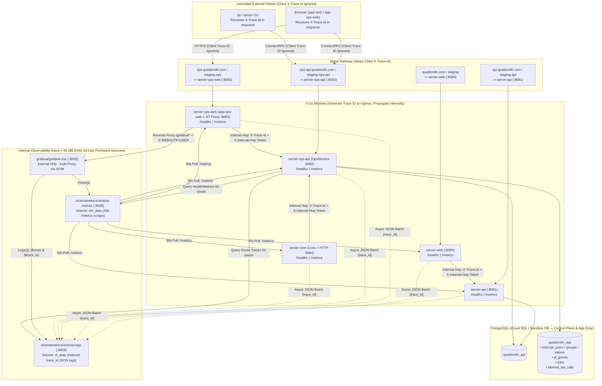
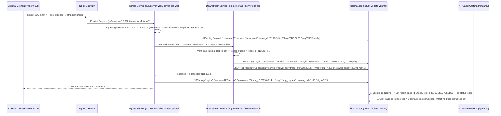

# <a id="service-health-monitoring-victoriametrics-victorialogs-ops-console-and-jit-gated-grafana" >Service Health Monitoring, Ingress-Generated Trace IDs, VictoriaMetrics & VictoriaLogs, and JIT-Gated Grafana</a>

## <a id="table-of-contents" >Table of Contents</a>

- [1. Background](#1-background)
- [2. Goal](#2-goal)
- [3. Proposal](#3-proposal)
  - [Five-Binary Topology (`server-ops-api`, `server-ops-web`, `server-cron`) + Observability Stack](#five-binary-topology-server-ops-api-server-ops-web-server-cron--observability-stack)
  - [Deep JSON `/healthz` Probes and Internal Prometheus `/metrics` Endpoints](#deep-json-healthz-probes-and-internal-prometheus-metrics-endpoints)
  - [Ingress-Only `trace_id` (`X-Trace-Id`) Generation, Internal Hop Propagation, and VictoriaLogs](#ingress-only-trace-id-x-trace-id-generation-internal-hop-propagation-and-victorialogs)
  - [`OpsService` RPCs and `qsops` CLI Health and Metrics Commands](#opsservice-rpcs-and-qsops-cli-health-and-metrics-commands)
  - [Ops Console SPA (`src/react/app-ops-web`) and JIT-Gated Grafana Reverse Proxy (`/grafana/`)](#ops-console-spa-src-react-app-ops-web-and-jit-gated-grafana-reverse-proxy-grafana)
- [4. Alternatives considered](#4-alternatives-considered)
- [5. Assumptions](#5-assumptions)
- [6. Future work](#6-future-work)

---

## <a id="1-background" >1. Background</a>

Quadsmith's deployment architecture across
[deployment_architecture.md](deployment_architecture.md),
[infrastructure_alignment_and_container_architecture.md](infrastructure_alignment_and_container_architecture.md),
and [tasks_and_jobs.md](tasks_and_jobs.md) previously ran four Go binaries
(`server-web`, `server-api`, `server-ops`, and `server-jobs`) behind an Nginx
reverse proxy in [deploy/nginx/nginx.conf](../deploy/nginx/nginx.conf).

Several operational gaps limited service monitoring and administration in
`staging` and `prod`:

- **Shallow `/healthz` Endpoints**:
  [src/go/server-api/main.go](../src/go/server-api/main.go),
  [src/go/server-ops-api/main.go](../src/go/server-ops-api/main.go), and
  [src/go/server-web/main.go](../src/go/server-web/main.go) previously returned
  a static `200 ok` without checking PostgreSQL, static bundles, or upstreams.
  Additionally, [deploy/nginx/nginx.conf](../deploy/nginx/nginx.conf) returned a
  static `200 OK` on `/healthz` without probing `server-web`.
- **Unprobed & Misnamed `server-jobs` Daemon**:
  [src/go/server-cron/main.go](../src/go/server-cron/main.go) (formerly
  `server-jobs`) exposed no HTTP listener for `/healthz` or `/metrics`. As a
  result, [deploy/deploy_blue_green.sh](../deploy/deploy_blue_green.sh) could
  only check `docker compose ps --status running`. Moreover, per
  [tasks_and_jobs.md](tasks_and_jobs.md), `server-ops-api` executes tasks and
  stores **Job** rows, whereas `server-cron` is strictly a cron scheduler.
- **No End-to-End Trace IDs or Route Drill-Down**: Requests were not assigned an
  ingress Trace ID (`X-Trace-Id` UUID v7) or traced across internal hops.
  Operators could not click a route to inspect recent failed or successful Trace
  IDs, HTTP status codes, and cross-service debug logs.
- **Missing Ops Web UI & JIT-Protected Dashboards**: The operations plane lacked
  a browser UI (`src/react/app-ops-web` served by `server-ops-web` on
  `ops.quadsmith.com`, anticipated in
  [infrastructure_alignment_and_container_architecture.md](infrastructure_alignment_and_container_architecture.md)).
  Operators need this UI to manage JIT leases, trigger tasks, inspect job
  history/details, and open a JIT-gated **Grafana** dashboard backed by
  **VictoriaMetrics** and **VictoriaLogs**.

This plan updates active plans [tasks_and_jobs.md](tasks_and_jobs.md),
[infrastructure_alignment_and_container_architecture.md](infrastructure_alignment_and_container_architecture.md),
[deployment_architecture.md](deployment_architecture.md),
[adding_deployment_regions.md](adding_deployment_regions.md),
[scaling_deployment_regions.md](scaling_deployment_regions.md), and
[admin_role_ops_task.md](admin_role_ops_task.md) in place to reflect these
changes.

---

## <a id="2-goal" >2. Goal</a>

Monitor service health, route availability, latency, and distributed request
traces across all five Go binaries (`server-web`, `server-api`,
`server-ops-web`, `server-ops-api`, and `server-cron`) in `sandbox`, `staging`,
and `prod`. Keep high-volume metrics and debug logs off `quadsmith_ops`
PostgreSQL by storing 60 days of telemetry in **VictoriaMetrics** and
**VictoriaLogs**. Provide the `app-ops-web` console (`server-ops-web`) to manage
JIT leases, trigger tasks, inspect job history, and access a JIT-gated
**Grafana** dashboard (`/grafana/`) with route and `trace_id` drill-down.

---

## <a id="3-proposal" >3. Proposal</a>

> **TL;DR:**
>
> - Rename `server-ops` to `server-ops-api`, rename `server-jobs` to
>   `server-cron`, and add `server-ops-web` serving `src/react/app-ops-web`.
> - Ignore any client-supplied `X-Trace-Id`, generate a fresh UUID v7 `trace_id`
>   strictly at ingress, and propagate it across internal hops.
> - Store 60 days of metrics in **VictoriaMetrics** (`vm_data` volume) and
>   structured JSON logs in **VictoriaLogs** (`vl_data` volume), off Cloud SQL.
> - Use `app-ops-web` (`ops.quadsmith.com`) to manage JIT leases, trigger tasks,
>   inspect job history/details, and launch `/grafana/`.
> - Gate `/grafana/*` in `server-ops-web` behind an active JIT lease to view
>   metrics and click routes or `trace_id` UUIDs in VictoriaLogs.

Relational control-plane state stays in `quadsmith_ops` PostgreSQL, while
high-volume metrics and trace logs are stored on persistent VM volumes in
**VictoriaMetrics** (`vm_data`) and **VictoriaLogs** (`vl_data`).
`server-ops-web` serves the `src/react/app-ops-web` console at `/` and verifies
an active JIT lease on every `/grafana/*` request before proxying to
`grafana/grafana-oss`:



### <a id="five-binary-topology-server-ops-api-server-ops-web-server-cron--observability-stack" >Five-Binary Topology (`server-ops-api`, `server-ops-web`, `server-cron`) + Observability Stack</a>

We align the operations plane with the public plane (`server-web` +
`server-api`) and the domain taxonomy in [tasks_and_jobs.md](tasks_and_jobs.md):

1. Rename `server-ops` to **`server-ops-api`** (`src/go/server-ops-api`,
   `src/proto/quadsmith/config/server_ops_api.proto`, `OpsApiServerConfig`).
2. Add **`server-ops-web`** (`src/go/server-ops-web`,
   `src/proto/quadsmith/config/server_ops_web.proto`, `OpsWebServerConfig`). It
   serves `src/react/app-ops-web` at `/` and reverse-proxies `/grafana/*` to
   `http://grafana:3000` only after verifying an active JIT lease.
3. Rename `server-jobs` to **`server-cron`** (`src/go/server-cron`,
   `src/proto/quadsmith/config/server_cron.proto`, `CronServerConfig`, Docker
   Compose service `cron`).
4. Add the internal observability stack (`victoria-metrics`, `victoria-logs`,
   and `grafana` in [deploy/docker-compose.yaml](../deploy/docker-compose.yaml)
   and
   [deploy/docker-compose.blue-green.yaml](../deploy/docker-compose.blue-green.yaml)):
   - **Where Metrics Are Stored**: `victoriametrics/victoria-metrics` mounts the
     persistent Docker volume `vm_data` at `/storage` on the host VM's 30 GB
     disk with `-retentionPeriod=60d`.
   - **Where Logs Are Stored**: `victoriametrics/victoria-logs` mounts the
     persistent Docker volume `vl_data` at `/vlogs` on the host VM's 30 GB disk
     with `-retentionPeriod=60d` and `-retention.maxDiskSpaceUsageBytes=8GB`.
     Oldest log blocks are pruned automatically if the volume reaches 8 GB.

```text
deploy/
├── grafana/
│   ├── grafana.ini                                       # Subpath /grafana/ & Auth Proxy config
│   └── provisioning/
│       ├── datasources/
│       │   └── datasources.yaml                          # VictoriaMetrics (:8428) & VictoriaLogs (:9428)
│       └── dashboards/
│           ├── dashboards.yaml                           # Dashboard provider config
│           └── json/
│               └── quadsmith_service_health.json         # Fleet Health, RTT, $route & $trace_id Inspector
├── victoriametrics/
│   └── scrape.yml                                        # 30s scrape config for all 5 Go binaries
src/
├── go/
│   ├── server-web/                                       # Public SPA & OpenGraph proxy (quadsmith.com)
│   ├── server-api/                                       # Public ConnectRPC API & blobs (api.quadsmith.com)
│   ├── server-ops-web/                                   # Ops Console SPA + JIT /grafana/ proxy (ops.quadsmith.com)
│   │   ├── config/{sandbox,staging,prod}.textproto
│   │   ├── Dockerfile
│   │   ├── go.mod
│   │   ├── main.go
│   │   └── main_test.go
│   ├── server-ops-api/                                   # OpsService ConnectRPC API (ops-api.quadsmith.com)
│   │   ├── config/{sandbox,staging,prod}.textproto
│   │   ├── pkg/ops/{service.go,telemetry.go}
│   │   ├── Dockerfile
│   │   ├── go.mod
│   │   └── main.go
│   └── server-cron/                                      # Cron scheduler + internal /healthz & /metrics (:8084)
│       ├── config/{sandbox,staging,prod}.textproto
│       ├── Dockerfile
│       ├── go.mod
│       ├── main.go
│       └── main_test.go
├── proto/quadsmith/config/
│   ├── server_web.proto                                  # WebServerConfig
│   ├── server_api.proto                                  # APIServerConfig
│   ├── server_ops_web.proto                              # OpsWebServerConfig
│   ├── server_ops_api.proto                              # OpsApiServerConfig (renamed from server_ops.proto)
│   └── server_cron.proto                                 # CronServerConfig (renamed from server_jobs.proto)
└── react/
    ├── app-web/                                          # Public React 19 SPA
    ├── app-ops-web/                                      # Ops Console SPA (JIT, Tasks, Job History/Details, Grafana link)
    └── shared/                                           # Shared TypeScript components & generated ConnectRPC clients
```

Domain, container, and port assignments across all three environments:

| Service / Image                    | Container Name (`blue`/`green`)    | `sandbox` Host Port | `staging` Subdomain             | `prod` Subdomain          |
| :--------------------------------- | :--------------------------------- | :------------------ | :------------------------------ | :------------------------ |
| `server-web`                       | `web` (`web-blue`/`green`)         | `127.0.0.1:8080`    | `staging.quadsmith.com`         | `quadsmith.com`           |
| `server-api`                       | `api` (`api-blue`/`green`)         | `127.0.0.1:8081`    | `staging-api.quadsmith.com`     | `api.quadsmith.com`       |
| `server-ops-api`                   | `ops-api` (`ops-api-blue`/`green`) | `127.0.0.1:8082`    | `staging-ops-api.quadsmith.com` | `ops-api.quadsmith.com`   |
| `server-ops-web`                   | `ops-web` (`ops-web-blue`/`green`) | `127.0.0.1:8083`    | `staging-ops.quadsmith.com`     | `ops.quadsmith.com`       |
| `server-cron`                      | `cron` (`cron-blue`/`green`)       | `127.0.0.1:8084`    | Internal Docker `:8084`         | Internal Docker `:8084`   |
| `grafana/grafana-oss`              | `grafana`                          | Internal `:3000`    | `staging-ops.../grafana/` (JIT) | `ops.../grafana/` (JIT)   |
| `victoriametrics/victoria-metrics` | `victoria-metrics` (`vm_data`)     | Internal `:8428`    | Internal Docker `:8428`         | Internal Docker `:8428`   |
| `victoriametrics/victoria-logs`    | `victoria-logs` (`vl_data`)        | Internal `:9428`    | Internal Docker `:9428`         | Internal Docker `:9428`   |
| `nginx`                            | `nginx`                            | `127.0.0.1:9000`    | `127.0.0.1:9000` (Tunnel)       | `127.0.0.1:9000` (Tunnel) |

<details>
<summary><strong>Alternatives considered</strong></summary>

##### <a id="alt-grafana-loki-promtail-and-prometheus" >Run `grafana/loki` + `promtail` + `prom/prometheus` Instead of VictoriaLogs + VictoriaMetrics</a>

Deploy the standard Prometheus, Loki, and Promtail containers alongside
`grafana/grafana-oss`.

**Pros:**

- Uses Grafana Labs' built-in Loki data source without installing the
  `victoriametrics-logs-datasource` plugin.

**Cons:**

- Consumes ~255 MB of resident RAM (~5x more than VictoriaLogs + VictoriaMetrics
  at ~55 MB) and does not index high-cardinality `trace_id` UUID fields, forcing
  Loki to brute-force scan raw log chunks during `trace_id` drill-down queries.

##### <a id="alt-gcp-cloud-logging-and-monitoring" >Store Logs and Metrics in GCP Cloud Logging & Cloud Monitoring</a>

Stream container stdout logs to GCP Cloud Logging and metrics to GCP Cloud
Monitoring, queried remotely by `grafana/grafana-oss`.

**Pros:**

- Zero metric/log storage containers on the `e2-micro` VM.

**Cons:**

- Incurs `$0.50/GiB` cloud ingestion charges once logs exceed 50 GiB/month and
  does not run offline in `make sandbox` without a separate local stack.

##### <a id="alt-store-request-and-debug-logs-in-quadsmith-ops-postgres" >Store Raw Request Logs and Debug Logs in `quadsmith_ops` PostgreSQL</a>

Insert every request record and debug log line into `quadsmith_ops` PostgreSQL
and prune rows older than 60 days via a daily SQL `DELETE` task.

**Pros:**

- Avoids running dedicated metric or log storage containers.

**Cons:**

- Generates millions of high-churn rows and B-tree index writes on the shared
  0.6 GB RAM / 10 GB SSD `db-f1-micro` Cloud SQL instance, and loses logs during
  database outages.

</details>

### <a id="deep-json-healthz-probes-and-internal-prometheus-metrics-endpoints" >Deep JSON `/healthz` Probes and Internal Prometheus `/metrics` Endpoints</a>

We introduce a shared Go package `src/go/shared/pkg/telemetry` used by all five
Go binaries to serve standardized `/healthz` and `/metrics` endpoints:

1. **Structured Deep `/healthz` Endpoint (`GET /healthz`)**:
   - Executes all registered dependency checks in parallel with a strict `2s`
     timeout per check:
     - `server-api`: Pings `quadsmith_api` (`SELECT 1` via `pool.Ping(ctx)`),
       plus `read_database` and `peer_databases` if configured.
     - `server-ops-api`: Pings both `quadsmith_api` (`publicPool.Ping(ctx)`) and
       `quadsmith_ops` (`internalPool.Ping(ctx)`).
     - `server-web`: Verifies `index.html` and `quadsmith-engine.wasm` exist in
       `static_dir` and probes `server-api`'s `/healthz?shallow=1` endpoint.
     - `server-ops-web`: Verifies `index.html` exists in `static_dir`, probes
       `server-ops-api`'s `/healthz?shallow=1` endpoint, and probes internal
       `grafana`'s `/api/health` endpoint.
     - `server-cron`: Verifies the `robfig/cron/v3` scheduler is active, reports
       registered cron schedule count, and probes `server-ops-api`'s
       `/healthz?shallow=1` endpoint (passing `?shallow=1` on upstream checks
       prevents recursive probe cascades).
   - Returns HTTP `200 OK` (`status: "HEALTHY"`) when all critical checks pass,
     or HTTP `503 Service Unavailable` (`status: "UNHEALTHY"` / `"DEGRADED"`)
     with `Content-Type: application/json`, including the deployment `region`
     (`QS_REGION`, e.g., `"us-central1"`, `"europe-west1"`, or `"local"` in
     `sandbox`):

```json
{
  "status": "HEALTHY",
  "service": "server-ops-api",
  "region": "us-central1",
  "instance_id": "server-ops-api-us-central1-a-1-blue",
  "version": "0.1.0",
  "environment": "prod",
  "uptime_seconds": 86420,
  "checked_at": "2026-10-17T22:00:00Z",
  "checks": [
    {
      "name": "postgres:quadsmith_api",
      "status": "HEALTHY",
      "latency_ms": 0.62
    },
    {
      "name": "postgres:quadsmith_ops",
      "status": "HEALTHY",
      "latency_ms": 0.51
    }
  ]
}
```

1. **Internal Prometheus `/metrics` Endpoint (`GET /metrics`)**:
   - Served by every Go binary in standard
     [Prometheus text exposition format (`0.0.4`)](https://prometheus.io/docs/instrumenting/exposition_formats/)
     with `region`, `service`, and `instance` labels on every metric, and
     scraped every **30 seconds** by `victoria-metrics`
     (`deploy/victoriametrics/scrape.yml`):
     - `quadsmith_health_status{region,service,instance}` (`1` = healthy, `0` =
       unhealthy) and
       `quadsmith_dependency_check_latency_ms{region,service,instance,check="..."}`
     - `quadsmith_uptime_seconds{region,service,instance}`
     - `quadsmith_memory_allocated_bytes{region,service,instance}` &
       `quadsmith_memory_sys_bytes{region,service,instance}`
     - `quadsmith_goroutines{region,service,instance}` &
       `quadsmith_gc_cpu_fraction{region,service,instance}`
     - `quadsmith_http_requests_total{region,service,instance,route,method,status_code,success}`
     - `quadsmith_http_request_duration_ms_bucket{region,service,instance,route,le}`
       (histogram for `P50 / P95 / P99` RTT calculation via
       `histogram_quantile`)
     - `quadsmith_db_acquired_conns{region,service,instance}`,
       `quadsmith_db_idle_conns{region,service,instance}`,
       `quadsmith_db_max_conns{region,service,instance}` (on `server-api` and
       `server-ops-api`)
     - `quadsmith_scheduler_registered_tasks{region,service,instance}`,
       `quadsmith_scheduler_runs_total{region,service,instance}`,
       `quadsmith_scheduler_failures_total{region,service,instance}` (on
       `server-cron`)
   - In [deploy/nginx/nginx.conf](../deploy/nginx/nginx.conf), remove the
     hardcoded `location = /healthz { return 200 "OK\n"; }` override so
     `/healthz` proxies through to each upstream binary, and add
     `location = /metrics { return 403; }` on all server blocks so `/metrics` is
     strictly internal to the Docker/VPC network.

<details>
<summary><strong>Alternatives considered</strong></summary>

##### <a id="alt-expose-prometheus-metrics-publicly" >Expose `/metrics` Publicly Through Nginx</a>

Allow unauthenticated internet requests to `*/metrics` across all subdomains.

**Pros:**

- Allows external scrapers outside the VPC to pull metrics without auth headers.

**Cons:**

- Leaks internal memory usage, goroutine counts, RPC method traffic patterns,
  and database pool saturation to unauthenticated users.

</details>

### <a id="ingress-only-trace-id-x-trace-id-generation-internal-hop-propagation-and-victorialogs" >Ingress-Only `trace_id` (`X-Trace-Id`) Generation, Internal Hop Propagation, and VictoriaLogs</a>

To guarantee that clients can never spoof, collide, or inject custom Trace IDs
while ensuring that a single ingress-generated `trace_id` flows unbroken across
every internal service-to-service hop:



1. **Strict Ingress Generation & Client Header Rejection**:
   - **Edge Stripping in `deploy/nginx/nginx.conf`**: Every server block clears
     incoming `proxy_set_header X-Trace-Id "";` and
     `proxy_set_header X-Internal-Hop-Token "";` so external clients can never
     inject trace or internal-hop headers through the gateway.
   - **Go Ingress Middleware (`telemetry.NewTraceMiddleware`)**:
     - Pure ingress services (`server-web` and `server-ops-web`) and direct
       external client calls to `server-api` or `server-ops-api` **always ignore
       any client-provided `X-Trace-Id` header** and generate a brand-new
       time-ordered **UUID v7** (`google/uuid.NewV7()`).
     - Only when a request arrives at `server-api` or `server-ops-api` from a
       trusted internal service carrying a valid `X-Internal-Hop-Token` header
       (shared internal secret matching the robot token) and a valid UUID
       `X-Trace-Id` does the middleware continue that existing `trace_id`.
     - The active `trace_id` is written to the `X-Trace-Id` response header
       (exposed via CORS `ExposedHeaders` on `server-api` and `server-ops-api`
       so clients can read the server-assigned ID from responses), stored in
       `r.Context()`, and attached to a request-scoped `*slog.Logger`.
2. **Internal Service-to-Service Hop Propagation
   (`telemetry.NewTracedHTTPClient`)**:
   - Outbound internal HTTP and ConnectRPC clients automatically read
     `telemetry.TraceIDFromContext(ctx)` and set both `X-Trace-Id: <trace_id>`
     and `X-Internal-Hop-Token: <token>` across all internal service calls:
     - `server-web` &rarr; `server-api` (OpenGraph SSR `BuildService.GetBuild`
       calls).
     - `server-ops-web` &rarr; `server-ops-api` (JIT lease verification on
       `/grafana/*`).
     - `server-cron` &rarr; `server-ops-api` (`server-cron` generates a fresh
       UUID v7 `trace_id` when each scheduled task fires and propagates it to
       `server-ops-api`).
3. **Structured JSON Log Shipping to VictoriaLogs
   (`http://victoria-logs:9428/insert/jsonline`)**:
   - The `telemetry` package writes structured JSON `log/slog` records both to
     container `stdout` and to an asynchronous, non-blocking batch shipper that
     flushes JSON lines every 1 second to
     `http://victoria-logs:9428/insert/jsonline?_stream_fields=region,service,instance&_msg_field=msg&_time_field=time`.
   - Indexing `region` (`QS_REGION`, e.g., `"us-central1"`, `"europe-west1"`, or
     `"local"` in `sandbox`) as a first-class VictoriaLogs stream field
     alongside `service` and `instance` allows operators to filter or compare
     logs across deployment regions
     (`{region="us-central1", service="server-api"}`).
   - Every completed HTTP/RPC request emits an access log entry with
     `"msg": "http_request"`, `"trace_id"`, `"region"`, `"service"`,
     `"instance"`, `"route"`, `"method"`, `"status_code"`, `"success"`, and
     `"rtt_ms"`, while any debug/warning/error logs emitted during the request
     across any internal hop include `"region"` and share the exact same
     `"trace_id"`.

<details>
<summary><strong>Alternatives considered</strong></summary>

##### <a id="alt-accept-client-provided-x-trace-id" >Accept and Reuse Client-Provided `X-Trace-Id` Headers at Ingress</a>

Allow external browsers or CLI clients to pass their own `X-Trace-Id` request
header into Quadsmith.

**Pros:**

- Lets a client pick an ID before sending a request.

**Cons:**

- Allows malicious or buggy clients to spoof existing `trace_id` values,
  corrupting trace logs or colliding multiple unrelated requests under a single
  static UUID in VictoriaLogs.

</details>

### <a id="opsservice-rpcs-and-qsops-cli-health-and-metrics-commands" >`OpsService` RPCs and `qsops` CLI Health and Metrics Commands</a>

In [src/proto/quadsmith/ops/ops.proto](../src/proto/quadsmith/ops/ops.proto),
extend `OpsService` so `qsops` can also inspect fleet health, route metrics, and
recent trace IDs by region and service from the terminal:

- `GetSystemHealth(GetSystemHealthRequest) returns (GetSystemHealthResponse)`:
  Accepts optional `region_filter`. Performs a live concurrent `/healthz` +
  `/metrics` probe across all 5 Go service binaries (`server-web`, `server-api`,
  `server-ops-web`, `server-ops-api`, `server-cron`) and returns overall fleet
  status alongside each binary's `region`, `instance_id`, deep dependency
  checks, uptime, memory, goroutines, and DB pool usage.
- `GetSystemMetrics(GetSystemMetricsRequest) returns (GetSystemMetricsResponse)`:
  Accepts `region_filter` (optional), `service_filter` (optional), `window`
  (`"15m"`, `"1h"`, `"24h"`, `"7d"`, `"60d"`), optional CEL `filter`, and
  `repeated string sort`. Queries VictoriaMetrics (with an in-memory ring-buffer
  fallback) to return per-region, per-service, and per-route availability
  (`total_requests`, `success_count`, `error_count`, `availability_percent`) and
  RTT percentiles (`p50_rtt_ms`, `p95_rtt_ms`, `p99_rtt_ms`), filtered and
  sorted via `cel2sql.FilterAndSort`.
- `ListRouteRequests(ListRouteRequestsRequest) returns (ListRouteRequestsResponse)`:
  Accepts `region_filter` (optional), `service_name` (optional), `route`,
  `window` (`"5m"`, `"15m"`, `"1h"`, `"6h"`, `"24h"`, `"7d"`, `"60d"`, or
  `"all"`), `only_errors` (optional bool), `limit` (default `50`, up to `2000`),
  `offset` (default `0`), optional CEL `filter`, and `repeated string sort`.
  Queries VictoriaLogs across the requested historical time window (with
  in-memory ring-buffer and `quadsmith_ops.internal_api_calls` merging) to
  return paginated `RouteRequestLog` records (`trace_id` UUID v7, `region`,
  `service_name`, `instance_id`, `route`, `method`, `status_code`, `success`,
  `rtt_ms`, `occurred_at`) alongside `total_count` and `has_more`, filtered and
  sorted via `cel2sql.FilterAndSort`.
- `GetTrace(GetTraceRequest) returns (GetTraceResponse)`: Accepts a `trace_id`
  UUID v7 and aggregates all cross-service `TraceSpan` hops (`span_id`,
  `service_name`, `instance_id`, `region`, `operation`, `method`, `status_code`,
  `success`, `duration_ms`, `occurred_at`, `attributes`) and chronological
  `TraceLogRecord` events (`timestamp`, `level`, `service_name`, `instance_id`,
  `region`, `message`, `attributes`) — including `DEBUG` logs such as
  `trace_context_initialized`, `db_query` (captured via `pgx.QueryTracer`),
  `rpc_auth_verified`, `outbound_internal_hop`, and `response_flushed` — across
  VictoriaLogs, the in-memory ring buffers of all 5 Go services, and
  `quadsmith_ops.internal_api_calls`.
- **Unified CEL Filtering and Multi-Column Sorting Across All `OpsService`
  Collections**: `GetDatabaseStats`, `ListTasks`, `ListJobs`,
  `ListInternalApiCalls`, `ListIamUsers`, `ListIamGroups`, `ListInternalTokens`,
  and `ListJitGrants` also accept optional CEL `filter` and
  `repeated string sort` (`field` for ascending, `^field` or `-field` for
  descending), evaluated by `src/go/shared/pkg/cel2sql.FilterAndSort`.
- `GetOAuthConfig(GetOAuthConfigRequest) returns (GetOAuthConfigResponse)`:
  Public (unauthenticated) RPC returning the GitHub OAuth `client_id`,
  `provider`, `environment`, `region`, and `authorize_url` so `app-ops-web` can
  initiate browser GitHub OAuth login (or 1-click sandbox login in `sandbox`).

In [src/go/cli-ops/main.go](../src/go/cli-ops/main.go), extend `qsops`:

- `qsops system health [--region <region>] [--json]`: Displays a table of all 5
  Go binaries (`REGION`, `INSTANCE`, `SERVICE`, `STATUS`, `UPTIME`, `RAM`,
  `GOROUTINES`, `CHECKS`) and each binary's deep dependency sub-checks and
  latencies.
- `qsops system metrics` (`[--region <region>]` `[--service <name>]`
  `[--route <route>]` `[--failed-only]` `[--window 5m|15m|1h|6h|24h|7d|60d|all]`
  `[--limit <n>]` `[--offset <n>]` `[-f|--filter <cel>]`
  `[-s|--sort <field,...>]` `[--json]`): Displays per-region, per-service, and
  per-route request availability %, RPS, and `P50 / P95 / P99` RTT (ms). When
  `--route <route>` or `--offset <n>` is provided, drills down via
  `ListRouteRequests` to display paginated `TRACE ID` UUIDs, `REGION`, `OUTCOME`
  (`SUCCESS` / `FAILED`), `HTTP CODE`, `RTT`, and `TIMESTAMP` with pagination
  summary (`offset`, `limit`, `total`, `has_more`).
- `qsops system trace <trace_id> [--json]`: Queries `OpsService.GetTrace` for a
  specific `X-Trace-Id` UUID v7 and prints the cross-service hop waterfall and
  chronological structured log events.
- `qsops` collection commands (`iam users`, `iam groups`, `iam tokens list`,
  `jit list`, `db stats`, `tasks list`, `jobs list`, and `audit`) also accept
  `-f|--filter` (CEL expression) and `-s|--sort` (`field` or `^field`).
- `qsops system diag [--json]`: Retained as a convenient summary command.

<details>
<summary><strong>Alternatives considered</strong></summary>

##### <a id="alt-replace-system-diag-with-top-level-commands" >Remove `qsops system diag` and Use Top-Level `qsops health` / `qsops metrics`</a>

Delete `qsops system diag` in favor of top-level `qsops health` and
`qsops metrics` subcommands.

**Pros:**

- Saves typing `system` before `health` or `metrics`.

**Cons:**

- Breaks existing operator scripts and tests invoking `qsops system diag`.

</details>

### <a id="ops-console-spa-src-react-app-ops-web-and-jit-gated-grafana-reverse-proxy-grafana" >Ops Console SPA (`src/react/app-ops-web`) and JIT-Gated Grafana Reverse Proxy (`/grafana/`)</a>

We create a focused React 19 + TypeScript + Tailwind CSS application in
`src/react/app-ops-web` served by `src/go/server-ops-web` (`ops.quadsmith.com`,
`staging-ops.quadsmith.com`, and `127.0.0.1:8083` in `sandbox`) alongside a
strictly JIT-gated `/grafana/*` reverse proxy to `grafana/grafana-oss`:

1. **Ops Console Web UI (`src/react/app-ops-web` at `/`)**:
   - **GitHub OAuth Login & Session Cookie**: Authenticates via `GetOAuthConfig`
     and `ExchangeOAuthCode` (with 1-click Sandbox Operator login in `sandbox`),
     storing the bearer token and setting a SameSite session cookie
     (`qs_ops_token`) on `ops.quadsmith.com` so `/grafana/*` requests are
     authenticated by `server-ops-web`.
   - **JIT Access Lease Management**: View active JIT countdown in the top
     header, request new 1–12h JIT leases (`AcquireJitGrant`), extend active
     leases (`ExtendJitGrant`), and revoke leases (`RevokeJitGrant`).
   - **Full-Width Layout, Sticky Top Header & Unnumbered Navigation Bar**: The
     Ops UI spans the full screen width (`w-full`) and pins its top header,
     unnumbered primary navigation bar (`Service Health & Route Metrics`,
     `Background Tasks & Triggers`, `Job Execution History`,
     `Public DB Statistics`, and `IAM, Tokens & Audit Log`), and JIT status bar
     inside a sticky top container (`sticky top-0 z-40`) so navigation and
     controls never disappear when scrolling.
   - **CEL Filtering, Sorting & Selectable Columns Across All Views**: Shares
     `SmartFilterInput` and `filterAndSortRecords` from `src/react/shared` with
     the public catalog. Every collection table in the Ops Console
     (`Service Health`, `Per-Route Metrics`, `Recent Traced Requests`,
     `Trace & Debug Logs`, `Operational Tasks`, `Job History`,
     `Public DB Statistics`, `Internal Bearer Tokens`, and `API Audit Log`)
     provides selectable column toggles (`Columns:`) so operators can choose
     which columns/fields to display, alongside a CEL filter bar with
     field/operator autocomplete, quick filter presets, an interactive
     collapsible **Common Expression Language (CEL) Filter Syntax** helper with
     clickable field pills, a sort column/direction selector, and sortable table
     headers. By default, the Per-Route Metrics and Recent Traced Requests
     tables initialize their CEL filter bars to
     `service_name == "server-api" && route != "/healthz" && route != "/metrics"`
     so the Ops UI focuses on public API server (`server-api`) application
     traffic while filtering out internal health and metrics scrape endpoints.
   - **4-Tab Telemetry Explorer (`Service Health`, `Per-Route Metrics`,
     `Recent Traced Requests` & `Trace & Debug Logs`)**: Renders the telemetry
     explorer inside an unnumbered 4-tab sub-navigation (`Service Health` as the
     default first tab, `Per-Route Metrics` as the second tab,
     `Recent Traced Requests` as the third tab, and `Trace & Debug Logs` as the
     fourth tab).
   - **Vertical `Service Health` Cards with Direct `/healthz` & `/metrics`
     Links**: Renders the 5 monitored services (`server-api`, `server-web`,
     `server-ops-api`, `server-ops-web`, and `server-cron`) in the first tab in
     a vertical stack of full-width health cards with selectable display fields.
     Each card includes direct links to `/services/<service>/healthz` and
     `/services/<service>/metrics`, which `server-ops-web` authenticates via the
     operator's `qs_ops_token` session and proxies to the target service
     (including internal-only `server-cron`) across `sandbox`, `staging`, and
     `prod`.
   - **Interactive `Per-Route Metrics` & Paginated `Recent Traced Requests`**:
     Clicking any route row in `Per-Route Metrics` automatically switches to
     `Recent Traced Requests` and applies `route == "<clicked_route>"` to the
     traced requests CEL filter. Operators can look further into the past via
     the extended lookback window selector (`5m`, `15m`, `1h`, `6h`, `24h`,
     `7d`, `60d`, or `All History`) and configurable **History Depth** (`100` to
     `2,000` traced requests fetched from VictoriaLogs), and page through
     matching requests using **Page Size** (`10`, `25`, `50`, or `100` per page)
     and `First / Prev / Next / Last` pagination controls.
   - **Clickable Trace IDs & `Trace & Debug Logs` Tab with Separate `Route` and
     Last-Column YAML `Attributes`**: Every `trace_id` displayed in Recent
     Traced Requests, Job Execution History, the Job Inspector, and the Internal
     API Audit Log is a clickable button that invokes `OpsService.GetTrace` and
     switches to the `Trace & Debug Logs` tab, displaying the Cross-Service Hop
     Waterfall (`spans`) and Chronological Cross-Service Structured & Debug Logs
     (`logs`, including `DEBUG` events for trace context initialization,
     PostgreSQL SQL queries via `pgx.QueryTracer`, RPC auth verification,
     outbound internal hops, and response flushing) with separate `Route` and
     `Attributes` columns (`Timestamp`, `Service`, `Level`, `Event`, `Route`,
     `Status / RTT`, and `Attributes` as the last column). The `Attributes`
     column renders structured attributes as multi-line YAML (`key: value`), is
     never ellipsized (including full SQL query strings), and wraps at natural
     word breaks (`whitespace-pre-wrap break-words`).
   - **Operational Task Triggering**: Interactive list of all 6 registered tasks
     (`ListTasks`: `cleanup_expired_otps`, `cleanup_expired_tokens`,
     `cleanup_orphaned_blobs`, `purge_soft_deleted_accounts`,
     `send_username_release_warnings`, and a parameter form for `set_user_role`)
     with 1-click manual trigger buttons, CEL filtering, and sorting.
   - **Job History & Job Details Inspector**: Live table of `ListJobs` with CEL
     filtering, sorting, and selectable columns where clicking any job row
     fetches and displays full job details (`GetJob`: `job_id`, `task_name`,
     `procedure`, `caller_id`, `status`, duration, timestamps, `region`,
     `X-Trace-Id` UUID, and execution output/error message).
   - **Database Stats, IAM & Audit Logs**: Views for `GetDatabaseStats`,
     `ListInternalTokens`, and `ListInternalApiCalls` with CEL filtering,
     sortable columns, and selectable column toggles.
   - **JIT-Gated Link to Grafana (`/grafana/`)**: A prominent **"📊 Open Grafana
     Dashboard (`/grafana/`)"** button in the header that navigates to
     `/grafana/` when a JIT lease is active (or prompts the operator to activate
     a JIT lease first if none is active).
2. **JIT-Enforcing Reverse Proxy for `/grafana/*` in `server-ops-web`**:
   - For every HTTP request to `/grafana/*`, `server-ops-web` extracts the
     operator's `qs_ops_token` cookie (or `Authorization` header) and calls
     `OpsService.GetCurrentOperator` on `server-ops-api` (forwarding its
     ingress-generated `X-Trace-Id` + `X-Internal-Hop-Token`) to verify that the
     authenticated operator holds at least one **active, non-expired JIT
     lease**.
   - If the operator lacks a valid session or an active JIT lease,
     `server-ops-web` rejects the request with `403 Forbidden` (or redirects
     HTML navigation to `/?jit_required=1`).
   - When an active JIT lease is verified, `server-ops-web` strips any incoming
     `X-WEBAUTH-*` headers, injects `X-WEBAUTH-USER: <operator_email>` and
     `X-WEBAUTH-ROLE: Admin`, and reverse-proxies the request to the internal
     `http://grafana:3000` container configured with
     `GF_SERVER_ROOT_URL=%(protocol)s://%(domain)s/grafana/`,
     `GF_SERVER_SERVE_FROM_SUB_PATH=true`, and `GF_AUTH_PROXY_ENABLED=true`.
3. **Declarative Grafana Dashboard
   (`deploy/grafana/provisioning/dashboards/json/quadsmith_service_health.json`)**:
   - Provisioned with **VictoriaMetrics** (`http://victoria-metrics:8428`,
     Prometheus data source) and **VictoriaLogs** (`http://victoria-logs:9428`,
     `victoriametrics-logs-datasource` plugin), and top-level template variables
     `$region`, `$service`, `$route`, `$outcome`, and `$trace_id`.
   - **Panel 1 (VictoriaMetrics)**: Live 5-binary `/healthz` status by
     `$region`, dependency check latencies, memory, goroutines, and DB pool
     gauges.
   - **Panel 2 (VictoriaMetrics)**: Per-region, per-route request count,
     availability `%`, and `P50 / P95 / P99` RTT (`ms`) table. Clicking any
     route row triggers a Grafana Data Link setting `$route`.
   - **Panel 3 (VictoriaLogs — Route Trace IDs)**: Queries VictoriaLogs for
     `$route` and `$region`
     (`{region=~"$region"} _msg:"http_request" route:"$route"`) to display
     recent individual `trace_id` UUIDs (`X-Trace-Id`), `region`, `SUCCESS` /
     `FAILED` outcomes, `HTTP <status_code>`, and `rtt_ms`. Clicking any
     `trace_id` UUID sets `$trace_id`.
   - **Panel 4 (VictoriaLogs — End-to-End Cross-Service Trace Logs)**: Queries
     VictoriaLogs for `trace_id:"$trace_id"` across all regions and services to
     display the complete chronological trace of `DEBUG`, `INFO`, `WARN`, and
     `ERROR` logs (including each hop's `region` and `service`) for that request
     across every internal binary hop.

<details>
<summary><strong>Alternatives considered</strong></summary>

##### <a id="alt-embed-ops-routes-inside-public-app-web" >Embed Ops Console Inside the Public `src/react/app-web` Bundle</a>

Add `/ops/*` routes directly inside `src/react/app-web` instead of creating
`src/react/app-ops-web` and `src/go/server-ops-web`.

**Pros:**

- Avoids building a `server-ops-web` binary.

**Cons:**

- Ships internal operator tooling and `OpsService` protobuf definitions inside
  the public consumer bundle on `quadsmith.com`, and cannot act as the isolated
  `ops.quadsmith.com` JIT reverse proxy for `/grafana/*`.

</details>

---

## <a id="4-alternatives-considered" >4. Alternatives considered</a>

<details>
<summary><strong>Alternatives considered</strong></summary>

### <a id="alt-external-uptime-probing-only" >External Cloud Uptime Probing Only Without Internal Metrics, Ops UI, or Grafana</a>

Configure Google Cloud Monitoring or Cloudflare external HTTP checks against the
existing `/healthz` endpoints without building `server-ops-web`, structured
`trace_id` logging, `server-cron` health checks, or Grafana dashboards.

**Pros:**

- Minimal code changes required in the repository.

**Cons:**

- Cannot detect degraded internal dependencies (`server-cron`, DB pool
  exhaustion, route-specific 5xx spikes, or tail latency regressions), cannot
  inspect failed `X-Trace-Id` UUIDs or debug logs, and provides no browser UI
  for JIT leases, tasks, or job history.

### <a id="alt-commercial-apm-datadog-new-relic" >Commercial SaaS APM Platform (Datadog / New Relic)</a>

Ship all metrics, traces, and health checks to a commercial APM vendor using
vendor SDKs and host agents.

**Pros:**

- Provides commercial APM tracing UI out of the box.

**Cons:**

- Introduces recurring SaaS costs, heavy agent RAM overhead on 1 GB `e2-micro`
  VMs, cannot be gated behind Quadsmith's internal JIT leases, and does not work
  in offline local `sandbox` testing.

</details>

---

## <a id="5-assumptions" >5. Assumptions</a>

1. `VictoriaMetrics` (`vm_data` volume) and `VictoriaLogs` (`vl_data` volume,
   `8GB` cap) store 60 days of compressed blocks on the host VM's 30 GB boot
   disk, never in `quadsmith_ops` PostgreSQL. Together they use ~55 MB of RAM,
   incur `$0.00/mo` extra cloud cost, and survive blue/green rollouts and Cloud
   SQL outages.
2. Internal service hops (`server-web` &rarr; `server-api`, `server-ops-web`
   &rarr; `server-ops-api`, `server-cron` &rarr; `server-ops-api`) authenticate
   propagated `X-Trace-Id` headers with `X-Internal-Hop-Token`. Any `X-Trace-Id`
   sent by an external client is ignored and replaced with a fresh UUID v7 at
   ingress.

---

## <a id="6-future-work" >6. Future work</a>

### <a id="declarative-grafana-alerting-rules" >Declarative Grafana Unified Alerting Rules (`deploy/grafana/provisioning/alerting/`)</a>

Provision Grafana Unified Alerting rules and contact points in
`deploy/grafana/provisioning/alerting/`. Rules will evaluate VictoriaMetrics and
VictoriaLogs queries (such as consecutive `/healthz` failures, error rate >1%,
or P99 RTT >250 ms) and send alerts via email or Discord/Slack webhooks.
