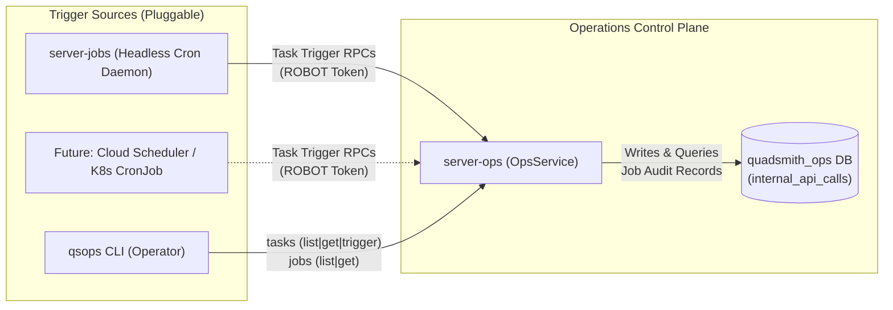

# <a id="tasks-and-jobs-architecture" >Tasks and Jobs Architecture</a>

## <a id="table-of-contents" >Table of Contents</a>

- [1. Background](#1-background)
- [2. Goal](#2-goal)
- [3. Proposal](#3-proposal)
  - [Terminology Alignment: Tasks vs. Jobs](#terminology-alignment-tasks-vs-jobs)
  - [Task and Job RPCs in OpsService (server-ops)](#task-and-job-rpcs-in-opsservice-server-ops)
  - [Strongly-Typed Per-Task Schedules in server_jobs.proto](#strongly-typed-per-task-schedules-in-server_jobsproto)
  - [CLI Command Structure: qsops tasks and qsops jobs](#cli-command-structure-qsops-tasks-and-qsops-jobs)
  - [Pure Headless Scheduler Architecture in server-jobs Daemon](#pure-headless-scheduler-architecture-in-server-jobs-daemon)
  - [Username Release Warning Counter in Shared Auth](#username-release-warning-counter-in-shared-auth)
- [4. Alternatives considered](#4-alternatives-considered)
- [5. Future work](#5-future-work)

---

## <a id="1-background" >1. Background</a>

In Quadsmith, background worker operations span two subsystems: the operations
server [`server-ops`](../src/go/server-ops) and a background scheduling daemon
[`server-jobs`](../src/go/server-jobs).

Previously, [`server-jobs`](../src/go/server-jobs/main.go) loaded a generic
repeated list of string schedule definitions
(`repeated JobScheduleConfig schedules`) and triggered operations through a
generic, string-based `TriggerJob` RPC on
[`OpsService`](../src/proto/quadsmith/ops/ops.proto). Within
[`server-ops`](../src/go/server-ops/pkg/ops/service.go), `TriggerJob` contained
a string switch statement dispatching to either specific methods like
[`CleanupExpiredOtps`](../src/proto/quadsmith/ops/ops.proto) or inline business
logic like
[`auth.HandlePurgeSoftDeletedAccounts`](../src/go/shared/pkg/auth/job.go).

Furthermore, hosting `GetJob` and `ListJobs` RPCs on `server-jobs` via a
separate `JobsService` coupled client tooling ([`qsops`](../src/go/cli-ops)),
reverse-proxy routing ([`nginx.conf`](../deploy/nginx/nginx.conf)), and database
connection pools directly to the scheduler process. Consolidating all task and
job RPCs into [`OpsService`](../src/proto/quadsmith/ops/ops.proto) on
[`server-ops`](../src/go/server-ops) ensures that
[`server-jobs`](../src/go/server-jobs) acts purely as a replaceable, headless
scheduling mechanism without any HTTP APIs or database connections.

---

## <a id="2-goal" >2. Goal</a>

Establish a clean separation of concerns and clear taxonomy across subsystems:

1. **Tasks** (definitions and execution methods) and **Jobs** (execution history
   and audit inspection) live in [`server-ops`](../src/go/server-ops) under
   [`OpsService`](../src/proto/quadsmith/ops/ops.proto).
2. [`server-jobs`](../src/go/server-jobs) operates purely as a headless
   scheduling daemon with zero exposed RPCs, HTTP listeners, or database
   connections, making it trivial to swap out the scheduling mechanism (e.g., to
   Google Cloud Scheduler or Kubernetes `CronJob`) without changing any client,
   proxy, or API logic.
3. [`server_jobs.proto`](../src/proto/quadsmith/config/server_jobs.proto)
   features strongly-typed schedule configurations with one message per task
   type.
4. [`qsops`](../src/go/cli-ops) organizes commands cleanly under
   `qsops tasks (list|get|trigger)` and `qsops jobs (list|get)`, communicating
   exclusively with `server-ops`.

---

## <a id="3-proposal" >3. Proposal</a>

> **TL;DR:**
>
> - Clarify taxonomy: a task is triggerable; a job is an instance of a task.
> - Host both task and job RPCs (`GetJob`, `ListJobs`) in `OpsService`
>   (`server-ops`).
> - Run `server-jobs` as a pure headless cron daemon with no HTTP API or DB
>   pool.
> - Structure `server_jobs.proto` with 1 strongly-typed schedule message per
>   task type.
> - Provide `qsops tasks (list|get|trigger)` and `qsops jobs (list|get)`.

The architecture cleanly separates the operations control plane from the
scheduling trigger mechanism:



The operations server [`server-ops`](../src/go/server-ops) serves
[`OpsService`](../src/proto/quadsmith/ops/ops.proto), acting as the single
authoritative owner of task definitions, task execution logic, and job execution
history. Every task is exposed as a strongly-typed Connect RPC method (e.g.,
`CleanupExpiredOtps`, `PurgeSoftDeletedAccounts`), task catalog inspection is
served via `ListTasks` and `GetTask`, and chronological job execution history is
served via `ListJobs` and `GetJob`.

The job scheduler [`server-jobs`](../src/go/server-jobs) is a lightweight,
headless background daemon. It holds no database connections and exposes no
network ports; it simply runs the validated `robfig/cron/v3` schedules and
triggers the strongly-typed task RPCs on `server-ops` using its `ROBOT` bearer
token.

### <a id="terminology-alignment-tasks-vs-jobs" >Terminology Alignment: Tasks vs. Jobs</a>

- **Task**: A defined, repeatable maintenance action that can be executed or
  scheduled (e.g., `cleanup_expired_otps`, `purge_soft_deleted_accounts`). A
  task has a canonical name, a target RPC procedure, a description, and a
  default schedule. Tasks are owned and executed by `server-ops`.
- **Job**: A concrete execution instance of a task. Every time a task is
  triggered—either automatically by `server-jobs` or manually by an operator via
  `qsops tasks trigger`—`server-ops` records a new job execution instance in
  `quadsmith_ops.internal_api_calls` with a unique identifier, execution
  duration, caller context (`ROBOT` or `HUMAN`), and status (`OK` or `ERROR`).
  Job queries (`ListJobs`, `GetJob`) are served directly by `server-ops`.

### <a id="task-and-job-rpcs-in-opsservice-server-ops" >Task and Job RPCs in OpsService (server-ops)</a>

In [`src/proto/quadsmith/ops/ops.proto`](../src/proto/quadsmith/ops/ops.proto),
all five maintenance and cleanup tasks, task catalog inspection RPCs, and job
history inspection RPCs are defined on
[`OpsService`](../src/proto/quadsmith/ops/ops.proto):

```protobuf
// Maintenance & Operational Tasks
rpc CleanupExpiredOtps(CleanupExpiredOtpsRequest) returns (CleanupExpiredOtpsResponse);
rpc CleanupExpiredTokens(CleanupExpiredTokensRequest) returns (CleanupExpiredTokensResponse);
rpc CleanupOrphanedBlobs(CleanupOrphanedBlobsRequest) returns (CleanupOrphanedBlobsResponse);
rpc PurgeSoftDeletedAccounts(PurgeSoftDeletedAccountsRequest) returns (PurgeSoftDeletedAccountsResponse);
rpc SendUsernameReleaseWarnings(SendUsernameReleaseWarningsRequest) returns (SendUsernameReleaseWarningsResponse);
rpc SetUserRole(SetUserRoleRequest) returns (SetUserRoleResponse);

// Tasks Inspection
rpc ListTasks(ListTasksRequest) returns (ListTasksResponse);
rpc GetTask(GetTaskRequest) returns (GetTaskResponse);

// Jobs Inspection
rpc GetJob(GetJobRequest) returns (GetJobResponse);
rpc ListJobs(ListJobsRequest) returns (ListJobsResponse);
```

When any of the task RPCs is executed on `server-ops`, the shared
[`OpsInterceptor`](../src/go/shared/pkg/opsauth/interceptor.go) synchronously
writes the job execution audit record to `quadsmith_ops.internal_api_calls` and
returns the generated job identifier in the `X-Job-Id` response header.
Read-only inspection calls (`ListTasks`, `GetTask`, `ListJobs`, `GetJob`) do not
emit `X-Job-Id` headers and are filtered out of job history queries via
`WHERE method IN (...)` for the registered task procedures.

#### <a id="task-and-job-messages" >Task and Job Messages</a>

```protobuf
message JobRecord {
  string uuid = 1;
  string job_id = 2;
  string task_name = 3;
  string procedure = 4;
  string caller = 5;
  string caller_type = 6;
  string status = 7;
  int64 duration_ms = 8;
  optional string error_message = 9;
  google.protobuf.Timestamp created_at = 10;
}

message TaskDef {
  string name = 1;
  string procedure = 2;
  string description = 3;
  string default_interval = 4;
}

message GetJobRequest {
  string job_id = 1;
}

message GetJobResponse {
  JobRecord job = 1;
}

message GetTaskRequest {
  string task_name = 1;
}

message GetTaskResponse {
  TaskDef task = 1;
}

message ListJobsRequest {
  optional int32 limit = 1;
  optional string task_name = 2;
}

message ListJobsResponse {
  repeated JobRecord jobs = 1;
}

message ListTasksRequest {}

message ListTasksResponse {
  repeated TaskDef tasks = 1;
}
```

In
[`src/go/server-ops/pkg/ops/service.go`](../src/go/server-ops/pkg/ops/service.go):

- `ListJobs`: Queries job execution records from
  `quadsmith_ops.internal_api_calls` for all task procedures, ordered by
  `created_at DESC` (latest on top), with optional filtering by `task_name`.
- `GetJob`: Retrieves a specific job execution instance by its human-readable ID
  or UUID fallback (`WHERE (id = $1 OR uuid::text = $1)`).
- `JobRecord` intentionally omits scheduler-specific interval configuration so
  `server-ops` remains 100% decoupled from how tasks are scheduled, while
  `TaskDef.default_interval` remains available via `GetTask`/`ListTasks`.

<details>
<summary><strong>Alternatives considered</strong></summary>

##### <a id="alt-jobs-service-on-server-jobs" >Host Job RPCs in JobsService on server-jobs</a>

Expose `GetJob` and `ListJobs` on a dedicated `JobsService` hosted by
`server-jobs` on its own HTTP port, with its own connection pool to
`quadsmith_ops` and its own Nginx route.

**Pros:**

- Allows `GetJob` to directly hydrate the active cron schedule configured in
  `JobServerConfig` onto `JobRecord`.

**Cons:**

- Couples [`qsops`](../src/go/cli-ops) (`jobs_server_url`), Nginx routing, and
  RBAC/bootstrap token configs to the scheduler daemon.
- Wastes PostgreSQL connections on a second connection pool to `quadsmith_ops`.
- Requires client and proxy changes if `server-jobs` is later replaced by Cloud
  Scheduler or Kubernetes `CronJob`.

##### <a id="alt-generic-task-payload" >Generic Payload in Task RPCs</a>

Keep a generic `TriggerTask` with a payload string instead of strongly-typed
RPCs.

**Pros:**

- Single endpoint for all task triggering.

**Cons:**

- Loses type-safety and compile-time verification.
- Prevents individual method-level ACLs and granular JIT policies.

</details>

### <a id="strongly-typed-per-task-schedules-in-server_jobsproto" >Strongly-Typed Per-Task Schedules in server_jobs.proto</a>

In
[`src/proto/quadsmith/config/server_jobs.proto`](../src/proto/quadsmith/config/server_jobs.proto),
`JobServerConfig` contains only the target `ops_server_url`, `auth_token`, and
strongly-typed schedule sub-messages—with no `ServerConfig`, `DatabaseConfig`,
`groups`, or `bootstrap_tokens`:

```protobuf
message JobServerConfig {
  optional string environment = 1;
  optional string ops_server_url = 2;
  optional string auth_token = 3;

  optional CleanupExpiredOtpsSchedule cleanup_expired_otps = 4;
  optional CleanupExpiredTokensSchedule cleanup_expired_tokens = 5;
  optional CleanupOrphanedBlobsSchedule cleanup_orphaned_blobs = 6;
  optional PurgeSoftDeletedAccountsSchedule purge_soft_deleted_accounts = 7;
  optional SendUsernameReleaseWarningsSchedule send_username_release_warnings = 8;
}

message CleanupExpiredOtpsSchedule {
  optional bool enabled = 1;
  oneof schedule {
    string cron = 2;
    google.protobuf.Duration interval = 3;
  }
}

message CleanupExpiredTokensSchedule {
  optional bool enabled = 1;
  oneof schedule {
    string cron = 2;
    google.protobuf.Duration interval = 3;
  }
}

message CleanupOrphanedBlobsSchedule {
  optional bool enabled = 1;
  oneof schedule {
    string cron = 2;
    google.protobuf.Duration interval = 3;
  }
}

message PurgeSoftDeletedAccountsSchedule {
  optional bool enabled = 1;
  oneof schedule {
    string cron = 2;
    google.protobuf.Duration interval = 3;
  }
}

message SendUsernameReleaseWarningsSchedule {
  optional bool enabled = 1;
  oneof schedule {
    string cron = 2;
    google.protobuf.Duration interval = 3;
  }
}
```

The textproto configuration files across all environments
([`sandbox.textproto`](../src/go/server-jobs/config/sandbox.textproto),
[`staging.textproto`](../src/go/server-jobs/config/staging.textproto), and
[`prod.textproto`](../src/go/server-jobs/config/prod.textproto)) specify either
a `cron` string or a typed `interval`:

```protobuf
environment: "sandbox"

ops_server_url: "http://127.0.0.1:8082"
auth_token: "${QS_JOB_SERVER_AUTH_TOKEN:-qs_robot_sandbox_token_67890}"

cleanup_expired_otps {
  enabled: true
  interval {
    seconds: 21600
  }
}

cleanup_expired_tokens {
  enabled: true
  cron: "0 */12 * * *"
}

cleanup_orphaned_blobs {
  enabled: true
  interval {
    seconds: 600
  }
}

purge_soft_deleted_accounts {
  enabled: true
  interval {
    seconds: 28800
  }
}

send_username_release_warnings {
  enabled: true
  cron: "0 0 * * *"
}
```

**Duration-to-Cron Conversion (January 1, 1970 12:00 AM UTC Anchor):**

- When a schedule configures an `interval` duration rather than an explicit
  `cron` expression, `server-jobs` calculates the recurring trigger schedule
  anchored at the Unix epoch: **January 1st, 1970 at 12:00 AM UTC**
  (`time.Date(1970, 1, 1, 0, 0, 0, 0, time.UTC)`):
  1. Trigger timestamps are calculated as integer multiples of the interval from
     epoch ($T_k = k \times \text{duration}$).
  2. Because the Unix epoch begins at 00:00:00 UTC, recurring intervals align
     cleanly with standard UTC wall-clock boundaries:
     - Intervals in minutes dividing 60 (e.g. 10m): `*/10 * * * *`
     - Intervals in hours dividing 24 (e.g. 6h, 8h, 12h): `0 */6 * * *`,
       `0 0,8,16 * * *`
     - 24-hour intervals: `0 0 * * *`
     - Multi-day intervals: Day-of-week patterns aligned from the Thursday epoch
       (e.g., 7d corresponds to `0 0 * * 4`).
- The converted string is fed directly into the cron engine, ensuring that both
  `interval` and `cron` schedules are handled through the exact same validated
  cron pipeline.
- Startup validation parses all resulting cron strings using `robfig/cron/v3`
  (`cron.NewParser(...)`). If any expression is invalid, `server-jobs`
  immediately aborts startup (`log.Fatalf`).

<details>
<summary><strong>Alternatives considered</strong></summary>

##### <a id="alt-generic-schedule-repeated" >Retain Repeated Generic Schedule List</a>

Keep generic `repeated JobScheduleConfig schedules` with string fields.

**Pros:**

- Minimal changes to protobuf configuration.

**Cons:**

- Lacks compile-time safety.
- Cannot configure task-specific schedule parameters.

</details>

### <a id="cli-command-structure-qsops-tasks-and-qsops-jobs" >CLI Command Structure: qsops tasks and qsops jobs</a>

In
[`src/proto/quadsmith/config/cli_ops.proto`](../src/proto/quadsmith/config/cli_ops.proto),
`OpsCliConfig` requires only `ops_server_url` (no `jobs_server_url`). Both
`qsops tasks` and `qsops jobs` in
[`src/go/cli-ops/main.go`](../src/go/cli-ops/main.go) use `getOpsClient()`:

#### <a id="tasks-commands" >1. Tasks Commands (`qsops tasks` -> targets `OpsService` on `server-ops`)</a>

- `qsops tasks list`: Calls `OpsService.ListTasks`, displaying all defined
  tasks, descriptions, and target procedures.
- `qsops tasks get <task-name>`: Calls `OpsService.GetTask`, displaying the full
  description, target procedure, and default schedule.
- `qsops tasks trigger <task-name>`: Calls the dedicated typed RPC on
  `OpsService` (e.g., `CleanupExpiredOtps`, `PurgeSoftDeletedAccounts`, or
  `SetUserRole` via `--user <id|uuid> --role <USER|ADMIN>`), outputting the
  execution result and generated job ID (`X-Job-Id`). Parameterized role changes
  require active JIT elevation and are strictly restricted to `HUMAN` operators.

#### <a id="jobs-commands" >2. Jobs Commands (`qsops jobs` -> targets `OpsService` on `server-ops`)</a>

- `qsops jobs list [--limit=N] [--task=name]`: Calls `OpsService.ListJobs`,
  displaying the chronological execution history (latest on top).
- `qsops jobs get <job-id>`: Calls `OpsService.GetJob`, displaying full
  execution details, runtime metrics, and caller information.

<details>
<summary><strong>Alternatives considered</strong></summary>

##### <a id="alt-all-cli-under-jobs" >Keep Tasks and Jobs Combined Under qsops jobs</a>

Keep all commands under `qsops jobs` without a `qsops tasks` subcommand group.

**Pros:**

- Keeps a single top-level command group for background operations.

**Cons:**

- Blurs the distinction between static task definitions (`tasks`) and historical
  execution records (`jobs`).

</details>

### <a id="pure-headless-scheduler-architecture-in-server-jobs-daemon" >Pure Headless Scheduler Architecture in server-jobs Daemon</a>

[`src/go/server-jobs/main.go`](../src/go/server-jobs/main.go) operates as a pure
headless scheduling daemon:

1. **Zero Network Listeners or DB Pools**: Does not open an `http.Server` or
   connect to PostgreSQL.
2. **Background Scheduler Goroutines**: For each strongly-typed task schedule
   that is enabled, it registers a `robfig/cron/v3` job invoking the typed
   `OpsService` RPC over the authenticated Connect client (`ROBOT` tokens bypass
   interactive human JIT checks while still enforcing group RBAC).
3. **Graceful Signal Handling**: Blocks on `SIGINT`/`SIGTERM` and stops the cron
   scheduler cleanly (`<-c.Stop().Done()`) before exiting.

<details>
<summary><strong>Alternatives considered</strong></summary>

##### <a id="alt-scheduler-heartbeat-push" >Headless server-jobs Reporting Schedule State to server-ops</a>

Keep `server-jobs` headless, but have it push its configured cron schedules to
`server-ops` on startup via a `RegisterSchedules` RPC so `GetJob` can still
return `schedule_interval`.

**Pros:**

- Preserves live `schedule_interval` on `JobRecord` while keeping `server-jobs`
  headless.

**Cons:**

- Introduces state synchronization complexity and stale-state edge cases if the
  scheduler is replaced or restarted independently of `server-ops`.

</details>

### <a id="username-release-warning-counter-in-shared-auth" >Username Release Warning Counter in Shared Auth</a>

In [`src/go/shared/pkg/auth/job.go`](../src/go/shared/pkg/auth/job.go),
`HandleUsernameReleaseWarning` has the signature:

```go
func HandleUsernameReleaseWarning(ctx context.Context, pool *pgxpool.Pool) (int64, error)
```

**Idempotency & Concurrency Safety:**

- **Idempotency filter**: Explicitly filters by
  `WHERE hh.release_warning_sent_at IS NULL`. Once a warning is dispatched,
  `release_warning_sent_at` is set to `NOW()`. Any subsequent runs (or repeated
  manual triggers) ignore the username hold.
- **Concurrency protection**: Uses a transaction with row locking
  (`FOR UPDATE SKIP LOCKED`) so concurrent executions cannot process the same
  expiring username twice.
- **Return counter**: Returns total count of warnings dispatched.

---

## <a id="4-alternatives-considered" >4. Alternatives considered</a>

<details>
<summary><strong>Alternatives considered</strong></summary>

### <a id="alt-fold-scheduler-into-server-ops" >Fold Cron Scheduler Directly into server-ops</a>

Eliminate the `server-jobs` binary and container entirely and run the
`robfig/cron/v3` scheduler loop inside `server-ops` as background goroutines.

**Pros:**

- Reduces the container count by one and eliminates internal network calls
  between `server-jobs` and `server-ops`.

**Cons:**

- Couples scheduling lifecycle to the API server process, preventing
  `server-ops` from scaling horizontally to multiple replicas without
  distributed locking (since every replica would fire duplicate cron jobs).
- Makes migrating to an external scheduler like Cloud Scheduler require code and
  configuration changes inside `server-ops` rather than simply turning off the
  `server-jobs` container.

### <a id="alt-container-crond-qsops" >Container crond Invoking qsops tasks trigger</a>

Replace the custom Go `server-jobs` binary with a standard Alpine `crond`
container that invokes `qsops tasks trigger <task>` on cron schedules.

**Pros:**

- Eliminates custom Go scheduler code in `src/go/server-jobs`.

**Cons:**

- Loses strongly-typed protobuf configuration validation (`JobServerConfig` with
  `check-config`) and epoch-anchored duration-to-cron conversion.

</details>

---

## <a id="5-future-work" >5. Future work</a>

### <a id="cloud-scheduler-and-serverless-triggers" >Cloud Scheduler and Serverless Triggers</a>

- Because `OpsService` exposes all task trigger RPCs over standard HTTP POST
  Connect endpoints and `server-jobs` exposes no APIs, `server-jobs` can be
  retired in cloud deployments by pointing Google Cloud Scheduler directly at
  `https://ops.quadsmith.com/quadsmith.ops.OpsService/<TaskMethod>` with the
  `ROBOT` bearer token.
