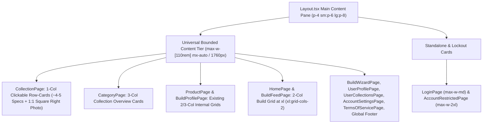

# <a id="wide-viewport-container-and-catalog-row-card-standardization" >Wide-Viewport Container and Catalog Row-Card Standardization</a>

## <a id="table-of-contents" >Table of Contents</a>

- [1. Background](#1-background)
- [2. Goal](#2-goal)
- [3. Proposal](#3-proposal)
  - [Universal 110rem (1760px) Centered Page Container Cap](#universal-110rem-1760px-centered-page-container-cap)
  - [Single-Column Clickable Horizontal Split Row-Cards on CollectionPage](#single-column-clickable-horizontal-split-row-cards-on-collectionpage)
  - [Two-Column Wide-Screen Build Grids on Home and Build Feed](#two-column-wide-screen-build-grids-on-home-and-build-feed)
  - [Detail Page Internal Grids and Uncapped Header Descriptions](#detail-page-internal-grids-and-uncapped-header-descriptions)
  - [In-Place Plan Sync, Unit Tests, and Playwright Visual Baselines](#in-place-plan-sync-unit-tests-and-playwright-visual-baselines)
- [4. Alternatives considered](#4-alternatives-considered)
- [5. Assumptions](#5-assumptions)

---

## <a id="1-background" >1. Background</a>

In [mobile_responsive_ui_design.md](mobile_responsive_ui_design.md), Quadsmith
established responsive breakpoints across mobile (`< 640px`), tablet
(`640px–1023px`), and standard desktop (`>= 1024px`) viewports.

On QHD (`2560px`), ultrawide (`3440px`), and 4K (`3840px`) displays, the current
`max-w-[96rem]` (`1536px`) container cap still feels too narrow inside `<main>`.
Conversely, removing `max-width` altogether stretches content uncomfortably wide
across ultrawide monitors.

Three layout inconsistencies also remain across wide screens:

- [`CategoryPage.tsx`](../src/react/app-web/src/pages/CategoryPage.tsx) and
  [`CollectionPage.tsx`](../src/react/app-web/src/pages/CollectionPage.tsx)
  rendered uncapped (`w-full`) rather than sharing the bounded container width.
- [`CollectionPage.tsx`](../src/react/app-web/src/pages/CollectionPage.tsx)
  rendered a 2–3 column vertical card grid where each card repeated the
  collection badge, duplicated `Manufacturer` in both the header and spec pills,
  and appended a raw-slug + `Details` footer bar instead of making the card
  itself clickable.
- [`HomePage.tsx`](../src/react/app-web/src/pages/HomePage.tsx) and
  [`BuildFeedPage.tsx`](../src/react/app-web/src/pages/BuildFeedPage.tsx)
  stacked `BuildCard` items in a 1-column stream, whereas
  [`UserProfilePage.tsx`](../src/react/app-web/src/pages/UserProfilePage.tsx)
  renders `BuildCard` items in a 2-column grid.

---

## <a id="2-goal" >2. Goal</a>

Unify every Quadsmith web content page under a centered `110rem` (`1760px`)
container cap. Redesign `CollectionPage` into a single-column list of clickable
horizontal row-cards with a full-height `1:1` square right-side product photo.
Pair `HomePage` and `BuildFeedPage` with 2-column wide-screen build grids and
keep active plans and tests synchronized.

---

## <a id="3-proposal" >3. Proposal</a>

> **TL;DR:**
>
> - Standardize every content page and the global footer to centered
>   `max-w-[110rem] mx-auto` (`1760px`).
> - Convert `CollectionPage` into single-column clickable row-cards with specs
>   and a full-height square right photo.
> - Render `HomePage` and `BuildFeedPage` build streams as 2-column grids at
>   `xl` (`xl:grid-cols-2`).
> - Remove inner `max-w-5xl` description caps while keeping existing internal
>   grid columns on detail pages.
> - Update `mobile_responsive_ui_design.md` in place alongside unit tests and
>   Playwright visual regression baselines.

This proposal standardizes [`src/react/app-web`](../src/react/app-web) around a
single `110rem` (`1760px`) centered container width using
[Tailwind CSS v4](https://tailwindcss.com/docs/max-width) utilities and
[CSS Grid Layout](https://developer.mozilla.org/en-US/docs/Web/CSS/CSS_grid_layout).
Interactive visual specifications for the redesigned `CollectionPage` row-card
were validated via Desktop Preview (`collection_card_preview_desktop.html`) and
Mobile Preview (`collection_card_preview_mobile.html`).

### <a id="universal-110rem-1760px-centered-page-container-cap" >Universal 110rem (1760px) Centered Page Container Cap</a>

Apply `max-w-[110rem] mx-auto` (`1760px`) across **every** content route in
`src/react/app-web` as well as the global legal footer in
[`Layout.tsx`](../src/react/app-web/src/components/Layout.tsx). Keep
[`LoginPage.tsx`](../src/react/app-web/src/pages/LoginPage.tsx) (`max-w-md`) and
[`AccountRestrictedPage.tsx`](../src/react/app-web/src/pages/AccountRestrictedPage.tsx)
(`max-w-2xl`) as compact centered dialog and lockout cards.

| Surface             | File                                                                                | Container Class                    |
| :------------------ | :---------------------------------------------------------------------------------- | :--------------------------------- |
| Component Catalog   | [`CollectionPage.tsx`](../src/react/app-web/src/pages/CollectionPage.tsx)           | `max-w-[110rem] mx-auto`           |
| Component Category  | [`CategoryPage.tsx`](../src/react/app-web/src/pages/CategoryPage.tsx)               | `max-w-[110rem] mx-auto`           |
| Component Details   | [`ProductPage.tsx`](../src/react/app-web/src/pages/ProductPage.tsx)                 | `max-w-[110rem] mx-auto`           |
| Build Details       | [`BuildProfilePage.tsx`](../src/react/app-web/src/pages/BuildProfilePage.tsx)       | `max-w-[110rem] mx-auto`           |
| Home Feed           | [`HomePage.tsx`](../src/react/app-web/src/pages/HomePage.tsx)                       | `max-w-[110rem] mx-auto`           |
| Build Feed          | [`BuildFeedPage.tsx`](../src/react/app-web/src/pages/BuildFeedPage.tsx)             | `max-w-[110rem] mx-auto`           |
| The Forge           | [`BuildWizardPage.tsx`](../src/react/app-web/src/pages/BuildWizardPage.tsx)         | `max-w-[110rem] mx-auto space-y-6` |
| User Profile        | [`UserProfilePage.tsx`](../src/react/app-web/src/pages/UserProfilePage.tsx)         | `max-w-[110rem] mx-auto space-y-8` |
| User Collections    | [`UserCollectionsPage.tsx`](../src/react/app-web/src/pages/UserCollectionsPage.tsx) | `max-w-[110rem] mx-auto ...`       |
| Account Settings    | [`AccountSettingsPage.tsx`](../src/react/app-web/src/pages/AccountSettingsPage.tsx) | `max-w-[110rem] mx-auto space-y-8` |
| Terms & Disclaimers | [`TermsOfServicePage.tsx`](../src/react/app-web/src/pages/TermsOfServicePage.tsx)   | `max-w-[110rem] mx-auto space-y-8` |
| Global Footer       | [`Layout.tsx`](../src/react/app-web/src/components/Layout.tsx)                      | `max-w-[110rem] mx-auto ...`       |

<strong>Alternatives considered</strong>

##### <a id="alt-keep-96rem-cap" >Keep 96rem (1536px) Cap</a>

Retain `max-w-[96rem] mx-auto` (`1536px`) across bounded pages.

**Pros:**

- Requires no container class updates on non-catalog pages.

**Cons:**

- Still feels constrained on QHD and larger displays.

##### <a id="alt-larger-120rem-or-140rem-caps" >Use Larger 120rem (1920px) or 140rem (2240px) Fixed Caps</a>

Set the bounded container cap to `120rem` (`1920px`) or `140rem` (`2240px`).

**Pros:**

- Fills almost all horizontal space on QHD (`2560px`) monitors.

**Cons:**

- Approaches the edge-to-edge full-width layout that felt overly wide on desktop
  monitors.

##### <a id="alt-keep-collection-or-category-full-width" >Leave CollectionPage or CategoryPage Uncapped</a>

Keep `CollectionPage.tsx` (and/or `CategoryPage.tsx`) uncapped at `w-full` while
capping detail and feed pages at `110rem`.

**Pros:**

- Preserves the existing outer wrapper on `CollectionPage.tsx` and
  `CategoryPage.tsx`.

**Cons:**

- Causes breadcrumbs, page titles, and filter bars to jump horizontally when
  navigating between `CategoryPage`, `CollectionPage`, and `ProductPage` on wide
  displays.

##### <a id="alt-left-aligned-bounded-containers" >Left-Align Bounded Containers Next to the Sidebar</a>

Omit `mx-auto` on `max-w-[110rem]` containers so content stays pinned to the
left sidebar.

**Pros:**

- Anchors all content against the left navigation rail regardless of monitor
  width.

**Cons:**

- Leaves an unbalanced empty void on the right side of ultrawide and 4K screens.

### <a id="single-column-clickable-horizontal-split-row-cards-on-collectionpage" >Single-Column Clickable Horizontal Split Row-Cards on CollectionPage</a>

Replace the 2–3 column vertical card grid in
[`CollectionPage.tsx`](../src/react/app-web/src/pages/CollectionPage.tsx)
(`grid-cols-1 sm:grid-cols-2 lg:grid-cols-2 2xl:grid-cols-3`) with a
**single-column (`grid-cols-1 gap-3`) list of full-card clickable horizontal
split row-cards**:

- **Full-Card Clickable Shell**: Wrap an `<article>` (`flex items-stretch`
  `rounded-2xl border border-zinc-800` `bg-zinc-900/90 overflow-clip`) inside
  `<Link to={productUrl}>` (`data-testid="catalog-card"` and
  `aria-label="View <name>"`). Remove the redundant per-card `CollectionBadge`
  and the bottom raw-slug + `Details` footer bar.
- **Left Identity & Description Column** (`lg:w-64 xl:w-[21rem] shrink-0` inside
  the `p-2.5 sm:p-4 lg:px-5` card body, stacked above the spec pills on `< lg`):
  Shows the uppercase `Manufacturer` label (plus `Internal` badge when
  `isInternalOnly` is true), bold single-line truncated component `Name`, and a
  1-line truncated `description` (`hidden sm:block`) when present.
- **Middle Responsive Spec Pills Panel** (`flex-1 grid grid-cols-3` plus up to
  `xl:grid-cols-5` capped to `Math.min(activeColumns.length, 5)`): Uses
  deterministic per-breakpoint column tracks while keeping mobile cards compact
  beside the `1:1` right-side photo and wrapping extra toggled properties
  cleanly onto balanced rows.
- **Right Full-Height Square (`1:1`) Product Photo Pane**
  (`w-[var(--card-photo-size,6rem)] aspect-square self-stretch shrink-0`
  `relative overflow-clip border-l border-zinc-800/80 bg-zinc-950/65`): Spans
  100% of the card height at a strict
  [CSS `aspect-ratio`](https://developer.mozilla.org/en-US/docs/Web/CSS/aspect-ratio)
  of `1 / 1` across Chromium, Firefox, and WebKit via `ResizeObserver` syncing
  `--card-photo-size` to the body height before paint. Renders
  `item.primaryDisplayImage` via an out-of-flow ``
  (`absolute inset-0 block w-full h-full object-cover`) with subtle hover zoom,
  or a centered `<CollectionIcon>` fallback when no photo is set.
- **4–5 Default Spec Properties & Deduped Controls**:
  - Exclude `"name"`, `"manufacturer"`, and `"primary_display_image"` from
    `PropertySelector` (`Properties (N)`) and from the spec pills because all
    three are permanently shown on the card.
  - Keep `"name"`, `"manufacturer"`, and all sortable `collection.columns`
    available in the toolbar `Sort:` dropdown (`StyledSelect`) so sorting by
    `Name` or `Manufacturer` works unchanged.
  - Derive web `defaultSpecColumnIds` in `CollectionPage.tsx` (without mutating
    `.proto` `default_columns` used by `qs` CLI and search indexing) by taking
    `protoDefaultCols` minus `"name"`/`"manufacturer"` and topping up with
    domain-specific columns plus `"weight_g"` up to **5** default spec pills.

<strong>Alternatives considered</strong>

##### <a id="alt-fixed-width-rectangular-right-photo" >Fixed-Width Rectangular Right Photo Pane</a>

Size the right-side product photo pane with fixed responsive widths
(`w-24 sm:w-28 lg:w-36`) instead of `aspect-square`.

**Pros:**

- Decouples the right media pane's inline width from the card's rendered block
  height.

**Cons:**

- Produces wide landscape crops on single-row desktop cards and tall portrait
  crops when extra spec properties wrap onto multiple rows, distorting square
  hardware product photography.

##### <a id="alt-left-square-thumbnail-icon" >Small 48×48 Left Thumbnail Box Instead of Right Full-Height Photo</a>

Render a small `48×48` rounded icon/thumbnail box to the left of the component
title with a right-edge chevron and no right-side media pane.

**Pros:**

- Leaves slightly more horizontal width for the middle spec pill grid.

**Cons:**

- Crushes detailed hardware product photography into a tiny `48px` square where
  stator geometry, stack layout, or frame carbon cuts are barely legible.

##### <a id="alt-two-band-stacked-row-card" >Two-Band Full-Width Card With Bottom Spec Strip</a>

Place the thumbnail, title, manufacturer, and description across a full-width
top band and render a 4–6 column spec pill strip underneath on every card.

**Pros:**

- Gives long component descriptions a wider line length before truncating.

**Cons:**

- Roughly doubles the vertical height of every row on desktop, showing far fewer
  components per screen than a single-band horizontal split row-card.

##### <a id="alt-existing-vertical-card-in-single-column" >Keep Existing Vertical Card Markup in a Single Column</a>

Change only `2xl:grid-cols-3` to `grid-cols-1` while keeping the current
2-column spec pills, per-card collection badge, duplicate `Manufacturer` pill,
and bottom slug/Details bar.

**Pros:**

- Minimal diff in `CollectionPage.tsx`.

**Cons:**

- Produces tall, sparse `1760px`-wide cards with `850px`-wide spec boxes and
  repetitive metadata clutter.

##### <a id="alt-keep-2-to-3-default-specs" >Keep Only 2–3 Default Spec Pills on the Right Panel</a>

Filter out `"name"` and `"manufacturer"` without adding extra default spec
columns, leaving only 2–3 spec pills visible by default.

**Pros:**

- Matches the exact non-header subset of `protoDefaultCols`.

**Cons:**

- Underutilizes the wide spec region on desktop when collections like Motors
  only had 2 non-header defaults (`Stator Size` and `KV`).

### <a id="two-column-wide-screen-build-grids-on-home-and-build-feed" >Two-Column Wide-Screen Build Grids on Home and Build Feed</a>

Update the build list and loading skeleton containers in
[`HomePage.tsx`](../src/react/app-web/src/pages/HomePage.tsx) and
[`BuildFeedPage.tsx`](../src/react/app-web/src/pages/BuildFeedPage.tsx) from a
1-column stack (`space-y-6`) to `grid grid-cols-1 xl:grid-cols-2 gap-6`,
matching
[`UserProfilePage.tsx`](../src/react/app-web/src/pages/UserProfilePage.tsx).

<strong>Alternatives considered</strong>

##### <a id="alt-single-column-build-stream" >Keep Single-Column Vertical Stream on HomePage and BuildFeedPage</a>

Retain `space-y-6` so each `BuildCard` stretches across the full `1760px`
container width.

**Pros:**

- Avoids changing `HomePage` desktop visual snapshots.

**Cons:**

- Stretches individual `BuildCard` banners `1760px` wide with excessive internal
  whitespace.

### <a id="detail-page-internal-grids-and-uncapped-header-descriptions" >Detail Page Internal Grids and Uncapped Header Descriptions</a>

Keep the existing 2- and 3-column internal grids on
[`ProductPage.tsx`](../src/react/app-web/src/pages/ProductPage.tsx) and
[`BuildProfilePage.tsx`](../src/react/app-web/src/pages/BuildProfilePage.tsx).
Remove the inner `max-w-5xl` paragraph width caps on the header descriptions in
[`BuildProfilePage.tsx`](../src/react/app-web/src/pages/BuildProfilePage.tsx)
and [`BuildFeedPage.tsx`](../src/react/app-web/src/pages/BuildFeedPage.tsx).

<strong>Alternatives considered</strong>

##### <a id="alt-increase-internal-columns-at-2xl" >Increase Internal Spec and Gallery Grids to 3 Columns at 2xl</a>

Add `2xl:grid-cols-3` to `ProductPage` technical specifications and
`MediaGallery` items on wide screens.

**Pros:**

- Shortens horizontal distance between specification labels and values.

**Cons:**

- Squeezes longer specification labels and multi-value strings into narrower
  columns.

### <a id="in-place-plan-sync-unit-tests-and-playwright-visual-baselines" >In-Place Plan Sync, Unit Tests, and Playwright Visual Baselines</a>

Synchronize active documentation, unit tests, and visual snapshots in a single
implementation commit:

- **In-Place Plan Update**: Update the `CollectionPage.tsx` card-grid section in
  [`mobile_responsive_ui_design.md`](mobile_responsive_ui_design.md) to reflect
  the single-column clickable horizontal row-card layout while keeping its other
  8 responsive design sections active, and commit this finalized plan to
  `plans/wide_viewport_container_standardization.md`.
- **Unit Tests**: Update
  [`CollectionPage.test.tsx`](../src/react/app-web/src/pages/__tests__/CollectionPage.test.tsx)
  (whole-card link navigation, ~4–5 default spec pills, right-side
  `aspect-square` photo pane, `Name`/`Manufacturer` excluded from
  `Properties (N)` checkboxes while remaining in `Sort:`, and
  `max-w-[110rem] mx-auto` container),
  [`ProductPage.test.tsx`](../src/react/app-web/src/pages/__tests__/ProductPage.test.tsx),
  [`BuildProfilePage.test.tsx`](../src/react/app-web/src/pages/__tests__/BuildProfilePage.test.tsx),
  [`CategoryPage.test.tsx`](../src/react/app-web/src/pages/__tests__/CategoryPage.test.tsx),
  [`HomePage.test.tsx`](../src/react/app-web/src/pages/__tests__/HomePage.test.tsx),
  and
  [`BuildFeedPage.test.tsx`](../src/react/app-web/src/pages/__tests__/BuildFeedPage.test.tsx).
- **Playwright Visual Regression Baselines**: Run `make test` in standard
  comparison mode first to confirm that only `catalog.spec.ts` (`catalog-motors`
  and `catalog-filtered` across all 5 profiles) and `home.spec.ts` (`home-page`
  across the 3 desktop profiles) differ, update baselines via
  `make update-snapshots`, inspect
  [`test/web/snapshots/`](../test/web/snapshots/), and re-run `make test` to
  verify all 85 specs pass.

<strong>Alternatives considered</strong>

##### <a id="alt-archive-mobile-responsive-plan" >Archive mobile_responsive_ui_design.md Instead of Updating In Place</a>

Move `plans/mobile_responsive_ui_design.md` untouched into `plans/archive/` and
mark it superseded.

**Pros:**

- Preserves the original 2–3 column `CollectionPage` specification verbatim in
  `plans/archive/`.

**Cons:**

- Retires 8 active architectural specifications (mobile slide-over drawer,
  single-row header, `/` search shortcut, `StyledSelect`, custom scrollbars,
  Forge mobile telemetry bar, and touch hover suppression) that still govern the
  live codebase.

---

## <a id="4-alternatives-considered" >4. Alternatives considered</a>

<strong>Alternatives considered</strong>

### <a id="alt-uncapped-full-width-across-all-pages" >Uncapped Full Width (w-full) Across All Pages</a>

Remove `max-width` constraints completely so every route stretches across 100%
of `<main>`.

**Pros:**

- Eliminates all horizontal side margins on every display size.

**Cons:**

- Stretches single-column row-cards, prose, and 2-column specification lists
  across 2200px–3500px on QHD, ultrawide, and 4K displays, hurting scannability.

### <a id="alt-fluid-percentage-container-width" >Proportional Percentage Width With a High Ceiling</a>

Size bounded pages using fluid percentage width such as
`w-[90%] max-w-[150rem] mx-auto`.

**Pros:**

- Scales side margins proportionally across intermediate monitor sizes.

**Cons:**

- Adds unnecessary side gutters on `1024px–1600px` laptops where `<main>`
  already applies `lg:p-8` padding.

---

## <a id="5-assumptions" >5. Assumptions</a>

1. Root font size remains `16px`, so `110rem` resolves to `1760px` across all
   desktop browsers.
2. Keeping `.proto` `default_columns` unchanged and deriving the 4–5 default web
   spec pills inside `CollectionPage.tsx` preserves existing `qs` CLI, `qsops`
   CLI, and search-engine behavior.
